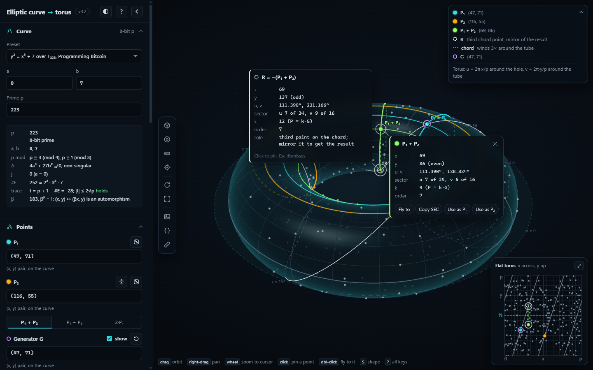
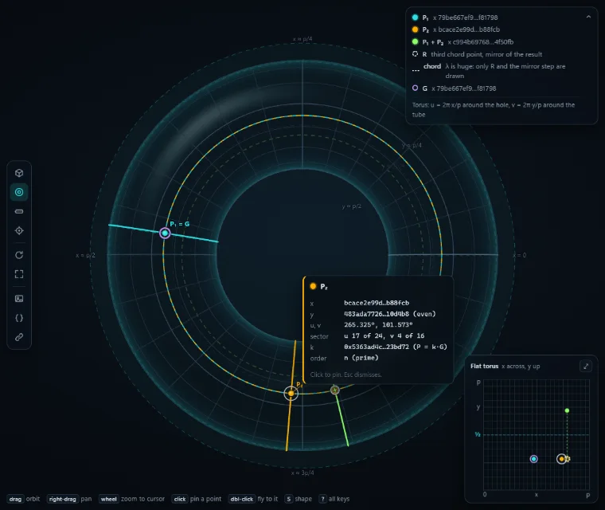
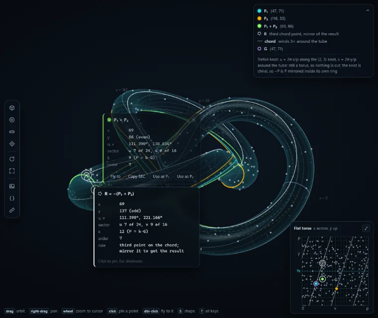
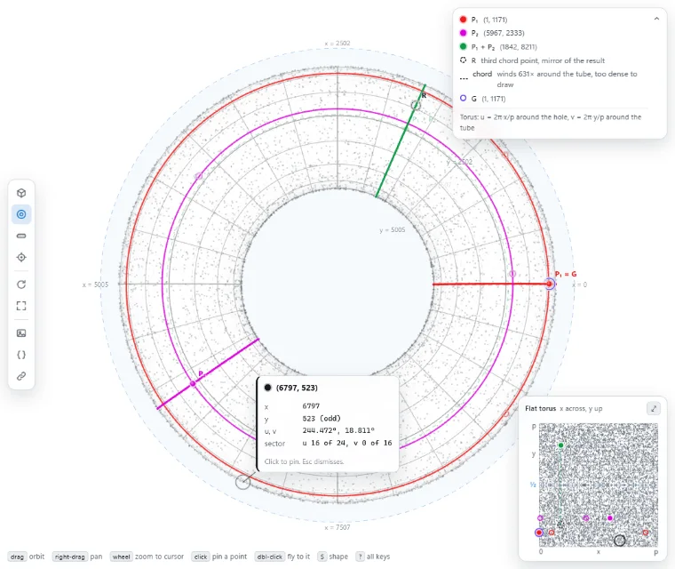
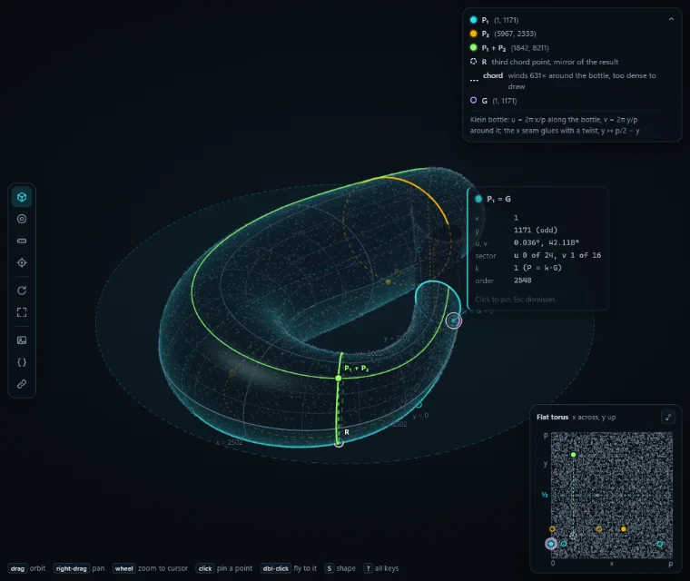
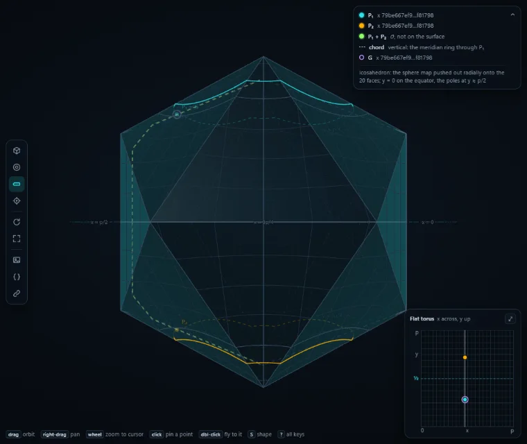
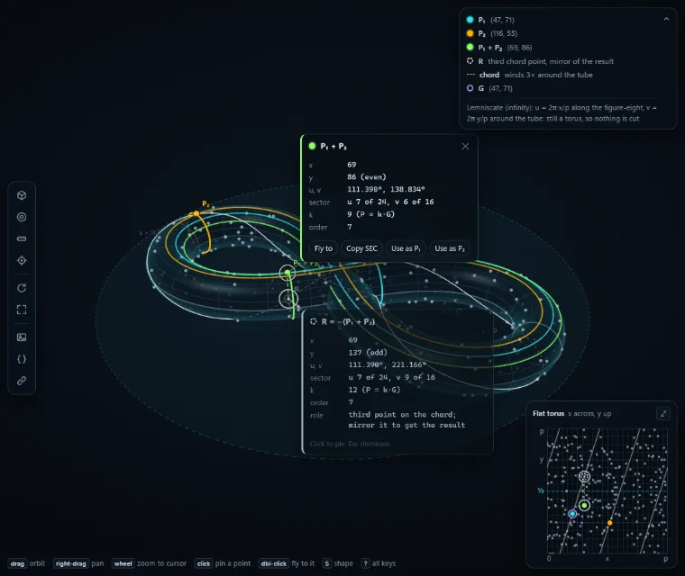

# Elliptic curve → torus

An interactive, single-file visualizer for **elliptic curves over finite fields**. It plots the points of
**y² = x³ + ax + b over F_p** on a torus (and on eight other shapes) and lets you watch the group law, negation,
the GLV endomorphism and the structure of the group happen in 3D. Made for elliptic-curve and secp256k1 research
and teaching.

- **Try it online:** [idlebg.com/idleGevrek](https://idlebg.com/idleGevrek/), a gallery of eighteen ready-made
  states and a tour video, each opening the live page exactly there.
- **Source:** [github.com/idlebg/EllipticTorus3d](https://github.com/idlebg/EllipticTorus3d)
- **Run it locally:** download [`elliptic_curve_torus_visualizer_v3.html`](elliptic_curve_torus_visualizer_v3.html)
  and open it in any current browser. One file, works from disk, no network, no install, no tracking.



**Contents:** [Why a torus](#why-a-torus) · [Quick start](#quick-start) · [What you can do](#what-you-can-do) ·
[Gallery](#gallery) · [Shapes](#shapes) · [Input formats](#input-formats) · [Keyboard and mouse](#keyboard-and-mouse) ·
[Export, links and scripting](#export-links-and-scripting) · [How it is checked](#how-it-is-checked) ·
[Browser support and privacy](#browser-support-and-privacy) · [Build from source](#build-from-source) ·
[Licence](#licence)

## Why a torus

Both coordinates of a point on the curve live in F_p = {0, …, p − 1} and wrap around at p, so the plane
F_p × F_p already *is* a torus. The visualizer makes that literal: x goes once around the hole (u = 2π·x/p) and y
once around the tube (v = 2π·y/p). Several facts about elliptic curves then become pictures:

- **Negation is a mirror.** −(x, y) = (x, p − y), so P and −P share a meridian ring and are reflections of each
  other through the equatorial plane.
- **The group law is a winding line.** The chord through P₁ and P₂ is the line y ≡ λx + c (mod p). On the torus it
  goes once around the hole and λ times around the tube (λ taken in (−p/2, p/2]); it meets the curve a third time at
  R = −(P₁ + P₂), and mirroring R gives the sum.
- **The GLV endomorphism keeps y.** With a = 0 and p ≡ 1 (mod 3) there is a cube root of unity β, and
  (x, y) ↦ (βx, y) maps the curve to itself; on secp256k1 that is multiplication by λ. G, λG and λ²G sit on one
  parallel ring.
- **Scalar multiples scatter.** Step through G, 2G, 3G, … and the points hop across the surface. Recovering k from
  where kG landed is the elliptic-curve discrete-log problem that secp256k1's security rests on.

## Quick start

1. Open the [online gallery](https://idlebg.com/idleGevrek/) and pick a card, or open the HTML file locally.
2. Choose a **preset** in the Curve section: secp256k1 (G and −G, G + 2G = 3G, G and λG), P-256, or one of the five
   toy curves where every point is visible.
3. Drag to orbit, scroll to zoom, **hover** a point for its card, **click** to pin it.
4. Type your own points in any of the [input formats](#input-formats), switch the operation (P₁ + P₂, P₁ − P₂, 2·P₁),
   press **N** to step, **S** to change shape and **?** for every key.

## What you can do

### Curves

- Any a, b and prime p up to 1024 bits, typed as numbers or as expressions: `2^256 - 2^32 - 977`, hex `0x…`,
  binary `0b…`, octal `0o…`, digit separators `1_000_003`, and the names `p`, `n`, `λ` / `lambda`, `β` / `beta`.
- secp256k1 and P-256 are recognised by their parameters, with their order n, cofactor h and, for secp256k1, the
  GLV constants β and λ.
- **Curve facts:** p's size and primality (Miller–Rabin with 13 fixed bases, deterministic below 3.3 · 10²⁴), the
  evaluated a and b (a small negative representative is named, so P-256 shows a ≡ −3), p mod 4 and mod 3, the
  discriminant (singular curves are flagged), the j-invariant, n and h for named curves; for p ≤ 2²² the point
  count #E factored, the trace t = p + 1 − #E with the Hasse bound |t| ≤ 2√p checked, and β or the reason there
  is none. A composite p is reported as such (F_p is not a field).
- **Nine presets:** secp256k1 G and −G (the mirror pair), secp256k1 G + 2G = 3G, secp256k1 G and λG (GLV), P-256
  G and 2G, and the toy curves y² = x³ + 7 over F₂₂₃ (*Programming Bitcoin*), over F₂₁₁ (three points share y = 33)
  and over F₁₀₀₀₉ (dense and 6-fold symmetric), y² = x³ + 2x + 3 over F₉₇ (a point of order 5) and
  y² = x³ + 2x + 2 over F₁₇ (Paar and Pelzl).

### Points

- Every common encoding is accepted (table below) and checked as it is typed: points off the curve are drawn
  anyway and labelled with the curve y² = x³ + ax + b′ they really lie on (the invalid-curve case), x values on the
  quadratic twist are named as such, hybrid keys with the wrong parity bit are flagged, and an (x, y) pair is
  reduced mod p with a note.
- Buttons for a random point on the curve, P₂ = −P₁, swapping P₁ and P₂, restoring the preset's G, and showing or
  hiding G.
- **Scalars are carried through:** a point typed as `5G` keeps k = 5, an operation's result inherits its k when both
  inputs have one, and on curves with p ≤ 2²² the discrete log is solved (baby-step giant-step) for any point in
  the subgroup generated by G.

### Group law

- **P₁ + P₂, P₁ − P₂ and 2·P₁** with the chord (or tangent) construction: the line, the third point
  R = −(P₁ + P₂), and the mirror step from R to the result. The legend gives the line's winding around the tube.
- In the proportional mapping the continuous line is drawn while its centred slope |λ| ≤ 24 and p ≤ 10⁶; beyond
  that it would be a solid coil,
  so the flat map shows its p lattice points instead (p ≤ 4000), and on 256-bit curves only R and the mirror step
  are drawn. A vertical chord (P and −P) is the meridian ring itself.
- **Step** (`N` or the Step button) puts the result into P₁, so the operation runs again from there: with P₂ = G it
  walks G, 2G, 3G, …, with 2·P₁ it walks the doublings, and the pinned cards follow.
- **Force group law on off-curve points** applies the formulas to invalid points anyway, which is what an
  implementation without the on-curve check would compute.

### Group structure

- **Every affine point** is drawn for p ≤ 262 144 (2¹⁸); hover any of them for its card.
- **Orders and discrete logs** on curves with p ≤ 2²², so non-cyclic groups show up: on F₂₂₃ ≅ Z/6 × Z/42 the
  points of order 3 outside ⟨G⟩ show their order and no k.
- **β-orbit:** the siblings (βx, y) and (β²x, y) of P₁ and P₂ when a = 0 and p ≡ 1 (mod 3); on secp256k1 they are
  λ·P and λ²·P, and Relations reports P₂ = λ·P₁ when that holds.
- **Flat map:** the torus cut open into the square [0, p)², with the mirror line y = p/2, the chord, every point,
  the markers; hover and click work there too, and it enlarges.

### Views

- A glass surface with a sector grid, where lines on the far side are drawn faint and dashed like the hidden lines
  of a technical drawing; a dark theme and a **paper theme** after the reference plate in
  [`docs/reference-torus.png`](docs/reference-torus.png).
- **Nine shapes** ([below](#shapes)), and the surface morphs from one to the next.
- **Stage toolbar:** oblique, top and side views (side puts the mirror plane edge-on), reset, auto-rotate, full
  screen, PNG, JSON, copy link. Fly to any point, zoom toward the cursor.
- **Angle mapping:** proportional (u = x/p) or a window on the low or high 4–52 bits of x and y, to look at bit
  patterns of 256-bit coordinates.
- Guide rings through each point (its meridian and parallel; coinciding rings are dashed so both colours show),
  axis and point labels, adjustable sector counts, sizes, glass and hidden-line strength.
- **Panel:** Curve, Points, Shape, Display, Inspector, Relations and Self-test sections; which ones are open is
  remembered with the rest of the state. A compact legend, keyboard focus everywhere, reduced motion respected.

### Inspecting

- **Cards:** hovering a point shows its card until you hover another one; click pins it, as many as you like.
  Pinned cards follow the camera, avoid each other, the legend and the flat map, keep a leader line to their point
  and fade when the point is behind the surface. Each one has *Fly to*, *Copy SEC*, *Use as P₁* and *Use as P₂*.
- **Inspector:** x and y (in hex, and in decimal below 100 000), y parity, u and v in degrees, radians and turns, the grid sector, k and
  the order, every SEC encoding (02/03, 04, 06/07) with a copy button, −P, and b′ for an off-curve point.
- **Relations:** P₂ = −P₁ or P₁, same x (one meridian) or same y (one parallel), the β link, Δu and Δv, each point
  against G, the result, the chord's type, slope, winding and third point, 2·P₁, 2·P₂ and ord(G).

## Gallery

Eighteen states with checked captions, online at [idlebg.com/idleGevrek](https://idlebg.com/idleGevrek/) (offline:
[`samples/index.html`](samples/index.html); as a list: [`samples/README.md`](samples/README.md)). A few of them:

<table>
<tr>
<td width="33%"><a href="https://idlebg.com/idleGevrek/#03-secp256k1-glv"></a><br><sub>secp256k1: G, λG and λ²G share a y (GLV)</sub></td>
<td width="33%"><a href="https://idlebg.com/idleGevrek/#17-trefoil-chord"></a><br><sub>The F₂₂₃ chord on a trefoil knot</sub></td>
<td width="33%"><a href="https://idlebg.com/idleGevrek/#09-f10009-cloud"></a><br><sub>All 10 191 points of F₁₀₀₀₉, paper theme</sub></td>
</tr>
<tr>
<td width="33%"><a href="https://idlebg.com/idleGevrek/#15-klein-cloud"></a><br><sub>F₁₀₀₀₉ on a Klein bottle</sub></td>
<td width="33%"><a href="https://idlebg.com/idleGevrek/#14-icosahedron-mirror"></a><br><sub>G and −G on an icosahedron, side view</sub></td>
<td width="33%"><a href="https://idlebg.com/idleGevrek/#13-lemniscate-chord"></a><br><sub>The F₂₂₃ chord on a lemniscate tube</sub></td>
</tr>
</table>

The full set covers secp256k1 (the G / −G mirror, G + 2G = 3G, the GLV endomorphism, 7G − 2G = 5G), P-256, the
chord winding three times on F₂₂₃, a β-orbit outside ⟨G⟩ on the non-cyclic F₂₂₃, the tangent on F₉₇, discrete logs
on F₁₇, walking the multiples of G with Step, the input edge cases (a hybrid key with a wrong parity bit, an
invalid-curve point) and six of the other shapes. The tour video (`samples/tour.webm`) shows auto-rotate, the cards,
the paper theme, Step and every shape morphing into the next.

## Shapes

The **Shape** tiles (or `S` / `Shift+S`) wrap the same points onto nine surfaces. Rings, the chord, the mirror plane, cards, picking and the
hidden-line look work on each of them, and each tile's pictogram is drawn from the shape's own equations.

| shape | how (x, y) lands | what to know |
| --- | --- | --- |
| Torus | u = 2π·x/p around the hole, v = 2π·y/p around the tube | the default; both directions close up |
| Cylinder | x around the axis, y along the height | cut at y ≈ p/2 (the top and bottom edges) |
| Sphere | x = longitude, y = latitude | cut at y ≈ p/2 (the poles) |
| Ellipsoid | the sphere map, semi-axes from R and r | cut at the poles |
| Icosahedron | the sphere map pushed out radially onto the 20 faces | cut at the poles; the 30 edges are drawn |
| Lemniscate (infinity) | x along a figure-eight, y around a tube | still a torus: nothing is cut |
| Trefoil knot | x along the (2, 3) torus knot, y around a tube | still a torus: nothing is cut; chiral, so no mirror plane (see below) |
| Wavy plane | the flat map lifted into 3D with waves | cut along both edges; mirrors through an upright plane |
| Klein bottle | x along the bottle, y around it | closes in y; the x seam glues with a twist, y ↦ p/2 − y |

On every shape **negation stays a reflection**: y is centred where a shape is cut, so y = 0 lies on the mirror
plane and P and −P are exact mirror images, as on the torus (`test/shapes.test.mjs` checks this for all nine,
with the normals). The trefoil is the one exception to "one mirror plane": a knot is chiral, no reflection of
space maps it onto itself, so −P is P reflected inside the ring they share (across the plane of the knot's
direction and the torus normal at that ring). The knot is C(θ) = ((A + B cos 3θ) cos 2θ, (A + B cos 3θ) sin 2θ,
B sin 3θ) with A = R, B = 0.45·R, where it is thickest (half its closest strand distance is 0.447·A), and the
tube of radius 0.42·r stays embedded over the whole slider range; the tests check the knot type (2 turns around
the axis, 3 around the tube) and the embedding at the worst slider corner.

Where a ring or the chord crosses a cut it breaks instead of slicing through the inside. The two size sliders take
each shape's meaning (radius, height, tube, waves); the second is greyed out where a shape has no use for it.

## Input formats

Every field (a, b, p and the three points) accepts integer expressions such as `2^256 - 2^32 - 977`, with
`+ - * / % ^ **` and brackets. Points can be given as:

| input | meaning |
| --- | --- |
| `02…` `03…` | compressed SEC (y even / odd) |
| `04…` | uncompressed SEC; drawn even when off the curve, flagged with the b′ curve it really lies on |
| `06…` `07…` | hybrid SEC, the parity bit checked against y |
| bare 32-byte hex | x-only (BIP340 `lift_x`, even y) |
| `(x, y)` | affine pair: decimal, hex or expressions |
| `G`, `5G`, `(n-1)G`, `λG`, `-G`, `0x1fG` | scalar multiples of G (n is the order of G when known) |
| `O` | the point at infinity |

## Keyboard and mouse

| key | action | key | action |
| --- | --- | --- | --- |
| `1` `2` `3` | oblique, top, side view | `G` | sector grid |
| `R` | reset the camera | `L` | labels |
| `F` | fly to the inspected point | `C` | every curve point |
| `Space` | auto-rotate | `K` | chord construction |
| `N` | step: P₁ ← the result | `B` | β-orbit |
| `S` / `Shift+S` | next / previous shape | `M` | flat map |
| `T` | dark or paper theme | `\` | hide or show the panel |
| `Esc` | drop the hover card, then the pins | `?` | help with every key |
| `Enter` in a field | plot now | | |

Mouse and touch: drag to orbit, right-drag (or Shift+drag) to pan, wheel or pinch to zoom toward the cursor, hover
for a card, click to pin, double-click to fly to a point.

## Export, links and scripting

- **PNG:** the 3D view at the screen's resolution (pixel ratio up to 2), on an opaque background.
- **JSON:** the whole state and result: the inputs; the curve (a, b, p, bits, primality, singularity, j, name, n,
  #E, β); every point with its SEC encodings, torus angles in turns, degrees and radians, sector, k and order; the
  operation with its chord (type, λ, c); and the relations (P₁ vs P₂, each against G, the doubles).
- **Copy link:** the complete state (curve, points, shape, view options, even which panel sections are open) is
  encoded after `#s=`, so a link reopens the exact view. Links and stored state are sanitised when read.
- **URL options:** `?lines=thin` draws the grid with hairlines (chosen automatically on software WebGL),
  `?lines=fat` forces thick lines.
- **Console:** the page exposes `ecTorus` for scripting and for checking results by hand:

  ```js
  ecTorus.set({ preset: 'custom', a: '0', b: '7', p: '223', g: '(47, 71)', p1: '5G', p2: 'G', op: 'add' });
  ecTorus.model.op.P;      // the result as BigInts: { x: 139n, y: 137n } = 6G
  const { Curve, KNOWN, encodeSEC } = ecTorus.engine;
  const k1 = KNOWN[0], c = new Curve(k1.a, k1.b, k1.p);
  encodeSEC(c.mul(7n, k1.G), c);   // 7G on secp256k1, compressed
  ecTorus.selfTest();      // { pass, fail, items }
  ```

  | `ecTorus.engine` | does |
  | --- | --- |
  | `evalExpr(text, env)` | an integer expression to a BigInt, without `eval`; `env` supplies names such as `p` or `n` |
  | `new Curve(a, b, p)` | `add`, `dbl`, `neg`, `mul(k, P)` (Jacobian, k may be negative), `isOn`, `eq`, `bPrime`, `disc`, `jInvariant` |
  | `parsePoint(text, { curve, G, env })` | any input format above → `{ ok, P, kind, onCurve, warnings, k }`; throws an `EcError` with the reason on bad input |
  | `encodeSEC(P, curve, kind)` | `'compressed'`, `'uncompressed'` or `'hybrid'` |
  | `sqrtMod(n, p)`, `isProbablePrime(n)` | Tonelli–Shanks (stops at once on a composite p), Miller–Rabin |
  | `chord(curve, P, Q)` | the secant or tangent: `{ type, lambda, c, R }` with R = −(P + Q) |
  | `turns(c, p, mode, bits)` | the torus mapping: a coordinate as a fraction of a turn |
  | `smallCurve(a, b, p, enumerate)` | #E, and optionally every point, for p ≤ 2²² |
  | `pointOrder(curve, P, N, factors)` | the order of P from the group order N and its factors (a `Map` prime → exponent) |
  | `dlog(curve, G, Q, ordG)` | baby-step giant-step: k with k·G = Q, or `null` when Q is not in ⟨G⟩ |
  | `KNOWN` | secp256k1 and P-256: p, a, b, G, n, h (and β, λ for secp256k1) |

  `ecTorus.state` is the editable state, `ecTorus.model` everything computed from it, `ecTorus.screenOf(key)` a
  point's position on screen.

## How it is checked

The maths is checked against an independent reference, never against itself:

- **209 engine checks** (`npm test`) against [`ref_out.json`](ref_out.json), produced by [`ref.py`](ref.py) with
  OpenSSL (through pyca/cryptography) for secp256k1 and P-256 multiples, sympy for primality and square roots, and
  brute force on the toy curves: point-set hashes, order histograms, 2-torsion, discrete logs, SEC points whose x
  starts with a zero byte, and the parser's edge cases.
- **140 shape-geometry checks** from the shapes' own definitions: unit normals perpendicular to the surface,
  negation as a reflection, seams, the icosahedron's faces, the trefoil's knot type and embedding.
- **42 checks inside the page**, run at load (Self-test section).
- **Browser suites** (Playwright): every control end to end with zero console errors allowed (96 checks); hostile
  links and stored state, a sanitiser fuzz, inputs that must not freeze the tab, GPU memory over 50 cycles, WebGL
  context loss and restore; the page without WebGL; WebKit; line widths and frame times on a real GPU.
- **Every caption in the gallery** is checked against the live page before its screenshot is taken.

## Browser support and privacy

- The 3D view needs WebGL 2 (current Chrome, Edge, Firefox and Safari). It is tested in Chromium, on a software
  renderer and on an RTX 4090, and in WebKit; Firefox has not been through the test suites yet. Without WebGL the
  maths, the inspector and the flat map still work.
- The file makes no network requests of its own: no CDN, no web fonts, no analytics. Its state stays in your
  browser's local storage and in the links you choose to copy. A web host can add to a page it serves (idlebg.com
  runs behind Cloudflare); the downloaded file is exactly what this repository builds.

## Build from source

The HTML file is built from [`src/`](src/): `build.mjs` tree-shakes three.js r187 into it and concatenates the app
code, which stays readable inside the page.

```sh
npm ci                        # three@0.187.0, esbuild@0.28.2 (pinned)
npm test                      # 209 engine checks vs ref_out.json + 140 shape-geometry checks (needs nothing installed)
npm run build                 # -> elliptic_curve_torus_visualizer_v3.html
npm run e2e                   # headless Chrome pass over every control (Playwright + Chromium, SwiftShader)
npm run e2e:gpu               # the same in the installed Chrome on the real GPU
npm run robust                # hostile links, freeze cases, leaks, WebGL context loss, DPR changes
npm run browsers              # Playwright WebKit / Firefox pass
npm run hw                    # GPU: renderer, hover frame times, line widths per DPR, PNG export
npm run showcase              # rebuild samples/ (screenshots on the GPU, claims checked)
py -3 ref.py > ref_out.json   # regenerate the reference (pip install cryptography sympy; ~40 s)
```

The Playwright suites need `pip install playwright` and `python -m playwright install chromium` (plus `webkit` /
`firefox` for the cross-browser pass). The npm scripts find a working Python by themselves (`py -3`, `python`,
`python3`); on Windows call the scripts directly with `py -3`, since `python3` is the Microsoft Store stub there.
The build is reproducible byte for byte; keep the files LF (`.gitattributes` does).

See [`docs/ARCHITECTURE.md`](docs/ARCHITECTURE.md) for how the code is laid out and why, [`CHANGELOG.md`](CHANGELOG.md)
for the history and [`ROADMAP.md`](ROADMAP.md) for ideas.

## Licence

MIT, see [`LICENSE`](LICENSE). The page inlines three.js r187, also MIT (© 2010-2026 three.js authors), see
[`THIRD_PARTY_NOTICES.md`](THIRD_PARTY_NOTICES.md).

made with ❤ by [idlebg.com](https://idlebg.com)
