# Showcase — elliptic curve → torus

Eighteen ready-made states of the visualizer, each a screenshot plus a link that opens the page exactly there. The gallery is
online at [idlebg.com/idleGevrek](https://idlebg.com/idleGevrek/); `samples/index.html` is the same gallery offline, opening the
`elliptic_curve_torus_visualizer_v3.html` next to it. The claims in the captions are checked against the visualizer's own
computation when the gallery is built (`py -3 test/showcase.py --gpu`); screenshots were taken in Chrome on an RTX 4090.

Tutorials with worked examples like these, for every level from first steps to Bitcoin keys: [`tutorials/`](../tutorials/), also online at [idlebg.com/idleGevrek/tutorials](https://idlebg.com/idleGevrek/tutorials/).

A 40-second tour of the F₂₂₃ sample, 1920×1080 (auto-rotate, hover cards, a pinned result, paper theme, side view, Step walking the multiples, then every shape morphing into the next): [`tour.mp4`](tour.mp4).

[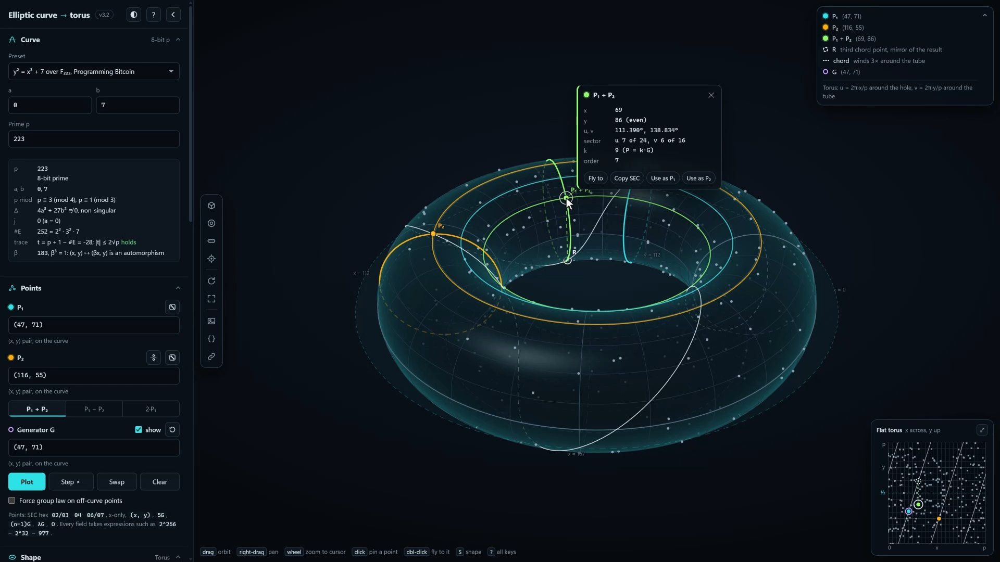](tour.mp4)

## secp256k1: G and −G are mirror images

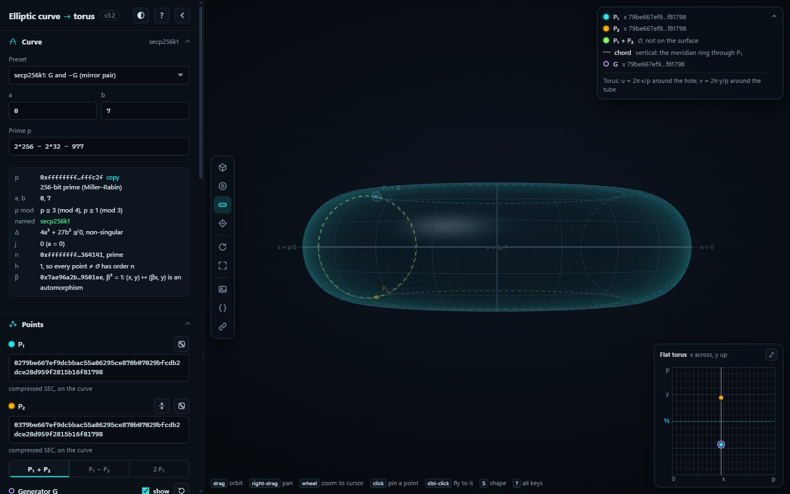

P₁ = 02‖x(G) is G and P₂ = 03‖x(G) is −G: the same x, and y ↦ p − y. On the torus that is a reflection through the equatorial plane, seen edge-on in the side view (key 3), so both points share one meridian ring. Their chord is vertical and P₁ + P₂ = 𝒪.

[Open this state](https://idlebg.com/idleGevrek/elliptic_curve_torus_visualizer_v3.html#s=eyJ2IjozLCJwcmVzZXQiOiJrMS1uZWciLCJiYXNlUHJlc2V0IjoiazEtbmVnIiwiYSI6IjAiLCJiIjoiNyIsInAiOiIyXjI1NiAtIDJeMzIgLSA5NzciLCJnIjoiMDI3OWJlNjY3ZWY5ZGNiYmFjNTVhMDYyOTVjZTg3MGIwNzAyOWJmY2RiMmRjZTI4ZDk1OWYyODE1YjE2ZjgxNzk4IiwicDEiOiIwMjc5YmU2NjdlZjlkY2JiYWM1NWEwNjI5NWNlODcwYjA3MDI5YmZjZGIyZGNlMjhkOTU5ZjI4MTViMTZmODE3OTgiLCJwMiI6IjAzNzliZTY2N2VmOWRjYmJhYzU1YTA2Mjk1Y2U4NzBiMDcwMjliZmNkYjJkY2UyOGQ5NTlmMjgxNWIxNmY4MTc5OCIsIm9wIjoiYWRkIiwic2hvd0ciOnRydWUsImZvcmNlIjpmYWxzZSwic2hhcGUiOiJ0b3J1cyIsIm1hcCI6InNjYWxlIiwiYml0cyI6MjQsInN1IjoyNCwic3YiOjE2LCJSIjoxLjIsInIiOjAuNDYsImdsYXNzIjowLjU1LCJiYWNrIjowLjQsInNob3ciOnsiZ3JpZCI6dHJ1ZSwicmluZ3MiOnRydWUsImxhYmVscyI6dHJ1ZSwiY2xvdWQiOnRydWUsImNob3JkIjp0cnVlLCJiZXRhIjpmYWxzZSwibWFwIjp0cnVlLCJzcGluIjpmYWxzZX0sInJpbmdzIjp7InAxIjp0cnVlLCJwMiI6dHJ1ZSwic3VtIjp0cnVlLCJnIjpmYWxzZX0sInRoZW1lIjoiZGFyayIsInBhbmVsIjp0cnVlLCJtaW5pQmlnIjpmYWxzZSwibGVnZW5kTWluIjpmYWxzZSwic2VjcyI6eyJjdXJ2ZSI6dHJ1ZSwicG9pbnRzIjp0cnVlLCJzaGFwZSI6dHJ1ZSwidmlldyI6dHJ1ZSwiaW5zcGVjdG9yIjp0cnVlLCJyZWxhdGlvbnMiOnRydWUsInRlc3QiOmZhbHNlfX0). Then press `3` for the side view. Tags: secp256k1, negation, side view.

## secp256k1: G + 2G = 3G

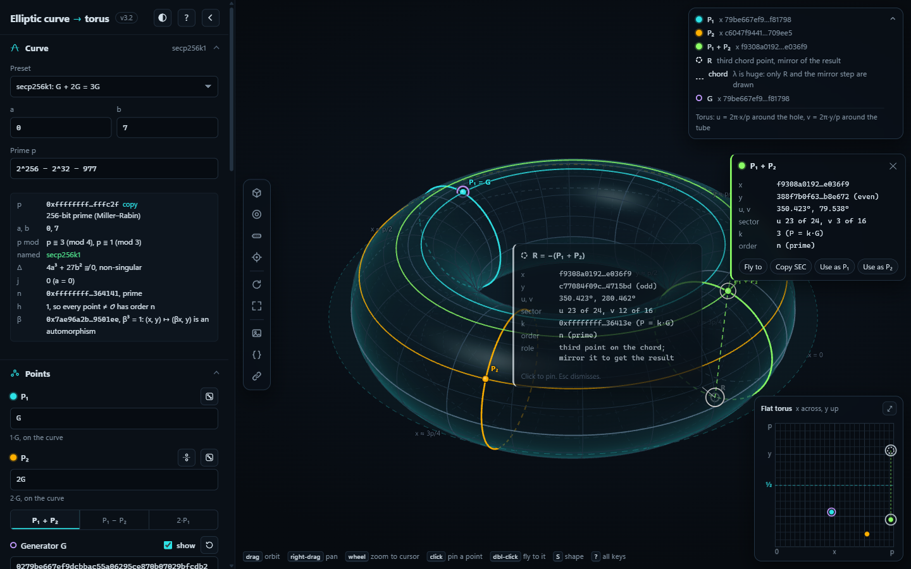

On a 256-bit curve the chord y ≡ λx + c winds around the tube a 254-bit number of times, so only its third point R = −3G (dashed ring) and the mirror step to the result are drawn. The result’s card shows k = 3, carried through from the scalars typed as G and 2G; its x is OpenSSL’s 3G.

[Open this state](https://idlebg.com/idleGevrek/elliptic_curve_torus_visualizer_v3.html#s=eyJ2IjozLCJwcmVzZXQiOiJrMS1jaG9yZCIsImJhc2VQcmVzZXQiOiJrMS1jaG9yZCIsImEiOiIwIiwiYiI6IjciLCJwIjoiMl4yNTYgLSAyXjMyIC0gOTc3IiwiZyI6IjAyNzliZTY2N2VmOWRjYmJhYzU1YTA2Mjk1Y2U4NzBiMDcwMjliZmNkYjJkY2UyOGQ5NTlmMjgxNWIxNmY4MTc5OCIsInAxIjoiRyIsInAyIjoiMkciLCJvcCI6ImFkZCIsInNob3dHIjp0cnVlLCJmb3JjZSI6ZmFsc2UsInNoYXBlIjoidG9ydXMiLCJtYXAiOiJzY2FsZSIsImJpdHMiOjI0LCJzdSI6MjQsInN2IjoxNiwiUiI6MS4yLCJyIjowLjQ2LCJnbGFzcyI6MC41NSwiYmFjayI6MC40LCJzaG93Ijp7ImdyaWQiOnRydWUsInJpbmdzIjp0cnVlLCJsYWJlbHMiOnRydWUsImNsb3VkIjp0cnVlLCJjaG9yZCI6dHJ1ZSwiYmV0YSI6ZmFsc2UsIm1hcCI6dHJ1ZSwic3BpbiI6ZmFsc2V9LCJyaW5ncyI6eyJwMSI6dHJ1ZSwicDIiOnRydWUsInN1bSI6dHJ1ZSwiZyI6ZmFsc2V9LCJ0aGVtZSI6ImRhcmsiLCJwYW5lbCI6dHJ1ZSwibWluaUJpZyI6ZmFsc2UsImxlZ2VuZE1pbiI6ZmFsc2UsInNlY3MiOnsiY3VydmUiOnRydWUsInBvaW50cyI6dHJ1ZSwic2hhcGUiOnRydWUsInZpZXciOnRydWUsImluc3BlY3RvciI6dHJ1ZSwicmVsYXRpb25zIjp0cnVlLCJ0ZXN0IjpmYWxzZX19). Tags: secp256k1, chord construction, scalar tracking.

## secp256k1 GLV: G, λG and λ²G share a y

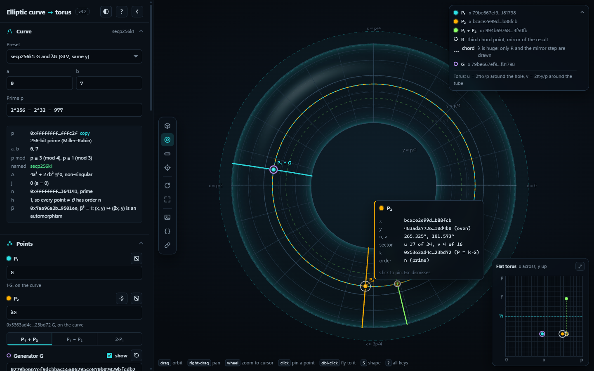

With a = 0 and p ≡ 1 (mod 3) a cube root of unity β gives the automorphism (x, y) ↦ (βx, y); on secp256k1 it is multiplication by λ. G, λG and λ²G therefore lie on one parallel ring. Relations reports P₂ = λ·P₁, and the β-orbit rings mark the third point, λ²G.

[Open this state](https://idlebg.com/idleGevrek/elliptic_curve_torus_visualizer_v3.html#s=eyJ2IjozLCJwcmVzZXQiOiJrMS1nbHYiLCJiYXNlUHJlc2V0IjoiazEtZ2x2IiwiYSI6IjAiLCJiIjoiNyIsInAiOiIyXjI1NiAtIDJeMzIgLSA5NzciLCJnIjoiMDI3OWJlNjY3ZWY5ZGNiYmFjNTVhMDYyOTVjZTg3MGIwNzAyOWJmY2RiMmRjZTI4ZDk1OWYyODE1YjE2ZjgxNzk4IiwicDEiOiJHIiwicDIiOiLOu0ciLCJvcCI6ImFkZCIsInNob3dHIjp0cnVlLCJmb3JjZSI6ZmFsc2UsInNoYXBlIjoidG9ydXMiLCJtYXAiOiJzY2FsZSIsImJpdHMiOjI0LCJzdSI6MjQsInN2IjoxNiwiUiI6MS4yLCJyIjowLjQ2LCJnbGFzcyI6MC41NSwiYmFjayI6MC40LCJzaG93Ijp7ImdyaWQiOnRydWUsInJpbmdzIjp0cnVlLCJsYWJlbHMiOnRydWUsImNsb3VkIjp0cnVlLCJjaG9yZCI6dHJ1ZSwiYmV0YSI6dHJ1ZSwibWFwIjp0cnVlLCJzcGluIjpmYWxzZX0sInJpbmdzIjp7InAxIjp0cnVlLCJwMiI6dHJ1ZSwic3VtIjp0cnVlLCJnIjpmYWxzZX0sInRoZW1lIjoiZGFyayIsInBhbmVsIjp0cnVlLCJtaW5pQmlnIjpmYWxzZSwibGVnZW5kTWluIjpmYWxzZSwic2VjcyI6eyJjdXJ2ZSI6dHJ1ZSwicG9pbnRzIjp0cnVlLCJzaGFwZSI6dHJ1ZSwidmlldyI6dHJ1ZSwiaW5zcGVjdG9yIjp0cnVlLCJyZWxhdGlvbnMiOnRydWUsInRlc3QiOmZhbHNlfX0). Then press `2` for the top view. Tags: secp256k1, GLV endomorphism, β-orbit, top view.

## secp256k1: 7G − 2G = 5G

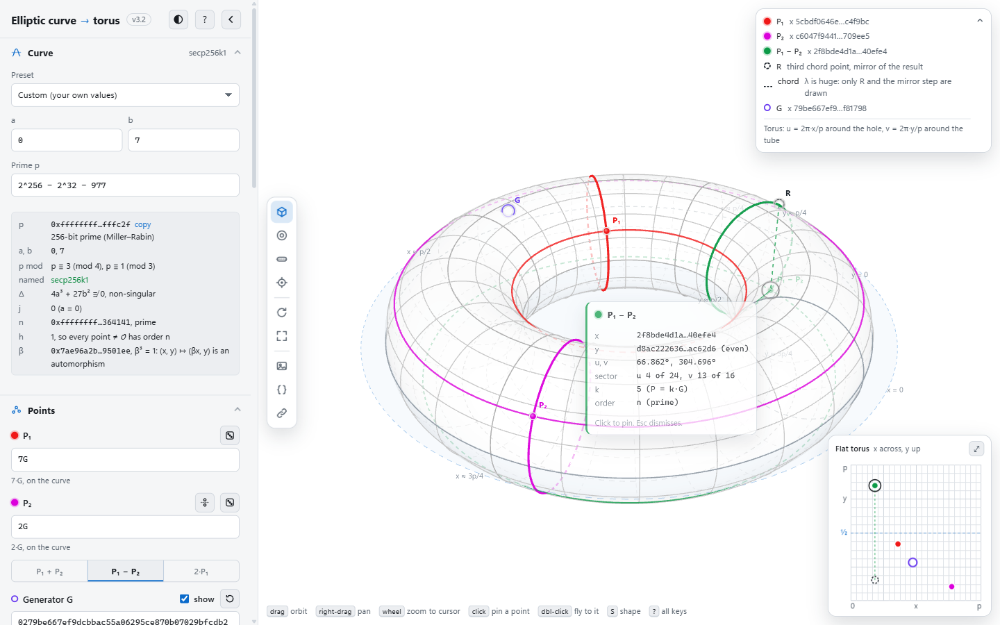

Subtraction adds −P₂, the mirror image of P₂. The scalars typed as 7G and 2G are carried through the operation, so the result’s card shows k = 5, and its x is OpenSSL’s 5G.

[Open this state](https://idlebg.com/idleGevrek/elliptic_curve_torus_visualizer_v3.html#s=eyJ2IjozLCJwcmVzZXQiOiJjdXN0b20iLCJiYXNlUHJlc2V0IjoiazEtY2hvcmQiLCJhIjoiMCIsImIiOiI3IiwicCI6IjJeMjU2IC0gMl4zMiAtIDk3NyIsImciOiIwMjc5YmU2NjdlZjlkY2JiYWM1NWEwNjI5NWNlODcwYjA3MDI5YmZjZGIyZGNlMjhkOTU5ZjI4MTViMTZmODE3OTgiLCJwMSI6IjdHIiwicDIiOiIyRyIsIm9wIjoic3ViIiwic2hvd0ciOnRydWUsImZvcmNlIjpmYWxzZSwic2hhcGUiOiJ0b3J1cyIsIm1hcCI6InNjYWxlIiwiYml0cyI6MjQsInN1IjoyNCwic3YiOjE2LCJSIjoxLjIsInIiOjAuNDYsImdsYXNzIjowLjU1LCJiYWNrIjowLjQsInNob3ciOnsiZ3JpZCI6dHJ1ZSwicmluZ3MiOnRydWUsImxhYmVscyI6dHJ1ZSwiY2xvdWQiOnRydWUsImNob3JkIjp0cnVlLCJiZXRhIjpmYWxzZSwibWFwIjp0cnVlLCJzcGluIjpmYWxzZX0sInJpbmdzIjp7InAxIjp0cnVlLCJwMiI6dHJ1ZSwic3VtIjp0cnVlLCJnIjpmYWxzZX0sInRoZW1lIjoicGFwZXIiLCJwYW5lbCI6dHJ1ZSwibWluaUJpZyI6ZmFsc2UsImxlZ2VuZE1pbiI6ZmFsc2UsInNlY3MiOnsiY3VydmUiOnRydWUsInBvaW50cyI6dHJ1ZSwic2hhcGUiOnRydWUsInZpZXciOnRydWUsImluc3BlY3RvciI6dHJ1ZSwicmVsYXRpb25zIjp0cnVlLCJ0ZXN0IjpmYWxzZX19). Tags: secp256k1, subtraction, scalar tracking, paper theme.

## P-256: G + 2G = 3G

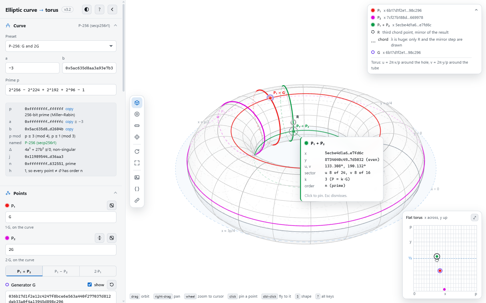

NIST P-256: p = 2²⁵⁶ − 2²²⁴ + 2¹⁹² + 2⁹⁶ − 1 and a ≡ −3, both shown evaluated in the Curve facts. The same construction as on secp256k1: R, the mirror step, and the result 3G, whose card and inspector carry every SEC encoding. Its x and y are OpenSSL’s 3G.

[Open this state](https://idlebg.com/idleGevrek/elliptic_curve_torus_visualizer_v3.html#s=eyJ2IjozLCJwcmVzZXQiOiJwMjU2IiwiYmFzZVByZXNldCI6InAyNTYiLCJhIjoiLTMiLCJiIjoiMHg1YWM2MzVkOGFhM2E5M2U3YjNlYmJkNTU3Njk4ODZiYzY1MWQwNmIwY2M1M2IwZjYzYmNlM2MzZTI3ZDI2MDRiIiwicCI6IjJeMjU2IC0gMl4yMjQgKyAyXjE5MiArIDJeOTYgLSAxIiwiZyI6IjAzNmIxN2QxZjJlMTJjNDI0N2Y4YmNlNmU1NjNhNDQwZjI3NzAzN2Q4MTJkZWIzM2EwZjRhMTM5NDVkODk4YzI5NiIsInAxIjoiRyIsInAyIjoiMkciLCJvcCI6ImFkZCIsInNob3dHIjp0cnVlLCJmb3JjZSI6ZmFsc2UsInNoYXBlIjoidG9ydXMiLCJtYXAiOiJzY2FsZSIsImJpdHMiOjI0LCJzdSI6MjQsInN2IjoxNiwiUiI6MS4yLCJyIjowLjQ2LCJnbGFzcyI6MC41NSwiYmFjayI6MC40LCJzaG93Ijp7ImdyaWQiOnRydWUsInJpbmdzIjp0cnVlLCJsYWJlbHMiOnRydWUsImNsb3VkIjp0cnVlLCJjaG9yZCI6dHJ1ZSwiYmV0YSI6ZmFsc2UsIm1hcCI6dHJ1ZSwic3BpbiI6ZmFsc2V9LCJyaW5ncyI6eyJwMSI6dHJ1ZSwicDIiOnRydWUsInN1bSI6dHJ1ZSwiZyI6ZmFsc2V9LCJ0aGVtZSI6InBhcGVyIiwicGFuZWwiOnRydWUsIm1pbmlCaWciOmZhbHNlLCJsZWdlbmRNaW4iOmZhbHNlLCJzZWNzIjp7ImN1cnZlIjp0cnVlLCJwb2ludHMiOnRydWUsInNoYXBlIjp0cnVlLCJ2aWV3Ijp0cnVlLCJpbnNwZWN0b3IiOnRydWUsInJlbGF0aW9ucyI6dHJ1ZSwidGVzdCI6ZmFsc2V9fQ). Tags: P-256 (secp256r1), a ≡ −3, paper theme.

## F₂₂₃: the chord winds three times — G + 8G = 9G

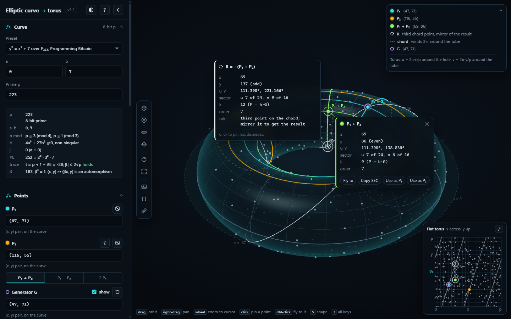

y² = x³ + 7 over F₂₂₃ (the curve of Programming Bitcoin). The chord through G = (47, 71) and 8G = (116, 55) has slope λ ≡ 3 (centred), so it winds three times around the tube while going once around the hole. It meets the curve again at R = −9G = (69, 137); the mirror step gives 9G = (69, 86). The flat map in the corner shows the same line wrapped on the square.

[Open this state](https://idlebg.com/idleGevrek/elliptic_curve_torus_visualizer_v3.html#s=eyJ2IjozLCJwcmVzZXQiOiJwYjIyMyIsImJhc2VQcmVzZXQiOiJwYjIyMyIsImEiOiIwIiwiYiI6IjciLCJwIjoiMjIzIiwiZyI6Iig0NywgNzEpIiwicDEiOiIoNDcsIDcxKSIsInAyIjoiKDExNiwgNTUpIiwib3AiOiJhZGQiLCJzaG93RyI6dHJ1ZSwiZm9yY2UiOmZhbHNlLCJzaGFwZSI6InRvcnVzIiwibWFwIjoic2NhbGUiLCJiaXRzIjoyNCwic3UiOjI0LCJzdiI6MTYsIlIiOjEuMiwiciI6MC40NiwiZ2xhc3MiOjAuNTUsImJhY2siOjAuNCwic2hvdyI6eyJncmlkIjp0cnVlLCJyaW5ncyI6dHJ1ZSwibGFiZWxzIjp0cnVlLCJjbG91ZCI6dHJ1ZSwiY2hvcmQiOnRydWUsImJldGEiOmZhbHNlLCJtYXAiOnRydWUsInNwaW4iOmZhbHNlfSwicmluZ3MiOnsicDEiOnRydWUsInAyIjp0cnVlLCJzdW0iOnRydWUsImciOmZhbHNlfSwidGhlbWUiOiJkYXJrIiwicGFuZWwiOnRydWUsIm1pbmlCaWciOmZhbHNlLCJsZWdlbmRNaW4iOmZhbHNlLCJzZWNzIjp7ImN1cnZlIjp0cnVlLCJwb2ludHMiOnRydWUsInNoYXBlIjp0cnVlLCJ2aWV3Ijp0cnVlLCJpbnNwZWN0b3IiOnRydWUsInJlbGF0aW9ucyI6dHJ1ZSwidGVzdCI6ZmFsc2V9fQ). Tags: toy curve, chord on the torus, flat map, Programming Bitcoin.

## F₂₂₃ is not cyclic: a β-orbit outside ⟨G⟩

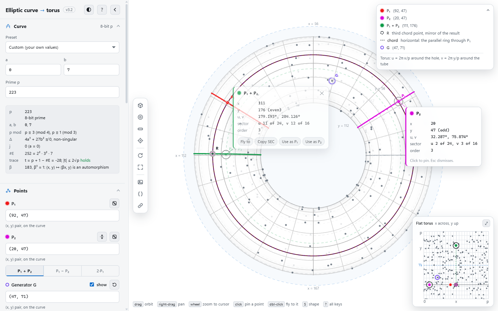

E(F₂₂₃) ≅ Z/6 × Z/42 (252 points, largest order 42). 7G = (92, 47) has order 3; its β-images (20, 47) and (111, 47) have order 3 too but are not multiples of G, so their cards show the order and no k. All three share y = 47, so the chord through two of them is the parallel ring y = 47 itself (λ = 0), and (92, 47) + (20, 47) = −(111, 47) = (111, 176).

[Open this state](https://idlebg.com/idleGevrek/elliptic_curve_torus_visualizer_v3.html#s=eyJ2IjozLCJwcmVzZXQiOiJjdXN0b20iLCJiYXNlUHJlc2V0IjoiazEtbmVnIiwiYSI6IjAiLCJiIjoiNyIsInAiOiIyMjMiLCJnIjoiKDQ3LCA3MSkiLCJwMSI6Iig5MiwgNDcpIiwicDIiOiIoMjAsIDQ3KSIsIm9wIjoiYWRkIiwic2hvd0ciOnRydWUsImZvcmNlIjpmYWxzZSwic2hhcGUiOiJ0b3J1cyIsIm1hcCI6InNjYWxlIiwiYml0cyI6MjQsInN1IjoyNCwic3YiOjE2LCJSIjoxLjIsInIiOjAuNDYsImdsYXNzIjowLjU1LCJiYWNrIjowLjQsInNob3ciOnsiZ3JpZCI6dHJ1ZSwicmluZ3MiOnRydWUsImxhYmVscyI6dHJ1ZSwiY2xvdWQiOnRydWUsImNob3JkIjp0cnVlLCJiZXRhIjp0cnVlLCJtYXAiOnRydWUsInNwaW4iOmZhbHNlfSwicmluZ3MiOnsicDEiOnRydWUsInAyIjp0cnVlLCJzdW0iOnRydWUsImciOmZhbHNlfSwidGhlbWUiOiJwYXBlciIsInBhbmVsIjp0cnVlLCJtaW5pQmlnIjpmYWxzZSwibGVnZW5kTWluIjpmYWxzZSwic2VjcyI6eyJjdXJ2ZSI6dHJ1ZSwicG9pbnRzIjp0cnVlLCJzaGFwZSI6dHJ1ZSwidmlldyI6dHJ1ZSwiaW5zcGVjdG9yIjp0cnVlLCJyZWxhdGlvbnMiOnRydWUsInRlc3QiOmZhbHNlfX0). Then press `2` for the top view. Tags: toy curve, group structure, β-orbit, discrete log.

## F₉₇: doubling uses the tangent — 2·(59, 32) = (80, 10)

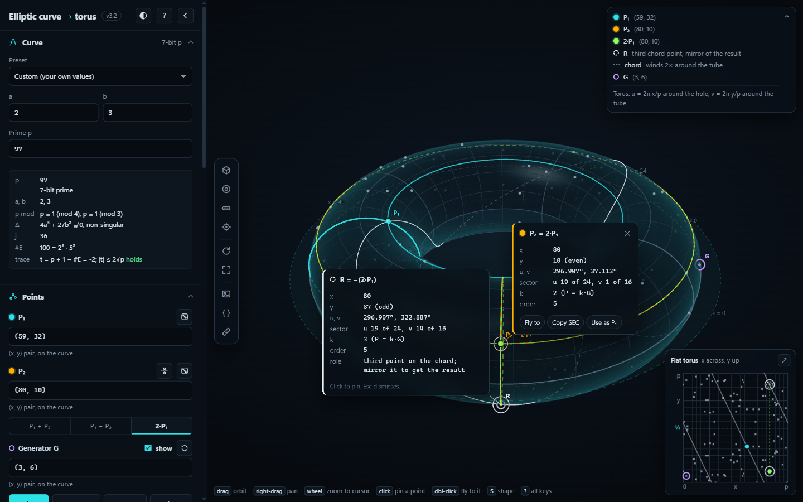

With the 2·P₁ operation the chord becomes the tangent at P₁. On y² = x³ + 2x + 3 over F₉₇ the tangent at (59, 32), a point of order 10, has slope λ ≡ −2 (centred), so it winds twice around the tube; it touches the curve at P₁ and meets it again at R = (80, 87). The mirror step gives 2·(59, 32) = (80, 10), which is P₂.

[Open this state](https://idlebg.com/idleGevrek/elliptic_curve_torus_visualizer_v3.html#s=eyJ2IjozLCJwcmVzZXQiOiJjdXN0b20iLCJiYXNlUHJlc2V0IjoiYzk3IiwiYSI6IjIiLCJiIjoiMyIsInAiOiI5NyIsImciOiIoMywgNikiLCJwMSI6Iig1OSwgMzIpIiwicDIiOiIoODAsIDEwKSIsIm9wIjoiZGJsIiwic2hvd0ciOnRydWUsImZvcmNlIjpmYWxzZSwic2hhcGUiOiJ0b3J1cyIsIm1hcCI6InNjYWxlIiwiYml0cyI6MjQsInN1IjoyNCwic3YiOjE2LCJSIjoxLjIsInIiOjAuNDYsImdsYXNzIjowLjU1LCJiYWNrIjowLjQsInNob3ciOnsiZ3JpZCI6dHJ1ZSwicmluZ3MiOnRydWUsImxhYmVscyI6dHJ1ZSwiY2xvdWQiOnRydWUsImNob3JkIjp0cnVlLCJiZXRhIjpmYWxzZSwibWFwIjp0cnVlLCJzcGluIjpmYWxzZX0sInJpbmdzIjp7InAxIjp0cnVlLCJwMiI6dHJ1ZSwic3VtIjp0cnVlLCJnIjpmYWxzZX0sInRoZW1lIjoiZGFyayIsInBhbmVsIjp0cnVlLCJtaW5pQmlnIjpmYWxzZSwibGVnZW5kTWluIjpmYWxzZSwic2VjcyI6eyJjdXJ2ZSI6dHJ1ZSwicG9pbnRzIjp0cnVlLCJzaGFwZSI6dHJ1ZSwidmlldyI6dHJ1ZSwiaW5zcGVjdG9yIjp0cnVlLCJyZWxhdGlvbnMiOnRydWUsInRlc3QiOmZhbHNlfX0). Tags: toy curve, doubling, tangent, flat map.

## F₁₀₀₀₉: all 10 191 points

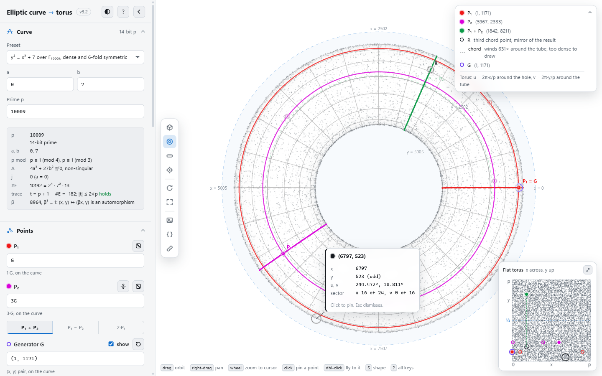

y² = x³ + 7 over F₁₀₀₀₉ has #E = 10 192, so 10 191 affine points cover the torus. Every point with x ≠ 0 and y ≠ 0 comes with five siblings under (x, y) ↦ (βⁱx, ±y); the ± half is the mirror about y = p/2 on the flat map. Hover any dot for its card.

[Open this state](https://idlebg.com/idleGevrek/elliptic_curve_torus_visualizer_v3.html#s=eyJ2IjozLCJwcmVzZXQiOiJ0MTAwMDkiLCJiYXNlUHJlc2V0IjoidDEwMDA5IiwiYSI6IjAiLCJiIjoiNyIsInAiOiIxMDAwOSIsImciOiIoMSwgMTE3MSkiLCJwMSI6IkciLCJwMiI6IjNHIiwib3AiOiJhZGQiLCJzaG93RyI6dHJ1ZSwiZm9yY2UiOmZhbHNlLCJzaGFwZSI6InRvcnVzIiwibWFwIjoic2NhbGUiLCJiaXRzIjoyNCwic3UiOjI0LCJzdiI6MTYsIlIiOjEuMiwiciI6MC40NiwiZ2xhc3MiOjAuNTUsImJhY2siOjAuNCwic2hvdyI6eyJncmlkIjp0cnVlLCJyaW5ncyI6dHJ1ZSwibGFiZWxzIjp0cnVlLCJjbG91ZCI6dHJ1ZSwiY2hvcmQiOnRydWUsImJldGEiOnRydWUsIm1hcCI6dHJ1ZSwic3BpbiI6ZmFsc2V9LCJyaW5ncyI6eyJwMSI6dHJ1ZSwicDIiOnRydWUsInN1bSI6dHJ1ZSwiZyI6ZmFsc2V9LCJ0aGVtZSI6InBhcGVyIiwicGFuZWwiOnRydWUsIm1pbmlCaWciOmZhbHNlLCJsZWdlbmRNaW4iOmZhbHNlLCJzZWNzIjp7ImN1cnZlIjp0cnVlLCJwb2ludHMiOnRydWUsInNoYXBlIjp0cnVlLCJ2aWV3Ijp0cnVlLCJpbnNwZWN0b3IiOnRydWUsInJlbGF0aW9ucyI6dHJ1ZSwidGVzdCI6ZmFsc2V9fQ). Then press `2` for the top view. Tags: toy curve, every point, automorphisms, top view.

## Edge cases: a hybrid key that lies about its parity, and an invalid-curve point

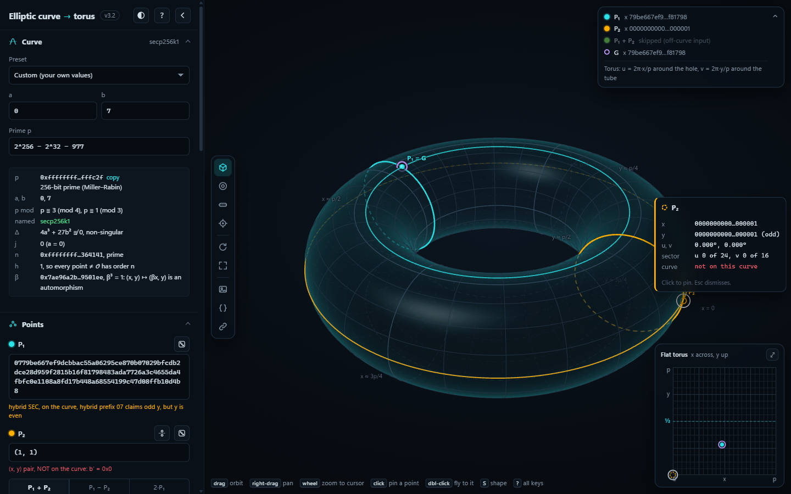

P₁ is G written as a 07 hybrid key, but G’s y is even, so the parity bit is wrong: the point is read, drawn and flagged in amber. P₂ = (1, 1) is not on secp256k1; it satisfies y² = x³ + ax + b′ with b′ = 0, the singular cusp y² = x³. The group law is skipped until “Force group law” is ticked, which is the check an implementation needs against invalid-curve attacks.

[Open this state](https://idlebg.com/idleGevrek/elliptic_curve_torus_visualizer_v3.html#s=eyJ2IjozLCJwcmVzZXQiOiJjdXN0b20iLCJiYXNlUHJlc2V0IjoiazEtbmVnIiwiYSI6IjAiLCJiIjoiNyIsInAiOiIyXjI1NiAtIDJeMzIgLSA5NzciLCJnIjoiMDI3OWJlNjY3ZWY5ZGNiYmFjNTVhMDYyOTVjZTg3MGIwNzAyOWJmY2RiMmRjZTI4ZDk1OWYyODE1YjE2ZjgxNzk4IiwicDEiOiIwNzc5YmU2NjdlZjlkY2JiYWM1NWEwNjI5NWNlODcwYjA3MDI5YmZjZGIyZGNlMjhkOTU5ZjI4MTViMTZmODE3OTg0ODNhZGE3NzI2YTNjNDY1NWRhNGZiZmMwZTExMDhhOGZkMTdiNDQ4YTY4NTU0MTk5YzQ3ZDA4ZmZiMTBkNGI4IiwicDIiOiIoMSwgMSkiLCJvcCI6ImFkZCIsInNob3dHIjp0cnVlLCJmb3JjZSI6ZmFsc2UsInNoYXBlIjoidG9ydXMiLCJtYXAiOiJzY2FsZSIsImJpdHMiOjI0LCJzdSI6MjQsInN2IjoxNiwiUiI6MS4yLCJyIjowLjQ2LCJnbGFzcyI6MC41NSwiYmFjayI6MC40LCJzaG93Ijp7ImdyaWQiOnRydWUsInJpbmdzIjp0cnVlLCJsYWJlbHMiOnRydWUsImNsb3VkIjp0cnVlLCJjaG9yZCI6dHJ1ZSwiYmV0YSI6ZmFsc2UsIm1hcCI6dHJ1ZSwic3BpbiI6ZmFsc2V9LCJyaW5ncyI6eyJwMSI6dHJ1ZSwicDIiOnRydWUsInN1bSI6dHJ1ZSwiZyI6ZmFsc2V9LCJ0aGVtZSI6ImRhcmsiLCJwYW5lbCI6dHJ1ZSwibWluaUJpZyI6ZmFsc2UsImxlZ2VuZE1pbiI6ZmFsc2UsInNlY3MiOnsiY3VydmUiOnRydWUsInBvaW50cyI6dHJ1ZSwic2hhcGUiOnRydWUsInZpZXciOnRydWUsImluc3BlY3RvciI6dHJ1ZSwicmVsYXRpb25zIjp0cnVlLCJ0ZXN0IjpmYWxzZX19). Tags: secp256k1, SEC 06/07, invalid curve, input checks.

## F₁₇: discrete logs on a curve of prime order

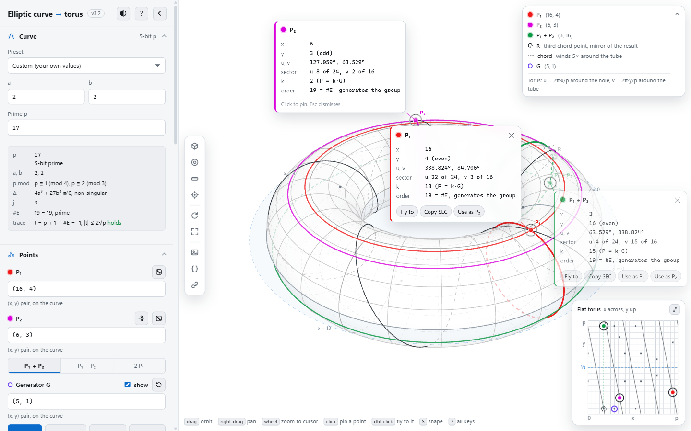

y² = x³ + 2x + 2 over F₁₇ (Paar & Pelzl) has 19 points, a prime, so G = (5, 1) generates the whole group. Type any point as (x, y) and baby-step giant-step finds its k: (16, 4) = 13G, (6, 3) = 2G, and their sum (3, 16) = 15G.

[Open this state](https://idlebg.com/idleGevrek/elliptic_curve_torus_visualizer_v3.html#s=eyJ2IjozLCJwcmVzZXQiOiJjdXN0b20iLCJiYXNlUHJlc2V0IjoiazEtbmVnIiwiYSI6IjIiLCJiIjoiMiIsInAiOiIxNyIsImciOiIoNSwgMSkiLCJwMSI6IigxNiwgNCkiLCJwMiI6Iig2LCAzKSIsIm9wIjoiYWRkIiwic2hvd0ciOnRydWUsImZvcmNlIjpmYWxzZSwic2hhcGUiOiJ0b3J1cyIsIm1hcCI6InNjYWxlIiwiYml0cyI6MjQsInN1IjoyNCwic3YiOjE2LCJSIjoxLjIsInIiOjAuNDYsImdsYXNzIjowLjU1LCJiYWNrIjowLjQsInNob3ciOnsiZ3JpZCI6dHJ1ZSwicmluZ3MiOnRydWUsImxhYmVscyI6dHJ1ZSwiY2xvdWQiOnRydWUsImNob3JkIjp0cnVlLCJiZXRhIjpmYWxzZSwibWFwIjp0cnVlLCJzcGluIjpmYWxzZX0sInJpbmdzIjp7InAxIjp0cnVlLCJwMiI6dHJ1ZSwic3VtIjp0cnVlLCJnIjpmYWxzZX0sInRoZW1lIjoicGFwZXIiLCJwYW5lbCI6dHJ1ZSwibWluaUJpZyI6ZmFsc2UsImxlZ2VuZE1pbiI6ZmFsc2UsInNlY3MiOnsiY3VydmUiOnRydWUsInBvaW50cyI6dHJ1ZSwic2hhcGUiOnRydWUsInZpZXciOnRydWUsImluc3BlY3RvciI6dHJ1ZSwicmVsYXRpb25zIjp0cnVlLCJ0ZXN0IjpmYWxzZX19). Tags: toy curve, discrete log, Paar & Pelzl.

## Shapes: secp256k1 GLV on a sphere

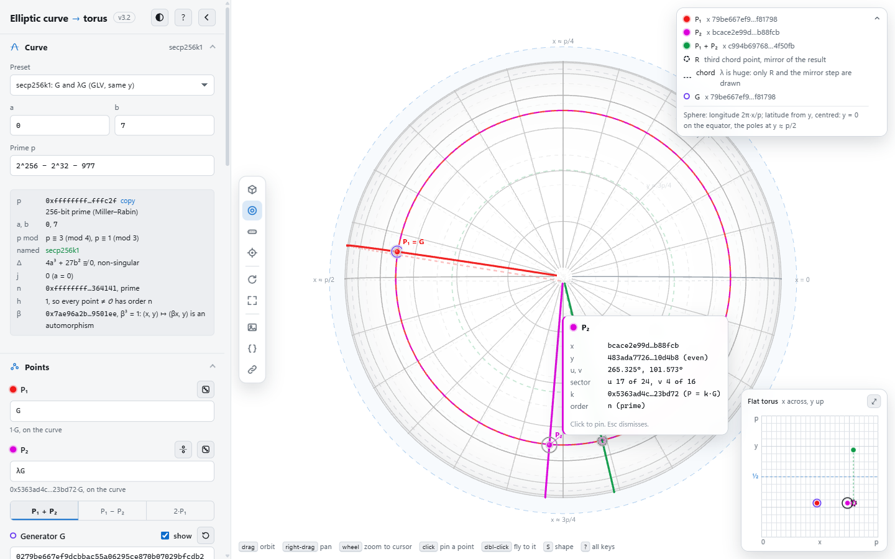

On the sphere x is the longitude and y the latitude, centred so that y = 0 is the equator and the mirror plane. G, λG and λ²G share a y, so they share a latitude: from the top (key 2) all three sit on one ring around the pole, as they share a parallel ring on the torus.

[Open this state](https://idlebg.com/idleGevrek/elliptic_curve_torus_visualizer_v3.html#s=eyJ2IjozLCJwcmVzZXQiOiJrMS1nbHYiLCJiYXNlUHJlc2V0IjoiazEtZ2x2IiwiYSI6IjAiLCJiIjoiNyIsInAiOiIyXjI1NiAtIDJeMzIgLSA5NzciLCJnIjoiMDI3OWJlNjY3ZWY5ZGNiYmFjNTVhMDYyOTVjZTg3MGIwNzAyOWJmY2RiMmRjZTI4ZDk1OWYyODE1YjE2ZjgxNzk4IiwicDEiOiJHIiwicDIiOiLOu0ciLCJvcCI6ImFkZCIsInNob3dHIjp0cnVlLCJmb3JjZSI6ZmFsc2UsInNoYXBlIjoic3BoZXJlIiwibWFwIjoic2NhbGUiLCJiaXRzIjoyNCwic3UiOjI0LCJzdiI6MTYsIlIiOjEuMiwiciI6MC40NiwiZ2xhc3MiOjAuNTUsImJhY2siOjAuNCwic2hvdyI6eyJncmlkIjp0cnVlLCJyaW5ncyI6dHJ1ZSwibGFiZWxzIjp0cnVlLCJjbG91ZCI6dHJ1ZSwiY2hvcmQiOnRydWUsImJldGEiOnRydWUsIm1hcCI6dHJ1ZSwic3BpbiI6ZmFsc2V9LCJyaW5ncyI6eyJwMSI6dHJ1ZSwicDIiOnRydWUsInN1bSI6dHJ1ZSwiZyI6ZmFsc2V9LCJ0aGVtZSI6InBhcGVyIiwicGFuZWwiOnRydWUsIm1pbmlCaWciOmZhbHNlLCJsZWdlbmRNaW4iOmZhbHNlLCJzZWNzIjp7ImN1cnZlIjp0cnVlLCJwb2ludHMiOnRydWUsInNoYXBlIjp0cnVlLCJ2aWV3Ijp0cnVlLCJpbnNwZWN0b3IiOnRydWUsInJlbGF0aW9ucyI6dHJ1ZSwidGVzdCI6ZmFsc2V9fQ). Then press `2` for the top view. Tags: shapes, sphere, GLV endomorphism, top view.

## Shapes: the F₂₂₃ chord on a lemniscate tube

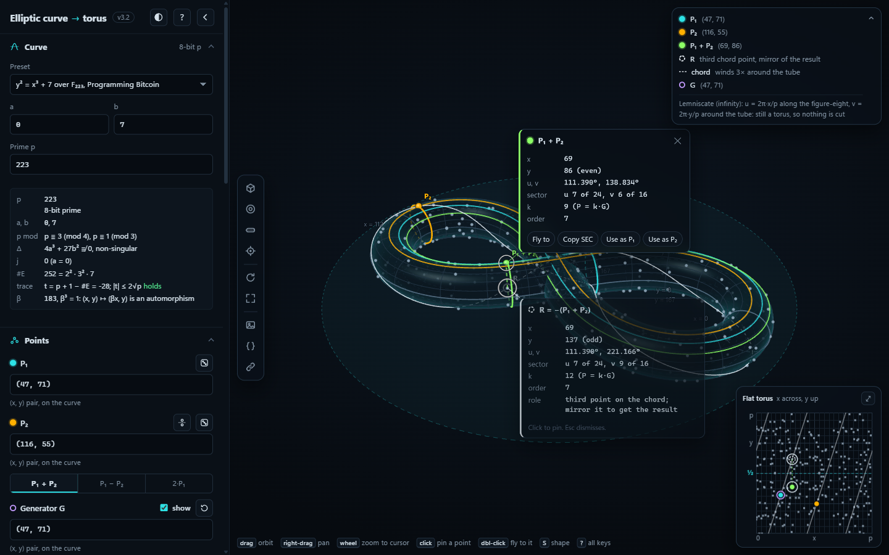

A tube bent into a figure-eight is still a torus, so nothing is cut and every construction carries over: the chord through G and 8G runs once along the figure-eight while it winds three times around the tube, meets the curve at R = −9G and mirrors to 9G = (69, 86).

[Open this state](https://idlebg.com/idleGevrek/elliptic_curve_torus_visualizer_v3.html#s=eyJ2IjozLCJwcmVzZXQiOiJwYjIyMyIsImJhc2VQcmVzZXQiOiJwYjIyMyIsImEiOiIwIiwiYiI6IjciLCJwIjoiMjIzIiwiZyI6Iig0NywgNzEpIiwicDEiOiIoNDcsIDcxKSIsInAyIjoiKDExNiwgNTUpIiwib3AiOiJhZGQiLCJzaG93RyI6dHJ1ZSwiZm9yY2UiOmZhbHNlLCJzaGFwZSI6ImxlbW5pc2NhdGUiLCJtYXAiOiJzY2FsZSIsImJpdHMiOjI0LCJzdSI6MjQsInN2IjoxNiwiUiI6MS4yLCJyIjowLjQ2LCJnbGFzcyI6MC41NSwiYmFjayI6MC40LCJzaG93Ijp7ImdyaWQiOnRydWUsInJpbmdzIjp0cnVlLCJsYWJlbHMiOnRydWUsImNsb3VkIjp0cnVlLCJjaG9yZCI6dHJ1ZSwiYmV0YSI6ZmFsc2UsIm1hcCI6dHJ1ZSwic3BpbiI6ZmFsc2V9LCJyaW5ncyI6eyJwMSI6dHJ1ZSwicDIiOnRydWUsInN1bSI6dHJ1ZSwiZyI6ZmFsc2V9LCJ0aGVtZSI6ImRhcmsiLCJwYW5lbCI6dHJ1ZSwibWluaUJpZyI6ZmFsc2UsImxlZ2VuZE1pbiI6ZmFsc2UsInNlY3MiOnsiY3VydmUiOnRydWUsInBvaW50cyI6dHJ1ZSwic2hhcGUiOnRydWUsInZpZXciOnRydWUsImluc3BlY3RvciI6dHJ1ZSwicmVsYXRpb25zIjp0cnVlLCJ0ZXN0IjpmYWxzZX19). Tags: shapes, lemniscate, chord construction.

## Shapes: G and −G on an icosahedron

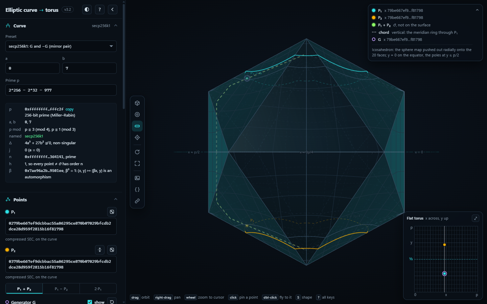

The icosahedron carries the sphere map pushed out radially onto its 20 faces. The plane z = 0 is a mirror of the solid, so P and −P still land as mirror images; in the side view (key 3) the plane is edge-on and G sits straight above −G.

[Open this state](https://idlebg.com/idleGevrek/elliptic_curve_torus_visualizer_v3.html#s=eyJ2IjozLCJwcmVzZXQiOiJrMS1uZWciLCJiYXNlUHJlc2V0IjoiazEtbmVnIiwiYSI6IjAiLCJiIjoiNyIsInAiOiIyXjI1NiAtIDJeMzIgLSA5NzciLCJnIjoiMDI3OWJlNjY3ZWY5ZGNiYmFjNTVhMDYyOTVjZTg3MGIwNzAyOWJmY2RiMmRjZTI4ZDk1OWYyODE1YjE2ZjgxNzk4IiwicDEiOiIwMjc5YmU2NjdlZjlkY2JiYWM1NWEwNjI5NWNlODcwYjA3MDI5YmZjZGIyZGNlMjhkOTU5ZjI4MTViMTZmODE3OTgiLCJwMiI6IjAzNzliZTY2N2VmOWRjYmJhYzU1YTA2Mjk1Y2U4NzBiMDcwMjliZmNkYjJkY2UyOGQ5NTlmMjgxNWIxNmY4MTc5OCIsIm9wIjoiYWRkIiwic2hvd0ciOnRydWUsImZvcmNlIjpmYWxzZSwic2hhcGUiOiJpY29zYWhlZHJvbiIsIm1hcCI6InNjYWxlIiwiYml0cyI6MjQsInN1IjoyNCwic3YiOjE2LCJSIjoxLjIsInIiOjAuNDYsImdsYXNzIjowLjU1LCJiYWNrIjowLjQsInNob3ciOnsiZ3JpZCI6dHJ1ZSwicmluZ3MiOnRydWUsImxhYmVscyI6dHJ1ZSwiY2xvdWQiOnRydWUsImNob3JkIjp0cnVlLCJiZXRhIjpmYWxzZSwibWFwIjp0cnVlLCJzcGluIjpmYWxzZX0sInJpbmdzIjp7InAxIjp0cnVlLCJwMiI6dHJ1ZSwic3VtIjp0cnVlLCJnIjpmYWxzZX0sInRoZW1lIjoiZGFyayIsInBhbmVsIjp0cnVlLCJtaW5pQmlnIjpmYWxzZSwibGVnZW5kTWluIjpmYWxzZSwic2VjcyI6eyJjdXJ2ZSI6dHJ1ZSwicG9pbnRzIjp0cnVlLCJzaGFwZSI6dHJ1ZSwidmlldyI6dHJ1ZSwiaW5zcGVjdG9yIjp0cnVlLCJyZWxhdGlvbnMiOnRydWUsInRlc3QiOmZhbHNlfX0). Then press `3` for the side view. Tags: shapes, icosahedron, negation, side view.

## Shapes: all 10 191 points of F₁₀₀₀₉ on a Klein bottle

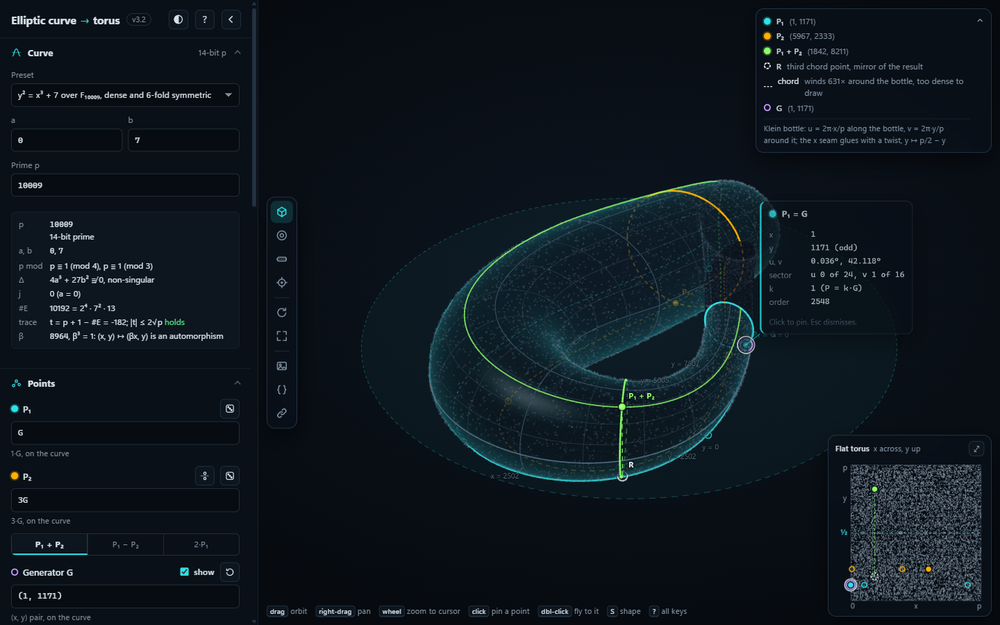

The Klein bottle closes up in y, but its x seam is glued with a twist: the end at x → p meets the start at y ↦ p/2 − y, so rings and the chord break there. It has no outside, so the glass is drawn from both sides. Negation is still the mirror through its horizontal plane.

[Open this state](https://idlebg.com/idleGevrek/elliptic_curve_torus_visualizer_v3.html#s=eyJ2IjozLCJwcmVzZXQiOiJ0MTAwMDkiLCJiYXNlUHJlc2V0IjoidDEwMDA5IiwiYSI6IjAiLCJiIjoiNyIsInAiOiIxMDAwOSIsImciOiIoMSwgMTE3MSkiLCJwMSI6IkciLCJwMiI6IjNHIiwib3AiOiJhZGQiLCJzaG93RyI6dHJ1ZSwiZm9yY2UiOmZhbHNlLCJzaGFwZSI6ImtsZWluIiwibWFwIjoic2NhbGUiLCJiaXRzIjoyNCwic3UiOjI0LCJzdiI6MTYsIlIiOjEuMiwiciI6MC40NiwiZ2xhc3MiOjAuNTUsImJhY2siOjAuNCwic2hvdyI6eyJncmlkIjp0cnVlLCJyaW5ncyI6dHJ1ZSwibGFiZWxzIjp0cnVlLCJjbG91ZCI6dHJ1ZSwiY2hvcmQiOnRydWUsImJldGEiOnRydWUsIm1hcCI6dHJ1ZSwic3BpbiI6ZmFsc2V9LCJyaW5ncyI6eyJwMSI6dHJ1ZSwicDIiOnRydWUsInN1bSI6dHJ1ZSwiZyI6ZmFsc2V9LCJ0aGVtZSI6ImRhcmsiLCJwYW5lbCI6dHJ1ZSwibWluaUJpZyI6ZmFsc2UsImxlZ2VuZE1pbiI6ZmFsc2UsInNlY3MiOnsiY3VydmUiOnRydWUsInBvaW50cyI6dHJ1ZSwic2hhcGUiOnRydWUsInZpZXciOnRydWUsImluc3BlY3RvciI6dHJ1ZSwicmVsYXRpb25zIjp0cnVlLCJ0ZXN0IjpmYWxzZX19). Tags: shapes, Klein bottle, every point.

## Shapes: the F₂₂₃ chord on a wavy plane

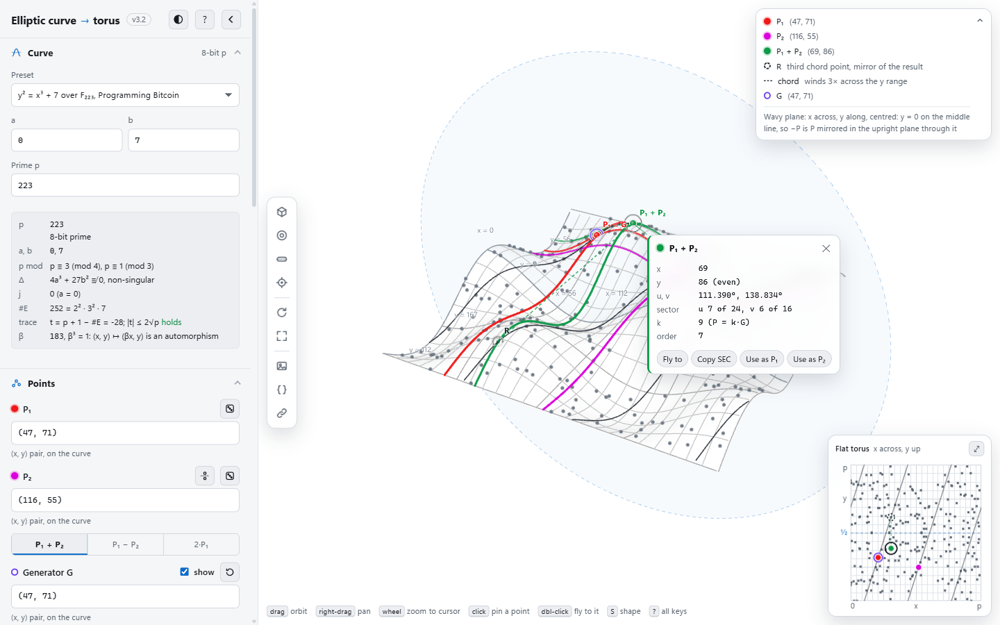

The wavy plane is the flat map lifted into 3D, with y centred on its middle line. The chord crosses the y range three times and breaks at the cut each time; negation mirrors through the upright plane along the middle, drawn here as the dashed circle.

[Open this state](https://idlebg.com/idleGevrek/elliptic_curve_torus_visualizer_v3.html#s=eyJ2IjozLCJwcmVzZXQiOiJwYjIyMyIsImJhc2VQcmVzZXQiOiJwYjIyMyIsImEiOiIwIiwiYiI6IjciLCJwIjoiMjIzIiwiZyI6Iig0NywgNzEpIiwicDEiOiIoNDcsIDcxKSIsInAyIjoiKDExNiwgNTUpIiwib3AiOiJhZGQiLCJzaG93RyI6dHJ1ZSwiZm9yY2UiOmZhbHNlLCJzaGFwZSI6IndhdnkiLCJtYXAiOiJzY2FsZSIsImJpdHMiOjI0LCJzdSI6MjQsInN2IjoxNiwiUiI6MS4yLCJyIjowLjQ2LCJnbGFzcyI6MC41NSwiYmFjayI6MC40LCJzaG93Ijp7ImdyaWQiOnRydWUsInJpbmdzIjp0cnVlLCJsYWJlbHMiOnRydWUsImNsb3VkIjp0cnVlLCJjaG9yZCI6dHJ1ZSwiYmV0YSI6ZmFsc2UsIm1hcCI6dHJ1ZSwic3BpbiI6ZmFsc2V9LCJyaW5ncyI6eyJwMSI6dHJ1ZSwicDIiOnRydWUsInN1bSI6dHJ1ZSwiZyI6ZmFsc2V9LCJ0aGVtZSI6InBhcGVyIiwicGFuZWwiOnRydWUsIm1pbmlCaWciOmZhbHNlLCJsZWdlbmRNaW4iOmZhbHNlLCJzZWNzIjp7ImN1cnZlIjp0cnVlLCJwb2ludHMiOnRydWUsInNoYXBlIjp0cnVlLCJ2aWV3Ijp0cnVlLCJpbnNwZWN0b3IiOnRydWUsInJlbGF0aW9ucyI6dHJ1ZSwidGVzdCI6ZmFsc2V9fQ). Tags: shapes, wavy plane, chord construction, paper theme.

## Shapes: the F₂₂₃ chord on a trefoil knot

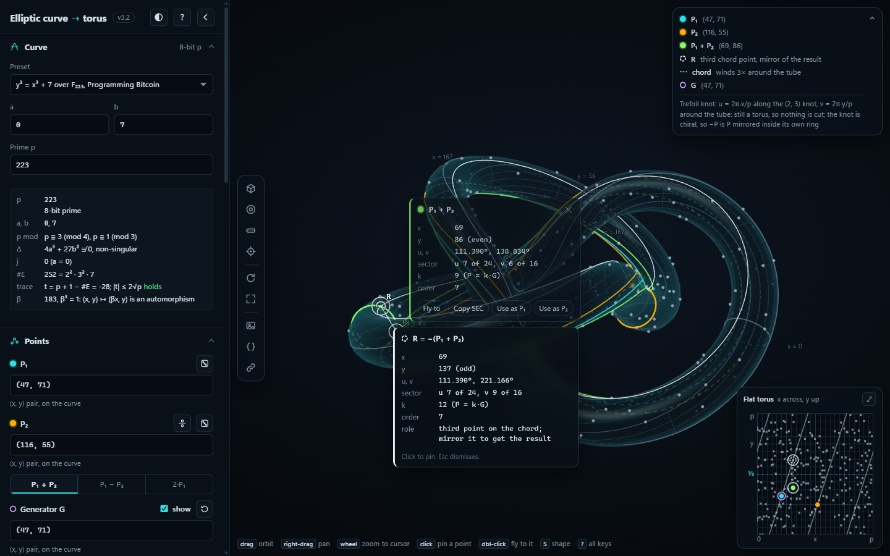

A tube tied into the (2, 3) torus knot is still a torus, so nothing is cut: the chord through G and 8G runs once along the knot while it winds three times around the tube, and meets the curve again at R = −9G. A knot is chiral, so no plane mirrors it onto itself; R and 9G = (69, 86) share a ring, and the mirror step is the reflection inside that ring.

[Open this state](https://idlebg.com/idleGevrek/elliptic_curve_torus_visualizer_v3.html#s=eyJ2IjozLCJwcmVzZXQiOiJwYjIyMyIsImJhc2VQcmVzZXQiOiJwYjIyMyIsImEiOiIwIiwiYiI6IjciLCJwIjoiMjIzIiwiZyI6Iig0NywgNzEpIiwicDEiOiIoNDcsIDcxKSIsInAyIjoiKDExNiwgNTUpIiwib3AiOiJhZGQiLCJzaG93RyI6dHJ1ZSwiZm9yY2UiOmZhbHNlLCJzaGFwZSI6InRyZWZvaWwiLCJtYXAiOiJzY2FsZSIsImJpdHMiOjI0LCJzdSI6MjQsInN2IjoxNiwiUiI6MS4yLCJyIjowLjQ2LCJnbGFzcyI6MC41NSwiYmFjayI6MC40LCJzaG93Ijp7ImdyaWQiOnRydWUsInJpbmdzIjp0cnVlLCJsYWJlbHMiOnRydWUsImNsb3VkIjp0cnVlLCJjaG9yZCI6dHJ1ZSwiYmV0YSI6ZmFsc2UsIm1hcCI6dHJ1ZSwic3BpbiI6ZmFsc2V9LCJyaW5ncyI6eyJwMSI6dHJ1ZSwicDIiOnRydWUsInN1bSI6dHJ1ZSwiZyI6ZmFsc2V9LCJ0aGVtZSI6ImRhcmsiLCJwYW5lbCI6dHJ1ZSwibWluaUJpZyI6ZmFsc2UsImxlZ2VuZE1pbiI6ZmFsc2UsInNlY3MiOnsiY3VydmUiOnRydWUsInBvaW50cyI6dHJ1ZSwic2hhcGUiOnRydWUsInZpZXciOnRydWUsImluc3BlY3RvciI6dHJ1ZSwicmVsYXRpb25zIjp0cnVlLCJ0ZXN0IjpmYWxzZX19). Tags: shapes, trefoil knot, chirality, chord construction.

## F₂₂₃: walking the multiples of G with Step

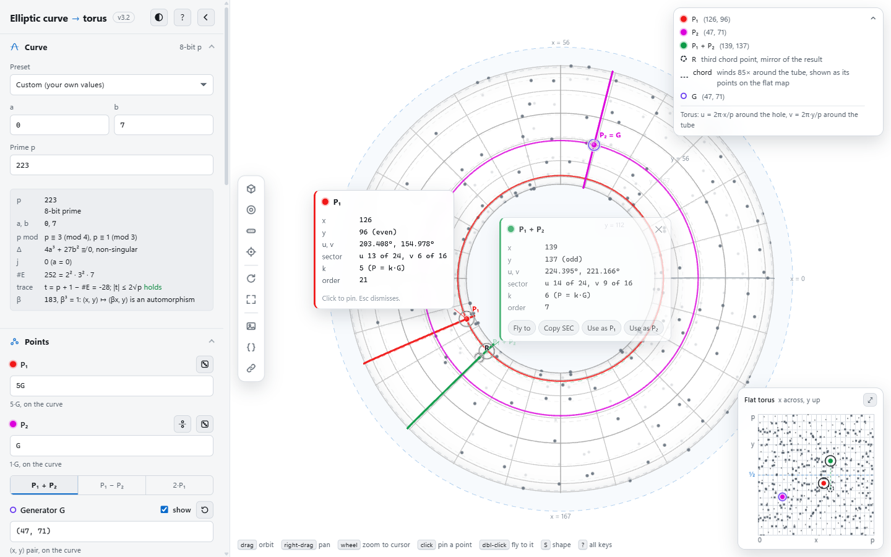

With P₂ = G, Step (key N) puts the result into P₁, so every press adds one more G: here P₁ = 5G = (126, 96) and the result is 6G = (139, 137). G has order 21, so 21 presses bring the walk back to where it started, through 𝒪 on the way. With 2·P₁ selected, Step walks the doublings instead.

[Open this state](https://idlebg.com/idleGevrek/elliptic_curve_torus_visualizer_v3.html#s=eyJ2IjozLCJwcmVzZXQiOiJjdXN0b20iLCJiYXNlUHJlc2V0IjoiazEtbmVnIiwiYSI6IjAiLCJiIjoiNyIsInAiOiIyMjMiLCJnIjoiKDQ3LCA3MSkiLCJwMSI6IjVHIiwicDIiOiJHIiwib3AiOiJhZGQiLCJzaG93RyI6dHJ1ZSwiZm9yY2UiOmZhbHNlLCJzaGFwZSI6InRvcnVzIiwibWFwIjoic2NhbGUiLCJiaXRzIjoyNCwic3UiOjI0LCJzdiI6MTYsIlIiOjEuMiwiciI6MC40NiwiZ2xhc3MiOjAuNTUsImJhY2siOjAuNCwic2hvdyI6eyJncmlkIjp0cnVlLCJyaW5ncyI6dHJ1ZSwibGFiZWxzIjp0cnVlLCJjbG91ZCI6dHJ1ZSwiY2hvcmQiOnRydWUsImJldGEiOmZhbHNlLCJtYXAiOnRydWUsInNwaW4iOmZhbHNlfSwicmluZ3MiOnsicDEiOnRydWUsInAyIjp0cnVlLCJzdW0iOnRydWUsImciOmZhbHNlfSwidGhlbWUiOiJwYXBlciIsInBhbmVsIjp0cnVlLCJtaW5pQmlnIjpmYWxzZSwibGVnZW5kTWluIjpmYWxzZSwic2VjcyI6eyJjdXJ2ZSI6dHJ1ZSwicG9pbnRzIjp0cnVlLCJzaGFwZSI6dHJ1ZSwidmlldyI6dHJ1ZSwiaW5zcGVjdG9yIjp0cnVlLCJyZWxhdGlvbnMiOnRydWUsInRlc3QiOmZhbHNlfX0). Then press `2` for the top view. Tags: toy curve, scalar multiplication, Step (key N), flat map, top view.

made with ❤ by [idlebg.com](https://idlebg.com) · source: [github.com/idlebg/EllipticTorus3d](https://github.com/idlebg/EllipticTorus3d)
