# Elliptic curve → torus: tutorials

[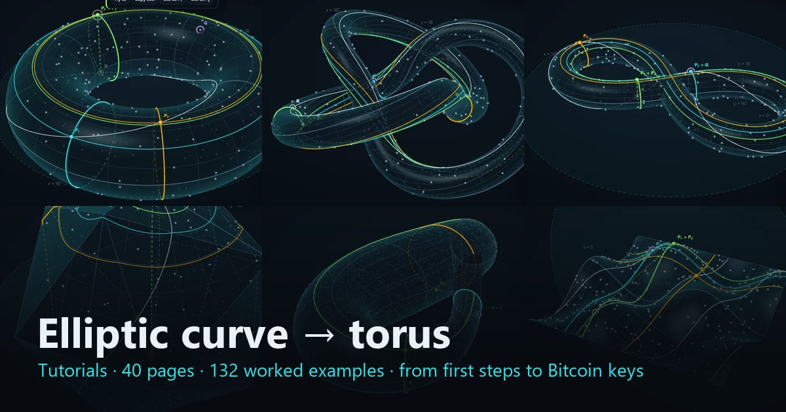](https://idlebg.com/idleGevrek/tutorials/)

Tutorials for **Elliptic curve → torus**, the single-file, offline visualizer of elliptic curves over finite fields
by Idle (idlebg.com). They show how to use it properly and what it can show, with many worked examples, for every
level: from no maths at all to Bitcoin keys and research on elliptic curves.

The visualizer draws the points of y² = x³ + ax + b over F_p on a donut (a torus) and on eight other shapes, with the
group law, negation as a mirror, the GLV endomorphism of Bitcoin’s curve, a flat map, orders and discrete logs on toy
curves, and every way of writing a public key.

## Four ways to read them

- **Online:** [idlebg.com/idleGevrek/tutorials](https://idlebg.com/idleGevrek/tutorials/), every page and screenshot; the examples open the visualizer on the same site.
- **In one file, offline:** [`elliptic_curve_torus_tutorials.html`](elliptic_curve_torus_tutorials.html) (14.2 MiB): every page, every screenshot and the visualizer in a single HTML file. GitHub shows HTML files as source, so use **Download raw file** on its page, then open the file in any current browser.
- **In a clone or a download of this repository:** open `tutorials/index.html`. The examples open `elliptic_curve_torus_visualizer_v3.html` at the top of the repository, so it all works offline.
- **Here on GitHub:** the chapters are Markdown and read well as they are; start at [11 Start here](chapters/11-start-here.md). There, **Open this view** opens the visualizer on idlebg.com.

## Where to start

| if you want to | read |
| --- | --- |
| just see what it does | 11 to 16: [Start here](chapters/11-start-here.md), [dots](chapters/12-cloud-of-dots.md), [donut](chapters/13-why-a-donut.md), [distance](chapters/14-how-far-apart.md), [mirror](chapters/15-mirror-images.md), [shapes](chapters/16-nine-shapes.md) |
| understand how Bitcoin keys work | 11, 13 to 15, then 31 to 36: [secp256k1](chapters/31-secp256k1.md), [private to public](chapters/32-private-to-public.md), [formats](chapters/33-key-formats.md), [parity](chapters/34-parity-taproot.md), [GLV](chapters/35-glv.md), [invalid points](chapters/36-invalid-points.md) |
| teach this | Level 1 and Level 2, then [96 For teachers](chapters/96-for-teachers.md) |
| research elliptic curves | [28](chapters/28-orders-subgroups.md) and [29](chapters/29-discrete-logs.md), then 41 to 49, from [The mapping](chapters/41-mapping.md) |

The four levels:

| level | for | assumes |
| --- | --- | --- |
| 1 Explorer | anyone curious | a browser and a mouse |
| 2 Learner | students, teachers, developers new to elliptic curves | school algebra; clock arithmetic is taught here |
| 3 Bitcoiner | Bitcoin users and developers | has heard of keys and addresses |
| 4 Researcher | mathematicians, cryptographers | groups and finite fields |

## Contents

### Level 1 · Explorer

| | |
| --- | --- |
| <a href="chapters/11-start-here.md">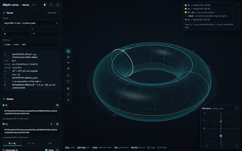</a> | **[11 Start here](chapters/11-start-here.md)** the screen, the mouse and keys, opening the examples · 4 examples |
| <a href="chapters/12-cloud-of-dots.md">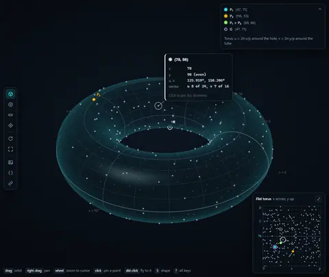</a> | **[12 A curve is a cloud of dots](chapters/12-cloud-of-dots.md)** every point of a small curve, cards, the Inspector · 5 examples |
| <a href="chapters/13-why-a-donut.md">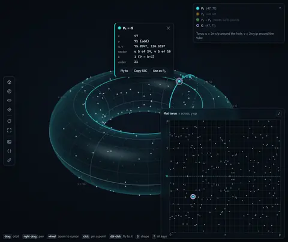</a> | **[13 Why a donut](chapters/13-why-a-donut.md)** numbers that wrap around, the flat map, guide rings · 5 examples |
| <a href="chapters/14-how-far-apart.md">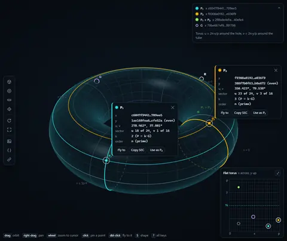</a> | **[14 Two points: how far apart?](chapters/14-how-far-apart.md)** “02 and 03” read three ways · 7 examples |
| <a href="chapters/15-mirror-images.md">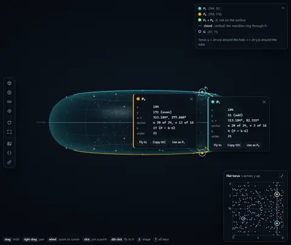</a> | **[15 Mirror images: 02 and 03](chapters/15-mirror-images.md)** every point and its mirror image, on every shape · 6 examples |
| <a href="chapters/16-nine-shapes.md">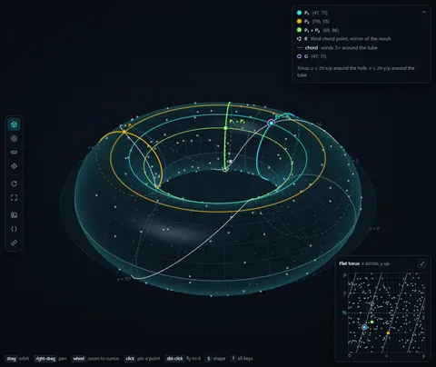</a> | **[16 One set of points, nine shapes](chapters/16-nine-shapes.md)** the same points on all nine shapes · 9 examples |
| <a href="chapters/17-save-share-export.md">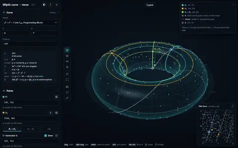</a> | **[17 Save, share, export](chapters/17-save-share-export.md)** links, PNG, JSON, what is remembered · 5 examples |
| <a href="chapters/18-make-it-look-right.md">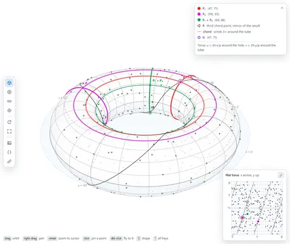</a> | **[18 Make it look right](chapters/18-make-it-look-right.md)** theme, sizes, glass, grid, labels · 8 examples |

### Level 2 · Learner

| | |
| --- | --- |
|  | **[21 Clock arithmetic and the curve equation](chapters/21-clock-arithmetic.md)** arithmetic mod p, and checking a point by hand · 3 examples |
| <a href="chapters/22-counting-points.md">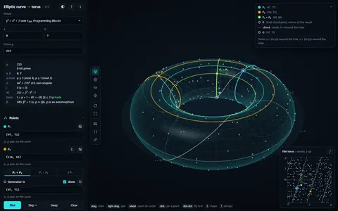</a> | **[22 Counting points](chapters/22-counting-points.md)** #E, the trace, and a count by hand · 2 examples |
| <a href="chapters/23-negation.md">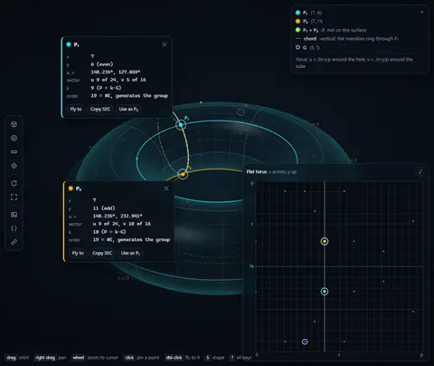</a> | **[23 Negation](chapters/23-negation.md)** −P = (x, p − y), and the points that are their own mirror image · 3 examples |
| <a href="chapters/24-chord.md">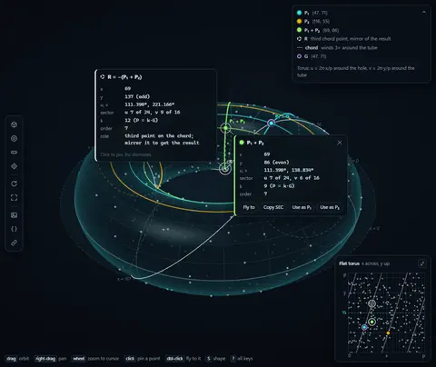</a> | **[24 Adding points: the chord](chapters/24-chord.md)** adding two points, and why the line winds around the donut · 5 examples |
| <a href="chapters/25-tangent.md">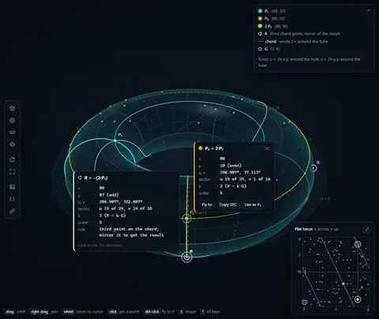</a> | **[25 Doubling: the tangent](chapters/25-tangent.md)** adding a point to itself · 3 examples |
| <a href="chapters/26-subtraction.md">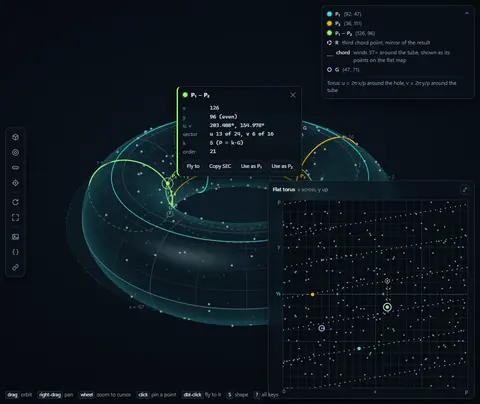</a> | **[26 Subtraction](chapters/26-subtraction.md)** subtracting is adding the mirror image · 3 examples |
| <a href="chapters/27-walking-multiples.md">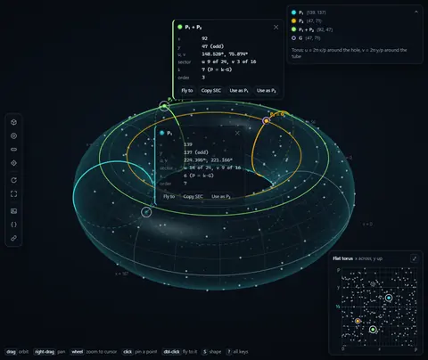</a> | **[27 Walking the multiples](chapters/27-walking-multiples.md)** Step through G, 2G, 3G, … and through the doublings · 3 examples |
| <a href="chapters/28-orders-subgroups.md">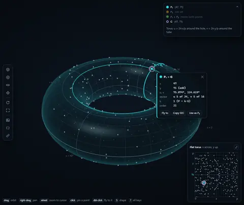</a> | **[28 Orders and subgroups](chapters/28-orders-subgroups.md)** the order of a point, the subgroup of G, the cofactor · 4 examples |
| <a href="chapters/29-discrete-logs.md">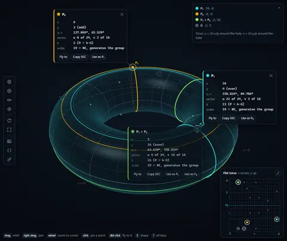</a> | **[29 Discrete logs on toy curves](chapters/29-discrete-logs.md)** finding k on small curves, and why not on Bitcoin’s · 3 examples |

### Level 3 · Bitcoiner

| | |
| --- | --- |
| <a href="chapters/31-secp256k1.md">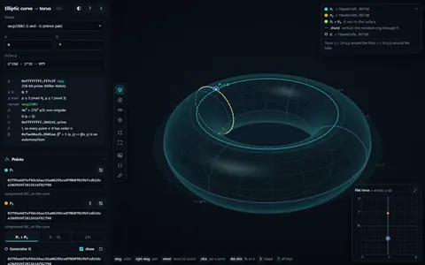</a> | **[31 secp256k1 in the panel](chapters/31-secp256k1.md)** Bitcoin’s curve and what Curve facts say about it · 3 examples |
| <a href="chapters/32-private-to-public.md">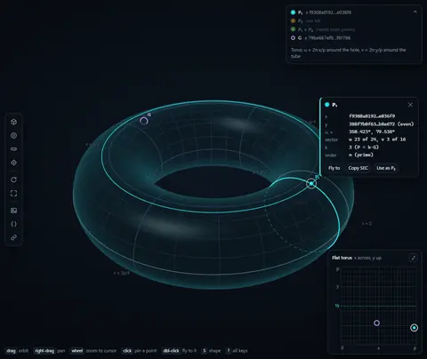</a> | **[32 Private key → public key](chapters/32-private-to-public.md)** a private key k and its public key kG · 5 examples |
| <a href="chapters/33-key-formats.md">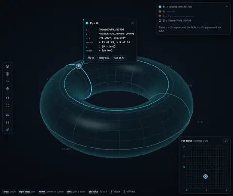</a> | **[33 Key formats](chapters/33-key-formats.md)** SEC 02/03, 04 and 06/07, x-only, (x, y), and every error · 2 examples |
| <a href="chapters/34-parity-taproot.md">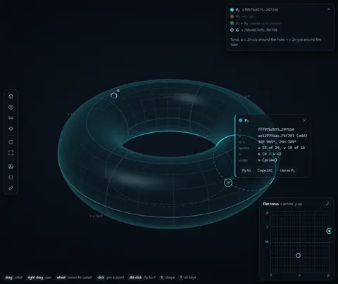</a> | **[34 Parity, 02/03 and Taproot](chapters/34-parity-taproot.md)** one bit of y, and x-only keys · 3 examples |
| <a href="chapters/35-glv.md">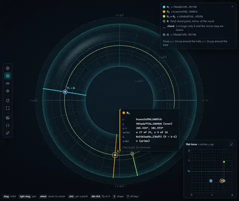</a> | **[35 The GLV endomorphism](chapters/35-glv.md)** β, λ, and the six keys that share three x values · 5 examples |
| <a href="chapters/36-invalid-points.md">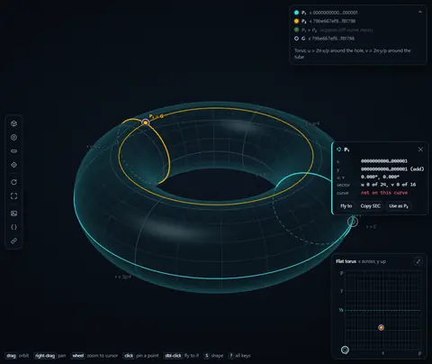</a> | **[36 Invalid points](chapters/36-invalid-points.md)** points off the curve, Force group law, and why keys are checked · 4 examples |
| <a href="chapters/37-points-in-bitcoin.md">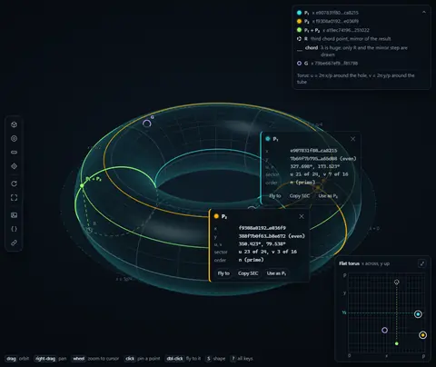</a> | **[37 Where points appear in Bitcoin](chapters/37-points-in-bitcoin.md)** BIP340 signatures, the Taproot tweak, BIP32 child keys · 5 examples |
| <a href="chapters/39-p256.md">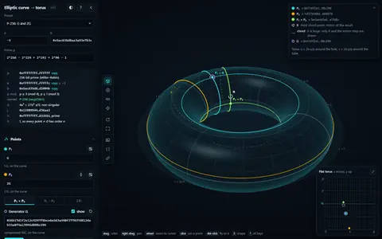</a> | **[39 P-256 next to secp256k1](chapters/39-p256.md)** the curve of TLS and passkeys, side by side with Bitcoin’s · 2 examples |

### Level 4 · Researcher

| | |
| --- | --- |
| <a href="chapters/41-mapping.md">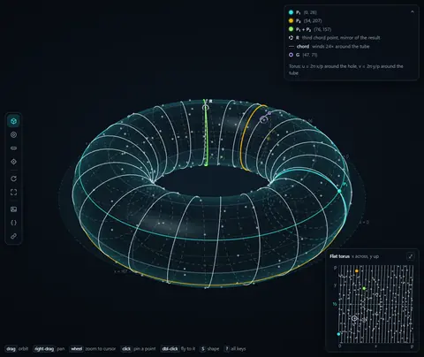</a> | **[41 The mapping](chapters/41-mapping.md)** how a point becomes a position, and what gets drawn · 4 examples |
| <a href="chapters/42-group-structure.md">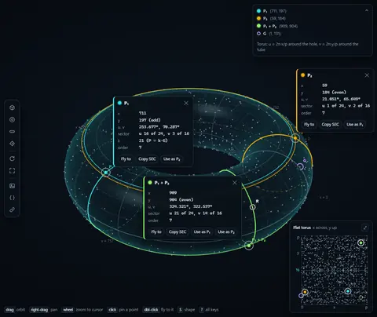</a> | **[42 Group structure](chapters/42-group-structure.md)** Z/m × Z/mn, 2-torsion, groups that are not cyclic · 2 examples |
| <a href="chapters/43-j-zero.md">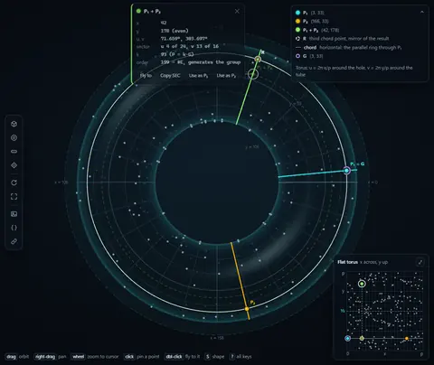</a> | **[43 j = 0 and its automorphisms](chapters/43-j-zero.md)** six automorphisms, and the supersingular case · 3 examples |
| <a href="chapters/44-twists.md">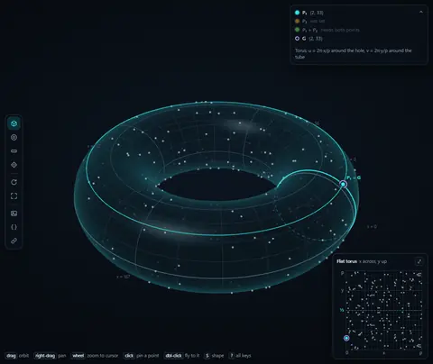</a> | **[44 Quadratic twists](chapters/44-twists.md)** every x is on the curve or on its twist · 2 examples |
| <a href="chapters/45-invalid-curve-attacks.md">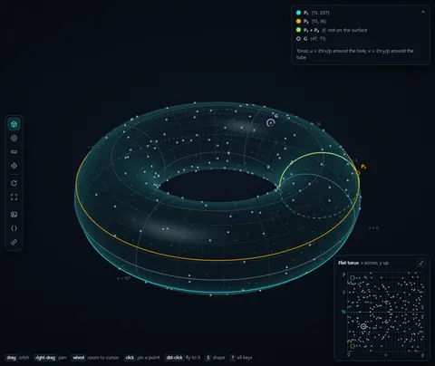</a> | **[45 Invalid-curve attacks](chapters/45-invalid-curve-attacks.md)** how an unchecked point leaks a secret key · 3 examples |
| <a href="chapters/46-singular-composite.md">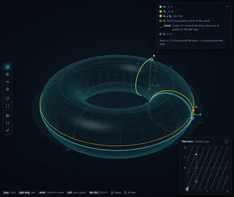</a> | **[46 Singular curves and composite moduli](chapters/46-singular-composite.md)** cusps, nodes, and Lenstra’s factoring idea · 3 examples |
| <a href="chapters/47-shapes-topology.md">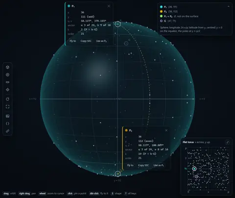</a> | **[47 Shapes as topology](chapters/47-shapes-topology.md)** which edges of the square each shape glues or cuts · 3 examples |
| <a href="chapters/48-scripting.md">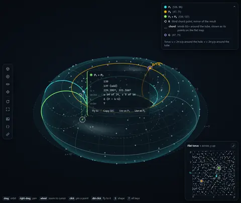</a> | **[48 Scripting with ecTorus](chapters/48-scripting.md)** the console API and the whole engine · 2 examples |
| <a href="chapters/49-trusting-numbers.md">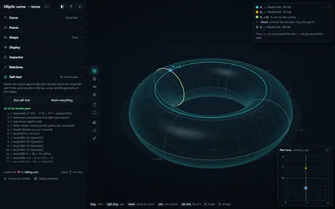</a> | **[49 Trusting the numbers](chapters/49-trusting-numbers.md)** the self-test, and how every claim was checked · 1 example |

### Reference

| | |
| --- | --- |
|  | **[91 Cookbook](chapters/91-cookbook.md)** one-line recipes |
|  | **[92 Exercises](chapters/92-exercises.md)** exercises for every level |
| <a href="chapters/93-answers.md">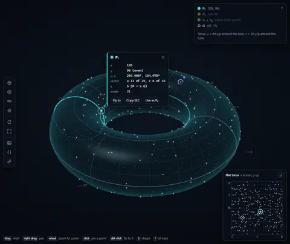</a> | **[93 Answers to the exercises](chapters/93-answers.md)** the answers, with the ones the visualizer confirms · 1 example |
|  | **[94 Glossary](chapters/94-glossary.md)** the words these tutorials use |
|  | **[95 FAQ and troubleshooting](chapters/95-faq.md)** short answers to common questions · 1 example |
|  | **[96 For teachers](chapters/96-for-teachers.md)** a 45-minute lesson and a 90-minute workshop |

## How the examples are checked

Every number, point, key, order or count in these tutorials is computed, never typed from memory, and checked twice:

1. **The live visualizer must show it.** Each example is built by a script that opens the tutorials’ copy of the visualizer, sets
   the state the way a person would, and checks the claims of the text against what the page computes and shows
   (its model and the text of its panel) before it takes the screenshot.
2. **An independent computation must agree.** Toy curves are checked by brute force, written separately from the
   visualizer; Bitcoin’s curve secp256k1 by the idleCore library and by OpenSSL; P-256 by OpenSSL.

[49 Trusting the numbers](chapters/49-trusting-numbers.md)
shows how to redo any claim yourself.

In all: 40 pages, 132 examples with a screenshot and a link, 144 more table rows with a link of their own, and 875 checks against the live visualizer.

## Version

These tutorials were built and checked against the visualizer v3.2.2, the copy at the top of this repository, SHA-256 `57b068d91e8c227af4066da6425144163eff10a671ef9f3852e3b1fb32663370`. They are generated from their source by the release tool; do not edit these files by hand.
