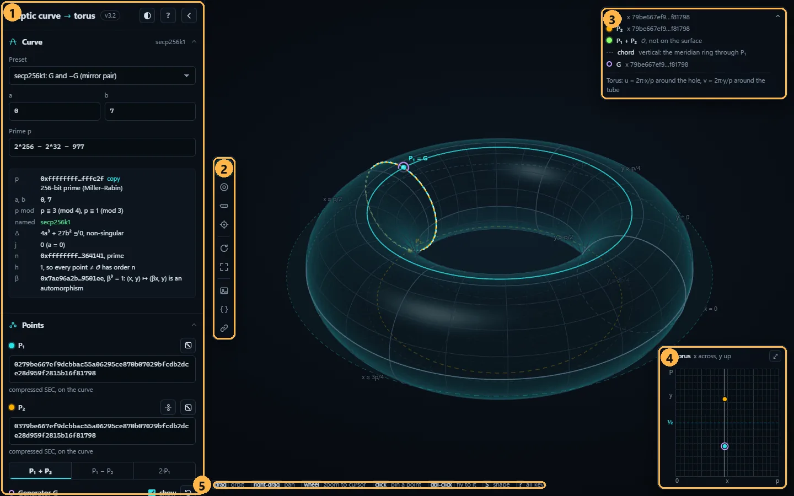
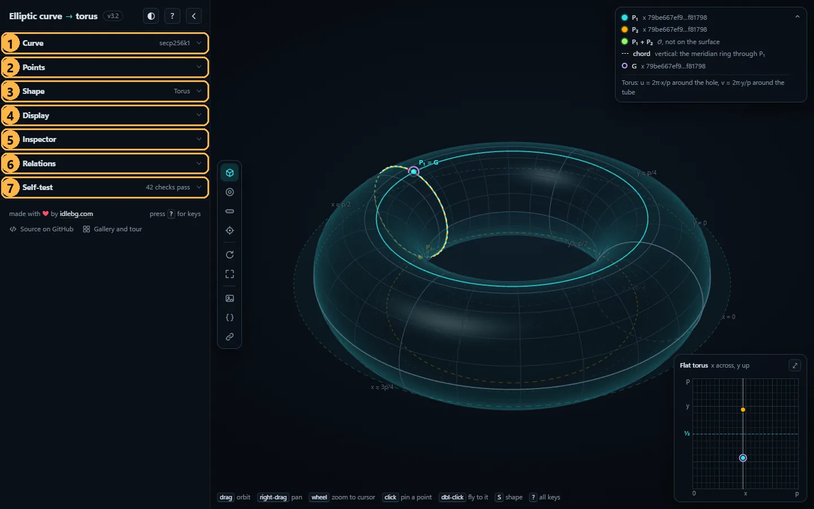
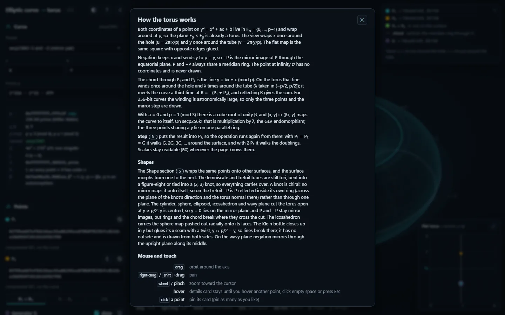
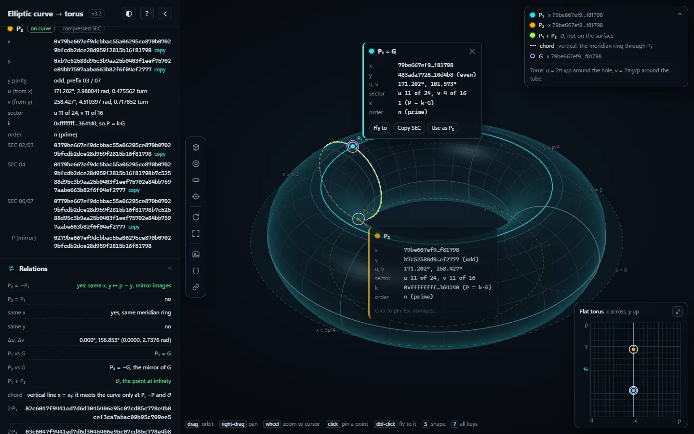

# 11 Start here

**Level 1 · Explorer.** You will learn how to open the visualizer, what each part of the screen does, how to move
around with the mouse and the keyboard, and how the examples in these tutorials work. Nothing to read first.

## What you need

- The file `elliptic_curve_torus_visualizer_v3.html`. The tutorials come with a copy of it, and every example in them
  opens that copy.
- A current browser: Chrome, Edge, Firefox or Safari. The 3D view needs WebGL 2, which every current browser has.
- No internet connection. The visualizer is a single file that loads nothing from the network, and these tutorials
  load nothing either.

To start, double-click the file (or drag it onto a browser window). It opens on Bitcoin’s curve, showing a point
called G and its mirror image. [15 Mirror images](15-mirror-images.md) explains that pair; for now, just look around.

## The parts of the screen

### Example 11.1 · The screen as it opens

**Open this view:** [the opening view](https://idlebg.com/idleGevrek/elliptic_curve_torus_visualizer_v3.html#s=eyJ2IjozLCJwcmVzZXQiOiJrMS1uZWciLCJiYXNlUHJlc2V0IjoiazEtbmVnIiwiYSI6IjAiLCJiIjoiNyIsInAiOiIyXjI1NiAtIDJeMzIgLSA5NzciLCJnIjoiMDI3OWJlNjY3ZWY5ZGNiYmFjNTVhMDYyOTVjZTg3MGIwNzAyOWJmY2RiMmRjZTI4ZDk1OWYyODE1YjE2ZjgxNzk4IiwicDEiOiIwMjc5YmU2NjdlZjlkY2JiYWM1NWEwNjI5NWNlODcwYjA3MDI5YmZjZGIyZGNlMjhkOTU5ZjI4MTViMTZmODE3OTgiLCJwMiI6IjAzNzliZTY2N2VmOWRjYmJhYzU1YTA2Mjk1Y2U4NzBiMDcwMjliZmNkYjJkY2UyOGQ5NTlmMjgxNWIxNmY4MTc5OCIsIm9wIjoiYWRkIiwic2hvd0ciOnRydWUsImZvcmNlIjpmYWxzZSwic2hhcGUiOiJ0b3J1cyIsIm1hcCI6InNjYWxlIiwiYml0cyI6MjQsInN1IjoyNCwic3YiOjE2LCJSIjoxLjIsInIiOjAuNDYsImdsYXNzIjowLjU1LCJiYWNrIjowLjQsInNob3ciOnsiZ3JpZCI6dHJ1ZSwicmluZ3MiOnRydWUsImxhYmVscyI6dHJ1ZSwiY2xvdWQiOnRydWUsImNob3JkIjp0cnVlLCJiZXRhIjpmYWxzZSwibWFwIjp0cnVlLCJzcGluIjpmYWxzZX0sInJpbmdzIjp7InAxIjp0cnVlLCJwMiI6dHJ1ZSwic3VtIjp0cnVlLCJnIjpmYWxzZX0sInRoZW1lIjoiZGFyayIsInBhbmVsIjp0cnVlLCJtaW5pQmlnIjpmYWxzZSwibGVnZW5kTWluIjpmYWxzZSwic2VjcyI6eyJjdXJ2ZSI6dHJ1ZSwicG9pbnRzIjp0cnVlLCJzaGFwZSI6dHJ1ZSwidmlldyI6dHJ1ZSwiaW5zcGVjdG9yIjp0cnVlLCJyZWxhdGlvbnMiOnRydWUsInRlc3QiOmZhbHNlfX0)

**Do it yourself**

1. In **Curve**, pick the preset **secp256k1: G and −G (mirror pair)**.

**Look at** the five numbered parts:

1. **The panel**, on the left. Everything you type or switch lives here, in sections (Example 11.2).
2. **The toolbar**, a narrow column of buttons beside the 3D view. Hover a button to read what it does; the table
   below lists them all.
3. **The legend**, top right. It names each coloured point and says how the shape maps the numbers. The small arrow
   at its corner makes it compact.
4. **The flat map**, bottom right, titled “Flat torus” with “x across, y up”. It is the donut cut open and laid
   flat ([13 Why a donut](13-why-a-donut.md)). The ⤢ button enlarges it.
5. **The hints**, along the bottom: drag to orbit, right-drag to pan, the wheel to zoom, click to pin a point,
   double-click to fly to it, **S** for the next shape and **?** for all the keys.

Everything else is the **3D view**: a glass donut with a grid on it, and coloured points on its surface.

The toolbar, from top to bottom (each name is the button’s own tooltip):

| button | what it does |
| --- | --- |
| Oblique view (1) | the slanted view the page opens with |
| Top view (2) | looking straight down at the donut |
| Side view, the mirror plane edge-on (3) | looking from the side |
| Reset the camera (R) | back to the oblique view, framed |
| Auto-rotate (Space) | the donut turns slowly by itself |
| Full screen | the whole page fills the screen |
| Save the view as PNG | downloads a picture of the 3D view |
| Export the state and every point as JSON | downloads every number as a text file |
| Copy a link that restores this exact state | copies a link to everything on screen |

[17 Save, share, export](17-save-share-export.md) shows the last three in action.

### Example 11.2 · The seven sections of the panel

**Open this view:** [every section closed](https://idlebg.com/idleGevrek/elliptic_curve_torus_visualizer_v3.html#s=eyJ2IjozLCJwcmVzZXQiOiJrMS1uZWciLCJiYXNlUHJlc2V0IjoiazEtbmVnIiwiYSI6IjAiLCJiIjoiNyIsInAiOiIyXjI1NiAtIDJeMzIgLSA5NzciLCJnIjoiMDI3OWJlNjY3ZWY5ZGNiYmFjNTVhMDYyOTVjZTg3MGIwNzAyOWJmY2RiMmRjZTI4ZDk1OWYyODE1YjE2ZjgxNzk4IiwicDEiOiIwMjc5YmU2NjdlZjlkY2JiYWM1NWEwNjI5NWNlODcwYjA3MDI5YmZjZGIyZGNlMjhkOTU5ZjI4MTViMTZmODE3OTgiLCJwMiI6IjAzNzliZTY2N2VmOWRjYmJhYzU1YTA2Mjk1Y2U4NzBiMDcwMjliZmNkYjJkY2UyOGQ5NTlmMjgxNWIxNmY4MTc5OCIsIm9wIjoiYWRkIiwic2hvd0ciOnRydWUsImZvcmNlIjpmYWxzZSwic2hhcGUiOiJ0b3J1cyIsIm1hcCI6InNjYWxlIiwiYml0cyI6MjQsInN1IjoyNCwic3YiOjE2LCJSIjoxLjIsInIiOjAuNDYsImdsYXNzIjowLjU1LCJiYWNrIjowLjQsInNob3ciOnsiZ3JpZCI6dHJ1ZSwicmluZ3MiOnRydWUsImxhYmVscyI6dHJ1ZSwiY2xvdWQiOnRydWUsImNob3JkIjp0cnVlLCJiZXRhIjpmYWxzZSwibWFwIjp0cnVlLCJzcGluIjpmYWxzZX0sInJpbmdzIjp7InAxIjp0cnVlLCJwMiI6dHJ1ZSwic3VtIjp0cnVlLCJnIjpmYWxzZX0sInRoZW1lIjoiZGFyayIsInBhbmVsIjp0cnVlLCJtaW5pQmlnIjpmYWxzZSwibGVnZW5kTWluIjpmYWxzZSwic2VjcyI6eyJjdXJ2ZSI6ZmFsc2UsInBvaW50cyI6ZmFsc2UsInNoYXBlIjpmYWxzZSwidmlldyI6ZmFsc2UsImluc3BlY3RvciI6ZmFsc2UsInJlbGF0aW9ucyI6ZmFsc2UsInRlc3QiOmZhbHNlfX0)

**Do it yourself**

1. In **Curve**, pick the preset **secp256k1: G and −G (mirror pair)**.
2. Close the **Curve**, **Points**, **Shape**, **Display**, **Inspector** and **Relations** sections (click the heading).

**Look at** the seven section headings. Click a heading to open or close its section; the visualizer remembers which
ones are open.

1. **Curve**: which curve is drawn. The **Preset** menu picks a ready-made one; below it are the curve’s numbers and
   a list of facts about it.
2. **Points**: the two points **P₁** and **P₂**, the operation that combines them, the generator **G**, and the
   buttons **Plot**, **Step ▸**, **Swap** and **Clear**.
3. **Shape**: the donut or one of eight other shapes, and two size sliders.
4. **Display**: what is drawn (grid, rings, labels, every curve point, and more), glass and line strength, and how
   numbers become angles.
5. **Inspector**: every detail of the last point you hovered.
6. **Relations**: how P₁ and P₂ relate: mirror images or not, how far apart, their sum, and more.
7. **Self-test**: the page checks its own maths when it opens; the heading then says “42 checks pass”. The section
   also holds **Reset everything**.

## Moving around

With a mouse:

- **drag** to turn the donut around (orbit);
- **right-drag**, or **Shift** + drag, to slide it sideways (pan);
- turn the **wheel** to zoom toward the mouse pointer;
- **hover** a point to see its card; the card stays until you hover another point;
- **click** a point to pin its card, as many as you like; click it again to unpin;
- **double-click** a point to fly the camera to it.

On a touch screen: drag with one finger to orbit, pinch to zoom, tap a point to pin it.

### Example 11.3 · The help dialog: every key

**Open this view:** [the opening view (then press ?)](https://idlebg.com/idleGevrek/elliptic_curve_torus_visualizer_v3.html#s=eyJ2IjozLCJwcmVzZXQiOiJrMS1uZWciLCJiYXNlUHJlc2V0IjoiazEtbmVnIiwiYSI6IjAiLCJiIjoiNyIsInAiOiIyXjI1NiAtIDJeMzIgLSA5NzciLCJnIjoiMDI3OWJlNjY3ZWY5ZGNiYmFjNTVhMDYyOTVjZTg3MGIwNzAyOWJmY2RiMmRjZTI4ZDk1OWYyODE1YjE2ZjgxNzk4IiwicDEiOiIwMjc5YmU2NjdlZjlkY2JiYWM1NWEwNjI5NWNlODcwYjA3MDI5YmZjZGIyZGNlMjhkOTU5ZjI4MTViMTZmODE3OTgiLCJwMiI6IjAzNzliZTY2N2VmOWRjYmJhYzU1YTA2Mjk1Y2U4NzBiMDcwMjliZmNkYjJkY2UyOGQ5NTlmMjgxNWIxNmY4MTc5OCIsIm9wIjoiYWRkIiwic2hvd0ciOnRydWUsImZvcmNlIjpmYWxzZSwic2hhcGUiOiJ0b3J1cyIsIm1hcCI6InNjYWxlIiwiYml0cyI6MjQsInN1IjoyNCwic3YiOjE2LCJSIjoxLjIsInIiOjAuNDYsImdsYXNzIjowLjU1LCJiYWNrIjowLjQsInNob3ciOnsiZ3JpZCI6dHJ1ZSwicmluZ3MiOnRydWUsImxhYmVscyI6dHJ1ZSwiY2xvdWQiOnRydWUsImNob3JkIjp0cnVlLCJiZXRhIjpmYWxzZSwibWFwIjp0cnVlLCJzcGluIjpmYWxzZX0sInJpbmdzIjp7InAxIjp0cnVlLCJwMiI6dHJ1ZSwic3VtIjp0cnVlLCJnIjpmYWxzZX0sInRoZW1lIjoiZGFyayIsInBhbmVsIjp0cnVlLCJtaW5pQmlnIjpmYWxzZSwibGVnZW5kTWluIjpmYWxzZSwic2VjcyI6eyJjdXJ2ZSI6dHJ1ZSwicG9pbnRzIjp0cnVlLCJzaGFwZSI6dHJ1ZSwidmlldyI6dHJ1ZSwiaW5zcGVjdG9yIjp0cnVlLCJyZWxhdGlvbnMiOnRydWUsInRlc3QiOmZhbHNlfX0)

**Do it yourself**

1. In **Curve**, pick the preset **secp256k1: G and −G (mirror pair)**.
2. Press **?** (or click **?** at the top of the panel) to open the help; **Esc** or ✕ closes it.

**Look at** the list of keys. You do not need to learn them now; these few are enough to start:

| key | does |
| --- | --- |
| <kbd>?</kbd> | opens this help |
| <kbd>1</kbd> <kbd>2</kbd> <kbd>3</kbd> | oblique, top and side view |
| <kbd>R</kbd> | resets the camera |
| <kbd>Space</kbd> | starts or stops auto-rotate |
| <kbd>T</kbd> | switches between the dark and the paper theme |
| <kbd>\\</kbd> | hides or shows the panel |
| <kbd>Esc</kbd> | drops the hover card, then the pinned cards |

The keys work whenever you are not typing in a field: if a key seems to do nothing, click on the 3D view first.

### Example 11.4 · Hover and pin: the cards

**Open this view:** [G and −G](https://idlebg.com/idleGevrek/elliptic_curve_torus_visualizer_v3.html#s=eyJ2IjozLCJwcmVzZXQiOiJrMS1uZWciLCJiYXNlUHJlc2V0IjoiazEtbmVnIiwiYSI6IjAiLCJiIjoiNyIsInAiOiIyXjI1NiAtIDJeMzIgLSA5NzciLCJnIjoiMDI3OWJlNjY3ZWY5ZGNiYmFjNTVhMDYyOTVjZTg3MGIwNzAyOWJmY2RiMmRjZTI4ZDk1OWYyODE1YjE2ZjgxNzk4IiwicDEiOiIwMjc5YmU2NjdlZjlkY2JiYWM1NWEwNjI5NWNlODcwYjA3MDI5YmZjZGIyZGNlMjhkOTU5ZjI4MTViMTZmODE3OTgiLCJwMiI6IjAzNzliZTY2N2VmOWRjYmJhYzU1YTA2Mjk1Y2U4NzBiMDcwMjliZmNkYjJkY2UyOGQ5NTlmMjgxNWIxNmY4MTc5OCIsIm9wIjoiYWRkIiwic2hvd0ciOnRydWUsImZvcmNlIjpmYWxzZSwic2hhcGUiOiJ0b3J1cyIsIm1hcCI6InNjYWxlIiwiYml0cyI6MjQsInN1IjoyNCwic3YiOjE2LCJSIjoxLjIsInIiOjAuNDYsImdsYXNzIjowLjU1LCJiYWNrIjowLjQsInNob3ciOnsiZ3JpZCI6dHJ1ZSwicmluZ3MiOnRydWUsImxhYmVscyI6dHJ1ZSwiY2xvdWQiOnRydWUsImNob3JkIjp0cnVlLCJiZXRhIjpmYWxzZSwibWFwIjp0cnVlLCJzcGluIjpmYWxzZX0sInJpbmdzIjp7InAxIjp0cnVlLCJwMiI6dHJ1ZSwic3VtIjp0cnVlLCJnIjpmYWxzZX0sInRoZW1lIjoiZGFyayIsInBhbmVsIjp0cnVlLCJtaW5pQmlnIjpmYWxzZSwibGVnZW5kTWluIjpmYWxzZSwic2VjcyI6eyJjdXJ2ZSI6dHJ1ZSwicG9pbnRzIjp0cnVlLCJzaGFwZSI6dHJ1ZSwidmlldyI6dHJ1ZSwiaW5zcGVjdG9yIjp0cnVlLCJyZWxhdGlvbnMiOnRydWUsInRlc3QiOmZhbHNlfX0)

**Do it yourself**

1. In **Curve**, pick the preset **secp256k1: G and −G (mirror pair)**.
2. In the 3D view, click P₁ to pin its card.
3. In the 3D view, hover P₂; its card stays until you hover another point.
4. Read the **Inspector** section in the panel.

**Look at:**

- the pinned card of P₁, titled “P₁ = G” because P₁ and G are the same point here. Its buttons: **Fly to** moves the
  camera to the point, **Copy SEC** copies the point as a Bitcoin public key, and **Use as P₂** copies the point into
  the P₂ field (a card of another point also offers **Use as P₁**). The ✕ unpins it;
- the hover card of P₂, lighter, with the hint “Click to pin. Esc dismisses.”;
- the **Inspector** in the panel: the full details of the last point you hovered, with copy buttons.

**Why:** cards show the short version of each number, so they fit on screen. The Inspector shows the full values, and
its copy buttons copy them exactly.

## Opening the examples in these tutorials

Every example has:

- a **screenshot** of the visualizer (click it to see it full size);
- **Open this view**: a link that opens the tutorials’ copy of the visualizer in exactly the state of the
  screenshot, in a new tab. The link carries everything after `#s=`, so it works offline;
- **Do it yourself**: the same state built by hand, step by step, starting from the view the page opens with;
- **Look at** and **Why**: what to notice, and why it looks that way.

> **Opening an example replaces your current view.** The visualizer remembers its last state in the browser, and
> opening a link overwrites it. To keep something you built, click **Copy a link that restores this exact state**
> in the toolbar first and save the link somewhere.

To go back to the beginning at any time, open **Self-test** and click **Reset everything** (its tooltip: “Forget
saved settings and reload the default view”). The “Do it yourself” steps assume you start from there.

## Try it yourself

- Press <kbd>Space</kbd> and let the donut turn; press it again to stop.
- Press <kbd>2</kbd>, then <kbd>3</kbd>, then <kbd>1</kbd>, and watch the camera move between the three views.
- Press <kbd>T</kbd> twice: paper theme, then dark again.
- Hover the purple ring marked G, then press <kbd>Esc</kbd>.

## Recap

- The panel on the left holds seven sections; the toolbar, legend, flat map and hints surround the 3D view.
- Drag to orbit, wheel to zoom, hover for a card, click to pin; <kbd>?</kbd> lists every key.
- “Open this view” replaces your current view; Copy link keeps yours, and Reset everything starts over.

Next: [12 A curve is a cloud of dots](12-cloud-of-dots.md).
