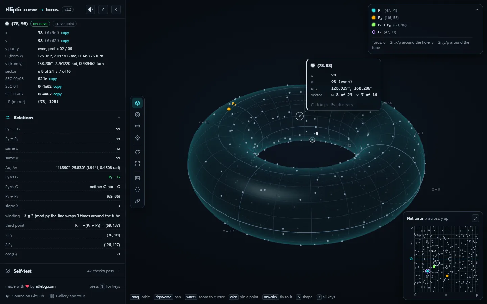
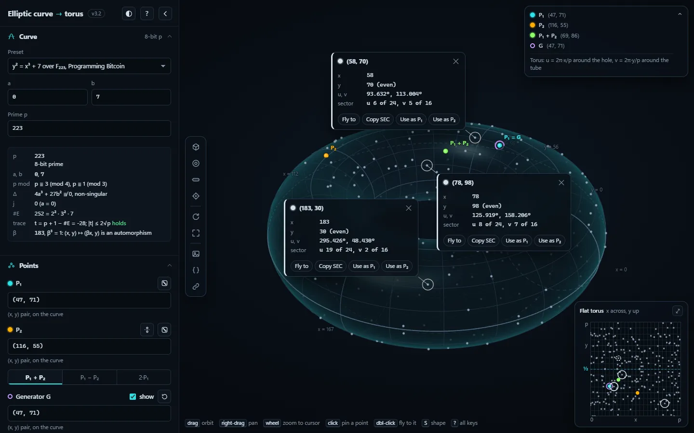
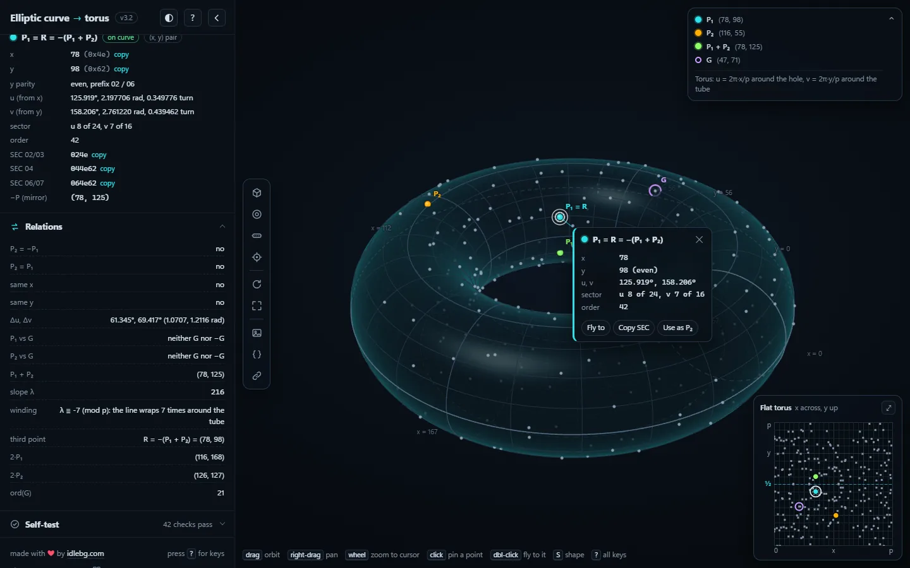
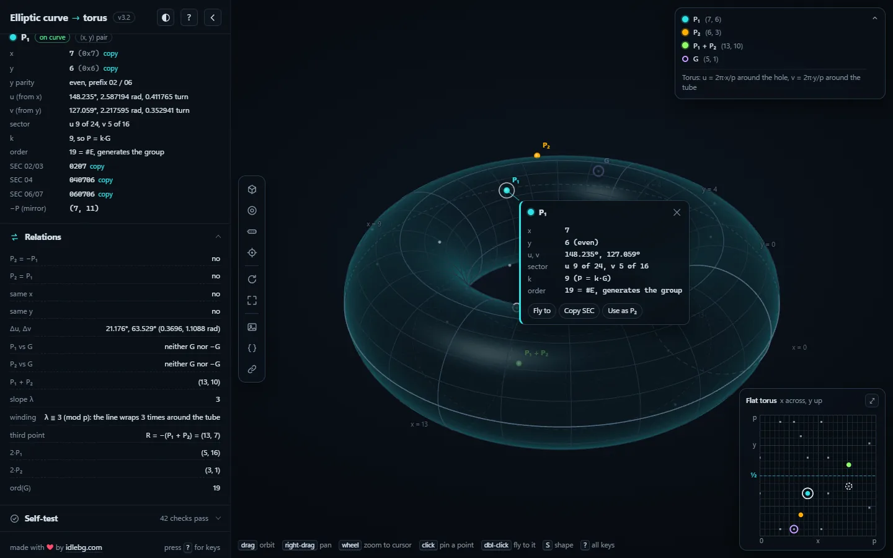
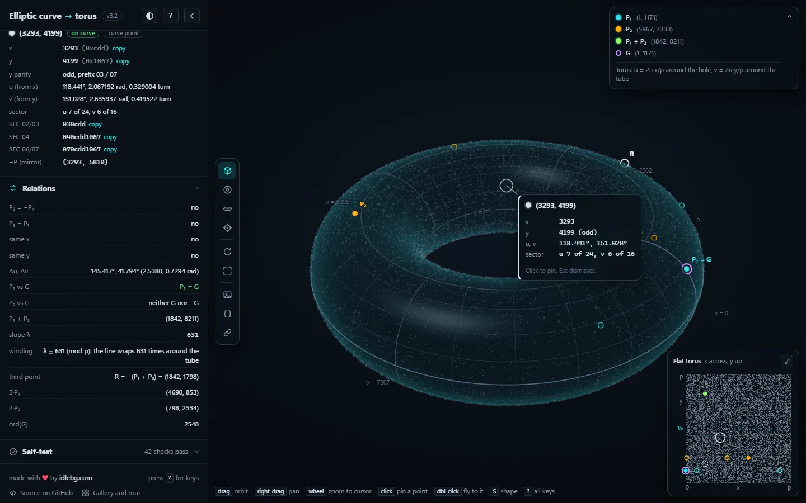

# 12 A curve is a cloud of dots

**Level 1 · Explorer.** You will learn what the dots on the donut are, how to read a point’s card and the Inspector,
and how many points a curve has. Read first: [11 Start here](11-start-here.md).

At school, a curve is a line you draw through the plane. The curves in this visualizer are different: their points
are pairs of **whole numbers** (x, y), and only some pairs belong to the curve. So the curve is not a line at all. It
is a cloud of separate dots.

Which pairs belong is decided by a rule such as y² = x³ + 7, worked out on a clock with p hours instead of on the
number line: every number wraps around to 0 when it reaches p. [21 Clock arithmetic](21-clock-arithmetic.md) shows
how to check the rule by hand. Here we only look at the result.

The visualizer can draw every dot when p is at most 262 144. The switch is **All curve points** in **Display** (key
**C**); it is on for the toy-curve presets. For Bitcoin’s curve, where p has 78 digits, no computer could list the
dots, so only the points you type are drawn.

### Example 12.1 · Every point of y² = x³ + 7 over F₂₂₃

The preset “y² = x³ + 7 over F₂₂₃, Programming Bitcoin” uses p = 223, so both coordinates run from 0 to 222. F₂₂₃
(“F two hundred twenty-three”) is the name of that clock.

**Open this view:** [every point of F₂₂₃](https://idlebg.com/idleGevrek/elliptic_curve_torus_visualizer_v3.html#s=eyJ2IjozLCJwcmVzZXQiOiJwYjIyMyIsImJhc2VQcmVzZXQiOiJwYjIyMyIsImEiOiIwIiwiYiI6IjciLCJwIjoiMjIzIiwiZyI6Iig0NywgNzEpIiwicDEiOiIoNDcsIDcxKSIsInAyIjoiKDExNiwgNTUpIiwib3AiOiJhZGQiLCJzaG93RyI6dHJ1ZSwiZm9yY2UiOmZhbHNlLCJzaGFwZSI6InRvcnVzIiwibWFwIjoic2NhbGUiLCJiaXRzIjoyNCwic3UiOjI0LCJzdiI6MTYsIlIiOjEuMiwiciI6MC40NiwiZ2xhc3MiOjAuNTUsImJhY2siOjAuNCwic2hvdyI6eyJncmlkIjp0cnVlLCJyaW5ncyI6ZmFsc2UsImxhYmVscyI6dHJ1ZSwiY2xvdWQiOnRydWUsImNob3JkIjpmYWxzZSwiYmV0YSI6ZmFsc2UsIm1hcCI6dHJ1ZSwic3BpbiI6ZmFsc2V9LCJyaW5ncyI6eyJwMSI6dHJ1ZSwicDIiOnRydWUsInN1bSI6dHJ1ZSwiZyI6ZmFsc2V9LCJ0aGVtZSI6ImRhcmsiLCJwYW5lbCI6dHJ1ZSwibWluaUJpZyI6ZmFsc2UsImxlZ2VuZE1pbiI6ZmFsc2UsInNlY3MiOnsiY3VydmUiOnRydWUsInBvaW50cyI6dHJ1ZSwic2hhcGUiOnRydWUsInZpZXciOnRydWUsImluc3BlY3RvciI6dHJ1ZSwicmVsYXRpb25zIjp0cnVlLCJ0ZXN0IjpmYWxzZX19)

**Do it yourself**

1. In **Curve**, pick the preset **y² = x³ + 7 over F₂₂₃, Programming Bitcoin**.
2. In **Display**, turn off **Guide rings** and **Chord construction** (**K**).
3. In the 3D view, hover the point (78, 98); its card stays until you hover another point.
4. Read the **Inspector** section in the panel.

**Look at:**

- the dots: 251 of them, scattered over the whole donut, front and back;
- the **Curve** section: the row **#E** (“the number of points of E”) says 252 = 2² · 3² · 7. The extra point is the
  [point at infinity](94-glossary.md#point-at-infinity) 𝒪, a point with no coordinates that every curve has and that
  is never drawn;
- the hovered dot (78, 98) and its card: x and y, then u, v = 125.919°, 158.206° (where it sits around the hole and
  around the tube), and the grid sector it falls in;
- the **Inspector**, with the full details: x and y in decimal and in hex, whether y is even or odd, the angles in
  degrees, radians and turns, and the point written in every Bitcoin format (`024e` is its compressed form). The last
  row, −P, is its mirror image (78, 125).

**Why:** a dot’s card says where the dot is. The coloured points you type into the panel get more: the next examples
show how to turn any dot into one of them.

### Example 12.2 · Pin as many as you like

**Open this view:** [F₂₂₃, three dots pinned](https://idlebg.com/idleGevrek/elliptic_curve_torus_visualizer_v3.html#s=eyJ2IjozLCJwcmVzZXQiOiJwYjIyMyIsImJhc2VQcmVzZXQiOiJwYjIyMyIsImEiOiIwIiwiYiI6IjciLCJwIjoiMjIzIiwiZyI6Iig0NywgNzEpIiwicDEiOiIoNDcsIDcxKSIsInAyIjoiKDExNiwgNTUpIiwib3AiOiJhZGQiLCJzaG93RyI6dHJ1ZSwiZm9yY2UiOmZhbHNlLCJzaGFwZSI6InRvcnVzIiwibWFwIjoic2NhbGUiLCJiaXRzIjoyNCwic3UiOjI0LCJzdiI6MTYsIlIiOjEuMiwiciI6MC40NiwiZ2xhc3MiOjAuNTUsImJhY2siOjAuNCwic2hvdyI6eyJncmlkIjp0cnVlLCJyaW5ncyI6ZmFsc2UsImxhYmVscyI6dHJ1ZSwiY2xvdWQiOnRydWUsImNob3JkIjpmYWxzZSwiYmV0YSI6ZmFsc2UsIm1hcCI6dHJ1ZSwic3BpbiI6ZmFsc2V9LCJyaW5ncyI6eyJwMSI6dHJ1ZSwicDIiOnRydWUsInN1bSI6dHJ1ZSwiZyI6ZmFsc2V9LCJ0aGVtZSI6ImRhcmsiLCJwYW5lbCI6dHJ1ZSwibWluaUJpZyI6ZmFsc2UsImxlZ2VuZE1pbiI6ZmFsc2UsInNlY3MiOnsiY3VydmUiOnRydWUsInBvaW50cyI6dHJ1ZSwic2hhcGUiOnRydWUsInZpZXciOnRydWUsImluc3BlY3RvciI6dHJ1ZSwicmVsYXRpb25zIjp0cnVlLCJ0ZXN0IjpmYWxzZX19)

**Do it yourself**

1. In **Curve**, pick the preset **y² = x³ + 7 over F₂₂₃, Programming Bitcoin**.
2. In **Display**, turn off **Guide rings** and **Chord construction** (**K**).
3. In the 3D view, click the point (78, 98), the point (183, 30) and the point (58, 70) to pin their cards.

**Look at:** three pinned cards, each with a thin leader line to its dot. Pinned cards follow the camera when you turn
the donut, move out of each other’s way and avoid the legend and the flat map. When their dot goes behind the donut,
the card fades.

**Why:** pinning is the way to compare several points. Each pinned card has four buttons: **Fly to**, **Copy SEC**,
**Use as P₁** and **Use as P₂**. Click a dot again, or its ✕, to unpin it; <kbd>Esc</kbd> drops the hover card first
and then every pin.

### Example 12.3 · Use as P₁: a dot’s order

Pin the dot (78, 98) and click **Use as P₁** on its card. The button writes the dot into the P₁ field as `(78, 98)`,
exactly what you could type yourself.

**Open this view:** [(78, 98) as P₁](https://idlebg.com/idleGevrek/elliptic_curve_torus_visualizer_v3.html#s=eyJ2IjozLCJwcmVzZXQiOiJjdXN0b20iLCJiYXNlUHJlc2V0IjoicGIyMjMiLCJhIjoiMCIsImIiOiI3IiwicCI6IjIyMyIsImciOiIoNDcsIDcxKSIsInAxIjoiKDc4LCA5OCkiLCJwMiI6IigxMTYsIDU1KSIsIm9wIjoiYWRkIiwic2hvd0ciOnRydWUsImZvcmNlIjpmYWxzZSwic2hhcGUiOiJ0b3J1cyIsIm1hcCI6InNjYWxlIiwiYml0cyI6MjQsInN1IjoyNCwic3YiOjE2LCJSIjoxLjIsInIiOjAuNDYsImdsYXNzIjowLjU1LCJiYWNrIjowLjQsInNob3ciOnsiZ3JpZCI6dHJ1ZSwicmluZ3MiOmZhbHNlLCJsYWJlbHMiOnRydWUsImNsb3VkIjp0cnVlLCJjaG9yZCI6ZmFsc2UsImJldGEiOmZhbHNlLCJtYXAiOnRydWUsInNwaW4iOmZhbHNlfSwicmluZ3MiOnsicDEiOnRydWUsInAyIjp0cnVlLCJzdW0iOnRydWUsImciOmZhbHNlfSwidGhlbWUiOiJkYXJrIiwicGFuZWwiOnRydWUsIm1pbmlCaWciOmZhbHNlLCJsZWdlbmRNaW4iOmZhbHNlLCJzZWNzIjp7ImN1cnZlIjp0cnVlLCJwb2ludHMiOnRydWUsInNoYXBlIjp0cnVlLCJ2aWV3Ijp0cnVlLCJpbnNwZWN0b3IiOnRydWUsInJlbGF0aW9ucyI6dHJ1ZSwidGVzdCI6ZmFsc2V9fQ)

**Do it yourself**

1. In **Curve**, pick the preset **y² = x³ + 7 over F₂₂₃, Programming Bitcoin**.
2. Type `(78, 98)` in **P₁**.
3. In **Display**, turn off **Guide rings** and **Chord construction** (**K**).
4. In the 3D view, click P₁ to pin its card.
5. Read the **Inspector** section in the panel.

**Look at:** the card of P₁, now with an **order** row: its order, 42. There is still no **k** row.

**Why:** the order says how many times you can add the point to itself before you reach 𝒪
([28 Orders and subgroups](28-orders-subgroups.md)). The k row would say which multiple of G the point is, but
(78, 98) is not a multiple of G at all. G has order 21 here: its multiples are G, 2G and so on up to 20G, and the
21st is 𝒪 again. So only 20 of the 251 dots are multiples of G, and only those get a k.

### Example 12.4 · A tiny curve: 18 dots and 𝒪

The preset “y² = x³ + 2x + 2 over F₁₇, Paar & Pelzl” is a textbook curve on a clock with only 17 hours. Here P₁ is
the dot (7, 6).

**Open this view:** [every point of F₁₇, P₁ = (7, 6)](https://idlebg.com/idleGevrek/elliptic_curve_torus_visualizer_v3.html#s=eyJ2IjozLCJwcmVzZXQiOiJjdXN0b20iLCJiYXNlUHJlc2V0IjoicHAxNyIsImEiOiIyIiwiYiI6IjIiLCJwIjoiMTciLCJnIjoiKDUsIDEpIiwicDEiOiIoNywgNikiLCJwMiI6Iig2LCAzKSIsIm9wIjoiYWRkIiwic2hvd0ciOnRydWUsImZvcmNlIjpmYWxzZSwic2hhcGUiOiJ0b3J1cyIsIm1hcCI6InNjYWxlIiwiYml0cyI6MjQsInN1IjoyNCwic3YiOjE2LCJSIjoxLjIsInIiOjAuNDYsImdsYXNzIjowLjU1LCJiYWNrIjowLjQsInNob3ciOnsiZ3JpZCI6dHJ1ZSwicmluZ3MiOmZhbHNlLCJsYWJlbHMiOnRydWUsImNsb3VkIjp0cnVlLCJjaG9yZCI6ZmFsc2UsImJldGEiOmZhbHNlLCJtYXAiOnRydWUsInNwaW4iOmZhbHNlfSwicmluZ3MiOnsicDEiOnRydWUsInAyIjp0cnVlLCJzdW0iOnRydWUsImciOmZhbHNlfSwidGhlbWUiOiJkYXJrIiwicGFuZWwiOnRydWUsIm1pbmlCaWciOmZhbHNlLCJsZWdlbmRNaW4iOmZhbHNlLCJzZWNzIjp7ImN1cnZlIjp0cnVlLCJwb2ludHMiOnRydWUsInNoYXBlIjp0cnVlLCJ2aWV3Ijp0cnVlLCJpbnNwZWN0b3IiOnRydWUsInJlbGF0aW9ucyI6dHJ1ZSwidGVzdCI6ZmFsc2V9fQ)

**Do it yourself**

1. In **Curve**, pick the preset **y² = x³ + 2x + 2 over F₁₇, Paar & Pelzl**.
2. Type `(7, 6)` in **P₁**.
3. In **Display**, turn off **Guide rings** and **Chord construction** (**K**).
4. In the 3D view, click P₁ to pin its card.
5. Read the **Inspector** section in the panel.

**Look at:**

- only 18 dots. With 𝒪 the curve has 19 points, and the **#E** row says “19 = 19, prime”;
- the card of P₁ = (7, 6): k = 9, so this dot is 9G, nine steps of the curve’s own addition from G = (5, 1);
- its order row: “19 = #E, generates the group”.

**Why:** 19 is a prime number, and on a curve with a prime number of points every dot is a multiple of every other
dot. So every dot here has a k between 1 and 18, and the visualizer finds it instantly.
[29 Discrete logs on toy curves](29-discrete-logs.md) shows how, and why the same is impossible on Bitcoin’s curve.

### Example 12.5 · A big cloud: 10 191 dots

**Open this view:** [every point of F₁₀₀₀₉](https://idlebg.com/idleGevrek/elliptic_curve_torus_visualizer_v3.html#s=eyJ2IjozLCJwcmVzZXQiOiJ0MTAwMDkiLCJiYXNlUHJlc2V0IjoidDEwMDA5IiwiYSI6IjAiLCJiIjoiNyIsInAiOiIxMDAwOSIsImciOiIoMSwgMTE3MSkiLCJwMSI6IkciLCJwMiI6IjNHIiwib3AiOiJhZGQiLCJzaG93RyI6dHJ1ZSwiZm9yY2UiOmZhbHNlLCJzaGFwZSI6InRvcnVzIiwibWFwIjoic2NhbGUiLCJiaXRzIjoyNCwic3UiOjI0LCJzdiI6MTYsIlIiOjEuMiwiciI6MC40NiwiZ2xhc3MiOjAuNTUsImJhY2siOjAuNCwic2hvdyI6eyJncmlkIjp0cnVlLCJyaW5ncyI6ZmFsc2UsImxhYmVscyI6dHJ1ZSwiY2xvdWQiOnRydWUsImNob3JkIjpmYWxzZSwiYmV0YSI6dHJ1ZSwibWFwIjp0cnVlLCJzcGluIjpmYWxzZX0sInJpbmdzIjp7InAxIjp0cnVlLCJwMiI6dHJ1ZSwic3VtIjp0cnVlLCJnIjpmYWxzZX0sInRoZW1lIjoiZGFyayIsInBhbmVsIjp0cnVlLCJtaW5pQmlnIjpmYWxzZSwibGVnZW5kTWluIjpmYWxzZSwic2VjcyI6eyJjdXJ2ZSI6dHJ1ZSwicG9pbnRzIjp0cnVlLCJzaGFwZSI6dHJ1ZSwidmlldyI6dHJ1ZSwiaW5zcGVjdG9yIjp0cnVlLCJyZWxhdGlvbnMiOnRydWUsInRlc3QiOmZhbHNlfX0)

**Do it yourself**

1. In **Curve**, pick the preset **y² = x³ + 7 over F₁₀₀₀₉, dense and 6-fold symmetric**.
2. In **Display**, turn off **Guide rings** and **Chord construction** (**K**).
3. In the 3D view, hover the point (3293, 4199); its card stays until you hover another point.
4. Read the **Inspector** section in the panel.

**Look at:** the donut is covered: y² = x³ + 7 over F₁₀₀₀₉ has 10 192 points, so 10 191 dots. Hovering still works:
the card of (3293, 4199) appears.

**Why:** even with this many dots, the cloud is not random. Enlarge the flat map (⤢): its top half is its bottom
half flipped upside down, because every dot has a mirror image ([15 Mirror images](15-mirror-images.md)). And every
row of the map, every value of y, holds either exactly three dots or none: 3397 rows hold three and the other 6612 are
empty. [43 j = 0 and its automorphisms](43-j-zero.md) explains where the threes come from.

## Try it yourself

- In Example 12.1, double-click a dot to fly the camera to it; press <kbd>R</kbd> to come back.
- Press <kbd>C</kbd> to hide and show the dots. The coloured points (P₁, P₂, G and the others) stay.
- Hover dots on the **flat map** in the corner: the same cards appear there.
- In Example 12.4, pin other dots and click **Use as P₁** on each: which one has k = 1? It is G.

## Recap

- A curve over a finite field is a cloud of dots: the pairs (x, y) that fit its rule, plus the point at infinity 𝒪.
- Hover for a card, click to pin, and read every detail in the **Inspector**; **Use as P₁** adds a dot’s order and k.
- **#E** in **Curve** counts the points; every dot is drawn when p is at most 262 144.

Next: [13 Why a donut](13-why-a-donut.md).
