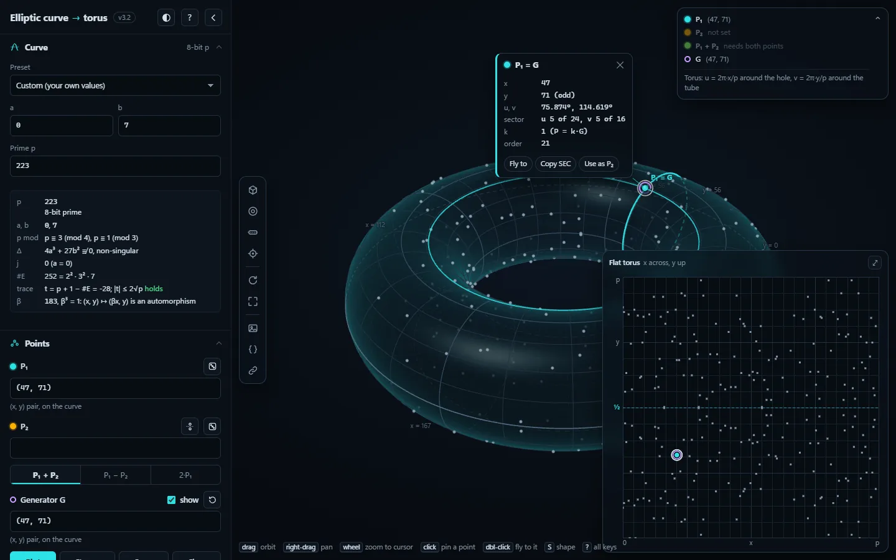
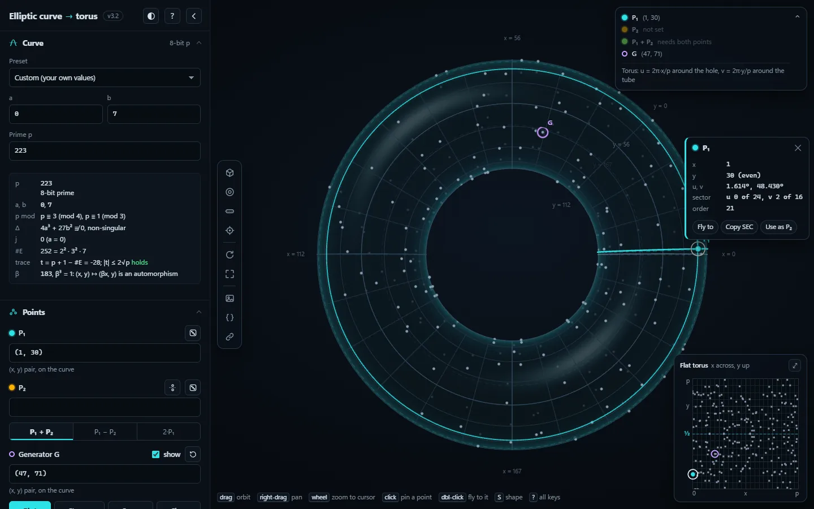
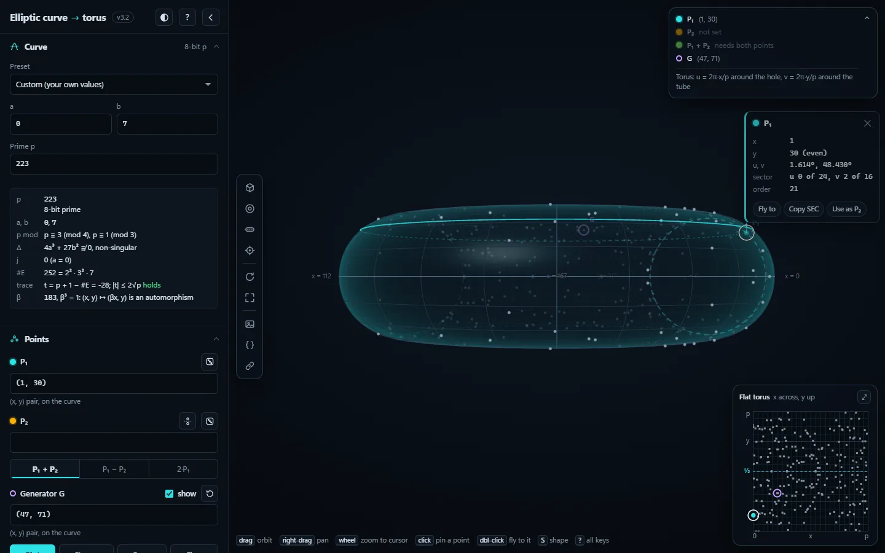
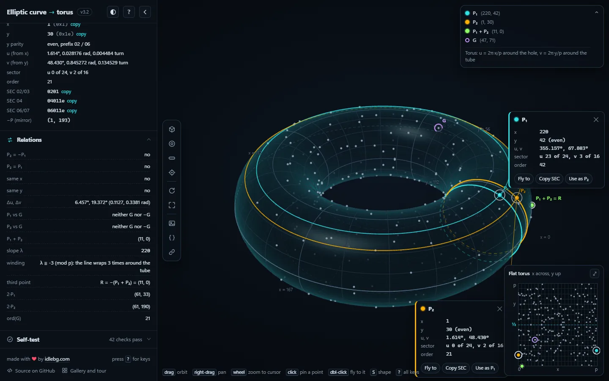
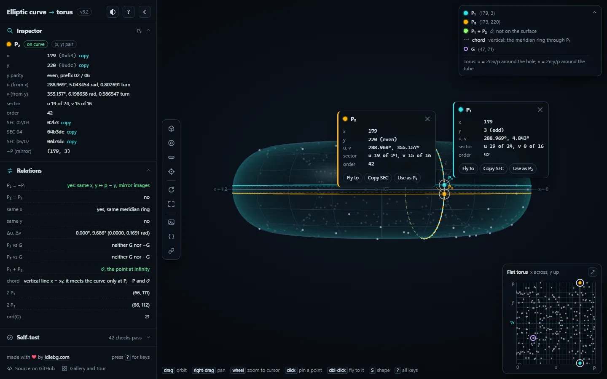

# 13 Why a donut

**Level 1 · Explorer.** You will learn why the points of a curve live on a donut, how the flat map in the corner is
the same donut cut open, and how to read a point’s position from its two rings. Read first:
[12 A curve is a cloud of dots](12-cloud-of-dots.md).

## Numbers on a clock

On a clock, after 12 comes 1 again: the hours wrap around. The curves in this visualizer count the same way, on a
clock with p hours. On the toy curve F₂₂₃ the “hours” are 0, 1, 2 and so on up to 222, and after 222 comes 0 again.
[21 Clock arithmetic](21-clock-arithmetic.md) does the sums; here we only need the wrapping.

Both coordinates of a point wrap like this. So think of all possible pairs (x, y) as a square: x runs across from 0
to 222, y runs up from 0 to 222. Now:

1. x wraps: just past the right edge (x = 222) comes the left edge (x = 0). Glue the right edge to the left edge and
   the square becomes a **tube**.
2. y wraps too: just past the top edge comes the bottom edge. Bend the tube round and glue its two ends together, and
   it becomes a **donut**, which mathematicians call a [torus](94-glossary.md#torus).

That is the whole idea of the visualizer. The donut is not a decoration: it is the only shape on which both
coordinates wrap the way the numbers do.

- x sets the angle **u around the hole**: u = 360° × x / p.
- y sets the angle **v around the tube**: v = 360° × y / p.

### Example 13.1 · The flat map is the donut cut open

**Open this view:** [F₂₂₃, flat map enlarged](https://idlebg.com/idleGevrek/elliptic_curve_torus_visualizer_v3.html#s=eyJ2IjozLCJwcmVzZXQiOiJjdXN0b20iLCJiYXNlUHJlc2V0IjoicGIyMjMiLCJhIjoiMCIsImIiOiI3IiwicCI6IjIyMyIsImciOiIoNDcsIDcxKSIsInAxIjoiKDQ3LCA3MSkiLCJwMiI6IiIsIm9wIjoiYWRkIiwic2hvd0ciOnRydWUsImZvcmNlIjpmYWxzZSwic2hhcGUiOiJ0b3J1cyIsIm1hcCI6InNjYWxlIiwiYml0cyI6MjQsInN1IjoyNCwic3YiOjE2LCJSIjoxLjIsInIiOjAuNDYsImdsYXNzIjowLjU1LCJiYWNrIjowLjQsInNob3ciOnsiZ3JpZCI6dHJ1ZSwicmluZ3MiOnRydWUsImxhYmVscyI6dHJ1ZSwiY2xvdWQiOnRydWUsImNob3JkIjpmYWxzZSwiYmV0YSI6ZmFsc2UsIm1hcCI6dHJ1ZSwic3BpbiI6ZmFsc2V9LCJyaW5ncyI6eyJwMSI6dHJ1ZSwicDIiOnRydWUsInN1bSI6dHJ1ZSwiZyI6ZmFsc2V9LCJ0aGVtZSI6ImRhcmsiLCJwYW5lbCI6dHJ1ZSwibWluaUJpZyI6dHJ1ZSwibGVnZW5kTWluIjpmYWxzZSwic2VjcyI6eyJjdXJ2ZSI6dHJ1ZSwicG9pbnRzIjp0cnVlLCJzaGFwZSI6dHJ1ZSwidmlldyI6dHJ1ZSwiaW5zcGVjdG9yIjp0cnVlLCJyZWxhdGlvbnMiOnRydWUsInRlc3QiOmZhbHNlfX0)

**Do it yourself**

1. In **Curve**, pick the preset **y² = x³ + 7 over F₂₂₃, Programming Bitcoin**.
2. Empty **P₂**.
3. In **Display**, turn off **Chord construction** (**K**).
4. Click **⤢** on the flat map to enlarge it.
5. In the 3D view, click P₁ to pin its card.

**Look at:**

- the enlarged flat map: the square, with x across and y up, and every dot of the curve. G = (47, 71), which is
  also P₁ here, is the cyan dot inside a purple ring, circled because it is pinned;
- the same G on the donut, and its card: u, v = 75.874°, 114.619°. That is 47/223 and 71/223 of a full turn;
- the dashed line across the middle of the map, marked ½: the mirror line. [15 Mirror images](15-mirror-images.md)
  explains it;
- the grey labels on the donut, x = 0, 56, 112 and 167, and the same for y: they mark the quarter turns.

**Why:** the map and the donut hold exactly the same dots; the map is just the donut cut along two rings and laid
flat. Click ⤢ to enlarge it or shrink it again. Hovering and clicking work on the map too.

### Example 13.2 · From the top: x goes around the hole

**Open this view:** [F₂₂₃, top view](https://idlebg.com/idleGevrek/elliptic_curve_torus_visualizer_v3.html#s=eyJ2IjozLCJwcmVzZXQiOiJjdXN0b20iLCJiYXNlUHJlc2V0IjoicGIyMjMiLCJhIjoiMCIsImIiOiI3IiwicCI6IjIyMyIsImciOiIoNDcsIDcxKSIsInAxIjoiKDEsIDMwKSIsInAyIjoiIiwib3AiOiJhZGQiLCJzaG93RyI6dHJ1ZSwiZm9yY2UiOmZhbHNlLCJzaGFwZSI6InRvcnVzIiwibWFwIjoic2NhbGUiLCJiaXRzIjoyNCwic3UiOjI0LCJzdiI6MTYsIlIiOjEuMiwiciI6MC40NiwiZ2xhc3MiOjAuNTUsImJhY2siOjAuNCwic2hvdyI6eyJncmlkIjp0cnVlLCJyaW5ncyI6dHJ1ZSwibGFiZWxzIjp0cnVlLCJjbG91ZCI6dHJ1ZSwiY2hvcmQiOmZhbHNlLCJiZXRhIjpmYWxzZSwibWFwIjp0cnVlLCJzcGluIjpmYWxzZX0sInJpbmdzIjp7InAxIjp0cnVlLCJwMiI6dHJ1ZSwic3VtIjp0cnVlLCJnIjpmYWxzZX0sInRoZW1lIjoiZGFyayIsInBhbmVsIjp0cnVlLCJtaW5pQmlnIjpmYWxzZSwibGVnZW5kTWluIjpmYWxzZSwic2VjcyI6eyJjdXJ2ZSI6dHJ1ZSwicG9pbnRzIjp0cnVlLCJzaGFwZSI6dHJ1ZSwidmlldyI6dHJ1ZSwiaW5zcGVjdG9yIjp0cnVlLCJyZWxhdGlvbnMiOnRydWUsInRlc3QiOmZhbHNlfX0)

**Do it yourself**

1. In **Curve**, pick the preset **y² = x³ + 7 over F₂₂₃, Programming Bitcoin**.
2. Type `(1, 30)` in **P₁**.
3. Empty **P₂**.
4. In **Display**, turn off **Chord construction** (**K**).
5. Press **2** for the top view.
6. In the 3D view, click P₁ to pin its card.

Here P₁ is the dot (1, 30), and P₂ is empty.

**Look at:** from the top (key **2**), P₁’s ring around the hole is a full circle, and the labels x = 0, x = 56,
x = 112 and x = 167 sit a quarter turn from each other, like the 12, 3, 6 and 9 of a clock face. P₁ itself, at
x = 1, sits just past the label x = 0; its card says u, v = 1.614°, 48.430°.

**Why:** from the top you see the angle u directly: every point with the same x lies on the same line out from the
centre, and walking once around the hole runs x through all 223 values.

### Example 13.3 · From the side: y goes around the tube

**Open this view:** [F₂₂₃, side view](https://idlebg.com/idleGevrek/elliptic_curve_torus_visualizer_v3.html#s=eyJ2IjozLCJwcmVzZXQiOiJjdXN0b20iLCJiYXNlUHJlc2V0IjoicGIyMjMiLCJhIjoiMCIsImIiOiI3IiwicCI6IjIyMyIsImciOiIoNDcsIDcxKSIsInAxIjoiKDEsIDMwKSIsInAyIjoiIiwib3AiOiJhZGQiLCJzaG93RyI6dHJ1ZSwiZm9yY2UiOmZhbHNlLCJzaGFwZSI6InRvcnVzIiwibWFwIjoic2NhbGUiLCJiaXRzIjoyNCwic3UiOjI0LCJzdiI6MTYsIlIiOjEuMiwiciI6MC40NiwiZ2xhc3MiOjAuNTUsImJhY2siOjAuNCwic2hvdyI6eyJncmlkIjp0cnVlLCJyaW5ncyI6dHJ1ZSwibGFiZWxzIjp0cnVlLCJjbG91ZCI6dHJ1ZSwiY2hvcmQiOmZhbHNlLCJiZXRhIjpmYWxzZSwibWFwIjp0cnVlLCJzcGluIjpmYWxzZX0sInJpbmdzIjp7InAxIjp0cnVlLCJwMiI6dHJ1ZSwic3VtIjp0cnVlLCJnIjpmYWxzZX0sInRoZW1lIjoiZGFyayIsInBhbmVsIjp0cnVlLCJtaW5pQmlnIjpmYWxzZSwibGVnZW5kTWluIjpmYWxzZSwic2VjcyI6eyJjdXJ2ZSI6dHJ1ZSwicG9pbnRzIjp0cnVlLCJzaGFwZSI6dHJ1ZSwidmlldyI6dHJ1ZSwiaW5zcGVjdG9yIjp0cnVlLCJyZWxhdGlvbnMiOnRydWUsInRlc3QiOmZhbHNlfX0)

**Do it yourself**

1. In **Curve**, pick the preset **y² = x³ + 7 over F₂₂₃, Programming Bitcoin**.
2. Type `(1, 30)` in **P₁**.
3. Empty **P₂**.
4. In **Display**, turn off **Chord construction** (**K**).
5. Press **3** for the side view.
6. In the 3D view, click P₁ to pin its card.

**Look at:** from the side (key **3**), the donut’s two ends show the tube’s round cross-section. P₁ sits on the
right-hand one, and its other ring, the one around the tube, is exactly that cross-section.

**Why:** y sets the angle v around the tube. y = 0 is on the outside of the donut, halfway round the tube (y near 112)
is on the inside, next to the hole, and the top and bottom of the tube are a quarter of the way (y = 56 and y = 167).

Every point has two **guide rings**, one of each kind:

- the ring **around the tube** passes through every place with the same x (mathematicians call it a meridian);
- the ring **around the hole** passes through every place with the same y (a parallel).

Two points on the same ring around the tube share their x; two on the same ring around the hole share their y. The
**Relations** section reports both (“same x”, “same y”), and they matter a lot in
[15 Mirror images](15-mirror-images.md) and [35 The GLV endomorphism](35-glv.md).

### Example 13.4 · Neighbours across the x seam

On the curve there are no points with x = 221 or x = 222, but there are (220, 42) and (1, 30).

**Open this view:** [(220, 42) and (1, 30)](https://idlebg.com/idleGevrek/elliptic_curve_torus_visualizer_v3.html#s=eyJ2IjozLCJwcmVzZXQiOiJjdXN0b20iLCJiYXNlUHJlc2V0IjoicGIyMjMiLCJhIjoiMCIsImIiOiI3IiwicCI6IjIyMyIsImciOiIoNDcsIDcxKSIsInAxIjoiKDIyMCwgNDIpIiwicDIiOiIoMSwgMzApIiwib3AiOiJhZGQiLCJzaG93RyI6dHJ1ZSwiZm9yY2UiOmZhbHNlLCJzaGFwZSI6InRvcnVzIiwibWFwIjoic2NhbGUiLCJiaXRzIjoyNCwic3UiOjI0LCJzdiI6MTYsIlIiOjEuMiwiciI6MC40NiwiZ2xhc3MiOjAuNTUsImJhY2siOjAuNCwic2hvdyI6eyJncmlkIjp0cnVlLCJyaW5ncyI6dHJ1ZSwibGFiZWxzIjp0cnVlLCJjbG91ZCI6dHJ1ZSwiY2hvcmQiOmZhbHNlLCJiZXRhIjpmYWxzZSwibWFwIjp0cnVlLCJzcGluIjpmYWxzZX0sInJpbmdzIjp7InAxIjp0cnVlLCJwMiI6dHJ1ZSwic3VtIjpmYWxzZSwiZyI6ZmFsc2V9LCJ0aGVtZSI6ImRhcmsiLCJwYW5lbCI6dHJ1ZSwibWluaUJpZyI6ZmFsc2UsImxlZ2VuZE1pbiI6ZmFsc2UsInNlY3MiOnsiY3VydmUiOnRydWUsInBvaW50cyI6dHJ1ZSwic2hhcGUiOnRydWUsInZpZXciOnRydWUsImluc3BlY3RvciI6dHJ1ZSwicmVsYXRpb25zIjp0cnVlLCJ0ZXN0IjpmYWxzZX19)

**Do it yourself**

1. In **Curve**, pick the preset **y² = x³ + 7 over F₂₂₃, Programming Bitcoin**.
2. Type `(220, 42)` in **P₁** and `(1, 30)` in **P₂**.
3. In **Display**, turn off **Chord construction** (**K**).
4. Under **Guide rings for**, turn off **Result**.
5. In the 3D view, click P₁ and P₂ to pin their cards.
6. Read the **Relations** section in the panel.

**Look at:** on the donut the two points sit side by side; on the flat map in the corner one is at the far right and
the other at the far left. Relations says Δu = 6.457°: only four steps apart around the hole (220, 221, 222, 0, 1).
Around the tube they are Δv = 19.372° apart, since their y values are 42 and 30.

**Why:** the flat map has to cut the donut somewhere, and it cuts at x = 0. Points on either side of the cut look far
apart on the map but are neighbours on the donut. The donut has no edges, so it never lies about distances.

### Example 13.5 · Neighbours across the y seam

The same happens with y: (179, 3) and (179, 220) are six steps apart (220, 221, 222, 0, 1, 2, 3).

**Open this view:** [(179, 3) and (179, 220)](https://idlebg.com/idleGevrek/elliptic_curve_torus_visualizer_v3.html#s=eyJ2IjozLCJwcmVzZXQiOiJjdXN0b20iLCJiYXNlUHJlc2V0IjoicGIyMjMiLCJhIjoiMCIsImIiOiI3IiwicCI6IjIyMyIsImciOiIoNDcsIDcxKSIsInAxIjoiKDE3OSwgMykiLCJwMiI6IigxNzksIDIyMCkiLCJvcCI6ImFkZCIsInNob3dHIjp0cnVlLCJmb3JjZSI6ZmFsc2UsInNoYXBlIjoidG9ydXMiLCJtYXAiOiJzY2FsZSIsImJpdHMiOjI0LCJzdSI6MjQsInN2IjoxNiwiUiI6MS4yLCJyIjowLjQ2LCJnbGFzcyI6MC41NSwiYmFjayI6MC40LCJzaG93Ijp7ImdyaWQiOnRydWUsInJpbmdzIjp0cnVlLCJsYWJlbHMiOnRydWUsImNsb3VkIjp0cnVlLCJjaG9yZCI6dHJ1ZSwiYmV0YSI6ZmFsc2UsIm1hcCI6dHJ1ZSwic3BpbiI6ZmFsc2V9LCJyaW5ncyI6eyJwMSI6dHJ1ZSwicDIiOnRydWUsInN1bSI6dHJ1ZSwiZyI6ZmFsc2V9LCJ0aGVtZSI6ImRhcmsiLCJwYW5lbCI6dHJ1ZSwibWluaUJpZyI6ZmFsc2UsImxlZ2VuZE1pbiI6ZmFsc2UsInNlY3MiOnsiY3VydmUiOnRydWUsInBvaW50cyI6dHJ1ZSwic2hhcGUiOnRydWUsInZpZXciOnRydWUsImluc3BlY3RvciI6dHJ1ZSwicmVsYXRpb25zIjp0cnVlLCJ0ZXN0IjpmYWxzZX19)

**Do it yourself**

1. In **Curve**, pick the preset **y² = x³ + 7 over F₂₂₃, Programming Bitcoin**.
2. Type `(179, 3)` in **P₁** and `(179, 220)` in **P₂**.
3. Press **3** for the side view.
4. In the 3D view, click P₁ and P₂ to pin their cards.
5. Read the **Relations** section in the panel.

**Look at:** from the side, the two points sit just above and just below the outer edge of the donut, on one ring
around the tube. On the flat map they are at the very bottom and the very top. Relations says Δv = 9.686°.

**Why:** y = 3 and y = 220 are close because y wraps at 223. They also share x = 179, so Relations reports “P₂ = −P₁”:
they are mirror images. Every point with a small y has its mirror image just across the outer edge of the donut, and
the next chapter is all about that.

## Try it yourself

- In Example 13.1, hover dots near the left edge of the flat map, then near the right edge, and compare their x.
- Turn **Guide rings** off and on in **Display**, and pick which points get rings under **Guide rings for**.
- Press **S** to switch to the cylinder: x still goes around, but y now runs up and down and the y seam becomes the
  top and bottom edge. [16 One set of points, nine shapes](16-nine-shapes.md) shows every shape.

## Recap

- Both coordinates wrap at p, so the pairs (x, y) form a square whose opposite edges are glued: a torus.
- u = 360° × x / p goes around the hole, v = 360° × y / p around the tube; each point has a ring of each kind.
- The flat map is the same torus cut open at x = 0 and y = 0; points near those seams are neighbours.

Next: [14 Two points: how far apart?](14-how-far-apart.md).
