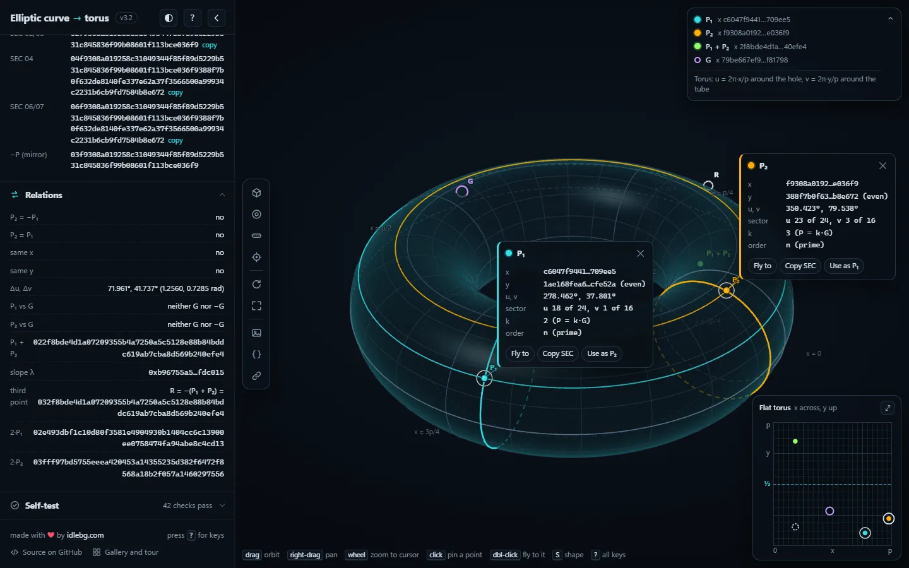
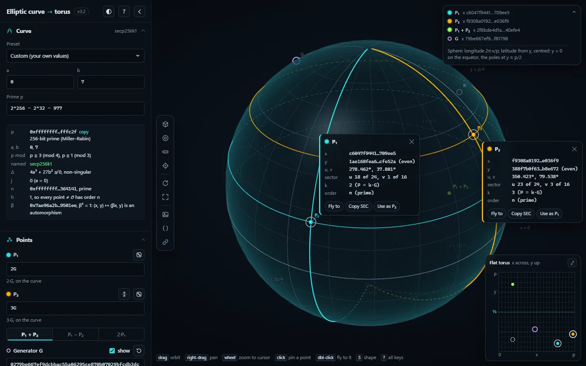
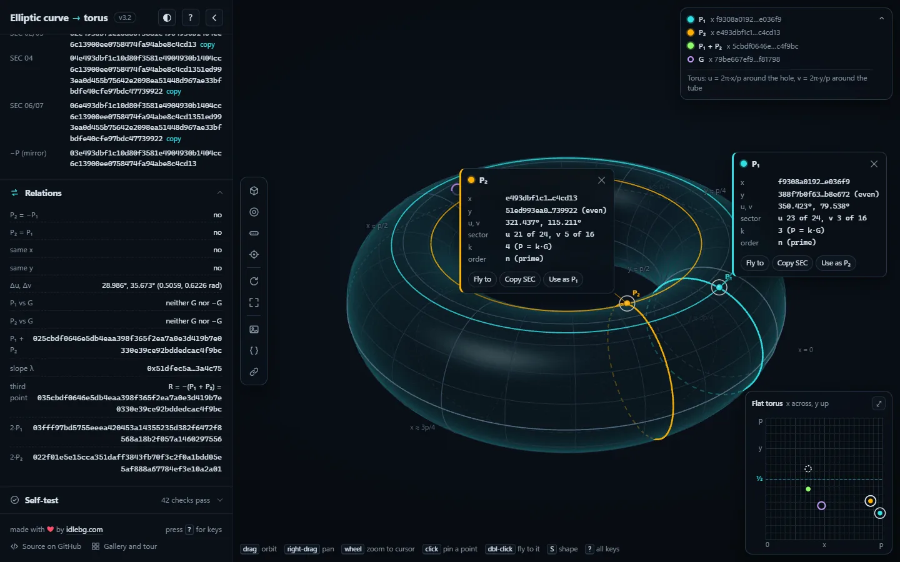
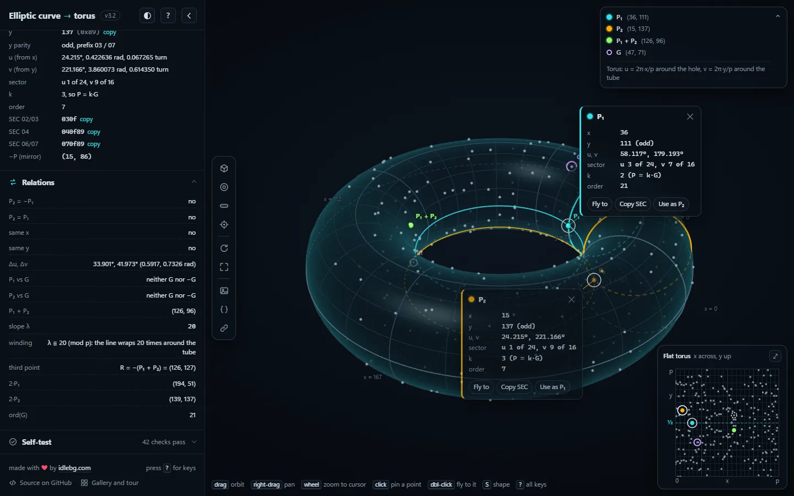
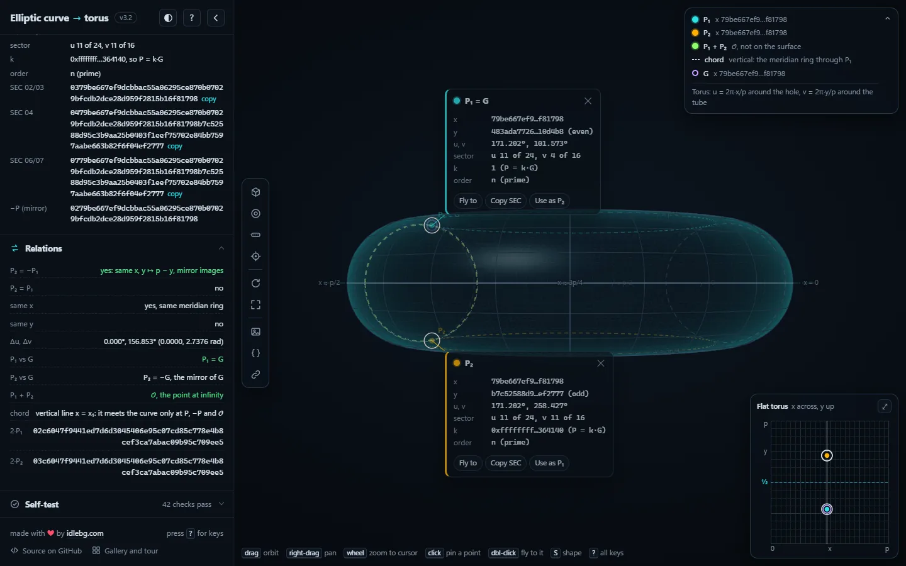
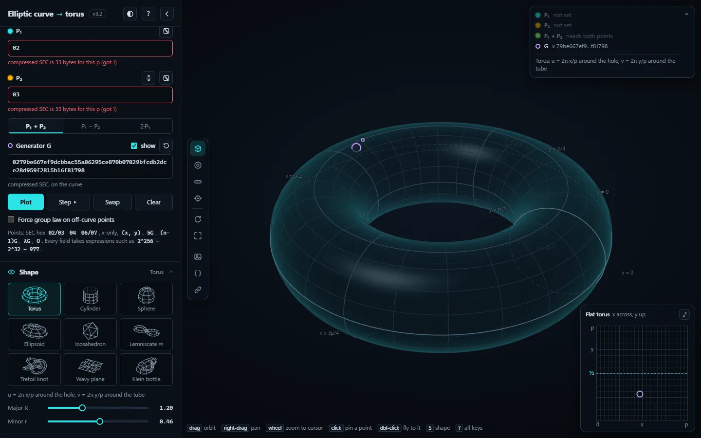
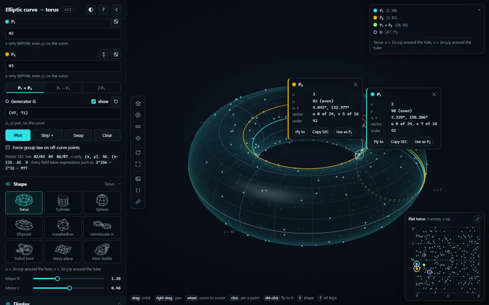

# 14 Two points: how far apart?

**Level 1 · Explorer.** You will learn how to put two points on the donut and read how far apart they are, and why
“02 and 03” can mean three quite different things. Read first: [11 Start here](11-start-here.md) and
[13 Why a donut](13-why-a-donut.md).

The idea fits in one sentence: type one point into **P₁** and another into **P₂**, and the visualizer draws both on
the donut (the [torus](94-glossary.md#torus)) and measures how far apart they are, once around the hole and once
around the tube. You can then switch to a sphere, or to any of the other shapes, and see the same two points there.

The catch is in what you type. Suppose someone says “put 02 and 03 in P₁ and P₂”. That can mean three things, and
the visualizer gives three different pictures:

| what “02 and 03” means | what to type | what you see |
| --- | --- | --- |
| the [private keys](94-glossary.md#private-key) 2 and 3 | `2G` and `3G` | two unrelated points ([reading 1](#reading-1-private-keys-2-and-3)) |
| a key that starts with `02` and the same key with `03` | `02` + x and `03` + the same x | a point and its mirror image ([reading 2](#reading-2-the-prefixes-02-and-03)) |
| literally the two characters `02` and `03` | `02` and `03` | refused on Bitcoin’s curve; two small points on a toy curve ([reading 3](#reading-3-literally-02-and-03)) |

This chapter shows all three.

## How the visualizer measures “how far”

The donut has two directions, and the visualizer measures the distance in each one separately:

- **Δu** (“delta u”) is how far apart the two points are **around the hole**. It comes from their x coordinates.
- **Δv** is how far apart they are **around the tube**. It comes from their y coordinates.

Both are angles, from 0° (same place) to 180° (opposite sides). The visualizer always takes the shorter way round,
like the shorter way between two hours on a clock. You find them in the **Relations** section of the panel, in the
row **Δu, Δv**, first in degrees and then in radians.

Each point’s own position is on its card: hover a point to see its card, click it to pin the card. The row **u, v**
gives the angle around the hole and the angle around the tube, measured from x = 0 and y = 0.

## Reading 1: private keys 2 and 3

In Bitcoin a private key is just a number, and the public key is that number times a fixed starting point called
**G**, the [generator](94-glossary.md#generator-g). “Times” here is a special kind of multiplication on the curve,
which the Level 2 chapters take apart step by step. The visualizer understands this directly: type `2G` and it
computes the point 2·G, the public key of private key 2.

A bare `2` does not work, because the visualizer reads a number without G as a key written in hexadecimal, and one
hex digit is not a key (Example 14.6 shows the message).

### Example 14.1 · Keys 2 and 3 on secp256k1

**Open this view:** [2G and 3G on the torus](https://idlebg.com/idleGevrek/elliptic_curve_torus_visualizer_v3.html#s=eyJ2IjozLCJwcmVzZXQiOiJjdXN0b20iLCJiYXNlUHJlc2V0IjoiazEtbmVnIiwiYSI6IjAiLCJiIjoiNyIsInAiOiIyXjI1NiAtIDJeMzIgLSA5NzciLCJnIjoiMDI3OWJlNjY3ZWY5ZGNiYmFjNTVhMDYyOTVjZTg3MGIwNzAyOWJmY2RiMmRjZTI4ZDk1OWYyODE1YjE2ZjgxNzk4IiwicDEiOiIyRyIsInAyIjoiM0ciLCJvcCI6ImFkZCIsInNob3dHIjp0cnVlLCJmb3JjZSI6ZmFsc2UsInNoYXBlIjoidG9ydXMiLCJtYXAiOiJzY2FsZSIsImJpdHMiOjI0LCJzdSI6MjQsInN2IjoxNiwiUiI6MS4yLCJyIjowLjQ2LCJnbGFzcyI6MC41NSwiYmFjayI6MC40LCJzaG93Ijp7ImdyaWQiOnRydWUsInJpbmdzIjp0cnVlLCJsYWJlbHMiOnRydWUsImNsb3VkIjp0cnVlLCJjaG9yZCI6ZmFsc2UsImJldGEiOmZhbHNlLCJtYXAiOnRydWUsInNwaW4iOmZhbHNlfSwicmluZ3MiOnsicDEiOnRydWUsInAyIjp0cnVlLCJzdW0iOmZhbHNlLCJnIjpmYWxzZX0sInRoZW1lIjoiZGFyayIsInBhbmVsIjp0cnVlLCJtaW5pQmlnIjpmYWxzZSwibGVnZW5kTWluIjpmYWxzZSwic2VjcyI6eyJjdXJ2ZSI6dHJ1ZSwicG9pbnRzIjp0cnVlLCJzaGFwZSI6dHJ1ZSwidmlldyI6dHJ1ZSwiaW5zcGVjdG9yIjp0cnVlLCJyZWxhdGlvbnMiOnRydWUsInRlc3QiOmZhbHNlfX0)

**Do it yourself**

1. In **Curve**, pick the preset **secp256k1: G and −G (mirror pair)**.
2. Type `2G` in **P₁** and `3G` in **P₂**.
3. In **Display**, turn off **Chord construction** (**K**).
4. Under **Guide rings for**, turn off **Result**.
5. In the 3D view, click P₁ and P₂ to pin their cards.
6. Read the **Relations** section in the panel.

**Look at:**

- the two points with their guide rings: cyan for P₁ = 2G, amber for P₂ = 3G. Each point has two rings through it,
  one around the tube (its x stays fixed along it) and one around the hole (its y stays fixed);
- the pinned cards: 2G sits at u, v = 278.462°, 37.801° and 3G at 350.423°, 79.538°;
- the Relations row **Δu, Δv**: 71.961° around the hole and 41.737° around the tube. These are exactly the
  differences of the cards’ angles: 350.423° − 278.462° and 79.538° − 37.801°;
- the green point and the small dashed ring: that is P₁ + P₂ = 5G and a helper point for the addition. Ignore them
  for now; [24 Adding points](24-chord.md) explains them.

**Why:** secp256k1 is the curve Bitcoin uses. Its numbers are 256 bits long, so the visualizer shortens them on the
cards. In full, the public keys of private keys 2 and 3, as Bitcoin writes them (compressed), are:

- 2G: `02c6047f9441ed7d6d3045406e95c07cd85c778e4b8cef3ca7abac09b95c709ee5`
- 3G: `02f9308a019258c31049344f85f89d5229b531c845836f99b08601f113bce036f9`

Both start with `02`. That is a first hint that the prefix 02 is not a private key; reading 2 explains what it is.

### Example 14.2 · The same two keys on the sphere

**Open this view:** [2G and 3G on the sphere](https://idlebg.com/idleGevrek/elliptic_curve_torus_visualizer_v3.html#s=eyJ2IjozLCJwcmVzZXQiOiJjdXN0b20iLCJiYXNlUHJlc2V0IjoiazEtbmVnIiwiYSI6IjAiLCJiIjoiNyIsInAiOiIyXjI1NiAtIDJeMzIgLSA5NzciLCJnIjoiMDI3OWJlNjY3ZWY5ZGNiYmFjNTVhMDYyOTVjZTg3MGIwNzAyOWJmY2RiMmRjZTI4ZDk1OWYyODE1YjE2ZjgxNzk4IiwicDEiOiIyRyIsInAyIjoiM0ciLCJvcCI6ImFkZCIsInNob3dHIjp0cnVlLCJmb3JjZSI6ZmFsc2UsInNoYXBlIjoic3BoZXJlIiwibWFwIjoic2NhbGUiLCJiaXRzIjoyNCwic3UiOjI0LCJzdiI6MTYsIlIiOjEuMiwiciI6MC40NiwiZ2xhc3MiOjAuNTUsImJhY2siOjAuNCwic2hvdyI6eyJncmlkIjp0cnVlLCJyaW5ncyI6dHJ1ZSwibGFiZWxzIjp0cnVlLCJjbG91ZCI6dHJ1ZSwiY2hvcmQiOmZhbHNlLCJiZXRhIjpmYWxzZSwibWFwIjp0cnVlLCJzcGluIjpmYWxzZX0sInJpbmdzIjp7InAxIjp0cnVlLCJwMiI6dHJ1ZSwic3VtIjpmYWxzZSwiZyI6ZmFsc2V9LCJ0aGVtZSI6ImRhcmsiLCJwYW5lbCI6dHJ1ZSwibWluaUJpZyI6ZmFsc2UsImxlZ2VuZE1pbiI6ZmFsc2UsInNlY3MiOnsiY3VydmUiOnRydWUsInBvaW50cyI6dHJ1ZSwic2hhcGUiOnRydWUsInZpZXciOnRydWUsImluc3BlY3RvciI6dHJ1ZSwicmVsYXRpb25zIjp0cnVlLCJ0ZXN0IjpmYWxzZX19)

**Do it yourself**

1. In **Curve**, pick the preset **secp256k1: G and −G (mirror pair)**.
2. Type `2G` in **P₁** and `3G` in **P₂**.
3. In **Shape**, pick **Sphere** (or press **S** until it shows).
4. In **Display**, turn off **Chord construction** (**K**).
5. Under **Guide rings for**, turn off **Result**.
6. In the 3D view, click P₁ and P₂ to pin their cards.

**Look at:** the same two points, now on a ball. On the sphere, x becomes the
[longitude](94-glossary.md#longitude-and-latitude) (the angle around the vertical axis) and y becomes the latitude
(how far north or south). The rings through each point are now a meridian (a line of longitude) and a circle of
latitude.

**Why:** the longitudes are the same angles as u on the donut, so the two points are again 71.961° apart around the
axis. The latitude is where the sphere differs: y = 0 is on the equator, and y climbs to the north pole as it
approaches half of p. Both keys have a y in the lower half of the range, so both sit in the northern half: 2G at
latitude 18.9° and 3G at 39.8°, which is 20.869° apart, exactly half of the 41.737° around the tube on the donut.
Measured along the surface of the ball, the two points are 64.4° apart.

The sphere is the donut cut open along one ring and closed up at the poles, so going “around the tube” the long way
is no longer possible there. [16 One set of points, nine shapes](16-nine-shapes.md) shows the other shapes.

### Example 14.3 · Neighbouring keys land far apart

**Open this view:** [3G and 4G](https://idlebg.com/idleGevrek/elliptic_curve_torus_visualizer_v3.html#s=eyJ2IjozLCJwcmVzZXQiOiJjdXN0b20iLCJiYXNlUHJlc2V0IjoiazEtbmVnIiwiYSI6IjAiLCJiIjoiNyIsInAiOiIyXjI1NiAtIDJeMzIgLSA5NzciLCJnIjoiMDI3OWJlNjY3ZWY5ZGNiYmFjNTVhMDYyOTVjZTg3MGIwNzAyOWJmY2RiMmRjZTI4ZDk1OWYyODE1YjE2ZjgxNzk4IiwicDEiOiIzRyIsInAyIjoiNEciLCJvcCI6ImFkZCIsInNob3dHIjp0cnVlLCJmb3JjZSI6ZmFsc2UsInNoYXBlIjoidG9ydXMiLCJtYXAiOiJzY2FsZSIsImJpdHMiOjI0LCJzdSI6MjQsInN2IjoxNiwiUiI6MS4yLCJyIjowLjQ2LCJnbGFzcyI6MC41NSwiYmFjayI6MC40LCJzaG93Ijp7ImdyaWQiOnRydWUsInJpbmdzIjp0cnVlLCJsYWJlbHMiOnRydWUsImNsb3VkIjp0cnVlLCJjaG9yZCI6ZmFsc2UsImJldGEiOmZhbHNlLCJtYXAiOnRydWUsInNwaW4iOmZhbHNlfSwicmluZ3MiOnsicDEiOnRydWUsInAyIjp0cnVlLCJzdW0iOmZhbHNlLCJnIjpmYWxzZX0sInRoZW1lIjoiZGFyayIsInBhbmVsIjp0cnVlLCJtaW5pQmlnIjpmYWxzZSwibGVnZW5kTWluIjpmYWxzZSwic2VjcyI6eyJjdXJ2ZSI6dHJ1ZSwicG9pbnRzIjp0cnVlLCJzaGFwZSI6dHJ1ZSwidmlldyI6dHJ1ZSwiaW5zcGVjdG9yIjp0cnVlLCJyZWxhdGlvbnMiOnRydWUsInRlc3QiOmZhbHNlfX0)

| P₁ | P₂ | Δu | Δv | open |
| --- | --- | --- | --- | --- |
| `1G` | `2G` | 107.260° | 63.773° | [open](https://idlebg.com/idleGevrek/elliptic_curve_torus_visualizer_v3.html#s=eyJ2IjozLCJwcmVzZXQiOiJjdXN0b20iLCJiYXNlUHJlc2V0IjoiazEtbmVnIiwiYSI6IjAiLCJiIjoiNyIsInAiOiIyXjI1NiAtIDJeMzIgLSA5NzciLCJnIjoiMDI3OWJlNjY3ZWY5ZGNiYmFjNTVhMDYyOTVjZTg3MGIwNzAyOWJmY2RiMmRjZTI4ZDk1OWYyODE1YjE2ZjgxNzk4IiwicDEiOiIxRyIsInAyIjoiMkciLCJvcCI6ImFkZCIsInNob3dHIjp0cnVlLCJmb3JjZSI6ZmFsc2UsInNoYXBlIjoidG9ydXMiLCJtYXAiOiJzY2FsZSIsImJpdHMiOjI0LCJzdSI6MjQsInN2IjoxNiwiUiI6MS4yLCJyIjowLjQ2LCJnbGFzcyI6MC41NSwiYmFjayI6MC40LCJzaG93Ijp7ImdyaWQiOnRydWUsInJpbmdzIjp0cnVlLCJsYWJlbHMiOnRydWUsImNsb3VkIjp0cnVlLCJjaG9yZCI6ZmFsc2UsImJldGEiOmZhbHNlLCJtYXAiOnRydWUsInNwaW4iOmZhbHNlfSwicmluZ3MiOnsicDEiOnRydWUsInAyIjp0cnVlLCJzdW0iOmZhbHNlLCJnIjpmYWxzZX0sInRoZW1lIjoiZGFyayIsInBhbmVsIjp0cnVlLCJtaW5pQmlnIjpmYWxzZSwibGVnZW5kTWluIjpmYWxzZSwic2VjcyI6eyJjdXJ2ZSI6dHJ1ZSwicG9pbnRzIjp0cnVlLCJzaGFwZSI6dHJ1ZSwidmlldyI6dHJ1ZSwiaW5zcGVjdG9yIjp0cnVlLCJyZWxhdGlvbnMiOnRydWUsInRlc3QiOmZhbHNlfX0) |
| `2G` | `3G` | 71.961° | 41.737° | [open](https://idlebg.com/idleGevrek/elliptic_curve_torus_visualizer_v3.html#s=eyJ2IjozLCJwcmVzZXQiOiJjdXN0b20iLCJiYXNlUHJlc2V0IjoiazEtbmVnIiwiYSI6IjAiLCJiIjoiNyIsInAiOiIyXjI1NiAtIDJeMzIgLSA5NzciLCJnIjoiMDI3OWJlNjY3ZWY5ZGNiYmFjNTVhMDYyOTVjZTg3MGIwNzAyOWJmY2RiMmRjZTI4ZDk1OWYyODE1YjE2ZjgxNzk4IiwicDEiOiIyRyIsInAyIjoiM0ciLCJvcCI6ImFkZCIsInNob3dHIjp0cnVlLCJmb3JjZSI6ZmFsc2UsInNoYXBlIjoidG9ydXMiLCJtYXAiOiJzY2FsZSIsImJpdHMiOjI0LCJzdSI6MjQsInN2IjoxNiwiUiI6MS4yLCJyIjowLjQ2LCJnbGFzcyI6MC41NSwiYmFjayI6MC40LCJzaG93Ijp7ImdyaWQiOnRydWUsInJpbmdzIjp0cnVlLCJsYWJlbHMiOnRydWUsImNsb3VkIjp0cnVlLCJjaG9yZCI6ZmFsc2UsImJldGEiOmZhbHNlLCJtYXAiOnRydWUsInNwaW4iOmZhbHNlfSwicmluZ3MiOnsicDEiOnRydWUsInAyIjp0cnVlLCJzdW0iOmZhbHNlLCJnIjpmYWxzZX0sInRoZW1lIjoiZGFyayIsInBhbmVsIjp0cnVlLCJtaW5pQmlnIjpmYWxzZSwibGVnZW5kTWluIjpmYWxzZSwic2VjcyI6eyJjdXJ2ZSI6dHJ1ZSwicG9pbnRzIjp0cnVlLCJzaGFwZSI6dHJ1ZSwidmlldyI6dHJ1ZSwiaW5zcGVjdG9yIjp0cnVlLCJyZWxhdGlvbnMiOnRydWUsInRlc3QiOmZhbHNlfX0) |
| `3G` | `4G` | 28.986° | 35.673° | [open](https://idlebg.com/idleGevrek/elliptic_curve_torus_visualizer_v3.html#s=eyJ2IjozLCJwcmVzZXQiOiJjdXN0b20iLCJiYXNlUHJlc2V0IjoiazEtbmVnIiwiYSI6IjAiLCJiIjoiNyIsInAiOiIyXjI1NiAtIDJeMzIgLSA5NzciLCJnIjoiMDI3OWJlNjY3ZWY5ZGNiYmFjNTVhMDYyOTVjZTg3MGIwNzAyOWJmY2RiMmRjZTI4ZDk1OWYyODE1YjE2ZjgxNzk4IiwicDEiOiIzRyIsInAyIjoiNEciLCJvcCI6ImFkZCIsInNob3dHIjp0cnVlLCJmb3JjZSI6ZmFsc2UsInNoYXBlIjoidG9ydXMiLCJtYXAiOiJzY2FsZSIsImJpdHMiOjI0LCJzdSI6MjQsInN2IjoxNiwiUiI6MS4yLCJyIjowLjQ2LCJnbGFzcyI6MC41NSwiYmFjayI6MC40LCJzaG93Ijp7ImdyaWQiOnRydWUsInJpbmdzIjp0cnVlLCJsYWJlbHMiOnRydWUsImNsb3VkIjp0cnVlLCJjaG9yZCI6ZmFsc2UsImJldGEiOmZhbHNlLCJtYXAiOnRydWUsInNwaW4iOmZhbHNlfSwicmluZ3MiOnsicDEiOnRydWUsInAyIjp0cnVlLCJzdW0iOmZhbHNlLCJnIjpmYWxzZX0sInRoZW1lIjoiZGFyayIsInBhbmVsIjp0cnVlLCJtaW5pQmlnIjpmYWxzZSwibGVnZW5kTWluIjpmYWxzZSwic2VjcyI6eyJjdXJ2ZSI6dHJ1ZSwicG9pbnRzIjp0cnVlLCJzaGFwZSI6dHJ1ZSwidmlldyI6dHJ1ZSwiaW5zcGVjdG9yIjp0cnVlLCJyZWxhdGlvbnMiOnRydWUsInRlc3QiOmZhbHNlfX0) |
| `4G` | `5G` | 105.425° | 170.516° | [open](https://idlebg.com/idleGevrek/elliptic_curve_torus_visualizer_v3.html#s=eyJ2IjozLCJwcmVzZXQiOiJjdXN0b20iLCJiYXNlUHJlc2V0IjoiazEtbmVnIiwiYSI6IjAiLCJiIjoiNyIsInAiOiIyXjI1NiAtIDJeMzIgLSA5NzciLCJnIjoiMDI3OWJlNjY3ZWY5ZGNiYmFjNTVhMDYyOTVjZTg3MGIwNzAyOWJmY2RiMmRjZTI4ZDk1OWYyODE1YjE2ZjgxNzk4IiwicDEiOiI0RyIsInAyIjoiNUciLCJvcCI6ImFkZCIsInNob3dHIjp0cnVlLCJmb3JjZSI6ZmFsc2UsInNoYXBlIjoidG9ydXMiLCJtYXAiOiJzY2FsZSIsImJpdHMiOjI0LCJzdSI6MjQsInN2IjoxNiwiUiI6MS4yLCJyIjowLjQ2LCJnbGFzcyI6MC41NSwiYmFjayI6MC40LCJzaG93Ijp7ImdyaWQiOnRydWUsInJpbmdzIjp0cnVlLCJsYWJlbHMiOnRydWUsImNsb3VkIjp0cnVlLCJjaG9yZCI6ZmFsc2UsImJldGEiOmZhbHNlLCJtYXAiOnRydWUsInNwaW4iOmZhbHNlfSwicmluZ3MiOnsicDEiOnRydWUsInAyIjp0cnVlLCJzdW0iOmZhbHNlLCJnIjpmYWxzZX0sInRoZW1lIjoiZGFyayIsInBhbmVsIjp0cnVlLCJtaW5pQmlnIjpmYWxzZSwibGVnZW5kTWluIjpmYWxzZSwic2VjcyI6eyJjdXJ2ZSI6dHJ1ZSwicG9pbnRzIjp0cnVlLCJzaGFwZSI6dHJ1ZSwidmlldyI6dHJ1ZSwiaW5zcGVjdG9yIjp0cnVlLCJyZWxhdGlvbnMiOnRydWUsInRlc3QiOmZhbHNlfX0) |
| `5G` | `6G` | 66.898° | 59.907° | [open](https://idlebg.com/idleGevrek/elliptic_curve_torus_visualizer_v3.html#s=eyJ2IjozLCJwcmVzZXQiOiJjdXN0b20iLCJiYXNlUHJlc2V0IjoiazEtbmVnIiwiYSI6IjAiLCJiIjoiNyIsInAiOiIyXjI1NiAtIDJeMzIgLSA5NzciLCJnIjoiMDI3OWJlNjY3ZWY5ZGNiYmFjNTVhMDYyOTVjZTg3MGIwNzAyOWJmY2RiMmRjZTI4ZDk1OWYyODE1YjE2ZjgxNzk4IiwicDEiOiI1RyIsInAyIjoiNkciLCJvcCI6ImFkZCIsInNob3dHIjp0cnVlLCJmb3JjZSI6ZmFsc2UsInNoYXBlIjoidG9ydXMiLCJtYXAiOiJzY2FsZSIsImJpdHMiOjI0LCJzdSI6MjQsInN2IjoxNiwiUiI6MS4yLCJyIjowLjQ2LCJnbGFzcyI6MC41NSwiYmFjayI6MC40LCJzaG93Ijp7ImdyaWQiOnRydWUsInJpbmdzIjp0cnVlLCJsYWJlbHMiOnRydWUsImNsb3VkIjp0cnVlLCJjaG9yZCI6ZmFsc2UsImJldGEiOmZhbHNlLCJtYXAiOnRydWUsInNwaW4iOmZhbHNlfSwicmluZ3MiOnsicDEiOnRydWUsInAyIjp0cnVlLCJzdW0iOmZhbHNlLCJnIjpmYWxzZX0sInRoZW1lIjoiZGFyayIsInBhbmVsIjp0cnVlLCJtaW5pQmlnIjpmYWxzZSwibGVnZW5kTWluIjpmYWxzZSwic2VjcyI6eyJjdXJ2ZSI6dHJ1ZSwicG9pbnRzIjp0cnVlLCJzaGFwZSI6dHJ1ZSwidmlldyI6dHJ1ZSwiaW5zcGVjdG9yIjp0cnVlLCJyZWxhdGlvbnMiOnRydWUsInRlc3QiOmZhbHNlfX0) |
| `6G` | `7G` | 130.454° | 94.431° | [open](https://idlebg.com/idleGevrek/elliptic_curve_torus_visualizer_v3.html#s=eyJ2IjozLCJwcmVzZXQiOiJjdXN0b20iLCJiYXNlUHJlc2V0IjoiazEtbmVnIiwiYSI6IjAiLCJiIjoiNyIsInAiOiIyXjI1NiAtIDJeMzIgLSA5NzciLCJnIjoiMDI3OWJlNjY3ZWY5ZGNiYmFjNTVhMDYyOTVjZTg3MGIwNzAyOWJmY2RiMmRjZTI4ZDk1OWYyODE1YjE2ZjgxNzk4IiwicDEiOiI2RyIsInAyIjoiN0ciLCJvcCI6ImFkZCIsInNob3dHIjp0cnVlLCJmb3JjZSI6ZmFsc2UsInNoYXBlIjoidG9ydXMiLCJtYXAiOiJzY2FsZSIsImJpdHMiOjI0LCJzdSI6MjQsInN2IjoxNiwiUiI6MS4yLCJyIjowLjQ2LCJnbGFzcyI6MC41NSwiYmFjayI6MC40LCJzaG93Ijp7ImdyaWQiOnRydWUsInJpbmdzIjp0cnVlLCJsYWJlbHMiOnRydWUsImNsb3VkIjp0cnVlLCJjaG9yZCI6ZmFsc2UsImJldGEiOmZhbHNlLCJtYXAiOnRydWUsInNwaW4iOmZhbHNlfSwicmluZ3MiOnsicDEiOnRydWUsInAyIjp0cnVlLCJzdW0iOmZhbHNlLCJnIjpmYWxzZX0sInRoZW1lIjoiZGFyayIsInBhbmVsIjp0cnVlLCJtaW5pQmlnIjpmYWxzZSwibGVnZW5kTWluIjpmYWxzZSwic2VjcyI6eyJjdXJ2ZSI6dHJ1ZSwicG9pbnRzIjp0cnVlLCJzaGFwZSI6dHJ1ZSwidmlldyI6dHJ1ZSwiaW5zcGVjdG9yIjp0cnVlLCJyZWxhdGlvbnMiOnRydWUsInRlc3QiOmZhbHNlfX0) |
| `7G` | `8G` | 64.314° | 20.556° | [open](https://idlebg.com/idleGevrek/elliptic_curve_torus_visualizer_v3.html#s=eyJ2IjozLCJwcmVzZXQiOiJjdXN0b20iLCJiYXNlUHJlc2V0IjoiazEtbmVnIiwiYSI6IjAiLCJiIjoiNyIsInAiOiIyXjI1NiAtIDJeMzIgLSA5NzciLCJnIjoiMDI3OWJlNjY3ZWY5ZGNiYmFjNTVhMDYyOTVjZTg3MGIwNzAyOWJmY2RiMmRjZTI4ZDk1OWYyODE1YjE2ZjgxNzk4IiwicDEiOiI3RyIsInAyIjoiOEciLCJvcCI6ImFkZCIsInNob3dHIjp0cnVlLCJmb3JjZSI6ZmFsc2UsInNoYXBlIjoidG9ydXMiLCJtYXAiOiJzY2FsZSIsImJpdHMiOjI0LCJzdSI6MjQsInN2IjoxNiwiUiI6MS4yLCJyIjowLjQ2LCJnbGFzcyI6MC41NSwiYmFjayI6MC40LCJzaG93Ijp7ImdyaWQiOnRydWUsInJpbmdzIjp0cnVlLCJsYWJlbHMiOnRydWUsImNsb3VkIjp0cnVlLCJjaG9yZCI6ZmFsc2UsImJldGEiOmZhbHNlLCJtYXAiOnRydWUsInNwaW4iOmZhbHNlfSwicmluZ3MiOnsicDEiOnRydWUsInAyIjp0cnVlLCJzdW0iOmZhbHNlLCJnIjpmYWxzZX0sInRoZW1lIjoiZGFyayIsInBhbmVsIjp0cnVlLCJtaW5pQmlnIjpmYWxzZSwibGVnZW5kTWluIjpmYWxzZSwic2VjcyI6eyJjdXJ2ZSI6dHJ1ZSwicG9pbnRzIjp0cnVlLCJzaGFwZSI6dHJ1ZSwidmlldyI6dHJ1ZSwiaW5zcGVjdG9yIjp0cnVlLCJyZWxhdGlvbnMiOnRydWUsInRlc3QiOmZhbHNlfX0) |

**Do it yourself**

1. In **Curve**, pick the preset **secp256k1: G and −G (mirror pair)**.
2. Type `3G` in **P₁** and `4G` in **P₂**.
3. In **Display**, turn off **Chord construction** (**K**).
4. Under **Guide rings for**, turn off **Result**.
5. In the 3D view, click P₁ and P₂ to pin their cards.
6. Read the **Relations** section in the panel.

**Look at:** the table. Each row is two neighbouring private keys and how far apart their public keys land, and each
row opens in the visualizer. The keys go up by one each time; the distances jump around with no pattern: a big step
around the hole, then a smaller one, then a big one again.

**Why:** this is the most important picture in the chapter. Where kG lands tells you nothing about k. If neighbouring
keys landed next to each other, you could find a private key by walking along the curve from G until you reached the
public key. They do not, and the number of possible keys is about 1.158 × 10⁷⁷, so walking is hopeless. That is the
[discrete logarithm problem](94-glossary.md#discrete-logarithm) that Bitcoin’s security rests on;
[29 Discrete logs on toy curves](29-discrete-logs.md) shows it on curves small enough to solve.

### Example 14.4 · Keys 2 and 3 on a small curve

The same experiment on a toy curve with small numbers: y² = x³ + 7 over F₂₂₃ (the curve of the book *Programming
Bitcoin*). Its G is (47, 71). The curve has 252 points, counting the special point at infinity, and every one of them
except that special point is drawn as a dot.

**Open this view:** [2G and 3G on F₂₂₃](https://idlebg.com/idleGevrek/elliptic_curve_torus_visualizer_v3.html#s=eyJ2IjozLCJwcmVzZXQiOiJjdXN0b20iLCJiYXNlUHJlc2V0IjoicGIyMjMiLCJhIjoiMCIsImIiOiI3IiwicCI6IjIyMyIsImciOiIoNDcsIDcxKSIsInAxIjoiMkciLCJwMiI6IjNHIiwib3AiOiJhZGQiLCJzaG93RyI6dHJ1ZSwiZm9yY2UiOmZhbHNlLCJzaGFwZSI6InRvcnVzIiwibWFwIjoic2NhbGUiLCJiaXRzIjoyNCwic3UiOjI0LCJzdiI6MTYsIlIiOjEuMiwiciI6MC40NiwiZ2xhc3MiOjAuNTUsImJhY2siOjAuNCwic2hvdyI6eyJncmlkIjp0cnVlLCJyaW5ncyI6dHJ1ZSwibGFiZWxzIjp0cnVlLCJjbG91ZCI6dHJ1ZSwiY2hvcmQiOmZhbHNlLCJiZXRhIjpmYWxzZSwibWFwIjp0cnVlLCJzcGluIjpmYWxzZX0sInJpbmdzIjp7InAxIjp0cnVlLCJwMiI6dHJ1ZSwic3VtIjpmYWxzZSwiZyI6ZmFsc2V9LCJ0aGVtZSI6ImRhcmsiLCJwYW5lbCI6dHJ1ZSwibWluaUJpZyI6ZmFsc2UsImxlZ2VuZE1pbiI6ZmFsc2UsInNlY3MiOnsiY3VydmUiOnRydWUsInBvaW50cyI6dHJ1ZSwic2hhcGUiOnRydWUsInZpZXciOnRydWUsImluc3BlY3RvciI6dHJ1ZSwicmVsYXRpb25zIjp0cnVlLCJ0ZXN0IjpmYWxzZX19)

**Do it yourself**

1. In **Curve**, pick the preset **y² = x³ + 7 over F₂₂₃, Programming Bitcoin**.
2. Type `2G` in **P₁** and `3G` in **P₂**.
3. In **Display**, turn off **Chord construction** (**K**).
4. Under **Guide rings for**, turn off **Result**.
5. In the 3D view, click P₁ and P₂ to pin their cards.
6. Read the **Relations** section in the panel.

**Look at:**

- the cards: 2G = (36, 111) and 3G = (15, 137), each with its k;
- the Relations row: Δu = 33.901° and Δv = 41.973°;
- the flat map in the corner: the same two points on a square, with x across and y up. On this curve the numbers are
  small enough to check by hand: x = 36 is 36/223 of a full turn, which is the u = 58.117° on the card.

**Why:** on a toy curve the visualizer shows every coordinate in ordinary decimal numbers. 2G and 3G still land far
apart, but here there are only 21 multiples of G, so anyone could list them all. The two cards also tell you how
Bitcoin would write these points: 2G = (36, 111) has an odd y, so its compressed key is `0324`, and 3G is `030f`.
Keep that in mind for reading 3.

## Reading 2: the prefixes 02 and 03

A compressed public key is the x coordinate with a one-byte prefix in front: `02` when y is even and `03` when y is
odd. For every x on the curve there are exactly two points, (x, y) and its mirror image (x, p − y), and one of their
y values is even and the other odd (secp256k1 has no point with y = 0, the one case where the two would coincide). So `02` + x and `03` + the same x are a point and its
[mirror image](94-glossary.md#negation).

### Example 14.5 · 02‖x and 03‖x: a point and its mirror image

The visualizer opens with exactly this pair: P₁ is G written as `02` + x(G), and P₂ is `03` + x(G).

**Open this view:** [02‖x and 03‖x, side view](https://idlebg.com/idleGevrek/elliptic_curve_torus_visualizer_v3.html#s=eyJ2IjozLCJwcmVzZXQiOiJrMS1uZWciLCJiYXNlUHJlc2V0IjoiazEtbmVnIiwiYSI6IjAiLCJiIjoiNyIsInAiOiIyXjI1NiAtIDJeMzIgLSA5NzciLCJnIjoiMDI3OWJlNjY3ZWY5ZGNiYmFjNTVhMDYyOTVjZTg3MGIwNzAyOWJmY2RiMmRjZTI4ZDk1OWYyODE1YjE2ZjgxNzk4IiwicDEiOiIwMjc5YmU2NjdlZjlkY2JiYWM1NWEwNjI5NWNlODcwYjA3MDI5YmZjZGIyZGNlMjhkOTU5ZjI4MTViMTZmODE3OTgiLCJwMiI6IjAzNzliZTY2N2VmOWRjYmJhYzU1YTA2Mjk1Y2U4NzBiMDcwMjliZmNkYjJkY2UyOGQ5NTlmMjgxNWIxNmY4MTc5OCIsIm9wIjoiYWRkIiwic2hvd0ciOnRydWUsImZvcmNlIjpmYWxzZSwic2hhcGUiOiJ0b3J1cyIsIm1hcCI6InNjYWxlIiwiYml0cyI6MjQsInN1IjoyNCwic3YiOjE2LCJSIjoxLjIsInIiOjAuNDYsImdsYXNzIjowLjU1LCJiYWNrIjowLjQsInNob3ciOnsiZ3JpZCI6dHJ1ZSwicmluZ3MiOnRydWUsImxhYmVscyI6dHJ1ZSwiY2xvdWQiOnRydWUsImNob3JkIjp0cnVlLCJiZXRhIjpmYWxzZSwibWFwIjp0cnVlLCJzcGluIjpmYWxzZX0sInJpbmdzIjp7InAxIjp0cnVlLCJwMiI6dHJ1ZSwic3VtIjp0cnVlLCJnIjpmYWxzZX0sInRoZW1lIjoiZGFyayIsInBhbmVsIjp0cnVlLCJtaW5pQmlnIjpmYWxzZSwibGVnZW5kTWluIjpmYWxzZSwic2VjcyI6eyJjdXJ2ZSI6dHJ1ZSwicG9pbnRzIjp0cnVlLCJzaGFwZSI6dHJ1ZSwidmlldyI6dHJ1ZSwiaW5zcGVjdG9yIjp0cnVlLCJyZWxhdGlvbnMiOnRydWUsInRlc3QiOmZhbHNlfX0)

**Do it yourself**

1. In **Curve**, pick the preset **secp256k1: G and −G (mirror pair)**.
2. Press **3** for the side view.
3. In the 3D view, click P₁ and P₂ to pin their cards.
4. Read the **Relations** section in the panel.

**Look at:**

- the side view (key **3**): the faint plane through the middle of the donut is edge-on, and P₁ sits above it while
  P₂ sits just as far below. They share one ring around the tube;
- the Relations rows: **P₂ = −P₁** says “yes: same x, y ↦ p − y, mirror images”, **same x** says “yes, same meridian
  ring”, and **Δu, Δv** is 0.000°, 156.853°: no distance at all around the hole, all of it around the tube;
- the cards: G sits at u, v = 171.202°, 101.573° and its mirror at 171.202°, 258.427°;
- **P₁ + P₂** in Relations is 𝒪, the point at infinity: a point plus its mirror image gives “nothing”.

**Why:** the private keys of this pair are 1 and n − 1, where n is the number of multiples of G. In full,
n − 1 = `fffffffffffffffffffffffffffffffebaaedce6af48a03bbfd25e8cd0364140` (hex). So the prefixes 02 and 03 do not
mean “keys 2 and 3” at all: they pick one of two mirror images. [15 Mirror images](15-mirror-images.md) explores
this pair on every shape.

## Reading 3: literally 02 and 03

What if you type just the two characters?

### Example 14.6 · On secp256k1: refused

**Open this view:** [02 and 03 on secp256k1](https://idlebg.com/idleGevrek/elliptic_curve_torus_visualizer_v3.html#s=eyJ2IjozLCJwcmVzZXQiOiJjdXN0b20iLCJiYXNlUHJlc2V0IjoiazEtbmVnIiwiYSI6IjAiLCJiIjoiNyIsInAiOiIyXjI1NiAtIDJeMzIgLSA5NzciLCJnIjoiMDI3OWJlNjY3ZWY5ZGNiYmFjNTVhMDYyOTVjZTg3MGIwNzAyOWJmY2RiMmRjZTI4ZDk1OWYyODE1YjE2ZjgxNzk4IiwicDEiOiIwMiIsInAyIjoiMDMiLCJvcCI6ImFkZCIsInNob3dHIjp0cnVlLCJmb3JjZSI6ZmFsc2UsInNoYXBlIjoidG9ydXMiLCJtYXAiOiJzY2FsZSIsImJpdHMiOjI0LCJzdSI6MjQsInN2IjoxNiwiUiI6MS4yLCJyIjowLjQ2LCJnbGFzcyI6MC41NSwiYmFjayI6MC40LCJzaG93Ijp7ImdyaWQiOnRydWUsInJpbmdzIjp0cnVlLCJsYWJlbHMiOnRydWUsImNsb3VkIjp0cnVlLCJjaG9yZCI6dHJ1ZSwiYmV0YSI6ZmFsc2UsIm1hcCI6dHJ1ZSwic3BpbiI6ZmFsc2V9LCJyaW5ncyI6eyJwMSI6dHJ1ZSwicDIiOnRydWUsInN1bSI6dHJ1ZSwiZyI6ZmFsc2V9LCJ0aGVtZSI6ImRhcmsiLCJwYW5lbCI6dHJ1ZSwibWluaUJpZyI6ZmFsc2UsImxlZ2VuZE1pbiI6ZmFsc2UsInNlY3MiOnsiY3VydmUiOnRydWUsInBvaW50cyI6dHJ1ZSwic2hhcGUiOnRydWUsInZpZXciOnRydWUsImluc3BlY3RvciI6dHJ1ZSwicmVsYXRpb25zIjp0cnVlLCJ0ZXN0IjpmYWxzZX19)

| typed in P₁ | the message under P₁ | open |
| --- | --- | --- |
| `2` | odd number of hex digits (1) | [open](https://idlebg.com/idleGevrek/elliptic_curve_torus_visualizer_v3.html#s=eyJ2IjozLCJwcmVzZXQiOiJjdXN0b20iLCJiYXNlUHJlc2V0IjoiazEtbmVnIiwiYSI6IjAiLCJiIjoiNyIsInAiOiIyXjI1NiAtIDJeMzIgLSA5NzciLCJnIjoiMDI3OWJlNjY3ZWY5ZGNiYmFjNTVhMDYyOTVjZTg3MGIwNzAyOWJmY2RiMmRjZTI4ZDk1OWYyODE1YjE2ZjgxNzk4IiwicDEiOiIyIiwicDIiOiIwMyIsIm9wIjoiYWRkIiwic2hvd0ciOnRydWUsImZvcmNlIjpmYWxzZSwic2hhcGUiOiJ0b3J1cyIsIm1hcCI6InNjYWxlIiwiYml0cyI6MjQsInN1IjoyNCwic3YiOjE2LCJSIjoxLjIsInIiOjAuNDYsImdsYXNzIjowLjU1LCJiYWNrIjowLjQsInNob3ciOnsiZ3JpZCI6dHJ1ZSwicmluZ3MiOnRydWUsImxhYmVscyI6dHJ1ZSwiY2xvdWQiOnRydWUsImNob3JkIjp0cnVlLCJiZXRhIjpmYWxzZSwibWFwIjp0cnVlLCJzcGluIjpmYWxzZX0sInJpbmdzIjp7InAxIjp0cnVlLCJwMiI6dHJ1ZSwic3VtIjp0cnVlLCJnIjpmYWxzZX0sInRoZW1lIjoiZGFyayIsInBhbmVsIjp0cnVlLCJtaW5pQmlnIjpmYWxzZSwibGVnZW5kTWluIjpmYWxzZSwic2VjcyI6eyJjdXJ2ZSI6dHJ1ZSwicG9pbnRzIjp0cnVlLCJzaGFwZSI6dHJ1ZSwidmlldyI6dHJ1ZSwiaW5zcGVjdG9yIjp0cnVlLCJyZWxhdGlvbnMiOnRydWUsInRlc3QiOmZhbHNlfX0) |
| `02` | compressed SEC is 33 bytes for this p (got 1) | [open](https://idlebg.com/idleGevrek/elliptic_curve_torus_visualizer_v3.html#s=eyJ2IjozLCJwcmVzZXQiOiJjdXN0b20iLCJiYXNlUHJlc2V0IjoiazEtbmVnIiwiYSI6IjAiLCJiIjoiNyIsInAiOiIyXjI1NiAtIDJeMzIgLSA5NzciLCJnIjoiMDI3OWJlNjY3ZWY5ZGNiYmFjNTVhMDYyOTVjZTg3MGIwNzAyOWJmY2RiMmRjZTI4ZDk1OWYyODE1YjE2ZjgxNzk4IiwicDEiOiIwMiIsInAyIjoiMDMiLCJvcCI6ImFkZCIsInNob3dHIjp0cnVlLCJmb3JjZSI6ZmFsc2UsInNoYXBlIjoidG9ydXMiLCJtYXAiOiJzY2FsZSIsImJpdHMiOjI0LCJzdSI6MjQsInN2IjoxNiwiUiI6MS4yLCJyIjowLjQ2LCJnbGFzcyI6MC41NSwiYmFjayI6MC40LCJzaG93Ijp7ImdyaWQiOnRydWUsInJpbmdzIjp0cnVlLCJsYWJlbHMiOnRydWUsImNsb3VkIjp0cnVlLCJjaG9yZCI6dHJ1ZSwiYmV0YSI6ZmFsc2UsIm1hcCI6dHJ1ZSwic3BpbiI6ZmFsc2V9LCJyaW5ncyI6eyJwMSI6dHJ1ZSwicDIiOnRydWUsInN1bSI6dHJ1ZSwiZyI6ZmFsc2V9LCJ0aGVtZSI6ImRhcmsiLCJwYW5lbCI6dHJ1ZSwibWluaUJpZyI6ZmFsc2UsImxlZ2VuZE1pbiI6ZmFsc2UsInNlY3MiOnsiY3VydmUiOnRydWUsInBvaW50cyI6dHJ1ZSwic2hhcGUiOnRydWUsInZpZXciOnRydWUsImluc3BlY3RvciI6dHJ1ZSwicmVsYXRpb25zIjp0cnVlLCJ0ZXN0IjpmYWxzZX19) |
| `2G` | 2·G, on the curve | [open](https://idlebg.com/idleGevrek/elliptic_curve_torus_visualizer_v3.html#s=eyJ2IjozLCJwcmVzZXQiOiJjdXN0b20iLCJiYXNlUHJlc2V0IjoiazEtbmVnIiwiYSI6IjAiLCJiIjoiNyIsInAiOiIyXjI1NiAtIDJeMzIgLSA5NzciLCJnIjoiMDI3OWJlNjY3ZWY5ZGNiYmFjNTVhMDYyOTVjZTg3MGIwNzAyOWJmY2RiMmRjZTI4ZDk1OWYyODE1YjE2ZjgxNzk4IiwicDEiOiIyRyIsInAyIjoiMDMiLCJvcCI6ImFkZCIsInNob3dHIjp0cnVlLCJmb3JjZSI6ZmFsc2UsInNoYXBlIjoidG9ydXMiLCJtYXAiOiJzY2FsZSIsImJpdHMiOjI0LCJzdSI6MjQsInN2IjoxNiwiUiI6MS4yLCJyIjowLjQ2LCJnbGFzcyI6MC41NSwiYmFjayI6MC40LCJzaG93Ijp7ImdyaWQiOnRydWUsInJpbmdzIjp0cnVlLCJsYWJlbHMiOnRydWUsImNsb3VkIjp0cnVlLCJjaG9yZCI6dHJ1ZSwiYmV0YSI6ZmFsc2UsIm1hcCI6dHJ1ZSwic3BpbiI6ZmFsc2V9LCJyaW5ncyI6eyJwMSI6dHJ1ZSwicDIiOnRydWUsInN1bSI6dHJ1ZSwiZyI6ZmFsc2V9LCJ0aGVtZSI6ImRhcmsiLCJwYW5lbCI6dHJ1ZSwibWluaUJpZyI6ZmFsc2UsImxlZ2VuZE1pbiI6ZmFsc2UsInNlY3MiOnsiY3VydmUiOnRydWUsInBvaW50cyI6dHJ1ZSwic2hhcGUiOnRydWUsInZpZXciOnRydWUsImluc3BlY3RvciI6dHJ1ZSwicmVsYXRpb25zIjp0cnVlLCJ0ZXN0IjpmYWxzZX19) |
| `2*G` | 2·G, on the curve | [open](https://idlebg.com/idleGevrek/elliptic_curve_torus_visualizer_v3.html#s=eyJ2IjozLCJwcmVzZXQiOiJjdXN0b20iLCJiYXNlUHJlc2V0IjoiazEtbmVnIiwiYSI6IjAiLCJiIjoiNyIsInAiOiIyXjI1NiAtIDJeMzIgLSA5NzciLCJnIjoiMDI3OWJlNjY3ZWY5ZGNiYmFjNTVhMDYyOTVjZTg3MGIwNzAyOWJmY2RiMmRjZTI4ZDk1OWYyODE1YjE2ZjgxNzk4IiwicDEiOiIyKkciLCJwMiI6IjAzIiwib3AiOiJhZGQiLCJzaG93RyI6dHJ1ZSwiZm9yY2UiOmZhbHNlLCJzaGFwZSI6InRvcnVzIiwibWFwIjoic2NhbGUiLCJiaXRzIjoyNCwic3UiOjI0LCJzdiI6MTYsIlIiOjEuMiwiciI6MC40NiwiZ2xhc3MiOjAuNTUsImJhY2siOjAuNCwic2hvdyI6eyJncmlkIjp0cnVlLCJyaW5ncyI6dHJ1ZSwibGFiZWxzIjp0cnVlLCJjbG91ZCI6dHJ1ZSwiY2hvcmQiOnRydWUsImJldGEiOmZhbHNlLCJtYXAiOnRydWUsInNwaW4iOmZhbHNlfSwicmluZ3MiOnsicDEiOnRydWUsInAyIjp0cnVlLCJzdW0iOnRydWUsImciOmZhbHNlfSwidGhlbWUiOiJkYXJrIiwicGFuZWwiOnRydWUsIm1pbmlCaWciOmZhbHNlLCJsZWdlbmRNaW4iOmZhbHNlLCJzZWNzIjp7ImN1cnZlIjp0cnVlLCJwb2ludHMiOnRydWUsInNoYXBlIjp0cnVlLCJ2aWV3Ijp0cnVlLCJpbnNwZWN0b3IiOnRydWUsInJlbGF0aW9ucyI6dHJ1ZSwidGVzdCI6ZmFsc2V9fQ) |

**Do it yourself**

1. In **Curve**, pick the preset **secp256k1: G and −G (mirror pair)**.
2. Type `02` in **P₁** and `03` in **P₂**.
3. Read the **Points** section in the panel.

**Look at:** the red messages under P₁ and P₂, and the table of other things you might type into P₁.

**Why:** the visualizer reads `02` as the start of a compressed key, and on secp256k1 a compressed key is 33 bytes
(66 hex digits): the prefix plus a 32-byte x. One byte is not enough, so it says “compressed SEC is 33 bytes for this
p (got 1)”. A bare `2` fails even earlier: hex digits come in pairs, so it says “odd number of hex digits (1)”. To
mean the private key 2, type `2G` (or `2*G`).

### Example 14.7 · On F₂₂₃: two x-only keys

On the toy curve the same two characters are accepted, but not as keys 2 and 3.

**Open this view:** [02 and 03 on F₂₂₃](https://idlebg.com/idleGevrek/elliptic_curve_torus_visualizer_v3.html#s=eyJ2IjozLCJwcmVzZXQiOiJjdXN0b20iLCJiYXNlUHJlc2V0IjoicGIyMjMiLCJhIjoiMCIsImIiOiI3IiwicCI6IjIyMyIsImciOiIoNDcsIDcxKSIsInAxIjoiMDIiLCJwMiI6IjAzIiwib3AiOiJhZGQiLCJzaG93RyI6dHJ1ZSwiZm9yY2UiOmZhbHNlLCJzaGFwZSI6InRvcnVzIiwibWFwIjoic2NhbGUiLCJiaXRzIjoyNCwic3UiOjI0LCJzdiI6MTYsIlIiOjEuMiwiciI6MC40NiwiZ2xhc3MiOjAuNTUsImJhY2siOjAuNCwic2hvdyI6eyJncmlkIjp0cnVlLCJyaW5ncyI6dHJ1ZSwibGFiZWxzIjp0cnVlLCJjbG91ZCI6dHJ1ZSwiY2hvcmQiOmZhbHNlLCJiZXRhIjpmYWxzZSwibWFwIjp0cnVlLCJzcGluIjpmYWxzZX0sInJpbmdzIjp7InAxIjp0cnVlLCJwMiI6dHJ1ZSwic3VtIjpmYWxzZSwiZyI6ZmFsc2V9LCJ0aGVtZSI6ImRhcmsiLCJwYW5lbCI6dHJ1ZSwibWluaUJpZyI6ZmFsc2UsImxlZ2VuZE1pbiI6ZmFsc2UsInNlY3MiOnsiY3VydmUiOnRydWUsInBvaW50cyI6dHJ1ZSwic2hhcGUiOnRydWUsInZpZXciOnRydWUsImluc3BlY3RvciI6dHJ1ZSwicmVsYXRpb25zIjp0cnVlLCJ0ZXN0IjpmYWxzZX19)

**Do it yourself**

1. In **Curve**, pick the preset **y² = x³ + 7 over F₂₂₃, Programming Bitcoin**.
2. Type `02` in **P₁** and `03` in **P₂**.
3. In **Display**, turn off **Chord construction** (**K**).
4. Under **Guide rings for**, turn off **Result**.
5. In the 3D view, click P₁ and P₂ to pin their cards.
6. Read the **Points** section in the panel.

**Look at:**

- the messages: both points are read as “x-only (BIP340, even y), on the curve”;
- the points: `02` became (2, 98) and `03` became (3, 82). They sit close together around the hole (Δu = 1.614°)
  and 25.830° apart around the tube;
- the cards: each has an **order** of 42 but no k.

**Why:** on F₂₂₃ every coordinate fits in one byte, so a one-byte hex string has exactly the length of an
[x-only key](94-glossary.md#x-only-key): just the x coordinate, with the even y implied, the way Taproot writes keys.
So `02` means “the point with x = 2 and even y”, which is (2, 98), and `03` means (3, 82). They are not mirror images
(their x values differ), and they are not 2G and 3G either, which were (36, 111) and (15, 137). In fact they are not
multiples of G at all: G has order 21, so all its multiples have an order that divides 21, while these two have
order 42. That is why their cards show no k. A compressed key on this curve is two bytes: `0324` is 2G, and `0224` is
its mirror image −2G.

## Try it yourself

- In Example 14.1, press **S** a few times to see 2G and 3G on the cylinder, the trefoil knot and the Klein bottle.
  Δu and Δv in Relations do not change: they are measured on the donut, whatever shape is drawn.
- Type `1G` and `(n-1)G`. Relations says they are mirror images, like Example 14.5.
- Click the dice button next to P₁ or P₂ for a random point, and watch Δu and Δv.
- On F₂₂₃, type `0324` and `0224`, then `24` alone. Which one is 2G?

## Recap

- Δu (around the hole, from x) and Δv (around the tube, from y) in **Relations** say how far apart P₁ and P₂ are.
- Keys 2 and 3 are typed `2G` and `3G`; their public keys land far apart, and neighbouring keys show no pattern.
- The prefixes 02 and 03 pick one of two mirror images; literally `02` and `03` are refused on secp256k1 and read as
  x-only keys on a curve with p below 256.

Next: [15 Mirror images: 02 and 03](15-mirror-images.md).
