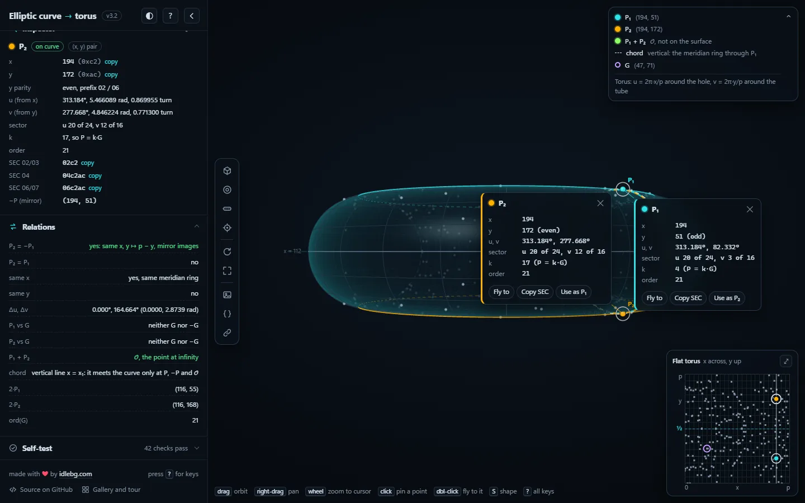
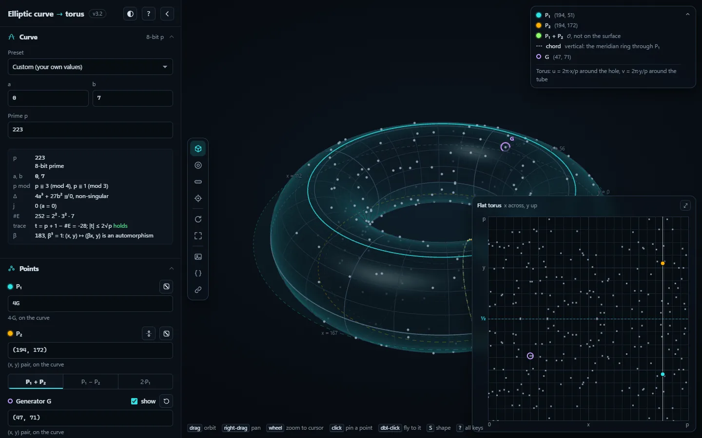
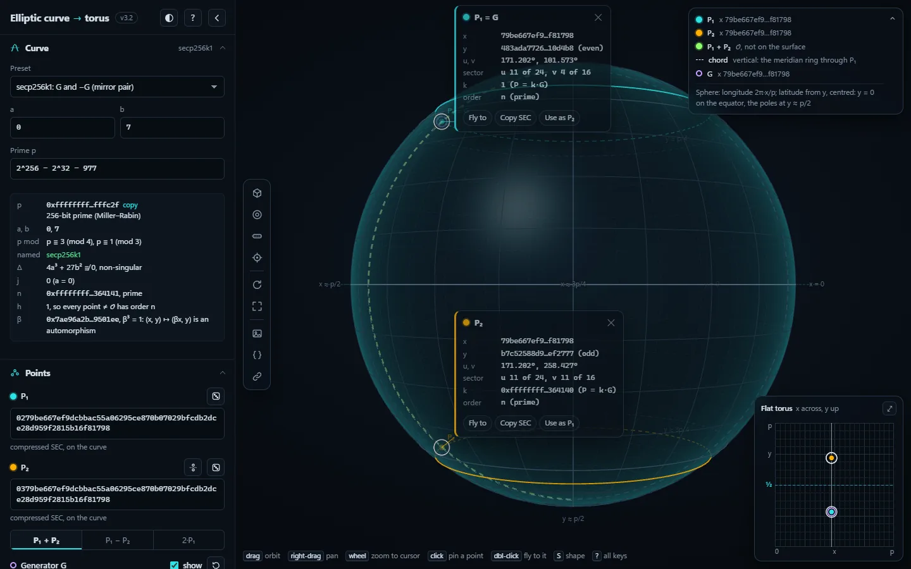
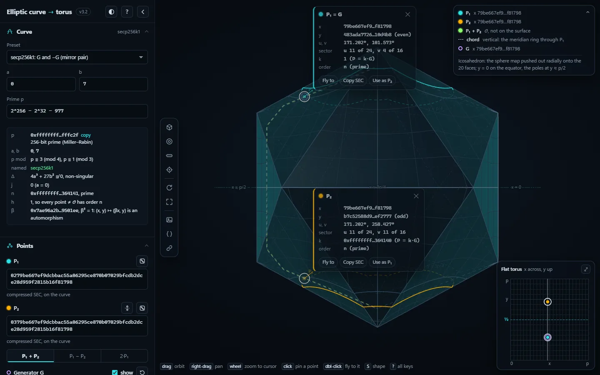
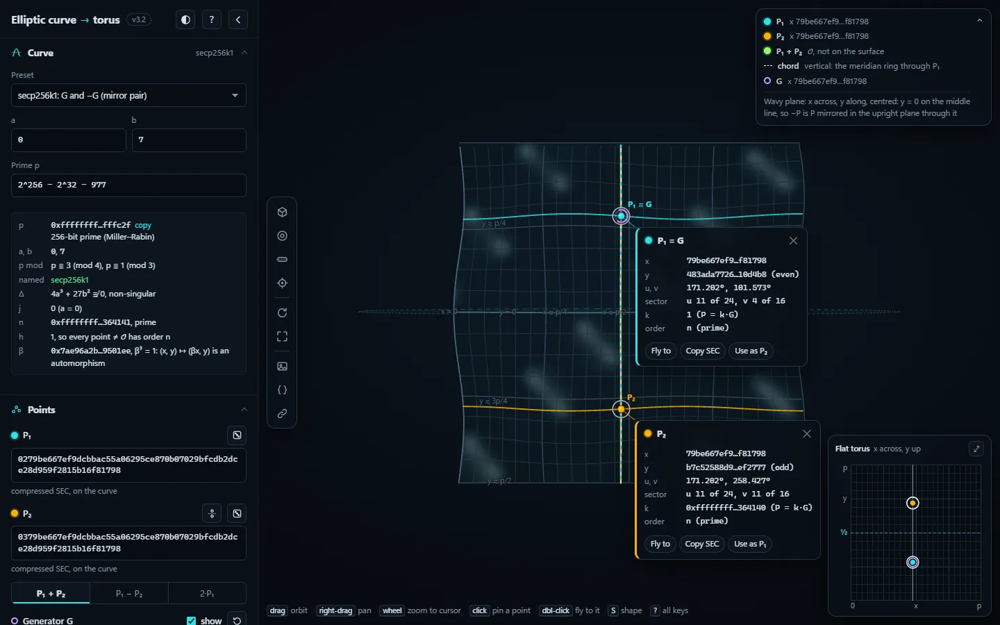
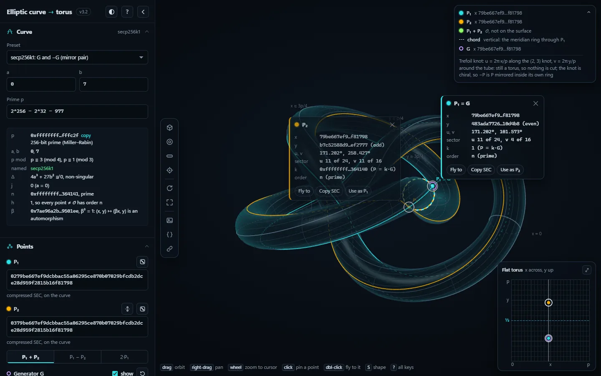

# 15 Mirror images: 02 and 03

**Level 1 · Explorer.** You will learn that every point of the curve has a mirror image, how the visualizer shows it
on the donut, on the flat map and on other shapes, and what the prefixes 02 and 03 of a Bitcoin key have to do with
it. Read first: [13 Why a donut](13-why-a-donut.md) and [14 Two points: how far apart?](14-how-far-apart.md).

## Two points for every x

The rule of the curve gives y² (“y times y”), not y itself. A number squared does not care about its sign: 3 × 3 and
(−3) × (−3) are both 9. So when one y fits, its negative fits too, and on a clock with p hours “minus y” is p − y.
Every point (x, y) therefore has a partner

  −P = (x, p − y),

with the same x and the other y. It is called the [negation](94-glossary.md#negation) of P, or its **mirror image**,
and the next sections show why.

There is one more fact that makes this matter for Bitcoin. p is odd, so y and p − y always have opposite parity: if
one is even, the other is odd. A compressed public key stores x and one extra byte: `02` for “the even y” and `03` for
“the odd y”. So `02` + x and `03` + x are always a point and its mirror image. The visualizer opens with exactly that
pair, G and −G on Bitcoin’s curve:

- G = `0279be667ef9dcbbac55a06295ce870b07029bfcdb2dce28d959f2815b16f81798`
- −G = `0379be667ef9dcbbac55a06295ce870b07029bfcdb2dce28d959f2815b16f81798`

Only the first byte differs.

### Example 15.1 · The mirror button: P₂ = −P₁

On the small curve F₂₂₃, type `4G` into P₁, then click the button next to P₂ whose tooltip says “Set P₂ = −P₁, the
mirror image”.

**Open this view:** [4G and its mirror image](https://idlebg.com/idleGevrek/elliptic_curve_torus_visualizer_v3.html#s=eyJ2IjozLCJwcmVzZXQiOiJjdXN0b20iLCJiYXNlUHJlc2V0IjoicGIyMjMiLCJhIjoiMCIsImIiOiI3IiwicCI6IjIyMyIsImciOiIoNDcsIDcxKSIsInAxIjoiNEciLCJwMiI6IigxOTQsIDE3MikiLCJvcCI6ImFkZCIsInNob3dHIjp0cnVlLCJmb3JjZSI6ZmFsc2UsInNoYXBlIjoidG9ydXMiLCJtYXAiOiJzY2FsZSIsImJpdHMiOjI0LCJzdSI6MjQsInN2IjoxNiwiUiI6MS4yLCJyIjowLjQ2LCJnbGFzcyI6MC41NSwiYmFjayI6MC40LCJzaG93Ijp7ImdyaWQiOnRydWUsInJpbmdzIjp0cnVlLCJsYWJlbHMiOnRydWUsImNsb3VkIjp0cnVlLCJjaG9yZCI6dHJ1ZSwiYmV0YSI6ZmFsc2UsIm1hcCI6dHJ1ZSwic3BpbiI6ZmFsc2V9LCJyaW5ncyI6eyJwMSI6dHJ1ZSwicDIiOnRydWUsInN1bSI6dHJ1ZSwiZyI6ZmFsc2V9LCJ0aGVtZSI6ImRhcmsiLCJwYW5lbCI6dHJ1ZSwibWluaUJpZyI6ZmFsc2UsImxlZ2VuZE1pbiI6ZmFsc2UsInNlY3MiOnsiY3VydmUiOnRydWUsInBvaW50cyI6dHJ1ZSwic2hhcGUiOnRydWUsInZpZXciOnRydWUsImluc3BlY3RvciI6dHJ1ZSwicmVsYXRpb25zIjp0cnVlLCJ0ZXN0IjpmYWxzZX19)

**Do it yourself**

1. In **Curve**, pick the preset **y² = x³ + 7 over F₂₂₃, Programming Bitcoin**.
2. Type `4G` in **P₁**.
3. Click the mirror button next to **P₂** (its tooltip: “Set P₂ = −P₁, the mirror image”).
4. Press **3** for the side view.
5. In the 3D view, click P₁ and P₂ to pin their cards.
6. Read the **Relations** section in the panel.

**Look at:**

- the side view (key **3**): P₁ = 4G = (194, 51) sits on top of the tube and P₂ = (194, 172) straight below it, at
  the bottom of the tube. The button wrote `(194, 172)` into P₂: the same x, and 223 − 51 = 172;
- the cards: u, v = 313.184°, 82.332° and 313.184°, 277.668°. The same u, and the two v add up to 360°;
- the faint plane through the middle of the donut, edge-on in this view: P₁ and P₂ are reflections of each other in
  it, like an object and its image in a still lake;
- **Relations**: “P₂ = −P₁: yes: same x, y ↦ p − y, mirror images”, “same x: yes, same meridian ring” and
  Δv = 164.664°;
- the k rows of the cards: 4 and 17.

**Why:** G has order 21 on this curve, and 4 + 17 = 21. Adding a point to its mirror image gives 𝒪, the point at
infinity, and 21G is 𝒪, so the mirror image of 4G must be 17G. On Bitcoin’s curve the same rule makes the mirror
image of G the key n − 1 (in hex, `fffffffffffffffffffffffffffffffebaaedce6af48a03bbfd25e8cd0364140`).

Relations also says **P₁ + P₂** is “𝒪, the point at infinity”, and the **chord** row explains: “vertical line
x = x₁: it meets the curve only at P, −P and 𝒪”. The dashed ring joining the two points is that vertical line,
drawn on the donut. [24 Adding points](24-chord.md) explains chords.

### Example 15.2 · On the flat map: a flip about the middle line

**Open this view:** [4G and −4G, flat map enlarged](https://idlebg.com/idleGevrek/elliptic_curve_torus_visualizer_v3.html#s=eyJ2IjozLCJwcmVzZXQiOiJjdXN0b20iLCJiYXNlUHJlc2V0IjoicGIyMjMiLCJhIjoiMCIsImIiOiI3IiwicCI6IjIyMyIsImciOiIoNDcsIDcxKSIsInAxIjoiNEciLCJwMiI6IigxOTQsIDE3MikiLCJvcCI6ImFkZCIsInNob3dHIjp0cnVlLCJmb3JjZSI6ZmFsc2UsInNoYXBlIjoidG9ydXMiLCJtYXAiOiJzY2FsZSIsImJpdHMiOjI0LCJzdSI6MjQsInN2IjoxNiwiUiI6MS4yLCJyIjowLjQ2LCJnbGFzcyI6MC41NSwiYmFjayI6MC40LCJzaG93Ijp7ImdyaWQiOnRydWUsInJpbmdzIjp0cnVlLCJsYWJlbHMiOnRydWUsImNsb3VkIjp0cnVlLCJjaG9yZCI6dHJ1ZSwiYmV0YSI6ZmFsc2UsIm1hcCI6dHJ1ZSwic3BpbiI6ZmFsc2V9LCJyaW5ncyI6eyJwMSI6dHJ1ZSwicDIiOnRydWUsInN1bSI6dHJ1ZSwiZyI6ZmFsc2V9LCJ0aGVtZSI6ImRhcmsiLCJwYW5lbCI6dHJ1ZSwibWluaUJpZyI6dHJ1ZSwibGVnZW5kTWluIjpmYWxzZSwic2VjcyI6eyJjdXJ2ZSI6dHJ1ZSwicG9pbnRzIjp0cnVlLCJzaGFwZSI6dHJ1ZSwidmlldyI6dHJ1ZSwiaW5zcGVjdG9yIjp0cnVlLCJyZWxhdGlvbnMiOnRydWUsInRlc3QiOmZhbHNlfX0)

**Do it yourself**

1. In **Curve**, pick the preset **y² = x³ + 7 over F₂₂₃, Programming Bitcoin**.
2. Type `4G` in **P₁**.
3. Click the mirror button next to **P₂** (its tooltip: “Set P₂ = −P₁, the mirror image”).
4. Click **⤢** on the flat map to enlarge it.

**Look at:** the enlarged flat map. The dashed line across the middle, marked ½, is y = p/2. P₁ is below it and P₂ is
above it, exactly as far from the line as P₁, on the same vertical line.

**Why:** y ↦ p − y flips the square upside down around its middle line. That is why the whole cloud of dots on the
map is symmetric top to bottom: every dot has its mirror image across the line. On the donut, the same flip is the
reflection in the middle plane.

## The mirror on other shapes

The visualizer can wrap the same points onto other shapes ([16 One set of points, nine shapes](16-nine-shapes.md)).
It places y on each of them so that the mirror image is still a true reflection. The next four examples show G and −G
on Bitcoin’s curve.

### Example 15.3 · On the sphere: north and south

**Open this view:** [G and −G on the sphere](https://idlebg.com/idleGevrek/elliptic_curve_torus_visualizer_v3.html#s=eyJ2IjozLCJwcmVzZXQiOiJrMS1uZWciLCJiYXNlUHJlc2V0IjoiazEtbmVnIiwiYSI6IjAiLCJiIjoiNyIsInAiOiIyXjI1NiAtIDJeMzIgLSA5NzciLCJnIjoiMDI3OWJlNjY3ZWY5ZGNiYmFjNTVhMDYyOTVjZTg3MGIwNzAyOWJmY2RiMmRjZTI4ZDk1OWYyODE1YjE2ZjgxNzk4IiwicDEiOiIwMjc5YmU2NjdlZjlkY2JiYWM1NWEwNjI5NWNlODcwYjA3MDI5YmZjZGIyZGNlMjhkOTU5ZjI4MTViMTZmODE3OTgiLCJwMiI6IjAzNzliZTY2N2VmOWRjYmJhYzU1YTA2Mjk1Y2U4NzBiMDcwMjliZmNkYjJkY2UyOGQ5NTlmMjgxNWIxNmY4MTc5OCIsIm9wIjoiYWRkIiwic2hvd0ciOnRydWUsImZvcmNlIjpmYWxzZSwic2hhcGUiOiJzcGhlcmUiLCJtYXAiOiJzY2FsZSIsImJpdHMiOjI0LCJzdSI6MjQsInN2IjoxNiwiUiI6MS4yLCJyIjowLjQ2LCJnbGFzcyI6MC41NSwiYmFjayI6MC40LCJzaG93Ijp7ImdyaWQiOnRydWUsInJpbmdzIjp0cnVlLCJsYWJlbHMiOnRydWUsImNsb3VkIjp0cnVlLCJjaG9yZCI6dHJ1ZSwiYmV0YSI6ZmFsc2UsIm1hcCI6dHJ1ZSwic3BpbiI6ZmFsc2V9LCJyaW5ncyI6eyJwMSI6dHJ1ZSwicDIiOnRydWUsInN1bSI6dHJ1ZSwiZyI6ZmFsc2V9LCJ0aGVtZSI6ImRhcmsiLCJwYW5lbCI6dHJ1ZSwibWluaUJpZyI6ZmFsc2UsImxlZ2VuZE1pbiI6ZmFsc2UsInNlY3MiOnsiY3VydmUiOnRydWUsInBvaW50cyI6dHJ1ZSwic2hhcGUiOnRydWUsInZpZXciOnRydWUsImluc3BlY3RvciI6dHJ1ZSwicmVsYXRpb25zIjp0cnVlLCJ0ZXN0IjpmYWxzZX19)

**Do it yourself**

1. In **Curve**, pick the preset **secp256k1: G and −G (mirror pair)**.
2. In **Shape**, pick **Sphere** (or press **S** until it shows).
3. Press **3** for the side view.
4. In the 3D view, click P₁ and P₂ to pin their cards.

**Look at:** G in the northern half and −G in the southern half, at the same longitude and the same distance from the
equator.

**Why:** on the sphere y sets the latitude, with y = 0 on the equator. The equator’s plane is the mirror: north and
south swap, nothing else changes. The same G and −G were 156.853° apart around the tube on the donut.

### Example 15.4 · On the icosahedron

**Open this view:** [G and −G on the icosahedron](https://idlebg.com/idleGevrek/elliptic_curve_torus_visualizer_v3.html#s=eyJ2IjozLCJwcmVzZXQiOiJrMS1uZWciLCJiYXNlUHJlc2V0IjoiazEtbmVnIiwiYSI6IjAiLCJiIjoiNyIsInAiOiIyXjI1NiAtIDJeMzIgLSA5NzciLCJnIjoiMDI3OWJlNjY3ZWY5ZGNiYmFjNTVhMDYyOTVjZTg3MGIwNzAyOWJmY2RiMmRjZTI4ZDk1OWYyODE1YjE2ZjgxNzk4IiwicDEiOiIwMjc5YmU2NjdlZjlkY2JiYWM1NWEwNjI5NWNlODcwYjA3MDI5YmZjZGIyZGNlMjhkOTU5ZjI4MTViMTZmODE3OTgiLCJwMiI6IjAzNzliZTY2N2VmOWRjYmJhYzU1YTA2Mjk1Y2U4NzBiMDcwMjliZmNkYjJkY2UyOGQ5NTlmMjgxNWIxNmY4MTc5OCIsIm9wIjoiYWRkIiwic2hvd0ciOnRydWUsImZvcmNlIjpmYWxzZSwic2hhcGUiOiJpY29zYWhlZHJvbiIsIm1hcCI6InNjYWxlIiwiYml0cyI6MjQsInN1IjoyNCwic3YiOjE2LCJSIjoxLjIsInIiOjAuNDYsImdsYXNzIjowLjU1LCJiYWNrIjowLjQsInNob3ciOnsiZ3JpZCI6dHJ1ZSwicmluZ3MiOnRydWUsImxhYmVscyI6dHJ1ZSwiY2xvdWQiOnRydWUsImNob3JkIjp0cnVlLCJiZXRhIjpmYWxzZSwibWFwIjp0cnVlLCJzcGluIjpmYWxzZX0sInJpbmdzIjp7InAxIjp0cnVlLCJwMiI6dHJ1ZSwic3VtIjp0cnVlLCJnIjpmYWxzZX0sInRoZW1lIjoiZGFyayIsInBhbmVsIjp0cnVlLCJtaW5pQmlnIjpmYWxzZSwibGVnZW5kTWluIjpmYWxzZSwic2VjcyI6eyJjdXJ2ZSI6dHJ1ZSwicG9pbnRzIjp0cnVlLCJzaGFwZSI6dHJ1ZSwidmlldyI6dHJ1ZSwiaW5zcGVjdG9yIjp0cnVlLCJyZWxhdGlvbnMiOnRydWUsInRlc3QiOmZhbHNlfX0)

**Do it yourself**

1. In **Curve**, pick the preset **secp256k1: G and −G (mirror pair)**.
2. In **Shape**, pick **Icosahedron** (or press **S** until it shows).
3. Press **3** for the side view.
4. In the 3D view, click P₁ and P₂ to pin their cards.

**Look at:** the icosahedron (a solid with 20 triangular faces) from the side: G straight above −G.

**Why:** the icosahedron carries the sphere’s map pushed outward onto its faces. It is built so that the plane
through its middle is a mirror of the solid itself, so the reflection still works.

### Example 15.5 · On the wavy plane: an upright mirror

**Open this view:** [G and −G on the wavy plane](https://idlebg.com/idleGevrek/elliptic_curve_torus_visualizer_v3.html#s=eyJ2IjozLCJwcmVzZXQiOiJrMS1uZWciLCJiYXNlUHJlc2V0IjoiazEtbmVnIiwiYSI6IjAiLCJiIjoiNyIsInAiOiIyXjI1NiAtIDJeMzIgLSA5NzciLCJnIjoiMDI3OWJlNjY3ZWY5ZGNiYmFjNTVhMDYyOTVjZTg3MGIwNzAyOWJmY2RiMmRjZTI4ZDk1OWYyODE1YjE2ZjgxNzk4IiwicDEiOiIwMjc5YmU2NjdlZjlkY2JiYWM1NWEwNjI5NWNlODcwYjA3MDI5YmZjZGIyZGNlMjhkOTU5ZjI4MTViMTZmODE3OTgiLCJwMiI6IjAzNzliZTY2N2VmOWRjYmJhYzU1YTA2Mjk1Y2U4NzBiMDcwMjliZmNkYjJkY2UyOGQ5NTlmMjgxNWIxNmY4MTc5OCIsIm9wIjoiYWRkIiwic2hvd0ciOnRydWUsImZvcmNlIjpmYWxzZSwic2hhcGUiOiJ3YXZ5IiwibWFwIjoic2NhbGUiLCJiaXRzIjoyNCwic3UiOjI0LCJzdiI6MTYsIlIiOjEuMiwiciI6MC40NiwiZ2xhc3MiOjAuNTUsImJhY2siOjAuNCwic2hvdyI6eyJncmlkIjp0cnVlLCJyaW5ncyI6dHJ1ZSwibGFiZWxzIjp0cnVlLCJjbG91ZCI6dHJ1ZSwiY2hvcmQiOnRydWUsImJldGEiOmZhbHNlLCJtYXAiOnRydWUsInNwaW4iOmZhbHNlfSwicmluZ3MiOnsicDEiOnRydWUsInAyIjp0cnVlLCJzdW0iOnRydWUsImciOmZhbHNlfSwidGhlbWUiOiJkYXJrIiwicGFuZWwiOnRydWUsIm1pbmlCaWciOmZhbHNlLCJsZWdlbmRNaW4iOmZhbHNlLCJzZWNzIjp7ImN1cnZlIjp0cnVlLCJwb2ludHMiOnRydWUsInNoYXBlIjp0cnVlLCJ2aWV3Ijp0cnVlLCJpbnNwZWN0b3IiOnRydWUsInJlbGF0aW9ucyI6dHJ1ZSwidGVzdCI6ZmFsc2V9fQ)

**Do it yourself**

1. In **Curve**, pick the preset **secp256k1: G and −G (mirror pair)**.
2. In **Shape**, pick **Wavy plane** (or press **S** until it shows).
3. Press **2** for the top view.
4. In the 3D view, click P₁ and P₂ to pin their cards.

**Look at:** from the top, G and −G lie at equal distances on either side of the middle line of the wavy sheet.

**Why:** the wavy plane is the flat map lifted into 3D with waves. Its mirror is the upright plane through its middle
line, which is the flat map’s line y = p/2 standing on edge.

### Example 15.6 · On the trefoil knot: a mirror inside the ring

**Open this view:** [G and −G on the trefoil](https://idlebg.com/idleGevrek/elliptic_curve_torus_visualizer_v3.html#s=eyJ2IjozLCJwcmVzZXQiOiJrMS1uZWciLCJiYXNlUHJlc2V0IjoiazEtbmVnIiwiYSI6IjAiLCJiIjoiNyIsInAiOiIyXjI1NiAtIDJeMzIgLSA5NzciLCJnIjoiMDI3OWJlNjY3ZWY5ZGNiYmFjNTVhMDYyOTVjZTg3MGIwNzAyOWJmY2RiMmRjZTI4ZDk1OWYyODE1YjE2ZjgxNzk4IiwicDEiOiIwMjc5YmU2NjdlZjlkY2JiYWM1NWEwNjI5NWNlODcwYjA3MDI5YmZjZGIyZGNlMjhkOTU5ZjI4MTViMTZmODE3OTgiLCJwMiI6IjAzNzliZTY2N2VmOWRjYmJhYzU1YTA2Mjk1Y2U4NzBiMDcwMjliZmNkYjJkY2UyOGQ5NTlmMjgxNWIxNmY4MTc5OCIsIm9wIjoiYWRkIiwic2hvd0ciOnRydWUsImZvcmNlIjpmYWxzZSwic2hhcGUiOiJ0cmVmb2lsIiwibWFwIjoic2NhbGUiLCJiaXRzIjoyNCwic3UiOjI0LCJzdiI6MTYsIlIiOjEuMiwiciI6MC40NiwiZ2xhc3MiOjAuNTUsImJhY2siOjAuNCwic2hvdyI6eyJncmlkIjp0cnVlLCJyaW5ncyI6dHJ1ZSwibGFiZWxzIjp0cnVlLCJjbG91ZCI6dHJ1ZSwiY2hvcmQiOnRydWUsImJldGEiOmZhbHNlLCJtYXAiOnRydWUsInNwaW4iOmZhbHNlfSwicmluZ3MiOnsicDEiOnRydWUsInAyIjp0cnVlLCJzdW0iOnRydWUsImciOmZhbHNlfSwidGhlbWUiOiJkYXJrIiwicGFuZWwiOnRydWUsIm1pbmlCaWciOmZhbHNlLCJsZWdlbmRNaW4iOmZhbHNlLCJzZWNzIjp7ImN1cnZlIjp0cnVlLCJwb2ludHMiOnRydWUsInNoYXBlIjp0cnVlLCJ2aWV3Ijp0cnVlLCJpbnNwZWN0b3IiOnRydWUsInJlbGF0aW9ucyI6dHJ1ZSwidGVzdCI6ZmFsc2V9fQ)

**Do it yourself**

1. In **Curve**, pick the preset **secp256k1: G and −G (mirror pair)**.
2. In **Shape**, pick **Trefoil knot** (or press **S** until it shows).
3. In the 3D view, click P₁ and P₂ to pin their cards.

**Look at:** G and −G on the same ring around the knotted tube, on opposite sides of it.

**Why:** a knot has a handedness, like a left and a right glove: no mirror turns the knot into itself, so there is no
mirror plane for the whole shape. The visualizer still keeps −P a reflection, but a local one: P is mirrored inside
its own ring, across the plane that runs along the knot through the middle of that ring.

## Try it yourself

- In Example 15.1, type other multiples into P₁ (`2G`, `7G`, `10G`) and press the mirror button each time. The two
  k always add up to 21.
- On Bitcoin’s curve, type `02` followed by any key’s x into P₁ and `03` with the same x into P₂ (copy the x from the
  Inspector). Relations always says they are mirror images.
- Press **S** with Example 15.1 open and watch the pair on every shape; on the trefoil, look for the shared ring.

## Recap

- Every point P = (x, y) has a mirror image −P = (x, p − y); a point plus its mirror image is 𝒪.
- 02 and 03 in front of the same x name the two mirror images: one has an even y, the other an odd y.
- On the donut −P is the reflection in the middle plane (edge-on in the side view); on the flat map it is a flip about
  y = p/2; every other shape keeps it a reflection.

Next: [16 One set of points, nine shapes](16-nine-shapes.md).
