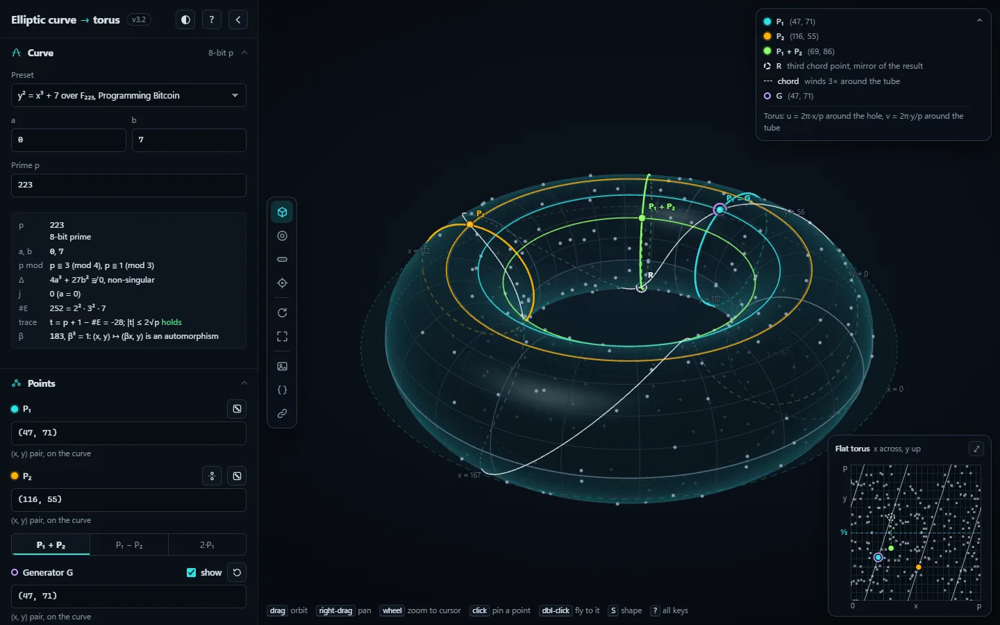
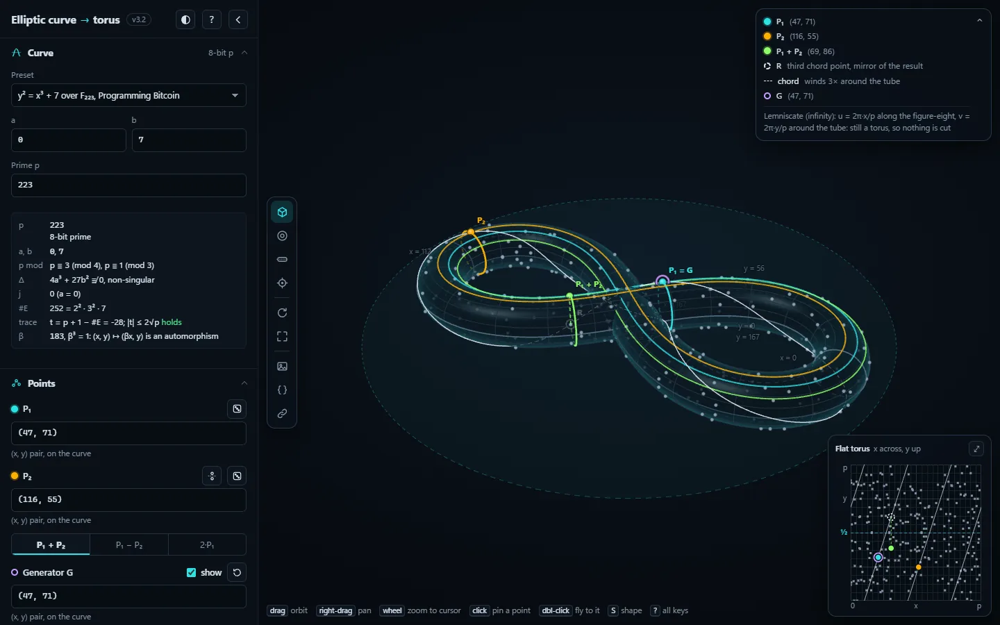
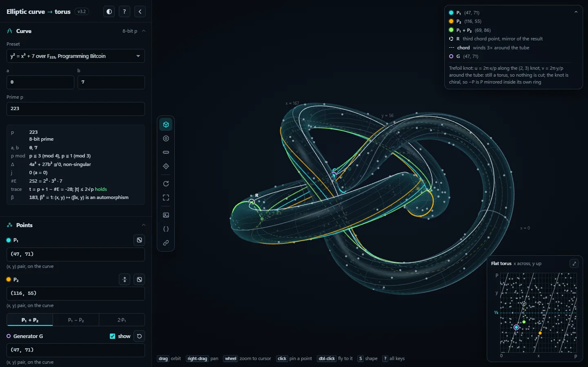
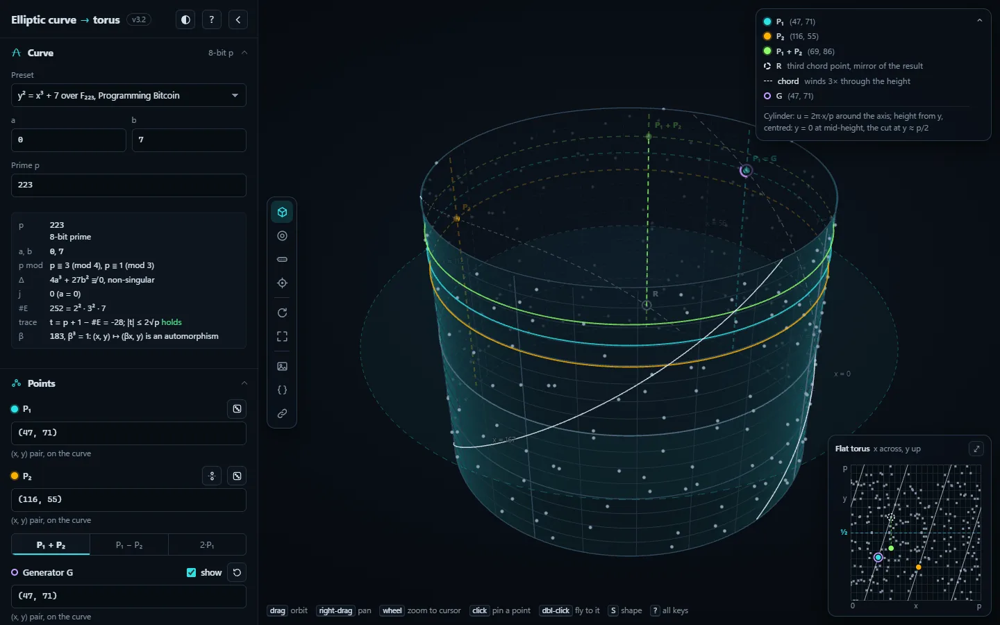
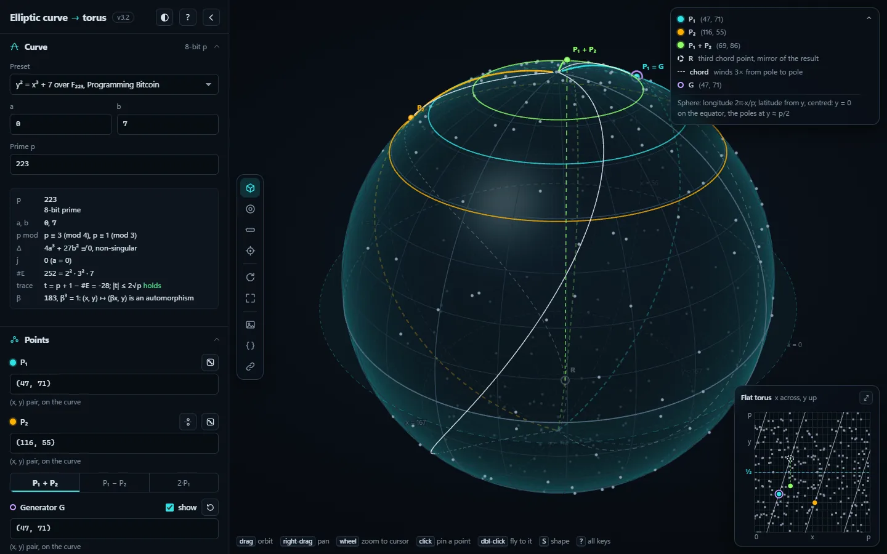
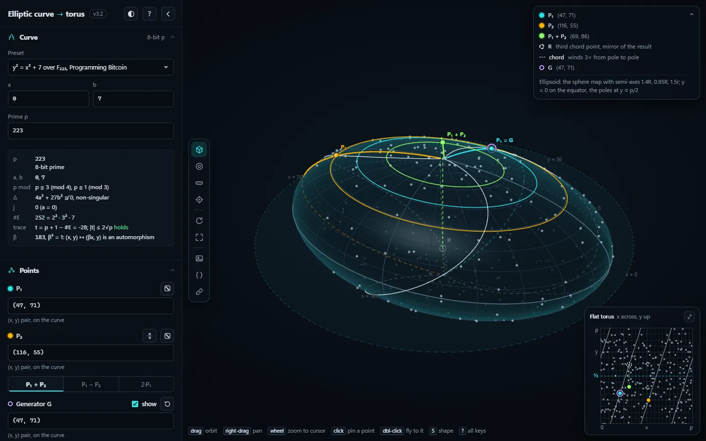
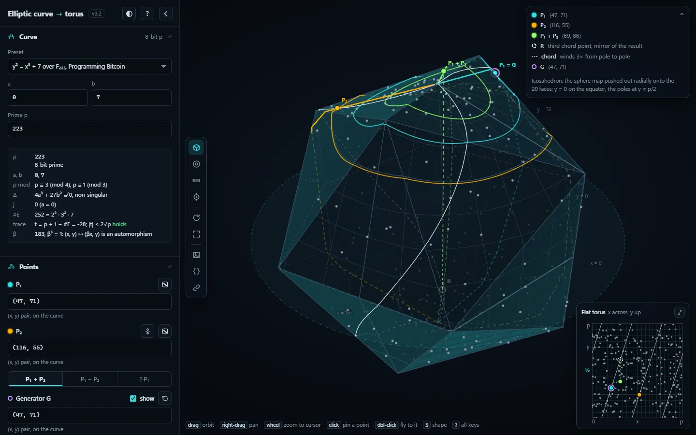
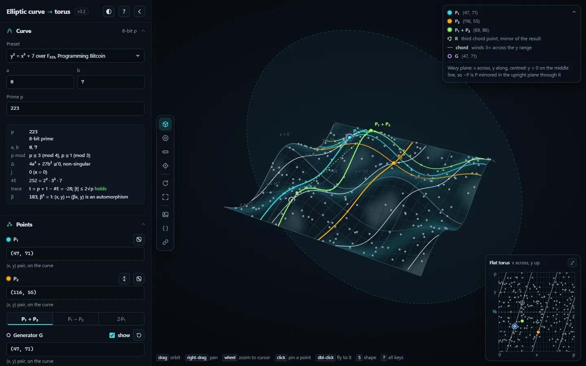
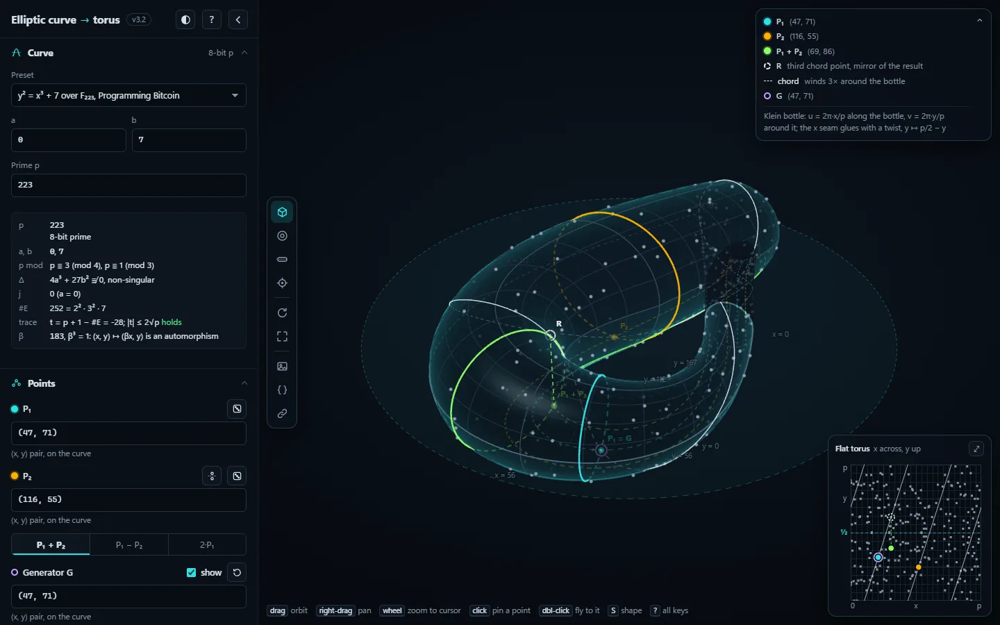

# 16 One set of points, nine shapes

**Level 1 · Explorer.** You will see the same points on all nine shapes the visualizer offers, learn which shapes keep
the donut’s wrap-around and which cut it open, and why the mirror image survives every cut. Read first:
[13 Why a donut](13-why-a-donut.md) and [15 Mirror images](15-mirror-images.md).

## Same numbers, different wrapping

The numbers never change when you change the shape: the points, their sums, Relations and the flat map all stay the
same. Only the 3D picture changes: the square of all pairs (x, y) is wrapped onto a different surface. You switch
shapes with the tiles in the **Shape** section, or with **S** (next) and **Shift** + **S** (previous). The surface
then morphs smoothly from the old shape into the new one.

The examples below all show one state, the preset “y² = x³ + 7 over F₂₂₃, Programming Bitcoin”: G and 8G = (116, 55)
with the line through them, the third point R where that line meets the curve again, and the sum
G + 8G = 9G = (69, 86). The line goes once around the hole and 3 times around the tube; chapter
[24 Adding points](24-chord.md) explains why. Here it is just a good test: a line that crosses every part of the
surface shows where a shape cuts it.

Each picture links to its own state; the legend at its top right repeats how that shape places x and y.

## Shapes that are still a torus

Three shapes keep both directions closed. Nothing is cut, so every ring and the whole line stay in one piece.

### Torus

**Open this view:** [Torus](https://idlebg.com/idleGevrek/elliptic_curve_torus_visualizer_v3.html#s=eyJ2IjozLCJwcmVzZXQiOiJwYjIyMyIsImJhc2VQcmVzZXQiOiJwYjIyMyIsImEiOiIwIiwiYiI6IjciLCJwIjoiMjIzIiwiZyI6Iig0NywgNzEpIiwicDEiOiIoNDcsIDcxKSIsInAyIjoiKDExNiwgNTUpIiwib3AiOiJhZGQiLCJzaG93RyI6dHJ1ZSwiZm9yY2UiOmZhbHNlLCJzaGFwZSI6InRvcnVzIiwibWFwIjoic2NhbGUiLCJiaXRzIjoyNCwic3UiOjI0LCJzdiI6MTYsIlIiOjEuMiwiciI6MC40NiwiZ2xhc3MiOjAuNTUsImJhY2siOjAuNCwic2hvdyI6eyJncmlkIjp0cnVlLCJyaW5ncyI6dHJ1ZSwibGFiZWxzIjp0cnVlLCJjbG91ZCI6dHJ1ZSwiY2hvcmQiOnRydWUsImJldGEiOmZhbHNlLCJtYXAiOnRydWUsInNwaW4iOmZhbHNlfSwicmluZ3MiOnsicDEiOnRydWUsInAyIjp0cnVlLCJzdW0iOnRydWUsImciOmZhbHNlfSwidGhlbWUiOiJkYXJrIiwicGFuZWwiOnRydWUsIm1pbmlCaWciOmZhbHNlLCJsZWdlbmRNaW4iOmZhbHNlLCJzZWNzIjp7ImN1cnZlIjp0cnVlLCJwb2ludHMiOnRydWUsInNoYXBlIjp0cnVlLCJ2aWV3Ijp0cnVlLCJpbnNwZWN0b3IiOnRydWUsInJlbGF0aW9ucyI6dHJ1ZSwidGVzdCI6ZmFsc2V9fQ) · In **Curve**, pick the preset **y² = x³ + 7 over F₂₂₃, Programming Bitcoin**.

The donut: x goes around the hole and y around the tube.

### Lemniscate ∞

**Open this view:** [Lemniscate (infinity)](https://idlebg.com/idleGevrek/elliptic_curve_torus_visualizer_v3.html#s=eyJ2IjozLCJwcmVzZXQiOiJwYjIyMyIsImJhc2VQcmVzZXQiOiJwYjIyMyIsImEiOiIwIiwiYiI6IjciLCJwIjoiMjIzIiwiZyI6Iig0NywgNzEpIiwicDEiOiIoNDcsIDcxKSIsInAyIjoiKDExNiwgNTUpIiwib3AiOiJhZGQiLCJzaG93RyI6dHJ1ZSwiZm9yY2UiOmZhbHNlLCJzaGFwZSI6ImxlbW5pc2NhdGUiLCJtYXAiOiJzY2FsZSIsImJpdHMiOjI0LCJzdSI6MjQsInN2IjoxNiwiUiI6MS4yLCJyIjowLjQ2LCJnbGFzcyI6MC41NSwiYmFjayI6MC40LCJzaG93Ijp7ImdyaWQiOnRydWUsInJpbmdzIjp0cnVlLCJsYWJlbHMiOnRydWUsImNsb3VkIjp0cnVlLCJjaG9yZCI6dHJ1ZSwiYmV0YSI6ZmFsc2UsIm1hcCI6dHJ1ZSwic3BpbiI6ZmFsc2V9LCJyaW5ncyI6eyJwMSI6dHJ1ZSwicDIiOnRydWUsInN1bSI6dHJ1ZSwiZyI6ZmFsc2V9LCJ0aGVtZSI6ImRhcmsiLCJwYW5lbCI6dHJ1ZSwibWluaUJpZyI6ZmFsc2UsImxlZ2VuZE1pbiI6ZmFsc2UsInNlY3MiOnsiY3VydmUiOnRydWUsInBvaW50cyI6dHJ1ZSwic2hhcGUiOnRydWUsInZpZXciOnRydWUsImluc3BlY3RvciI6dHJ1ZSwicmVsYXRpb25zIjp0cnVlLCJ0ZXN0IjpmYWxzZX19) · In **Curve**, pick the preset **y² = x³ + 7 over F₂₂₃, Programming Bitcoin**. In **Shape**, pick **Lemniscate ∞** (or press **S** until it shows).

A tube bent into a figure-eight (the “infinity” sign). x runs along the figure-eight, y around the tube. It is still a
torus, only bent differently, so the line still winds 3 times around the tube while it runs once along the eight.

### Trefoil knot

**Open this view:** [Trefoil knot](https://idlebg.com/idleGevrek/elliptic_curve_torus_visualizer_v3.html#s=eyJ2IjozLCJwcmVzZXQiOiJwYjIyMyIsImJhc2VQcmVzZXQiOiJwYjIyMyIsImEiOiIwIiwiYiI6IjciLCJwIjoiMjIzIiwiZyI6Iig0NywgNzEpIiwicDEiOiIoNDcsIDcxKSIsInAyIjoiKDExNiwgNTUpIiwib3AiOiJhZGQiLCJzaG93RyI6dHJ1ZSwiZm9yY2UiOmZhbHNlLCJzaGFwZSI6InRyZWZvaWwiLCJtYXAiOiJzY2FsZSIsImJpdHMiOjI0LCJzdSI6MjQsInN2IjoxNiwiUiI6MS4yLCJyIjowLjQ2LCJnbGFzcyI6MC41NSwiYmFjayI6MC40LCJzaG93Ijp7ImdyaWQiOnRydWUsInJpbmdzIjp0cnVlLCJsYWJlbHMiOnRydWUsImNsb3VkIjp0cnVlLCJjaG9yZCI6dHJ1ZSwiYmV0YSI6ZmFsc2UsIm1hcCI6dHJ1ZSwic3BpbiI6ZmFsc2V9LCJyaW5ncyI6eyJwMSI6dHJ1ZSwicDIiOnRydWUsInN1bSI6dHJ1ZSwiZyI6ZmFsc2V9LCJ0aGVtZSI6ImRhcmsiLCJwYW5lbCI6dHJ1ZSwibWluaUJpZyI6ZmFsc2UsImxlZ2VuZE1pbiI6ZmFsc2UsInNlY3MiOnsiY3VydmUiOnRydWUsInBvaW50cyI6dHJ1ZSwic2hhcGUiOnRydWUsInZpZXciOnRydWUsImluc3BlY3RvciI6dHJ1ZSwicmVsYXRpb25zIjp0cnVlLCJ0ZXN0IjpmYWxzZX19) · In **Curve**, pick the preset **y² = x³ + 7 over F₂₂₃, Programming Bitcoin**. In **Shape**, pick **Trefoil knot** (or press **S** until it shows).

A tube tied into the simplest knot: go twice around the centre while winding three times around a ring, and the tube
closes on itself with a knot in it. It is still a torus, so nothing is cut. A knot has a handedness, which is why the
mirror image on this shape is a reflection inside each ring ([Example 15.6](15-mirror-images.md#example-156--on-the-trefoil-knot-a-mirror-inside-the-ring)).

## Shapes cut open along y

Four shapes cannot close the y direction, so they cut the donut along one ring, at y ≈ p/2: the ring that is
farthest from y = 0. A line that crosses the cut stops there and continues from the other edge.

### Cylinder

**Open this view:** [Cylinder](https://idlebg.com/idleGevrek/elliptic_curve_torus_visualizer_v3.html#s=eyJ2IjozLCJwcmVzZXQiOiJwYjIyMyIsImJhc2VQcmVzZXQiOiJwYjIyMyIsImEiOiIwIiwiYiI6IjciLCJwIjoiMjIzIiwiZyI6Iig0NywgNzEpIiwicDEiOiIoNDcsIDcxKSIsInAyIjoiKDExNiwgNTUpIiwib3AiOiJhZGQiLCJzaG93RyI6dHJ1ZSwiZm9yY2UiOmZhbHNlLCJzaGFwZSI6ImN5bGluZGVyIiwibWFwIjoic2NhbGUiLCJiaXRzIjoyNCwic3UiOjI0LCJzdiI6MTYsIlIiOjEuMiwiciI6MC40NiwiZ2xhc3MiOjAuNTUsImJhY2siOjAuNCwic2hvdyI6eyJncmlkIjp0cnVlLCJyaW5ncyI6dHJ1ZSwibGFiZWxzIjp0cnVlLCJjbG91ZCI6dHJ1ZSwiY2hvcmQiOnRydWUsImJldGEiOmZhbHNlLCJtYXAiOnRydWUsInNwaW4iOmZhbHNlfSwicmluZ3MiOnsicDEiOnRydWUsInAyIjp0cnVlLCJzdW0iOnRydWUsImciOmZhbHNlfSwidGhlbWUiOiJkYXJrIiwicGFuZWwiOnRydWUsIm1pbmlCaWciOmZhbHNlLCJsZWdlbmRNaW4iOmZhbHNlLCJzZWNzIjp7ImN1cnZlIjp0cnVlLCJwb2ludHMiOnRydWUsInNoYXBlIjp0cnVlLCJ2aWV3Ijp0cnVlLCJpbnNwZWN0b3IiOnRydWUsInJlbGF0aW9ucyI6dHJ1ZSwidGVzdCI6ZmFsc2V9fQ) · In **Curve**, pick the preset **y² = x³ + 7 over F₂₂₃, Programming Bitcoin**. In **Shape**, pick **Cylinder** (or press **S** until it shows).

x goes around the axis, y goes up the height. y = 0 is at mid-height, and the cut is the top and bottom edge. The line
crosses the height 3 times, so it breaks at the edges 3 times.

### Sphere

**Open this view:** [Sphere](https://idlebg.com/idleGevrek/elliptic_curve_torus_visualizer_v3.html#s=eyJ2IjozLCJwcmVzZXQiOiJwYjIyMyIsImJhc2VQcmVzZXQiOiJwYjIyMyIsImEiOiIwIiwiYiI6IjciLCJwIjoiMjIzIiwiZyI6Iig0NywgNzEpIiwicDEiOiIoNDcsIDcxKSIsInAyIjoiKDExNiwgNTUpIiwib3AiOiJhZGQiLCJzaG93RyI6dHJ1ZSwiZm9yY2UiOmZhbHNlLCJzaGFwZSI6InNwaGVyZSIsIm1hcCI6InNjYWxlIiwiYml0cyI6MjQsInN1IjoyNCwic3YiOjE2LCJSIjoxLjIsInIiOjAuNDYsImdsYXNzIjowLjU1LCJiYWNrIjowLjQsInNob3ciOnsiZ3JpZCI6dHJ1ZSwicmluZ3MiOnRydWUsImxhYmVscyI6dHJ1ZSwiY2xvdWQiOnRydWUsImNob3JkIjp0cnVlLCJiZXRhIjpmYWxzZSwibWFwIjp0cnVlLCJzcGluIjpmYWxzZX0sInJpbmdzIjp7InAxIjp0cnVlLCJwMiI6dHJ1ZSwic3VtIjp0cnVlLCJnIjpmYWxzZX0sInRoZW1lIjoiZGFyayIsInBhbmVsIjp0cnVlLCJtaW5pQmlnIjpmYWxzZSwibGVnZW5kTWluIjpmYWxzZSwic2VjcyI6eyJjdXJ2ZSI6dHJ1ZSwicG9pbnRzIjp0cnVlLCJzaGFwZSI6dHJ1ZSwidmlldyI6dHJ1ZSwiaW5zcGVjdG9yIjp0cnVlLCJyZWxhdGlvbnMiOnRydWUsInRlc3QiOmZhbHNlfX0) · In **Curve**, pick the preset **y² = x³ + 7 over F₂₂₃, Programming Bitcoin**. In **Shape**, pick **Sphere** (or press **S** until it shows).

x is the longitude, y the latitude: y = 0 on the equator, the cut squeezed into the two poles. The line runs from pole
to pole 3 times.

### Ellipsoid

**Open this view:** [Ellipsoid](https://idlebg.com/idleGevrek/elliptic_curve_torus_visualizer_v3.html#s=eyJ2IjozLCJwcmVzZXQiOiJwYjIyMyIsImJhc2VQcmVzZXQiOiJwYjIyMyIsImEiOiIwIiwiYiI6IjciLCJwIjoiMjIzIiwiZyI6Iig0NywgNzEpIiwicDEiOiIoNDcsIDcxKSIsInAyIjoiKDExNiwgNTUpIiwib3AiOiJhZGQiLCJzaG93RyI6dHJ1ZSwiZm9yY2UiOmZhbHNlLCJzaGFwZSI6ImVsbGlwc29pZCIsIm1hcCI6InNjYWxlIiwiYml0cyI6MjQsInN1IjoyNCwic3YiOjE2LCJSIjoxLjIsInIiOjAuNDYsImdsYXNzIjowLjU1LCJiYWNrIjowLjQsInNob3ciOnsiZ3JpZCI6dHJ1ZSwicmluZ3MiOnRydWUsImxhYmVscyI6dHJ1ZSwiY2xvdWQiOnRydWUsImNob3JkIjp0cnVlLCJiZXRhIjpmYWxzZSwibWFwIjp0cnVlLCJzcGluIjpmYWxzZX0sInJpbmdzIjp7InAxIjp0cnVlLCJwMiI6dHJ1ZSwic3VtIjp0cnVlLCJnIjpmYWxzZX0sInRoZW1lIjoiZGFyayIsInBhbmVsIjp0cnVlLCJtaW5pQmlnIjpmYWxzZSwibGVnZW5kTWluIjpmYWxzZSwic2VjcyI6eyJjdXJ2ZSI6dHJ1ZSwicG9pbnRzIjp0cnVlLCJzaGFwZSI6dHJ1ZSwidmlldyI6dHJ1ZSwiaW5zcGVjdG9yIjp0cnVlLCJyZWxhdGlvbnMiOnRydWUsInRlc3QiOmZhbHNlfX0) · In **Curve**, pick the preset **y² = x³ + 7 over F₂₂₃, Programming Bitcoin**. In **Shape**, pick **Ellipsoid** (or press **S** until it shows).

The sphere’s map on a stretched ball. Its proportions follow the two size sliders.

### Icosahedron

**Open this view:** [Icosahedron](https://idlebg.com/idleGevrek/elliptic_curve_torus_visualizer_v3.html#s=eyJ2IjozLCJwcmVzZXQiOiJwYjIyMyIsImJhc2VQcmVzZXQiOiJwYjIyMyIsImEiOiIwIiwiYiI6IjciLCJwIjoiMjIzIiwiZyI6Iig0NywgNzEpIiwicDEiOiIoNDcsIDcxKSIsInAyIjoiKDExNiwgNTUpIiwib3AiOiJhZGQiLCJzaG93RyI6dHJ1ZSwiZm9yY2UiOmZhbHNlLCJzaGFwZSI6Imljb3NhaGVkcm9uIiwibWFwIjoic2NhbGUiLCJiaXRzIjoyNCwic3UiOjI0LCJzdiI6MTYsIlIiOjEuMiwiciI6MC40NiwiZ2xhc3MiOjAuNTUsImJhY2siOjAuNCwic2hvdyI6eyJncmlkIjp0cnVlLCJyaW5ncyI6dHJ1ZSwibGFiZWxzIjp0cnVlLCJjbG91ZCI6dHJ1ZSwiY2hvcmQiOnRydWUsImJldGEiOmZhbHNlLCJtYXAiOnRydWUsInNwaW4iOmZhbHNlfSwicmluZ3MiOnsicDEiOnRydWUsInAyIjp0cnVlLCJzdW0iOnRydWUsImciOmZhbHNlfSwidGhlbWUiOiJkYXJrIiwicGFuZWwiOnRydWUsIm1pbmlCaWciOmZhbHNlLCJsZWdlbmRNaW4iOmZhbHNlLCJzZWNzIjp7ImN1cnZlIjp0cnVlLCJwb2ludHMiOnRydWUsInNoYXBlIjp0cnVlLCJ2aWV3Ijp0cnVlLCJpbnNwZWN0b3IiOnRydWUsInJlbGF0aW9ucyI6dHJ1ZSwidGVzdCI6ZmFsc2V9fQ) · In **Curve**, pick the preset **y² = x³ + 7 over F₂₂₃, Programming Bitcoin**. In **Shape**, pick **Icosahedron** (or press **S** until it shows).

The sphere’s map pushed outward onto a solid with 20 triangular faces; its 30 edges are drawn.

## The two odd ones out

### Wavy plane

**Open this view:** [Wavy plane](https://idlebg.com/idleGevrek/elliptic_curve_torus_visualizer_v3.html#s=eyJ2IjozLCJwcmVzZXQiOiJwYjIyMyIsImJhc2VQcmVzZXQiOiJwYjIyMyIsImEiOiIwIiwiYiI6IjciLCJwIjoiMjIzIiwiZyI6Iig0NywgNzEpIiwicDEiOiIoNDcsIDcxKSIsInAyIjoiKDExNiwgNTUpIiwib3AiOiJhZGQiLCJzaG93RyI6dHJ1ZSwiZm9yY2UiOmZhbHNlLCJzaGFwZSI6IndhdnkiLCJtYXAiOiJzY2FsZSIsImJpdHMiOjI0LCJzdSI6MjQsInN2IjoxNiwiUiI6MS4yLCJyIjowLjQ2LCJnbGFzcyI6MC41NSwiYmFjayI6MC40LCJzaG93Ijp7ImdyaWQiOnRydWUsInJpbmdzIjp0cnVlLCJsYWJlbHMiOnRydWUsImNsb3VkIjp0cnVlLCJjaG9yZCI6dHJ1ZSwiYmV0YSI6ZmFsc2UsIm1hcCI6dHJ1ZSwic3BpbiI6ZmFsc2V9LCJyaW5ncyI6eyJwMSI6dHJ1ZSwicDIiOnRydWUsInN1bSI6dHJ1ZSwiZyI6ZmFsc2V9LCJ0aGVtZSI6ImRhcmsiLCJwYW5lbCI6dHJ1ZSwibWluaUJpZyI6ZmFsc2UsImxlZ2VuZE1pbiI6ZmFsc2UsInNlY3MiOnsiY3VydmUiOnRydWUsInBvaW50cyI6dHJ1ZSwic2hhcGUiOnRydWUsInZpZXciOnRydWUsImluc3BlY3RvciI6dHJ1ZSwicmVsYXRpb25zIjp0cnVlLCJ0ZXN0IjpmYWxzZX19) · In **Curve**, pick the preset **y² = x³ + 7 over F₂₂₃, Programming Bitcoin**. In **Shape**, pick **Wavy plane** (or press **S** until it shows).

The flat map itself, lifted into 3D with waves. Both directions are cut: x across, y along. The line crosses the y
range 3 times and breaks at the edges each time. Its mirror is the upright plane through the middle line.

### Klein bottle

**Open this view:** [Klein bottle](https://idlebg.com/idleGevrek/elliptic_curve_torus_visualizer_v3.html#s=eyJ2IjozLCJwcmVzZXQiOiJwYjIyMyIsImJhc2VQcmVzZXQiOiJwYjIyMyIsImEiOiIwIiwiYiI6IjciLCJwIjoiMjIzIiwiZyI6Iig0NywgNzEpIiwicDEiOiIoNDcsIDcxKSIsInAyIjoiKDExNiwgNTUpIiwib3AiOiJhZGQiLCJzaG93RyI6dHJ1ZSwiZm9yY2UiOmZhbHNlLCJzaGFwZSI6ImtsZWluIiwibWFwIjoic2NhbGUiLCJiaXRzIjoyNCwic3UiOjI0LCJzdiI6MTYsIlIiOjEuMiwiciI6MC40NiwiZ2xhc3MiOjAuNTUsImJhY2siOjAuNCwic2hvdyI6eyJncmlkIjp0cnVlLCJyaW5ncyI6dHJ1ZSwibGFiZWxzIjp0cnVlLCJjbG91ZCI6dHJ1ZSwiY2hvcmQiOnRydWUsImJldGEiOmZhbHNlLCJtYXAiOnRydWUsInNwaW4iOmZhbHNlfSwicmluZ3MiOnsicDEiOnRydWUsInAyIjp0cnVlLCJzdW0iOnRydWUsImciOmZhbHNlfSwidGhlbWUiOiJkYXJrIiwicGFuZWwiOnRydWUsIm1pbmlCaWciOmZhbHNlLCJsZWdlbmRNaW4iOmZhbHNlLCJzZWNzIjp7ImN1cnZlIjp0cnVlLCJwb2ludHMiOnRydWUsInNoYXBlIjp0cnVlLCJ2aWV3Ijp0cnVlLCJpbnNwZWN0b3IiOnRydWUsInJlbGF0aW9ucyI6dHJ1ZSwidGVzdCI6ZmFsc2V9fQ) · In **Curve**, pick the preset **y² = x³ + 7 over F₂₂₃, Programming Bitcoin**. In **Shape**, pick **Klein bottle** (or press **S** until it shows).

A surface with no inside and no outside: it closes up around y, but its x ends are glued with a twist, so that
y ↦ p/2 − y across that seam. Lines break there. Because it has no outside, its glass is drawn from both sides.

## Why the mirror image survives every cut

Every shape that cuts y cuts it at y ≈ p/2 and puts y = 0 in the middle. The mirror image swaps y and p − y, which
keeps y = 0 where it is and swaps the two sides of the middle. So on every shape the mirror is still a reflection: in
the plane of the equator (sphere, ellipsoid, icosahedron), the mid-height plane (cylinder), the upright middle plane
(wavy plane), or inside each ring (trefoil). Chapter [47 Shapes as topology](47-shapes-topology.md) says this
precisely for every shape.

## Try it yourself

- Open the torus picture and press **S** slowly, nine times, to watch every morph.
- On the sphere, press **3** for the side view: the line runs from pole to pole.
- Change the two size sliders in **Shape** on each shape: they mean different things (radius, height, tube, waves),
  and the second one is greyed out where a shape does not use it.
- Try the shapes with Example 15.1 open (4G and its mirror image).

## Recap

- The shape changes only the 3D picture; the numbers, Relations and the flat map stay the same.
- Torus, lemniscate and trefoil keep both directions closed; cylinder, sphere, ellipsoid and icosahedron cut y at
  y ≈ p/2; the wavy plane cuts both, and the Klein bottle glues x with a twist.
- y = 0 is always on the mirror, so −P stays a reflection on every shape.

Next: [17 Save, share, export](17-save-share-export.md).
