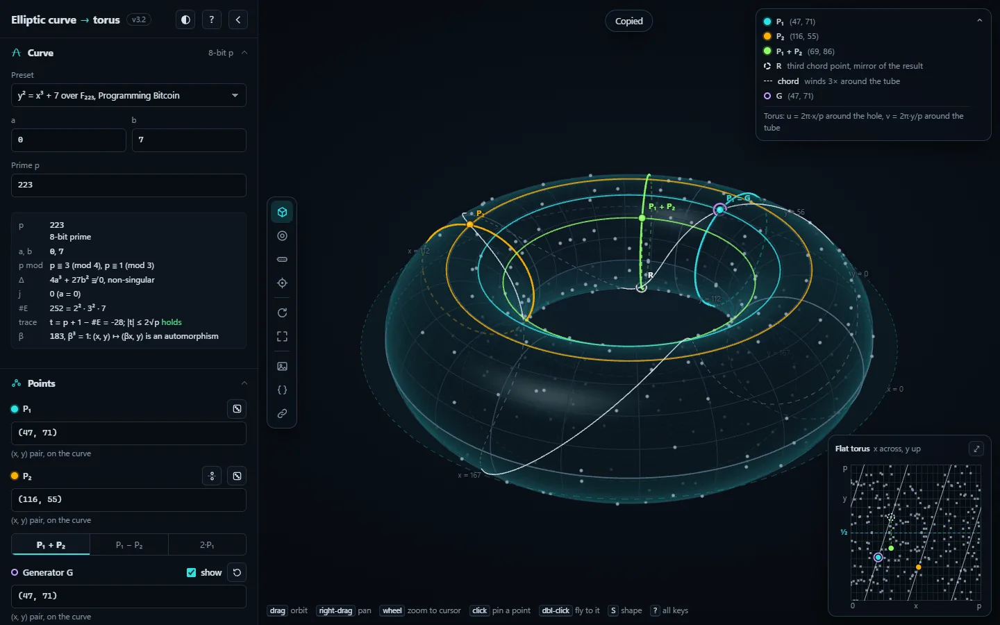
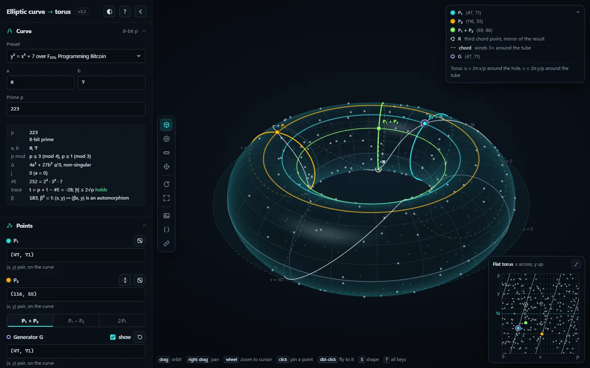
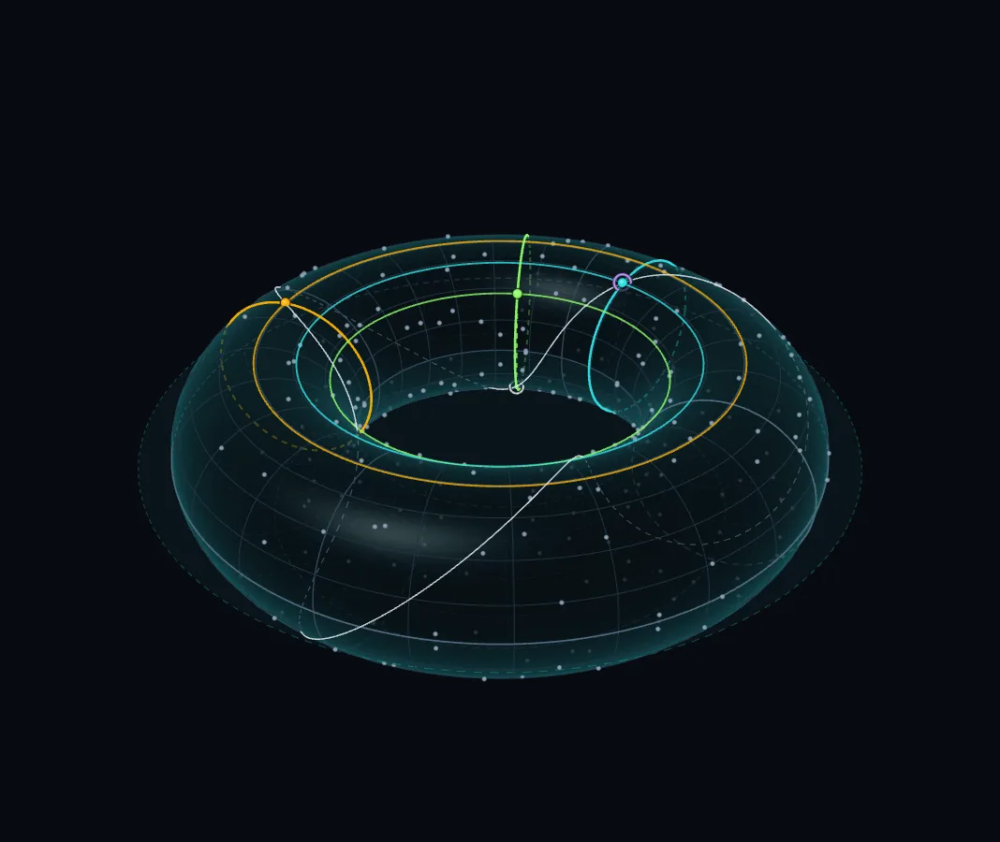
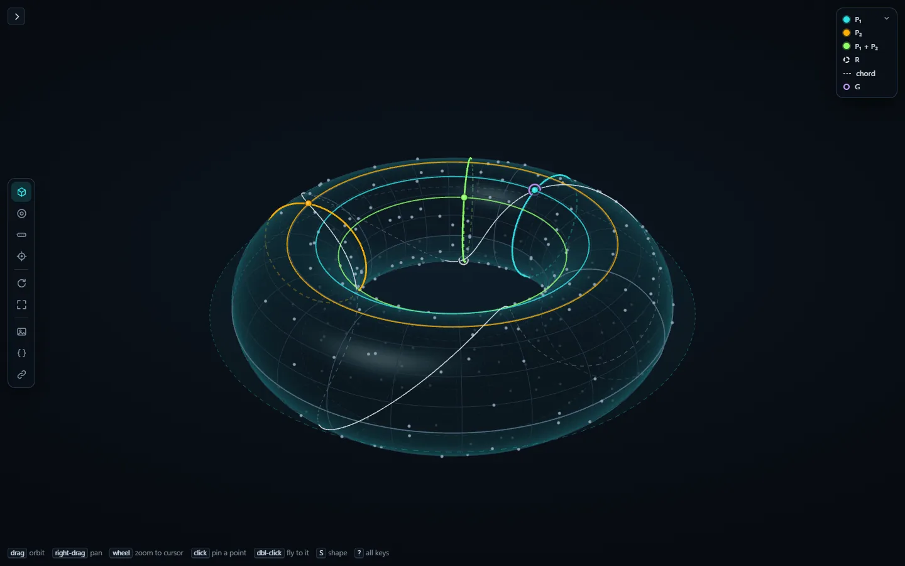
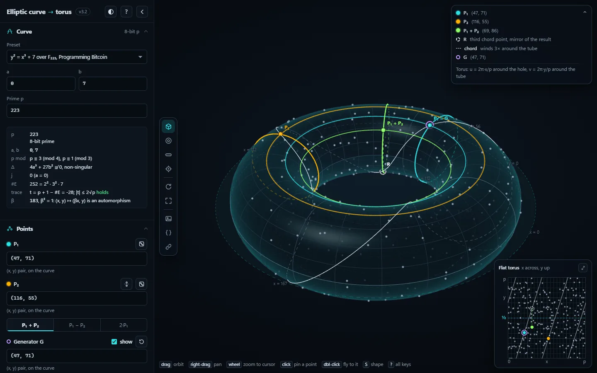

# 17 Save, share, export

**Level 1 · Explorer.** You will learn how to keep a view, send it to someone, save a picture, and download every
number on screen, and what the visualizer remembers by itself. Read first: [11 Start here](11-start-here.md).

The last three buttons of the toolbar do the saving: **Save the view as PNG**, **Export the state and every point as
JSON** and **Copy a link that restores this exact state**. The visualizer also remembers your last view on its own.

## What the visualizer remembers by itself

Everything you set (the curve, the points, the shape, the theme, which panel sections are open) is stored in your
browser, under the name `ec-torus-v3`, a moment after each change. Close the tab, open the file again tomorrow, and
the view is back. Nothing is sent anywhere: the storage stays in that browser on that computer.

Three things replace it: changing the view, opening a link that carries a state (every **Open this view** in these
tutorials does), and **Reset everything** in the **Self-test** section, which forgets it and goes back to the opening
view.

### Example 17.1 · Copy link

**Open this view:** [the F₂₂₃ preset](https://idlebg.com/idleGevrek/elliptic_curve_torus_visualizer_v3.html#s=eyJ2IjozLCJwcmVzZXQiOiJwYjIyMyIsImJhc2VQcmVzZXQiOiJwYjIyMyIsImEiOiIwIiwiYiI6IjciLCJwIjoiMjIzIiwiZyI6Iig0NywgNzEpIiwicDEiOiIoNDcsIDcxKSIsInAyIjoiKDExNiwgNTUpIiwib3AiOiJhZGQiLCJzaG93RyI6dHJ1ZSwiZm9yY2UiOmZhbHNlLCJzaGFwZSI6InRvcnVzIiwibWFwIjoic2NhbGUiLCJiaXRzIjoyNCwic3UiOjI0LCJzdiI6MTYsIlIiOjEuMiwiciI6MC40NiwiZ2xhc3MiOjAuNTUsImJhY2siOjAuNCwic2hvdyI6eyJncmlkIjp0cnVlLCJyaW5ncyI6dHJ1ZSwibGFiZWxzIjp0cnVlLCJjbG91ZCI6dHJ1ZSwiY2hvcmQiOnRydWUsImJldGEiOmZhbHNlLCJtYXAiOnRydWUsInNwaW4iOmZhbHNlfSwicmluZ3MiOnsicDEiOnRydWUsInAyIjp0cnVlLCJzdW0iOnRydWUsImciOmZhbHNlfSwidGhlbWUiOiJkYXJrIiwicGFuZWwiOnRydWUsIm1pbmlCaWciOmZhbHNlLCJsZWdlbmRNaW4iOmZhbHNlLCJzZWNzIjp7ImN1cnZlIjp0cnVlLCJwb2ludHMiOnRydWUsInNoYXBlIjp0cnVlLCJ2aWV3Ijp0cnVlLCJpbnNwZWN0b3IiOnRydWUsInJlbGF0aW9ucyI6dHJ1ZSwidGVzdCI6ZmFsc2V9fQ)

**Do it yourself**

1. In **Curve**, pick the preset **y² = x³ + 7 over F₂₂₃, Programming Bitcoin**.

**Look at:** the small “Copied” message at the top of the view, after a click on the last toolbar button.

**Why:** the link now on your clipboard holds the whole state after `#s=`: the curve, the points, the shape, the
display options and even which sections of the panel are open. Paste it into the address bar and the visualizer opens
exactly as it was. That is how every **Open this view** in these tutorials works, and it works offline, because the
state is in the link itself.

The part before `#s=` is wherever you opened the visualizer, such as a file on your own disk. To send a view to
someone else, send the link together with the HTML file, or tell them to put the part from `#s=` onwards after the
address of their own copy. A camera angle you set by dragging is not part of the state; the views 1, 2 and 3 are one
key away.

### Example 17.2 · Save the view as PNG

**Open this view:** [the F₂₂₃ preset](https://idlebg.com/idleGevrek/elliptic_curve_torus_visualizer_v3.html#s=eyJ2IjozLCJwcmVzZXQiOiJwYjIyMyIsImJhc2VQcmVzZXQiOiJwYjIyMyIsImEiOiIwIiwiYiI6IjciLCJwIjoiMjIzIiwiZyI6Iig0NywgNzEpIiwicDEiOiIoNDcsIDcxKSIsInAyIjoiKDExNiwgNTUpIiwib3AiOiJhZGQiLCJzaG93RyI6dHJ1ZSwiZm9yY2UiOmZhbHNlLCJzaGFwZSI6InRvcnVzIiwibWFwIjoic2NhbGUiLCJiaXRzIjoyNCwic3UiOjI0LCJzdiI6MTYsIlIiOjEuMiwiciI6MC40NiwiZ2xhc3MiOjAuNTUsImJhY2siOjAuNCwic2hvdyI6eyJncmlkIjp0cnVlLCJyaW5ncyI6dHJ1ZSwibGFiZWxzIjp0cnVlLCJjbG91ZCI6dHJ1ZSwiY2hvcmQiOnRydWUsImJldGEiOmZhbHNlLCJtYXAiOnRydWUsInNwaW4iOmZhbHNlfSwicmluZ3MiOnsicDEiOnRydWUsInAyIjp0cnVlLCJzdW0iOnRydWUsImciOmZhbHNlfSwidGhlbWUiOiJkYXJrIiwicGFuZWwiOnRydWUsIm1pbmlCaWciOmZhbHNlLCJsZWdlbmRNaW4iOmZhbHNlLCJzZWNzIjp7ImN1cnZlIjp0cnVlLCJwb2ludHMiOnRydWUsInNoYXBlIjp0cnVlLCJ2aWV3Ijp0cnVlLCJpbnNwZWN0b3IiOnRydWUsInJlbGF0aW9ucyI6dHJ1ZSwidGVzdCI6ZmFsc2V9fQ)

**Do it yourself**

1. In **Curve**, pick the preset **y² = x³ + 7 over F₂₂₃, Programming Bitcoin**.

**Look at:** the file it saves, named after the preset and the time (`ec-torus-pb223-` and then the date and time,
`.png`). Here it is, exactly as the button saved it:

**Why:** the PNG holds only the 3D drawing, at the size of the 3D view on screen (here 1068 × 900 pixels; on a sharp
screen up to twice as many in each direction), on a solid background in the theme’s colour. The labels, cards, legend
and flat map are not in it. To capture those too, take a screenshot with your computer’s own tool.

### Example 17.3 · Export the state and every point as JSON

**Open this view:** [the F₂₂₃ preset](https://idlebg.com/idleGevrek/elliptic_curve_torus_visualizer_v3.html#s=eyJ2IjozLCJwcmVzZXQiOiJwYjIyMyIsImJhc2VQcmVzZXQiOiJwYjIyMyIsImEiOiIwIiwiYiI6IjciLCJwIjoiMjIzIiwiZyI6Iig0NywgNzEpIiwicDEiOiIoNDcsIDcxKSIsInAyIjoiKDExNiwgNTUpIiwib3AiOiJhZGQiLCJzaG93RyI6dHJ1ZSwiZm9yY2UiOmZhbHNlLCJzaGFwZSI6InRvcnVzIiwibWFwIjoic2NhbGUiLCJiaXRzIjoyNCwic3UiOjI0LCJzdiI6MTYsIlIiOjEuMiwiciI6MC40NiwiZ2xhc3MiOjAuNTUsImJhY2siOjAuNCwic2hvdyI6eyJncmlkIjp0cnVlLCJyaW5ncyI6dHJ1ZSwibGFiZWxzIjp0cnVlLCJjbG91ZCI6dHJ1ZSwiY2hvcmQiOnRydWUsImJldGEiOmZhbHNlLCJtYXAiOnRydWUsInNwaW4iOmZhbHNlfSwicmluZ3MiOnsicDEiOnRydWUsInAyIjp0cnVlLCJzdW0iOnRydWUsImciOmZhbHNlfSwidGhlbWUiOiJkYXJrIiwicGFuZWwiOnRydWUsIm1pbmlCaWciOmZhbHNlLCJsZWdlbmRNaW4iOmZhbHNlLCJzZWNzIjp7ImN1cnZlIjp0cnVlLCJwb2ludHMiOnRydWUsInNoYXBlIjp0cnVlLCJ2aWV3Ijp0cnVlLCJpbnNwZWN0b3IiOnRydWUsInJlbGF0aW9ucyI6dHJ1ZSwidGVzdCI6ZmFsc2V9fQ)

**Do it yourself**

1. In **Curve**, pick the preset **y² = x³ + 7 over F₂₂₃, Programming Bitcoin**.

**Look at:** the downloaded file, `ec-torus-pb223-` with the date and time, `.json`. It is plain text, and
[a sample export of this very view](17-export-sample.json) comes with the tutorials. Its parts:

- `input`: what is typed in the fields, such as `"P1": "(47, 71)"`;
- `curve`: the curve’s numbers, for example `"p": "0xdf"` (223), `"pointCount": "0xfc"` (252) and
  `"beta": "0xb7"` (183, see [35 The GLV endomorphism](35-glv.md));
- `points`: every point drawn (P₁, P₂, the result, G and R), each with x and y, its SEC encodings such as
  `"compressed": "032f"`, its angles on the torus, and its k and order when known;
- `operation`: the result and the line through the points: `"type": "secant"`, `"lambda": "0x3"`, `"c": "0x99"`;
- `relations`: P₁ against P₂ (same x, same y, mirror images, Δu and Δv), each against G, and the doubles 2·P₁ and 2·P₂.

**Why:** big numbers are written as hexadecimal strings starting with `0x`, so that nothing is rounded: a spreadsheet
or a program can read them exactly. The sum’s x is `"0x45"`, which is 69: the 9G = (69, 86) you see on screen.

### Example 17.4 · A clean picture: panel hidden, legend compact

**Open this view:** [a clean picture](https://idlebg.com/idleGevrek/elliptic_curve_torus_visualizer_v3.html#s=eyJ2IjozLCJwcmVzZXQiOiJwYjIyMyIsImJhc2VQcmVzZXQiOiJwYjIyMyIsImEiOiIwIiwiYiI6IjciLCJwIjoiMjIzIiwiZyI6Iig0NywgNzEpIiwicDEiOiIoNDcsIDcxKSIsInAyIjoiKDExNiwgNTUpIiwib3AiOiJhZGQiLCJzaG93RyI6dHJ1ZSwiZm9yY2UiOmZhbHNlLCJzaGFwZSI6InRvcnVzIiwibWFwIjoic2NhbGUiLCJiaXRzIjoyNCwic3UiOjI0LCJzdiI6MTYsIlIiOjEuMiwiciI6MC40NiwiZ2xhc3MiOjAuNTUsImJhY2siOjAuNCwic2hvdyI6eyJncmlkIjp0cnVlLCJyaW5ncyI6dHJ1ZSwibGFiZWxzIjpmYWxzZSwiY2xvdWQiOnRydWUsImNob3JkIjp0cnVlLCJiZXRhIjpmYWxzZSwibWFwIjpmYWxzZSwic3BpbiI6ZmFsc2V9LCJyaW5ncyI6eyJwMSI6dHJ1ZSwicDIiOnRydWUsInN1bSI6dHJ1ZSwiZyI6ZmFsc2V9LCJ0aGVtZSI6ImRhcmsiLCJwYW5lbCI6ZmFsc2UsIm1pbmlCaWciOmZhbHNlLCJsZWdlbmRNaW4iOnRydWUsInNlY3MiOnsiY3VydmUiOnRydWUsInBvaW50cyI6dHJ1ZSwic2hhcGUiOnRydWUsInZpZXciOnRydWUsImluc3BlY3RvciI6dHJ1ZSwicmVsYXRpb25zIjp0cnVlLCJ0ZXN0IjpmYWxzZX19)

**Do it yourself**

1. In **Curve**, pick the preset **y² = x³ + 7 over F₂₂₃, Programming Bitcoin**.
2. In **Display**, turn off **Labels** (**L**) and **Flat map** (**M**).
3. Click the small arrow at the top right of the legend to make it compact.
4. Press **\\** to hide the panel.

**Look at:** just the donut. The panel is hidden (key <kbd>\\</kbd>; a small arrow at the top left brings it back),
the legend is compact (the arrow at its corner), and the flat map and labels are off (keys **M** and **L**).

**Why:** for slides and screenshots. Add **Full screen** from the toolbar and press <kbd>Space</kbd> for auto-rotate,
and the visualizer becomes a moving picture. All of this is part of the state, so Copy link keeps it.

### Example 17.5 · Hairlines: ?lines=thin

**Open this view:** [the F₂₂₃ preset with ?lines=thin](https://idlebg.com/idleGevrek/elliptic_curve_torus_visualizer_v3.html?lines=thin#s=eyJ2IjozLCJwcmVzZXQiOiJwYjIyMyIsImJhc2VQcmVzZXQiOiJwYjIyMyIsImEiOiIwIiwiYiI6IjciLCJwIjoiMjIzIiwiZyI6Iig0NywgNzEpIiwicDEiOiIoNDcsIDcxKSIsInAyIjoiKDExNiwgNTUpIiwib3AiOiJhZGQiLCJzaG93RyI6dHJ1ZSwiZm9yY2UiOmZhbHNlLCJzaGFwZSI6InRvcnVzIiwibWFwIjoic2NhbGUiLCJiaXRzIjoyNCwic3UiOjI0LCJzdiI6MTYsIlIiOjEuMiwiciI6MC40NiwiZ2xhc3MiOjAuNTUsImJhY2siOjAuNCwic2hvdyI6eyJncmlkIjp0cnVlLCJyaW5ncyI6dHJ1ZSwibGFiZWxzIjp0cnVlLCJjbG91ZCI6dHJ1ZSwiY2hvcmQiOnRydWUsImJldGEiOmZhbHNlLCJtYXAiOnRydWUsInNwaW4iOmZhbHNlfSwicmluZ3MiOnsicDEiOnRydWUsInAyIjp0cnVlLCJzdW0iOnRydWUsImciOmZhbHNlfSwidGhlbWUiOiJkYXJrIiwicGFuZWwiOnRydWUsIm1pbmlCaWciOmZhbHNlLCJsZWdlbmRNaW4iOmZhbHNlLCJzZWNzIjp7ImN1cnZlIjp0cnVlLCJwb2ludHMiOnRydWUsInNoYXBlIjp0cnVlLCJ2aWV3Ijp0cnVlLCJpbnNwZWN0b3IiOnRydWUsInJlbGF0aW9ucyI6dHJ1ZSwidGVzdCI6ZmFsc2V9fQ)

**Do it yourself**

1. In **Curve**, pick the preset **y² = x³ + 7 over F₂₂₃, Programming Bitcoin**.

**Look at:** the grid on the surface, drawn with thin one-pixel lines instead of the usual thicker ones.

**Why:** the address can carry options after a `?`, before the `#s=`. `?lines=thin` draws the grid with hairlines,
which is lighter work for a slow computer; the visualizer picks it by itself when the browser draws 3D in software,
without a graphics card. `?lines=fat` forces the thick lines. The option is not part of the state, so add it to the
address yourself.

## Try it yourself

- Build a view, click **Copy a link that restores this exact state**, click **Reset everything**, then paste the link
  into the address bar. Everything comes back.
- Export the JSON of Example 14.1 and find 2G’s full x in it.
- Save a PNG in the paper theme (key **T**): its background is the paper colour.

## Recap

- The visualizer remembers its last state in the browser; opening a link or **Reset everything** replaces it.
- Copy link keeps the whole state after `#s=`; PNG saves the 3D drawing; JSON saves every number exactly.
- The panel, legend, flat map and labels can all be hidden for clean pictures; `?lines=thin` and `?lines=fat` choose
  the grid’s line width.

Next: [18 Make it look right](18-make-it-look-right.md).
