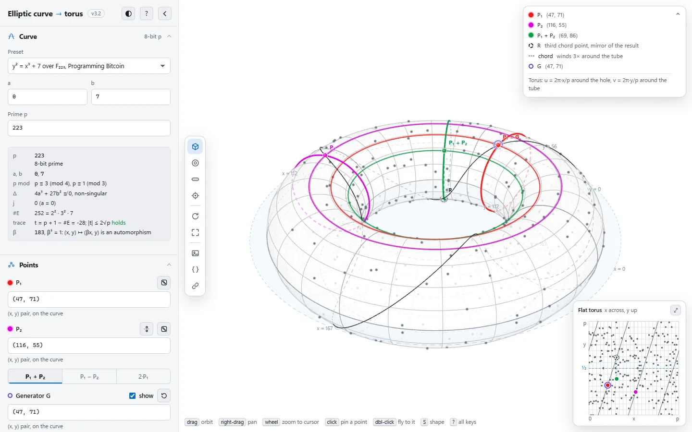
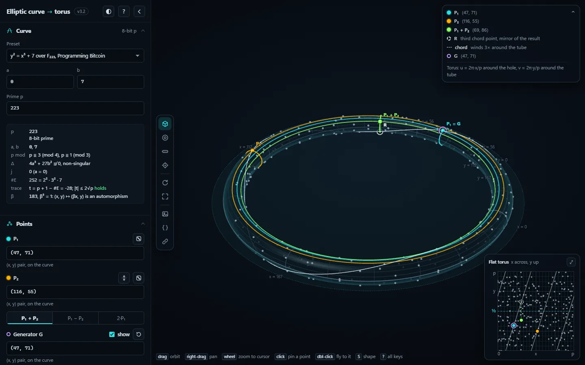
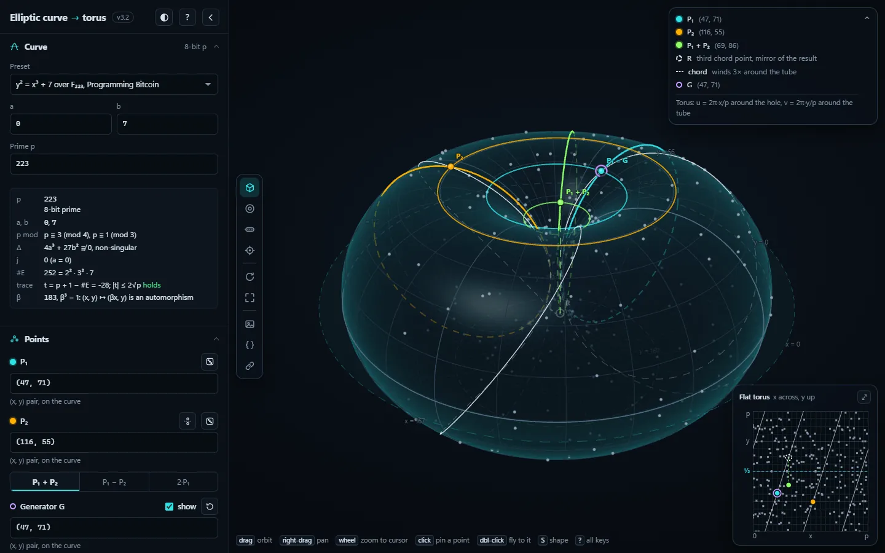
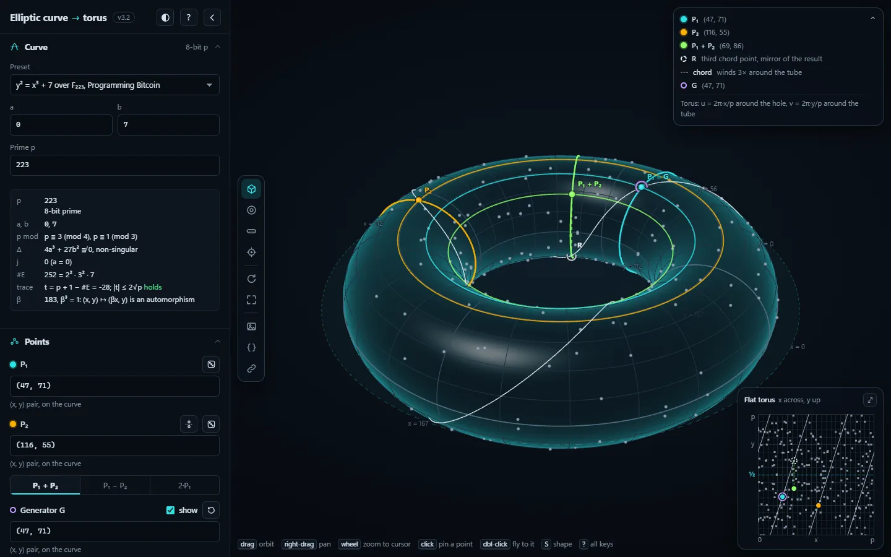
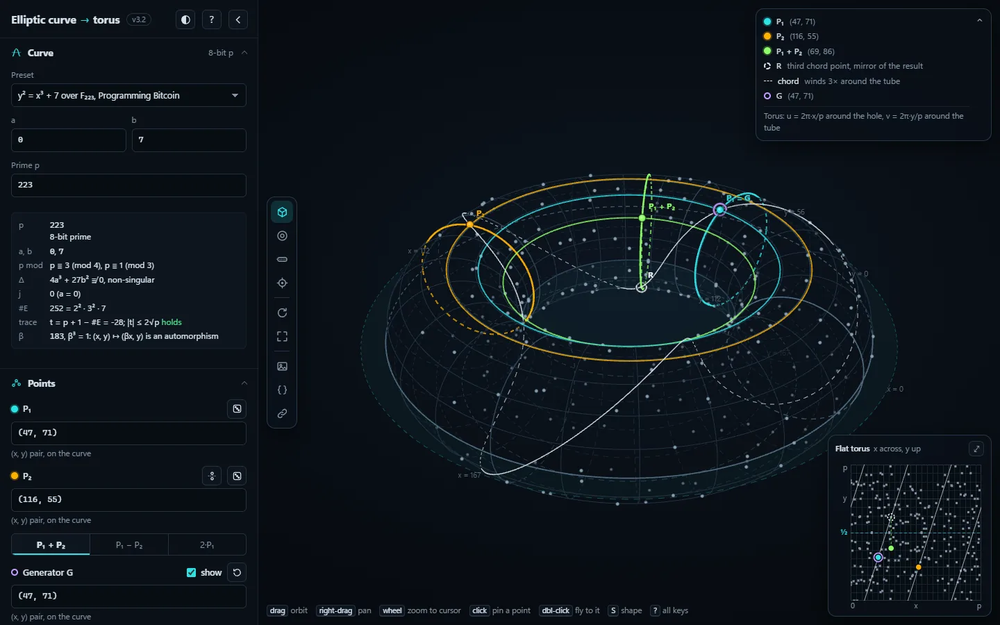
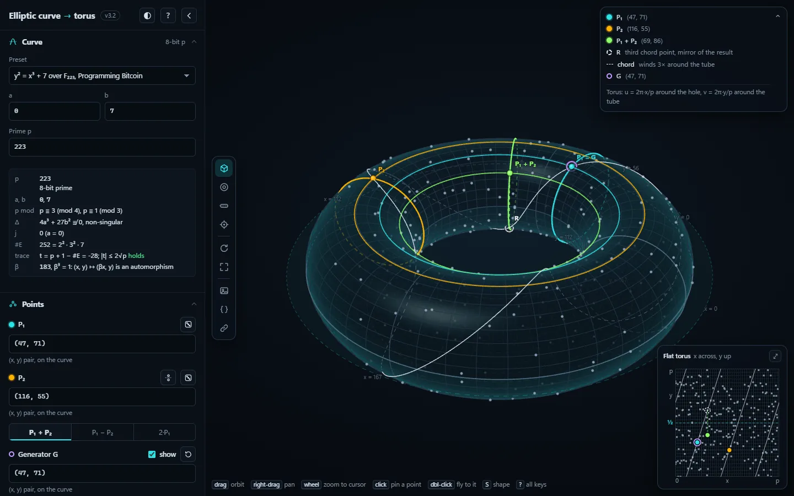
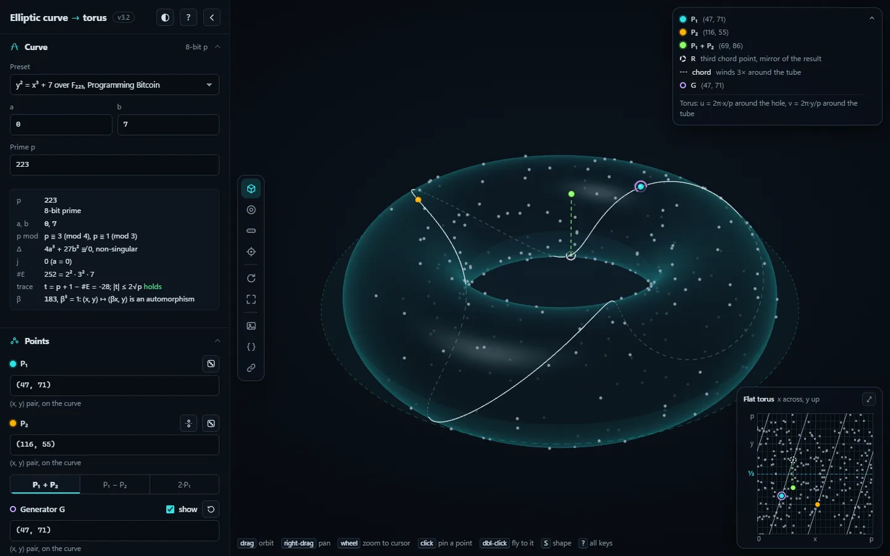
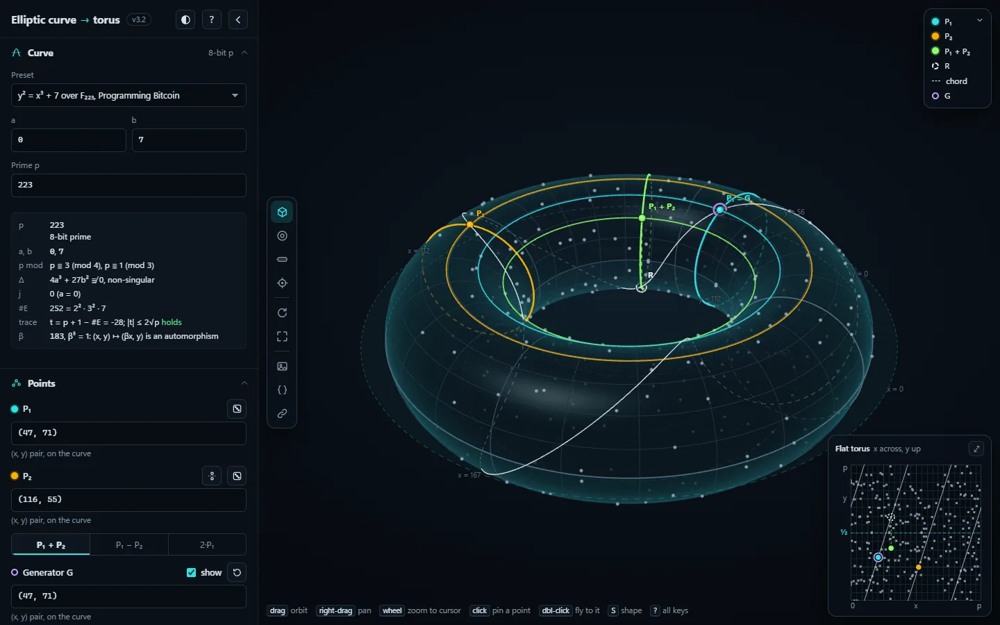

# 18 Make it look right

**Level 1 · Explorer.** You will learn every control that changes how the picture looks without changing the
numbers: the theme, the size sliders, glass and hidden lines, the grid, rings, labels and the legend. Read first:
[11 Start here](11-start-here.md).

All the examples here start from the preset “y² = x³ + 7 over F₂₂₃, Programming Bitcoin”, so you can compare them
with [16 One set of points, nine shapes](16-nine-shapes.md#torus).

### Example 18.1 · The paper theme

**Open this view:** [The paper theme](https://idlebg.com/idleGevrek/elliptic_curve_torus_visualizer_v3.html#s=eyJ2IjozLCJwcmVzZXQiOiJwYjIyMyIsImJhc2VQcmVzZXQiOiJwYjIyMyIsImEiOiIwIiwiYiI6IjciLCJwIjoiMjIzIiwiZyI6Iig0NywgNzEpIiwicDEiOiIoNDcsIDcxKSIsInAyIjoiKDExNiwgNTUpIiwib3AiOiJhZGQiLCJzaG93RyI6dHJ1ZSwiZm9yY2UiOmZhbHNlLCJzaGFwZSI6InRvcnVzIiwibWFwIjoic2NhbGUiLCJiaXRzIjoyNCwic3UiOjI0LCJzdiI6MTYsIlIiOjEuMiwiciI6MC40NiwiZ2xhc3MiOjAuNTUsImJhY2siOjAuNCwic2hvdyI6eyJncmlkIjp0cnVlLCJyaW5ncyI6dHJ1ZSwibGFiZWxzIjp0cnVlLCJjbG91ZCI6dHJ1ZSwiY2hvcmQiOnRydWUsImJldGEiOmZhbHNlLCJtYXAiOnRydWUsInNwaW4iOmZhbHNlfSwicmluZ3MiOnsicDEiOnRydWUsInAyIjp0cnVlLCJzdW0iOnRydWUsImciOmZhbHNlfSwidGhlbWUiOiJwYXBlciIsInBhbmVsIjp0cnVlLCJtaW5pQmlnIjpmYWxzZSwibGVnZW5kTWluIjpmYWxzZSwic2VjcyI6eyJjdXJ2ZSI6dHJ1ZSwicG9pbnRzIjp0cnVlLCJzaGFwZSI6dHJ1ZSwidmlldyI6dHJ1ZSwiaW5zcGVjdG9yIjp0cnVlLCJyZWxhdGlvbnMiOnRydWUsInRlc3QiOmZhbHNlfX0)

**Do it yourself**

1. In **Curve**, pick the preset **y² = x³ + 7 over F₂₂₃, Programming Bitcoin**.
2. Press **T** for the paper theme.

**Look at:** dark ink on a light background, with flat shading: the look of a printed plate in a geometry book.

**Why:** the dark theme is made for screens and the paper theme for print, slides and documents. Press **T** (or the
half-filled circle at the top of the panel) to switch. The theme is part of the state, so a link keeps it, and a PNG
saved in the paper theme has a light background.

## Size

The **Shape** section has two size sliders, and their names change with the shape. On the torus they are **Major R**
(the size of the whole ring, from 0.80 to 2.00) and **Minor r** (the thickness of the tube, from 0.15 to 0.75).

### Example 18.2 · A slim tube

**Open this view:** [A slim tube: Major R 2.00, Minor r 0.15](https://idlebg.com/idleGevrek/elliptic_curve_torus_visualizer_v3.html#s=eyJ2IjozLCJwcmVzZXQiOiJwYjIyMyIsImJhc2VQcmVzZXQiOiJwYjIyMyIsImEiOiIwIiwiYiI6IjciLCJwIjoiMjIzIiwiZyI6Iig0NywgNzEpIiwicDEiOiIoNDcsIDcxKSIsInAyIjoiKDExNiwgNTUpIiwib3AiOiJhZGQiLCJzaG93RyI6dHJ1ZSwiZm9yY2UiOmZhbHNlLCJzaGFwZSI6InRvcnVzIiwibWFwIjoic2NhbGUiLCJiaXRzIjoyNCwic3UiOjI0LCJzdiI6MTYsIlIiOjIsInIiOjAuMTUsImdsYXNzIjowLjU1LCJiYWNrIjowLjQsInNob3ciOnsiZ3JpZCI6dHJ1ZSwicmluZ3MiOnRydWUsImxhYmVscyI6dHJ1ZSwiY2xvdWQiOnRydWUsImNob3JkIjp0cnVlLCJiZXRhIjpmYWxzZSwibWFwIjp0cnVlLCJzcGluIjpmYWxzZX0sInJpbmdzIjp7InAxIjp0cnVlLCJwMiI6dHJ1ZSwic3VtIjp0cnVlLCJnIjpmYWxzZX0sInRoZW1lIjoiZGFyayIsInBhbmVsIjp0cnVlLCJtaW5pQmlnIjpmYWxzZSwibGVnZW5kTWluIjpmYWxzZSwic2VjcyI6eyJjdXJ2ZSI6dHJ1ZSwicG9pbnRzIjp0cnVlLCJzaGFwZSI6dHJ1ZSwidmlldyI6dHJ1ZSwiaW5zcGVjdG9yIjp0cnVlLCJyZWxhdGlvbnMiOnRydWUsInRlc3QiOmZhbHNlfX0) · In **Curve**, pick the preset **y² = x³ + 7 over F₂₂₃, Programming Bitcoin**. In **Shape**, set **Major R** to 2.00 and **Minor r** to 0.15.

### Example 18.3 · A fat tube

**Open this view:** [A fat tube: Major R 0.80, Minor r 0.75](https://idlebg.com/idleGevrek/elliptic_curve_torus_visualizer_v3.html#s=eyJ2IjozLCJwcmVzZXQiOiJwYjIyMyIsImJhc2VQcmVzZXQiOiJwYjIyMyIsImEiOiIwIiwiYiI6IjciLCJwIjoiMjIzIiwiZyI6Iig0NywgNzEpIiwicDEiOiIoNDcsIDcxKSIsInAyIjoiKDExNiwgNTUpIiwib3AiOiJhZGQiLCJzaG93RyI6dHJ1ZSwiZm9yY2UiOmZhbHNlLCJzaGFwZSI6InRvcnVzIiwibWFwIjoic2NhbGUiLCJiaXRzIjoyNCwic3UiOjI0LCJzdiI6MTYsIlIiOjAuOCwiciI6MC43NSwiZ2xhc3MiOjAuNTUsImJhY2siOjAuNCwic2hvdyI6eyJncmlkIjp0cnVlLCJyaW5ncyI6dHJ1ZSwibGFiZWxzIjp0cnVlLCJjbG91ZCI6dHJ1ZSwiY2hvcmQiOnRydWUsImJldGEiOmZhbHNlLCJtYXAiOnRydWUsInNwaW4iOmZhbHNlfSwicmluZ3MiOnsicDEiOnRydWUsInAyIjp0cnVlLCJzdW0iOnRydWUsImciOmZhbHNlfSwidGhlbWUiOiJkYXJrIiwicGFuZWwiOnRydWUsIm1pbmlCaWciOmZhbHNlLCJsZWdlbmRNaW4iOmZhbHNlLCJzZWNzIjp7ImN1cnZlIjp0cnVlLCJwb2ludHMiOnRydWUsInNoYXBlIjp0cnVlLCJ2aWV3Ijp0cnVlLCJpbnNwZWN0b3IiOnRydWUsInJlbGF0aW9ucyI6dHJ1ZSwidGVzdCI6ZmFsc2V9fQ) · In **Curve**, pick the preset **y² = x³ + 7 over F₂₂₃, Programming Bitcoin**. In **Shape**, set **Major R** to 0.80 and **Minor r** to 0.75.

**Why:** the numbers do not change, only the proportions. A slim tube makes the angle around the hole easy to read; a
fat tube spreads the points around the tube, so the y direction is easier to see.

## Glass and hidden lines

Two sliders in **Display** control how solid the surface looks. **Glass** (0.55 at the start) is the shine of the
surface, strongest where you look along it. **Hidden lines** (0.40 at the start) is how strongly the lines and points
behind the surface show through, faint and dashed, like the hidden edges in a technical drawing.

### Example 18.4 · Glass 1.00, hidden lines 0.00

**Open this view:** [Glass 1.00, hidden lines 0.00](https://idlebg.com/idleGevrek/elliptic_curve_torus_visualizer_v3.html#s=eyJ2IjozLCJwcmVzZXQiOiJwYjIyMyIsImJhc2VQcmVzZXQiOiJwYjIyMyIsImEiOiIwIiwiYiI6IjciLCJwIjoiMjIzIiwiZyI6Iig0NywgNzEpIiwicDEiOiIoNDcsIDcxKSIsInAyIjoiKDExNiwgNTUpIiwib3AiOiJhZGQiLCJzaG93RyI6dHJ1ZSwiZm9yY2UiOmZhbHNlLCJzaGFwZSI6InRvcnVzIiwibWFwIjoic2NhbGUiLCJiaXRzIjoyNCwic3UiOjI0LCJzdiI6MTYsIlIiOjEuMiwiciI6MC40NiwiZ2xhc3MiOjEsImJhY2siOjAsInNob3ciOnsiZ3JpZCI6dHJ1ZSwicmluZ3MiOnRydWUsImxhYmVscyI6dHJ1ZSwiY2xvdWQiOnRydWUsImNob3JkIjp0cnVlLCJiZXRhIjpmYWxzZSwibWFwIjp0cnVlLCJzcGluIjpmYWxzZX0sInJpbmdzIjp7InAxIjp0cnVlLCJwMiI6dHJ1ZSwic3VtIjp0cnVlLCJnIjpmYWxzZX0sInRoZW1lIjoiZGFyayIsInBhbmVsIjp0cnVlLCJtaW5pQmlnIjpmYWxzZSwibGVnZW5kTWluIjpmYWxzZSwic2VjcyI6eyJjdXJ2ZSI6dHJ1ZSwicG9pbnRzIjp0cnVlLCJzaGFwZSI6dHJ1ZSwidmlldyI6dHJ1ZSwiaW5zcGVjdG9yIjp0cnVlLCJyZWxhdGlvbnMiOnRydWUsInRlc3QiOmZhbHNlfX0) · In **Curve**, pick the preset **y² = x³ + 7 over F₂₂₃, Programming Bitcoin**. Set the **Glass** slider to 1.00. Set the **Hidden lines** slider to 0.00.

### Example 18.5 · Glass 0.00, hidden lines 1.00

**Open this view:** [Glass 0.00, hidden lines 1.00](https://idlebg.com/idleGevrek/elliptic_curve_torus_visualizer_v3.html#s=eyJ2IjozLCJwcmVzZXQiOiJwYjIyMyIsImJhc2VQcmVzZXQiOiJwYjIyMyIsImEiOiIwIiwiYiI6IjciLCJwIjoiMjIzIiwiZyI6Iig0NywgNzEpIiwicDEiOiIoNDcsIDcxKSIsInAyIjoiKDExNiwgNTUpIiwib3AiOiJhZGQiLCJzaG93RyI6dHJ1ZSwiZm9yY2UiOmZhbHNlLCJzaGFwZSI6InRvcnVzIiwibWFwIjoic2NhbGUiLCJiaXRzIjoyNCwic3UiOjI0LCJzdiI6MTYsIlIiOjEuMiwiciI6MC40NiwiZ2xhc3MiOjAsImJhY2siOjEsInNob3ciOnsiZ3JpZCI6dHJ1ZSwicmluZ3MiOnRydWUsImxhYmVscyI6dHJ1ZSwiY2xvdWQiOnRydWUsImNob3JkIjp0cnVlLCJiZXRhIjpmYWxzZSwibWFwIjp0cnVlLCJzcGluIjpmYWxzZX0sInJpbmdzIjp7InAxIjp0cnVlLCJwMiI6dHJ1ZSwic3VtIjp0cnVlLCJnIjpmYWxzZX0sInRoZW1lIjoiZGFyayIsInBhbmVsIjp0cnVlLCJtaW5pQmlnIjpmYWxzZSwibGVnZW5kTWluIjpmYWxzZSwic2VjcyI6eyJjdXJ2ZSI6dHJ1ZSwicG9pbnRzIjp0cnVlLCJzaGFwZSI6dHJ1ZSwidmlldyI6dHJ1ZSwiaW5zcGVjdG9yIjp0cnVlLCJyZWxhdGlvbnMiOnRydWUsInRlc3QiOmZhbHNlfX0) · In **Curve**, pick the preset **y² = x³ + 7 over F₂₂₃, Programming Bitcoin**. Set the **Glass** slider to 0.00. Set the **Hidden lines** slider to 1.00.

**Why:** with no hidden lines you see only the front, as with a solid object. With no glass and full hidden lines you
see everything at once, which helps when a point is on the far side; the dashes still tell you which lines are behind.

## The grid, rings and labels

The grid divides the surface into sectors: 24 × 16 at the start (24 around the hole, 24 along x, and 16 around the
tube). **Grid sectors along x** and **Grid sectors along y** in **Display** change that. Each point’s card names the
sector it is in, which is a quick way to describe where a point is.

### Example 18.6 · A finer grid: 48 × 32 sectors

**Open this view:** [A finer grid: 48 × 32 sectors](https://idlebg.com/idleGevrek/elliptic_curve_torus_visualizer_v3.html#s=eyJ2IjozLCJwcmVzZXQiOiJwYjIyMyIsImJhc2VQcmVzZXQiOiJwYjIyMyIsImEiOiIwIiwiYiI6IjciLCJwIjoiMjIzIiwiZyI6Iig0NywgNzEpIiwicDEiOiIoNDcsIDcxKSIsInAyIjoiKDExNiwgNTUpIiwib3AiOiJhZGQiLCJzaG93RyI6dHJ1ZSwiZm9yY2UiOmZhbHNlLCJzaGFwZSI6InRvcnVzIiwibWFwIjoic2NhbGUiLCJiaXRzIjoyNCwic3UiOjQ4LCJzdiI6MzIsIlIiOjEuMiwiciI6MC40NiwiZ2xhc3MiOjAuNTUsImJhY2siOjAuNCwic2hvdyI6eyJncmlkIjp0cnVlLCJyaW5ncyI6dHJ1ZSwibGFiZWxzIjp0cnVlLCJjbG91ZCI6dHJ1ZSwiY2hvcmQiOnRydWUsImJldGEiOmZhbHNlLCJtYXAiOnRydWUsInNwaW4iOmZhbHNlfSwicmluZ3MiOnsicDEiOnRydWUsInAyIjp0cnVlLCJzdW0iOnRydWUsImciOmZhbHNlfSwidGhlbWUiOiJkYXJrIiwicGFuZWwiOnRydWUsIm1pbmlCaWciOmZhbHNlLCJsZWdlbmRNaW4iOmZhbHNlLCJzZWNzIjp7ImN1cnZlIjp0cnVlLCJwb2ludHMiOnRydWUsInNoYXBlIjp0cnVlLCJ2aWV3Ijp0cnVlLCJpbnNwZWN0b3IiOnRydWUsInJlbGF0aW9ucyI6dHJ1ZSwidGVzdCI6ZmFsc2V9fQ) · In **Curve**, pick the preset **y² = x³ + 7 over F₂₂₃, Programming Bitcoin**. Set **Grid sectors along x** to 48 and **Grid sectors along y** to 32.

### Example 18.7 · Only the points: grid, rings and labels off

**Open this view:** [Only the points: grid, rings and labels off](https://idlebg.com/idleGevrek/elliptic_curve_torus_visualizer_v3.html#s=eyJ2IjozLCJwcmVzZXQiOiJwYjIyMyIsImJhc2VQcmVzZXQiOiJwYjIyMyIsImEiOiIwIiwiYiI6IjciLCJwIjoiMjIzIiwiZyI6Iig0NywgNzEpIiwicDEiOiIoNDcsIDcxKSIsInAyIjoiKDExNiwgNTUpIiwib3AiOiJhZGQiLCJzaG93RyI6dHJ1ZSwiZm9yY2UiOmZhbHNlLCJzaGFwZSI6InRvcnVzIiwibWFwIjoic2NhbGUiLCJiaXRzIjoyNCwic3UiOjI0LCJzdiI6MTYsIlIiOjEuMiwiciI6MC40NiwiZ2xhc3MiOjAuNTUsImJhY2siOjAuNCwic2hvdyI6eyJncmlkIjpmYWxzZSwicmluZ3MiOmZhbHNlLCJsYWJlbHMiOmZhbHNlLCJjbG91ZCI6dHJ1ZSwiY2hvcmQiOnRydWUsImJldGEiOmZhbHNlLCJtYXAiOnRydWUsInNwaW4iOmZhbHNlfSwicmluZ3MiOnsicDEiOnRydWUsInAyIjp0cnVlLCJzdW0iOnRydWUsImciOmZhbHNlfSwidGhlbWUiOiJkYXJrIiwicGFuZWwiOnRydWUsIm1pbmlCaWciOmZhbHNlLCJsZWdlbmRNaW4iOmZhbHNlLCJzZWNzIjp7ImN1cnZlIjp0cnVlLCJwb2ludHMiOnRydWUsInNoYXBlIjp0cnVlLCJ2aWV3Ijp0cnVlLCJpbnNwZWN0b3IiOnRydWUsInJlbGF0aW9ucyI6dHJ1ZSwidGVzdCI6ZmFsc2V9fQ) · In **Curve**, pick the preset **y² = x³ + 7 over F₂₂₃, Programming Bitcoin**. In **Display**, turn off **Sector grid** (**G**), **Guide rings** and **Labels** (**L**).

**Why:** the switches in **Display** turn each layer on and off: **Sector grid** (key **G**), **Guide rings**,
**Labels** (key **L**), **All curve points** (key **C**), **Chord construction** (key **K**) and **Flat map** (key
**M**). Below them, **Guide rings for** picks whose rings are drawn: P₁, P₂, the result, G.

### Example 18.8 · The compact legend

**Open this view:** [The compact legend](https://idlebg.com/idleGevrek/elliptic_curve_torus_visualizer_v3.html#s=eyJ2IjozLCJwcmVzZXQiOiJwYjIyMyIsImJhc2VQcmVzZXQiOiJwYjIyMyIsImEiOiIwIiwiYiI6IjciLCJwIjoiMjIzIiwiZyI6Iig0NywgNzEpIiwicDEiOiIoNDcsIDcxKSIsInAyIjoiKDExNiwgNTUpIiwib3AiOiJhZGQiLCJzaG93RyI6dHJ1ZSwiZm9yY2UiOmZhbHNlLCJzaGFwZSI6InRvcnVzIiwibWFwIjoic2NhbGUiLCJiaXRzIjoyNCwic3UiOjI0LCJzdiI6MTYsIlIiOjEuMiwiciI6MC40NiwiZ2xhc3MiOjAuNTUsImJhY2siOjAuNCwic2hvdyI6eyJncmlkIjp0cnVlLCJyaW5ncyI6dHJ1ZSwibGFiZWxzIjp0cnVlLCJjbG91ZCI6dHJ1ZSwiY2hvcmQiOnRydWUsImJldGEiOmZhbHNlLCJtYXAiOnRydWUsInNwaW4iOmZhbHNlfSwicmluZ3MiOnsicDEiOnRydWUsInAyIjp0cnVlLCJzdW0iOnRydWUsImciOmZhbHNlfSwidGhlbWUiOiJkYXJrIiwicGFuZWwiOnRydWUsIm1pbmlCaWciOmZhbHNlLCJsZWdlbmRNaW4iOnRydWUsInNlY3MiOnsiY3VydmUiOnRydWUsInBvaW50cyI6dHJ1ZSwic2hhcGUiOnRydWUsInZpZXciOnRydWUsImluc3BlY3RvciI6dHJ1ZSwicmVsYXRpb25zIjp0cnVlLCJ0ZXN0IjpmYWxzZX19) · In **Curve**, pick the preset **y² = x³ + 7 over F₂₂₃, Programming Bitcoin**. Click the small arrow at the top right of the legend to make it compact.

**Why:** the small arrow at the corner of the legend folds it down to one line per point; click it again for the full
legend. Cards keep out of the legend’s way either way.

## Try it yourself

- Make a picture for a slide: the paper theme, a slim tube, no labels, the compact legend, the panel hidden
  (<kbd>\\</kbd>), and **Save the view as PNG**.
- Set **Grid sectors along x** to 4 and **Grid sectors along y** to 4: each sector is now a quarter turn each way.
- Turn **Hidden lines** to 0 and orbit until a point goes behind the surface: its marker disappears.

## Recap

- **T** switches between the dark and the paper theme; the two size sliders set the proportions of each shape.
- **Glass** and **Hidden lines** set how solid the surface looks; the grid’s sectors, rings, labels and the legend
  can all be changed or hidden.
- None of this changes a number: only the picture.

Next, Level 2 begins: [21 Clock arithmetic and the curve equation](21-clock-arithmetic.md). Or jump to the Bitcoin
chapters at [31 secp256k1 in the panel](31-secp256k1.md).
