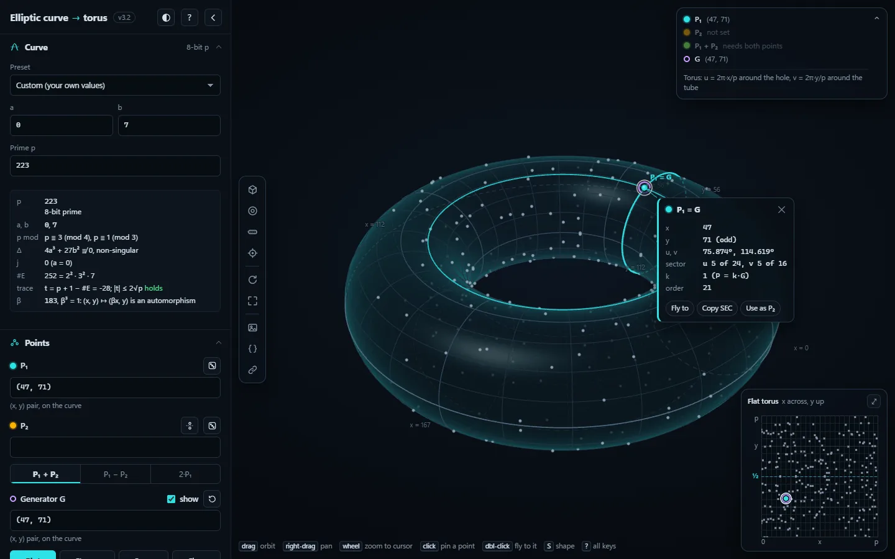
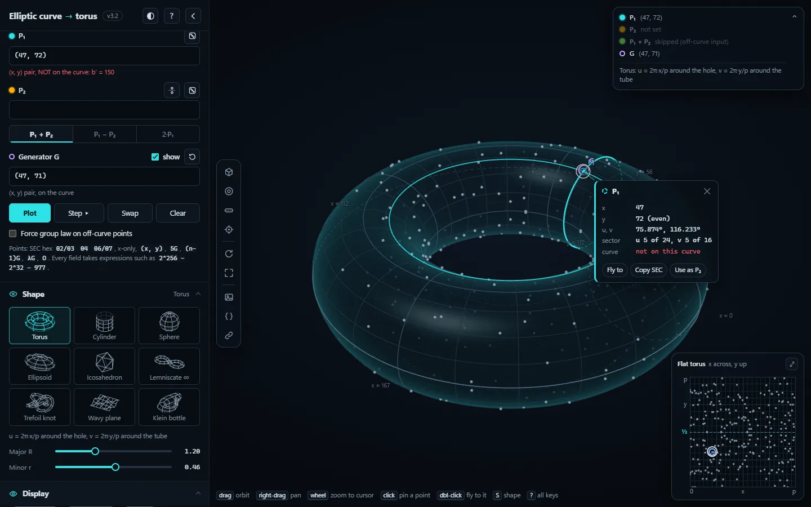
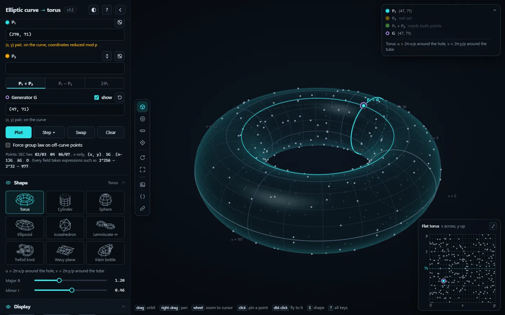

# 21 Clock arithmetic and the curve equation

**Level 2 · Learner.** You will learn arithmetic “mod p”, check by hand that a point lies on a curve, and see what
the visualizer does with a point that does not, or with a coordinate that is too big. Read first:
[12 A curve is a cloud of dots](12-cloud-of-dots.md) and [13 Why a donut](13-why-a-donut.md).

## Arithmetic mod p

Pick a whole number p, here p = 223. Arithmetic **mod p** (“modulo p”) is ordinary arithmetic followed by one more
step: divide by p and keep only the remainder. The remainder is always one of 0, 1, …, p − 1, the p hours of a clock
with p hours.

- 220 + 5 = 225, and 225 = 1 × 223 + 2, so 220 + 5 ≡ 2 (mod 223). Read “≡” as “is the same as, on this clock”.
- 270 = 1 × 223 + 47, so 270 ≡ 47: going 270 hours forward lands on hour 47.
- −152 + 223 = 71, so −152 ≡ 71: a negative number is counted backwards from 0.

Adding, subtracting and multiplying all work this way. When p is a prime number, dividing works too (every number
except 0 has an inverse), and the numbers 0 to p − 1 with this arithmetic form a
[finite field](94-glossary.md#finite-field), written F_p. F₂₂₃ is the one with 223 elements.

## The curve equation

An [elliptic curve](94-glossary.md#elliptic-curve) here is given by three numbers a, b and p, and its points are the
pairs (x, y) with

  y² ≡ x³ + ax + b (mod p),

together with one extra point, 𝒪, the point at infinity. The **Curve** section shows a, b and p, and the facts the
visualizer works out about them.

### Example 21.1 · G = (47, 71) is on y² = x³ + 7 over F₂₂₃

**Open this view:** [(47, 71) on F₂₂₃](https://idlebg.com/idleGevrek/elliptic_curve_torus_visualizer_v3.html#s=eyJ2IjozLCJwcmVzZXQiOiJjdXN0b20iLCJiYXNlUHJlc2V0IjoicGIyMjMiLCJhIjoiMCIsImIiOiI3IiwicCI6IjIyMyIsImciOiIoNDcsIDcxKSIsInAxIjoiKDQ3LCA3MSkiLCJwMiI6IiIsIm9wIjoiYWRkIiwic2hvd0ciOnRydWUsImZvcmNlIjpmYWxzZSwic2hhcGUiOiJ0b3J1cyIsIm1hcCI6InNjYWxlIiwiYml0cyI6MjQsInN1IjoyNCwic3YiOjE2LCJSIjoxLjIsInIiOjAuNDYsImdsYXNzIjowLjU1LCJiYWNrIjowLjQsInNob3ciOnsiZ3JpZCI6dHJ1ZSwicmluZ3MiOnRydWUsImxhYmVscyI6dHJ1ZSwiY2xvdWQiOnRydWUsImNob3JkIjpmYWxzZSwiYmV0YSI6ZmFsc2UsIm1hcCI6dHJ1ZSwic3BpbiI6ZmFsc2V9LCJyaW5ncyI6eyJwMSI6dHJ1ZSwicDIiOnRydWUsInN1bSI6dHJ1ZSwiZyI6ZmFsc2V9LCJ0aGVtZSI6ImRhcmsiLCJwYW5lbCI6dHJ1ZSwibWluaUJpZyI6ZmFsc2UsImxlZ2VuZE1pbiI6ZmFsc2UsInNlY3MiOnsiY3VydmUiOnRydWUsInBvaW50cyI6dHJ1ZSwic2hhcGUiOnRydWUsInZpZXciOnRydWUsImluc3BlY3RvciI6dHJ1ZSwicmVsYXRpb25zIjp0cnVlLCJ0ZXN0IjpmYWxzZX19)

**Do it yourself**

1. In **Curve**, pick the preset **y² = x³ + 7 over F₂₂₃, Programming Bitcoin**.
2. Empty **P₂**.
3. In **Display**, turn off **Chord construction** (**K**).
4. In the 3D view, click P₁ to pin its card.

**Look at:** the message under P₁, “(x, y) pair, on the curve”, and the **Curve** facts: p = 223, an 8-bit prime;
a, b = 0, 7; Δ “4a³ + 27b² ≢ 0, non-singular”; #E = 252.

**Why:** check it by hand. Here a = 0 and b = 7, so the right-hand side is x³ + 7:

- right: 47³ = 103823, and 103823 + 7 = 103830 = 465 × 223 + 135, so x³ + 7 ≡ 135;
- left: 71² = 5041 = 22 × 223 + 135, so y² ≡ 135.

Both sides are 135 on the 223-hour clock, so (47, 71) is a point of the curve. The visualizer does the same test for
every point you type, with numbers of any size.

The other facts, briefly: **p mod** says p ≡ 3 (mod 4) and p ≡ 1 (mod 3), two remainders that matter later
([31](31-secp256k1.md), [35](35-glv.md)); **Δ** is the discriminant, which must not be 0 or the curve has a sharp
point ([46](46-singular-composite.md)); **j** is the j-invariant, 0 for every curve with a = 0
([43](43-j-zero.md)); **#E** and **trace** are the subject of [22 Counting points](22-counting-points.md).

### Example 21.2 · A point that is not on the curve

Change the 71 to 72.

**Open this view:** [(47, 72) on F₂₂₃](https://idlebg.com/idleGevrek/elliptic_curve_torus_visualizer_v3.html#s=eyJ2IjozLCJwcmVzZXQiOiJjdXN0b20iLCJiYXNlUHJlc2V0IjoicGIyMjMiLCJhIjoiMCIsImIiOiI3IiwicCI6IjIyMyIsImciOiIoNDcsIDcxKSIsInAxIjoiKDQ3LCA3MikiLCJwMiI6IiIsIm9wIjoiYWRkIiwic2hvd0ciOnRydWUsImZvcmNlIjpmYWxzZSwic2hhcGUiOiJ0b3J1cyIsIm1hcCI6InNjYWxlIiwiYml0cyI6MjQsInN1IjoyNCwic3YiOjE2LCJSIjoxLjIsInIiOjAuNDYsImdsYXNzIjowLjU1LCJiYWNrIjowLjQsInNob3ciOnsiZ3JpZCI6dHJ1ZSwicmluZ3MiOnRydWUsImxhYmVscyI6dHJ1ZSwiY2xvdWQiOnRydWUsImNob3JkIjpmYWxzZSwiYmV0YSI6ZmFsc2UsIm1hcCI6dHJ1ZSwic3BpbiI6ZmFsc2V9LCJyaW5ncyI6eyJwMSI6dHJ1ZSwicDIiOnRydWUsInN1bSI6dHJ1ZSwiZyI6ZmFsc2V9LCJ0aGVtZSI6ImRhcmsiLCJwYW5lbCI6dHJ1ZSwibWluaUJpZyI6ZmFsc2UsImxlZ2VuZE1pbiI6ZmFsc2UsInNlY3MiOnsiY3VydmUiOnRydWUsInBvaW50cyI6dHJ1ZSwic2hhcGUiOnRydWUsInZpZXciOnRydWUsImluc3BlY3RvciI6dHJ1ZSwicmVsYXRpb25zIjp0cnVlLCJ0ZXN0IjpmYWxzZX19)

**Do it yourself**

1. In **Curve**, pick the preset **y² = x³ + 7 over F₂₂₃, Programming Bitcoin**.
2. Type `(47, 72)` in **P₁**.
3. Empty **P₂**.
4. In **Display**, turn off **Chord construction** (**K**).
5. In the 3D view, click P₁ to pin its card.
6. Read the **Points** section in the panel.

**Look at:**

- the message under P₁, in red: “(x, y) pair, NOT on the curve: b′ = 150”;
- the point itself, drawn with a dashed outline;
- **Relations**: “not on this curve; it satisfies y² = x³ + ax + b′ with b′ = 150 (invalid-curve point)”;
- the **Inspector**: a row b′ = 150, “this point lives on y² = x³ + ax + b′”.

**Why:** 72² = 5184, and 5184 − 47³ = −98639 ≡ 150 (mod 223). So (47, 72) does satisfy an equation of the same
shape, just with b′ = 150 instead of 7: it is a point of a different curve. The visualizer still draws it (that is
useful), but it refuses to add it to anything until you say so. [36 Invalid points](36-invalid-points.md) explains why
that refusal matters for Bitcoin.

### Example 21.3 · Coordinates are read mod p

**Open this view:** [(270, 71) on F₂₂₃](https://idlebg.com/idleGevrek/elliptic_curve_torus_visualizer_v3.html#s=eyJ2IjozLCJwcmVzZXQiOiJjdXN0b20iLCJiYXNlUHJlc2V0IjoicGIyMjMiLCJhIjoiMCIsImIiOiI3IiwicCI6IjIyMyIsImciOiIoNDcsIDcxKSIsInAxIjoiKDI3MCwgNzEpIiwicDIiOiIiLCJvcCI6ImFkZCIsInNob3dHIjp0cnVlLCJmb3JjZSI6ZmFsc2UsInNoYXBlIjoidG9ydXMiLCJtYXAiOiJzY2FsZSIsImJpdHMiOjI0LCJzdSI6MjQsInN2IjoxNiwiUiI6MS4yLCJyIjowLjQ2LCJnbGFzcyI6MC41NSwiYmFjayI6MC40LCJzaG93Ijp7ImdyaWQiOnRydWUsInJpbmdzIjp0cnVlLCJsYWJlbHMiOnRydWUsImNsb3VkIjp0cnVlLCJjaG9yZCI6ZmFsc2UsImJldGEiOmZhbHNlLCJtYXAiOnRydWUsInNwaW4iOmZhbHNlfSwicmluZ3MiOnsicDEiOnRydWUsInAyIjp0cnVlLCJzdW0iOnRydWUsImciOmZhbHNlfSwidGhlbWUiOiJkYXJrIiwicGFuZWwiOnRydWUsIm1pbmlCaWciOmZhbHNlLCJsZWdlbmRNaW4iOmZhbHNlLCJzZWNzIjp7ImN1cnZlIjp0cnVlLCJwb2ludHMiOnRydWUsInNoYXBlIjp0cnVlLCJ2aWV3Ijp0cnVlLCJpbnNwZWN0b3IiOnRydWUsInJlbGF0aW9ucyI6dHJ1ZSwidGVzdCI6ZmFsc2V9fQ)

| typed in P₁ | the message under P₁ | the point | open |
| --- | --- | --- | --- |
| `(47, 71)` | (x, y) pair, on the curve | (47, 71) | [open](https://idlebg.com/idleGevrek/elliptic_curve_torus_visualizer_v3.html#s=eyJ2IjozLCJwcmVzZXQiOiJjdXN0b20iLCJiYXNlUHJlc2V0IjoicGIyMjMiLCJhIjoiMCIsImIiOiI3IiwicCI6IjIyMyIsImciOiIoNDcsIDcxKSIsInAxIjoiKDQ3LCA3MSkiLCJwMiI6IiIsIm9wIjoiYWRkIiwic2hvd0ciOnRydWUsImZvcmNlIjpmYWxzZSwic2hhcGUiOiJ0b3J1cyIsIm1hcCI6InNjYWxlIiwiYml0cyI6MjQsInN1IjoyNCwic3YiOjE2LCJSIjoxLjIsInIiOjAuNDYsImdsYXNzIjowLjU1LCJiYWNrIjowLjQsInNob3ciOnsiZ3JpZCI6dHJ1ZSwicmluZ3MiOnRydWUsImxhYmVscyI6dHJ1ZSwiY2xvdWQiOnRydWUsImNob3JkIjpmYWxzZSwiYmV0YSI6ZmFsc2UsIm1hcCI6dHJ1ZSwic3BpbiI6ZmFsc2V9LCJyaW5ncyI6eyJwMSI6dHJ1ZSwicDIiOnRydWUsInN1bSI6dHJ1ZSwiZyI6ZmFsc2V9LCJ0aGVtZSI6ImRhcmsiLCJwYW5lbCI6dHJ1ZSwibWluaUJpZyI6ZmFsc2UsImxlZ2VuZE1pbiI6ZmFsc2UsInNlY3MiOnsiY3VydmUiOnRydWUsInBvaW50cyI6dHJ1ZSwic2hhcGUiOnRydWUsInZpZXciOnRydWUsImluc3BlY3RvciI6dHJ1ZSwicmVsYXRpb25zIjp0cnVlLCJ0ZXN0IjpmYWxzZX19) |
| `(270, 71)` | (x, y) pair, on the curve, coordinates reduced mod p | (47, 71) | [open](https://idlebg.com/idleGevrek/elliptic_curve_torus_visualizer_v3.html#s=eyJ2IjozLCJwcmVzZXQiOiJjdXN0b20iLCJiYXNlUHJlc2V0IjoicGIyMjMiLCJhIjoiMCIsImIiOiI3IiwicCI6IjIyMyIsImciOiIoNDcsIDcxKSIsInAxIjoiKDI3MCwgNzEpIiwicDIiOiIiLCJvcCI6ImFkZCIsInNob3dHIjp0cnVlLCJmb3JjZSI6ZmFsc2UsInNoYXBlIjoidG9ydXMiLCJtYXAiOiJzY2FsZSIsImJpdHMiOjI0LCJzdSI6MjQsInN2IjoxNiwiUiI6MS4yLCJyIjowLjQ2LCJnbGFzcyI6MC41NSwiYmFjayI6MC40LCJzaG93Ijp7ImdyaWQiOnRydWUsInJpbmdzIjp0cnVlLCJsYWJlbHMiOnRydWUsImNsb3VkIjp0cnVlLCJjaG9yZCI6ZmFsc2UsImJldGEiOmZhbHNlLCJtYXAiOnRydWUsInNwaW4iOmZhbHNlfSwicmluZ3MiOnsicDEiOnRydWUsInAyIjp0cnVlLCJzdW0iOnRydWUsImciOmZhbHNlfSwidGhlbWUiOiJkYXJrIiwicGFuZWwiOnRydWUsIm1pbmlCaWciOmZhbHNlLCJsZWdlbmRNaW4iOmZhbHNlLCJzZWNzIjp7ImN1cnZlIjp0cnVlLCJwb2ludHMiOnRydWUsInNoYXBlIjp0cnVlLCJ2aWV3Ijp0cnVlLCJpbnNwZWN0b3IiOnRydWUsInJlbGF0aW9ucyI6dHJ1ZSwidGVzdCI6ZmFsc2V9fQ) |
| `(47, -152)` | (x, y) pair, on the curve, coordinates reduced mod p | (47, 71) | [open](https://idlebg.com/idleGevrek/elliptic_curve_torus_visualizer_v3.html#s=eyJ2IjozLCJwcmVzZXQiOiJjdXN0b20iLCJiYXNlUHJlc2V0IjoicGIyMjMiLCJhIjoiMCIsImIiOiI3IiwicCI6IjIyMyIsImciOiIoNDcsIDcxKSIsInAxIjoiKDQ3LCAtMTUyKSIsInAyIjoiIiwib3AiOiJhZGQiLCJzaG93RyI6dHJ1ZSwiZm9yY2UiOmZhbHNlLCJzaGFwZSI6InRvcnVzIiwibWFwIjoic2NhbGUiLCJiaXRzIjoyNCwic3UiOjI0LCJzdiI6MTYsIlIiOjEuMiwiciI6MC40NiwiZ2xhc3MiOjAuNTUsImJhY2siOjAuNCwic2hvdyI6eyJncmlkIjp0cnVlLCJyaW5ncyI6dHJ1ZSwibGFiZWxzIjp0cnVlLCJjbG91ZCI6dHJ1ZSwiY2hvcmQiOmZhbHNlLCJiZXRhIjpmYWxzZSwibWFwIjp0cnVlLCJzcGluIjpmYWxzZX0sInJpbmdzIjp7InAxIjp0cnVlLCJwMiI6dHJ1ZSwic3VtIjp0cnVlLCJnIjpmYWxzZX0sInRoZW1lIjoiZGFyayIsInBhbmVsIjp0cnVlLCJtaW5pQmlnIjpmYWxzZSwibGVnZW5kTWluIjpmYWxzZSwic2VjcyI6eyJjdXJ2ZSI6dHJ1ZSwicG9pbnRzIjp0cnVlLCJzaGFwZSI6dHJ1ZSwidmlldyI6dHJ1ZSwiaW5zcGVjdG9yIjp0cnVlLCJyZWxhdGlvbnMiOnRydWUsInRlc3QiOmZhbHNlfX0) |
| `(0x2f, 0x47)` | (x, y) pair, on the curve | (47, 71) | [open](https://idlebg.com/idleGevrek/elliptic_curve_torus_visualizer_v3.html#s=eyJ2IjozLCJwcmVzZXQiOiJjdXN0b20iLCJiYXNlUHJlc2V0IjoicGIyMjMiLCJhIjoiMCIsImIiOiI3IiwicCI6IjIyMyIsImciOiIoNDcsIDcxKSIsInAxIjoiKDB4MmYsIDB4NDcpIiwicDIiOiIiLCJvcCI6ImFkZCIsInNob3dHIjp0cnVlLCJmb3JjZSI6ZmFsc2UsInNoYXBlIjoidG9ydXMiLCJtYXAiOiJzY2FsZSIsImJpdHMiOjI0LCJzdSI6MjQsInN2IjoxNiwiUiI6MS4yLCJyIjowLjQ2LCJnbGFzcyI6MC41NSwiYmFjayI6MC40LCJzaG93Ijp7ImdyaWQiOnRydWUsInJpbmdzIjp0cnVlLCJsYWJlbHMiOnRydWUsImNsb3VkIjp0cnVlLCJjaG9yZCI6ZmFsc2UsImJldGEiOmZhbHNlLCJtYXAiOnRydWUsInNwaW4iOmZhbHNlfSwicmluZ3MiOnsicDEiOnRydWUsInAyIjp0cnVlLCJzdW0iOnRydWUsImciOmZhbHNlfSwidGhlbWUiOiJkYXJrIiwicGFuZWwiOnRydWUsIm1pbmlCaWciOmZhbHNlLCJsZWdlbmRNaW4iOmZhbHNlLCJzZWNzIjp7ImN1cnZlIjp0cnVlLCJwb2ludHMiOnRydWUsInNoYXBlIjp0cnVlLCJ2aWV3Ijp0cnVlLCJpbnNwZWN0b3IiOnRydWUsInJlbGF0aW9ucyI6dHJ1ZSwidGVzdCI6ZmFsc2V9fQ) |
| `(2*23 + 1, 71)` | (x, y) pair, on the curve | (47, 71) | [open](https://idlebg.com/idleGevrek/elliptic_curve_torus_visualizer_v3.html#s=eyJ2IjozLCJwcmVzZXQiOiJjdXN0b20iLCJiYXNlUHJlc2V0IjoicGIyMjMiLCJhIjoiMCIsImIiOiI3IiwicCI6IjIyMyIsImciOiIoNDcsIDcxKSIsInAxIjoiKDIqMjMgKyAxLCA3MSkiLCJwMiI6IiIsIm9wIjoiYWRkIiwic2hvd0ciOnRydWUsImZvcmNlIjpmYWxzZSwic2hhcGUiOiJ0b3J1cyIsIm1hcCI6InNjYWxlIiwiYml0cyI6MjQsInN1IjoyNCwic3YiOjE2LCJSIjoxLjIsInIiOjAuNDYsImdsYXNzIjowLjU1LCJiYWNrIjowLjQsInNob3ciOnsiZ3JpZCI6dHJ1ZSwicmluZ3MiOnRydWUsImxhYmVscyI6dHJ1ZSwiY2xvdWQiOnRydWUsImNob3JkIjpmYWxzZSwiYmV0YSI6ZmFsc2UsIm1hcCI6dHJ1ZSwic3BpbiI6ZmFsc2V9LCJyaW5ncyI6eyJwMSI6dHJ1ZSwicDIiOnRydWUsInN1bSI6dHJ1ZSwiZyI6ZmFsc2V9LCJ0aGVtZSI6ImRhcmsiLCJwYW5lbCI6dHJ1ZSwibWluaUJpZyI6ZmFsc2UsImxlZ2VuZE1pbiI6ZmFsc2UsInNlY3MiOnsiY3VydmUiOnRydWUsInBvaW50cyI6dHJ1ZSwic2hhcGUiOnRydWUsInZpZXciOnRydWUsImluc3BlY3RvciI6dHJ1ZSwicmVsYXRpb25zIjp0cnVlLCJ0ZXN0IjpmYWxzZX19) |
| `(47, 72)` | (x, y) pair, NOT on the curve: b′ = 150 | (47, 72) | [open](https://idlebg.com/idleGevrek/elliptic_curve_torus_visualizer_v3.html#s=eyJ2IjozLCJwcmVzZXQiOiJjdXN0b20iLCJiYXNlUHJlc2V0IjoicGIyMjMiLCJhIjoiMCIsImIiOiI3IiwicCI6IjIyMyIsImciOiIoNDcsIDcxKSIsInAxIjoiKDQ3LCA3MikiLCJwMiI6IiIsIm9wIjoiYWRkIiwic2hvd0ciOnRydWUsImZvcmNlIjpmYWxzZSwic2hhcGUiOiJ0b3J1cyIsIm1hcCI6InNjYWxlIiwiYml0cyI6MjQsInN1IjoyNCwic3YiOjE2LCJSIjoxLjIsInIiOjAuNDYsImdsYXNzIjowLjU1LCJiYWNrIjowLjQsInNob3ciOnsiZ3JpZCI6dHJ1ZSwicmluZ3MiOnRydWUsImxhYmVscyI6dHJ1ZSwiY2xvdWQiOnRydWUsImNob3JkIjpmYWxzZSwiYmV0YSI6ZmFsc2UsIm1hcCI6dHJ1ZSwic3BpbiI6ZmFsc2V9LCJyaW5ncyI6eyJwMSI6dHJ1ZSwicDIiOnRydWUsInN1bSI6dHJ1ZSwiZyI6ZmFsc2V9LCJ0aGVtZSI6ImRhcmsiLCJwYW5lbCI6dHJ1ZSwibWluaUJpZyI6ZmFsc2UsImxlZ2VuZE1pbiI6ZmFsc2UsInNlY3MiOnsiY3VydmUiOnRydWUsInBvaW50cyI6dHJ1ZSwic2hhcGUiOnRydWUsInZpZXciOnRydWUsImluc3BlY3RvciI6dHJ1ZSwicmVsYXRpb25zIjp0cnVlLCJ0ZXN0IjpmYWxzZX19) |

**Do it yourself**

1. In **Curve**, pick the preset **y² = x³ + 7 over F₂₂₃, Programming Bitcoin**.
2. Type `(270, 71)` in **P₁**.
3. Empty **P₂**.
4. In **Display**, turn off **Chord construction** (**K**).
5. Read the **Points** section in the panel.

**Look at:** the table. Every field takes numbers in decimal or hex (`0x2f`), and whole expressions such as
`2*23 + 1`. A coordinate outside 0 to 222 is wrapped onto the clock, and the message then ends with “coordinates
reduced mod p”, so it never happens silently.

**Why:** 270 − 223 = 47 and −152 + 223 = 71, so `(270, 71)` and `(47, -152)` are the same point as `(47, 71)`. The
visualizer reads every input on the clock, because that is the only place the point lives.

## Try it yourself

- Check (116, 55) by hand: is 55² ≡ 116³ + 7 (mod 223)? Type it into P₁ to confirm.
- Type `(47, 71 + 223)` into P₁. What does the message say?
- Change **b** from 7 to 8 in **Curve**: G = (47, 71) is no longer on the curve, and the message under
  **Generator G** turns red. Which b′ does it name?

## Recap

- Mod p means “keep the remainder after dividing by p”; with p prime, the numbers 0 to p − 1 form the field F_p.
- A point is on the curve when y² ≡ x³ + ax + b (mod p); the visualizer checks every input.
- An off-curve point is drawn dashed and named with the b′ of the curve it really lies on; coordinates are reduced
  mod p, with a note.

Next: [22 Counting points](22-counting-points.md).
