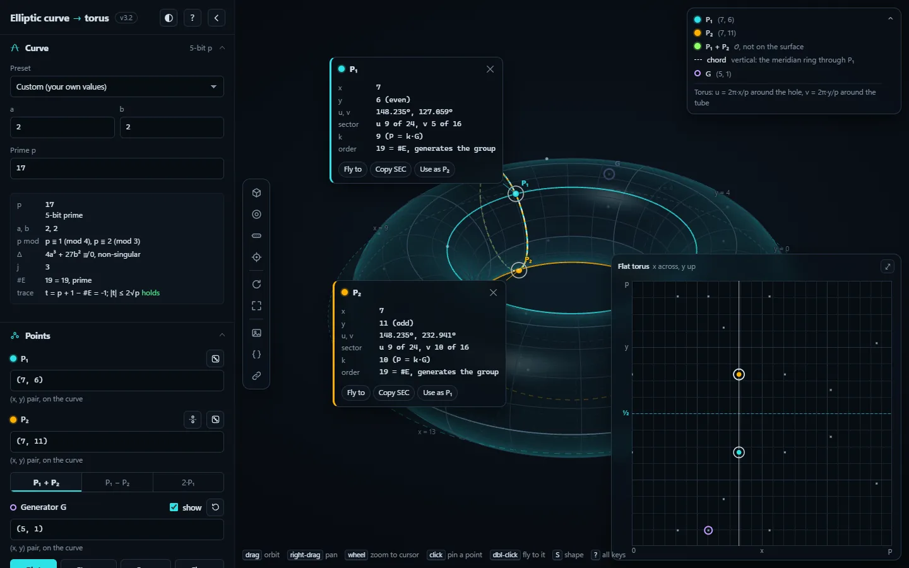
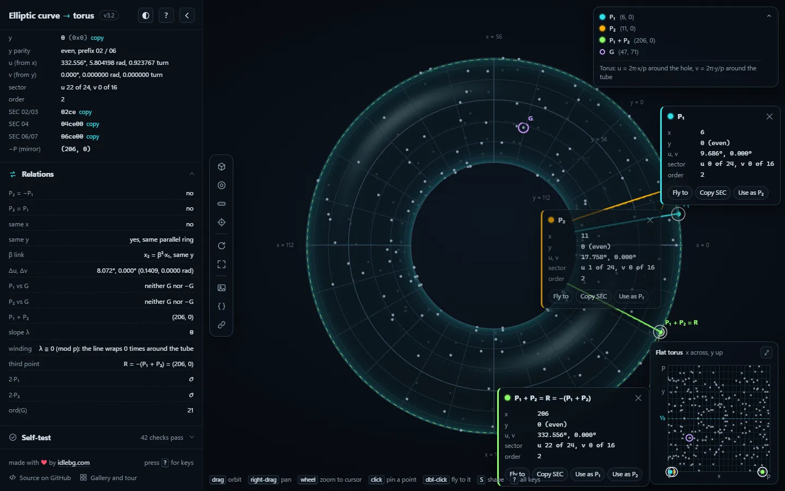
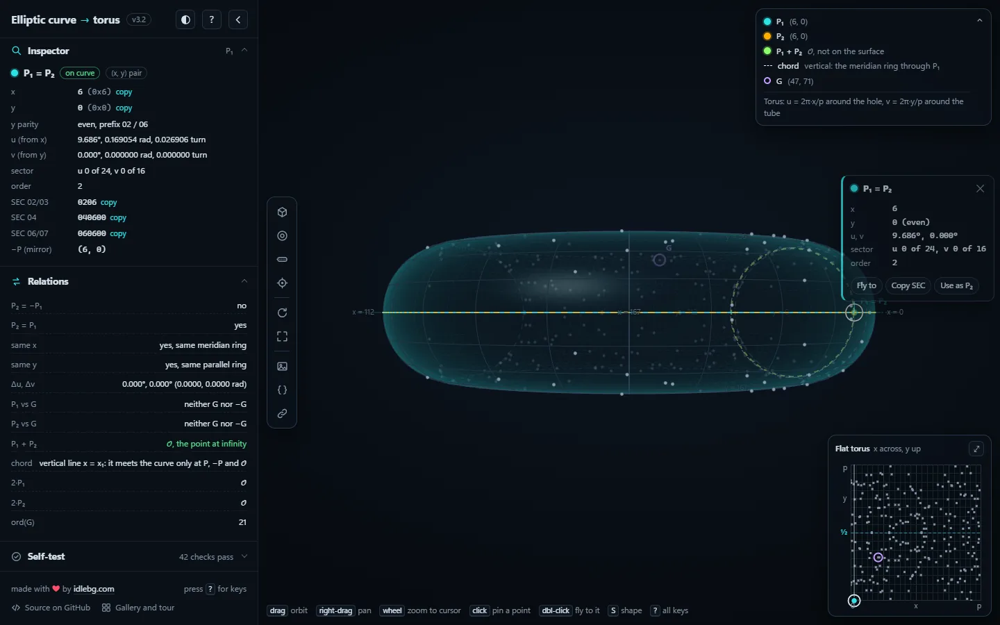

# 23 Negation

**Level 2 · Learner.** You will learn the rule −P = (x, p − y) as arithmetic, why a point plus its negation is the
point at infinity 𝒪, and which points are their own negation. Read first: [15 Mirror images](15-mirror-images.md)
and [21 Clock arithmetic](21-clock-arithmetic.md).

## The rule

Chapter 15 showed the picture: every point has a mirror image. In numbers: if (x, y) satisfies y² ≡ x³ + ax + b, so
does (x, −y), because (−y)² = y². On the clock, −y is p − y (and −0 is 0). So the
[negation](94-glossary.md#negation) of P = (x, y) is

  −P = (x, p − y).

The points of an elliptic curve form a **group**: there is an addition (chapters 24 and 25), 𝒪 plays the role of
zero (P + 𝒪 = P), and every point has a negative with P + (−P) = 𝒪. The visualizer shows all three facts.

### Example 23.1 · A point plus its mirror image is 𝒪

On the small curve F₁₇: (7, 6) and (7, 11), since 17 − 6 = 11.

**Open this view:** [(7, 6) and (7, 11) on F₁₇](https://idlebg.com/idleGevrek/elliptic_curve_torus_visualizer_v3.html#s=eyJ2IjozLCJwcmVzZXQiOiJjdXN0b20iLCJiYXNlUHJlc2V0IjoicHAxNyIsImEiOiIyIiwiYiI6IjIiLCJwIjoiMTciLCJnIjoiKDUsIDEpIiwicDEiOiIoNywgNikiLCJwMiI6Iig3LCAxMSkiLCJvcCI6ImFkZCIsInNob3dHIjp0cnVlLCJmb3JjZSI6ZmFsc2UsInNoYXBlIjoidG9ydXMiLCJtYXAiOiJzY2FsZSIsImJpdHMiOjI0LCJzdSI6MjQsInN2IjoxNiwiUiI6MS4yLCJyIjowLjQ2LCJnbGFzcyI6MC41NSwiYmFjayI6MC40LCJzaG93Ijp7ImdyaWQiOnRydWUsInJpbmdzIjp0cnVlLCJsYWJlbHMiOnRydWUsImNsb3VkIjp0cnVlLCJjaG9yZCI6dHJ1ZSwiYmV0YSI6ZmFsc2UsIm1hcCI6dHJ1ZSwic3BpbiI6ZmFsc2V9LCJyaW5ncyI6eyJwMSI6dHJ1ZSwicDIiOnRydWUsInN1bSI6dHJ1ZSwiZyI6ZmFsc2V9LCJ0aGVtZSI6ImRhcmsiLCJwYW5lbCI6dHJ1ZSwibWluaUJpZyI6dHJ1ZSwibGVnZW5kTWluIjpmYWxzZSwic2VjcyI6eyJjdXJ2ZSI6dHJ1ZSwicG9pbnRzIjp0cnVlLCJzaGFwZSI6dHJ1ZSwidmlldyI6dHJ1ZSwiaW5zcGVjdG9yIjp0cnVlLCJyZWxhdGlvbnMiOnRydWUsInRlc3QiOmZhbHNlfX0)

**Do it yourself**

1. In **Curve**, pick the preset **y² = x³ + 2x + 2 over F₁₇, Paar & Pelzl**.
2. Type `(7, 6)` in **P₁** and `(7, 11)` in **P₂**.
3. Click **⤢** on the flat map to enlarge it.
4. In the 3D view, click P₁ and P₂ to pin their cards.

**Look at:**

- the cards: (7, 6) is 9G and (7, 11) is 10G, and 9 + 10 = 19, the number of points of this curve;
- **Relations**: “P₂ = −P₁: yes”, and **P₁ + P₂** is “𝒪, the point at infinity”;
- the **chord** row: “vertical line x = x₁: it meets the curve only at P, −P and 𝒪”;
- the enlarged flat map: all 18 dots come in pairs, one above the dashed middle line and one below, on the same
  vertical line.

**Why:** adding means drawing a line through the two points ([24 Adding points](24-chord.md)). Through P and −P that
line is vertical (both have the same x), and a vertical line meets the curve in no third point. The group law says the
answer is then 𝒪, which is why 𝒪 is called the point at infinity: it is where all vertical lines meet. On the donut
that line is the ring around the tube through both points.

## Points that are their own mirror image

If y = 0, then p − y = p ≡ 0, so −P = P: the point is its own negation, and P + P = 𝒪. These points are where
x³ + ax + b = 0. A cubic has at most three roots, so a curve has 0, 1 or 3 such points. They sit exactly on the mirror
plane: on the donut, on its outer rim (y = 0 means v = 0°).

### Example 23.2 · The three points with y = 0

F₂₂₃ has three of them: (6, 0), (11, 0) and (206, 0).

**Open this view:** [(6, 0) + (11, 0) on F₂₂₃](https://idlebg.com/idleGevrek/elliptic_curve_torus_visualizer_v3.html#s=eyJ2IjozLCJwcmVzZXQiOiJjdXN0b20iLCJiYXNlUHJlc2V0IjoicGIyMjMiLCJhIjoiMCIsImIiOiI3IiwicCI6IjIyMyIsImciOiIoNDcsIDcxKSIsInAxIjoiKDYsIDApIiwicDIiOiIoMTEsIDApIiwib3AiOiJhZGQiLCJzaG93RyI6dHJ1ZSwiZm9yY2UiOmZhbHNlLCJzaGFwZSI6InRvcnVzIiwibWFwIjoic2NhbGUiLCJiaXRzIjoyNCwic3UiOjI0LCJzdiI6MTYsIlIiOjEuMiwiciI6MC40NiwiZ2xhc3MiOjAuNTUsImJhY2siOjAuNCwic2hvdyI6eyJncmlkIjp0cnVlLCJyaW5ncyI6dHJ1ZSwibGFiZWxzIjp0cnVlLCJjbG91ZCI6dHJ1ZSwiY2hvcmQiOmZhbHNlLCJiZXRhIjpmYWxzZSwibWFwIjp0cnVlLCJzcGluIjpmYWxzZX0sInJpbmdzIjp7InAxIjp0cnVlLCJwMiI6dHJ1ZSwic3VtIjp0cnVlLCJnIjpmYWxzZX0sInRoZW1lIjoiZGFyayIsInBhbmVsIjp0cnVlLCJtaW5pQmlnIjpmYWxzZSwibGVnZW5kTWluIjpmYWxzZSwic2VjcyI6eyJjdXJ2ZSI6dHJ1ZSwicG9pbnRzIjp0cnVlLCJzaGFwZSI6dHJ1ZSwidmlldyI6dHJ1ZSwiaW5zcGVjdG9yIjp0cnVlLCJyZWxhdGlvbnMiOnRydWUsInRlc3QiOmZhbHNlfX0)

**Do it yourself**

1. In **Curve**, pick the preset **y² = x³ + 7 over F₂₂₃, Programming Bitcoin**.
2. Type `(6, 0)` in **P₁** and `(11, 0)` in **P₂**.
3. In **Display**, turn off **Chord construction** (**K**).
4. Press **2** for the top view.
5. In the 3D view, click P₁, P₂ and the result to pin their cards.
6. Read the **Relations** section in the panel.

**Look at:**

- from the top, all three points on the outer rim of the donut;
- **Relations**: (6, 0) + (11, 0) = (206, 0), the third one; **2·P₁** and **2·P₂** are both 𝒪;
- each card’s order: 2.

**Why:** the three points with y = 0, together with 𝒪, form a small group of their own, in which every element is its
own negative and the sum of any two is the third. Their order is 2: one addition of the point to itself already gives
𝒪. A mathematician calls them the [2-torsion](94-glossary.md#torsion) points.

### Example 23.3 · A point that is its own mirror image

Type `(6, 0)` into P₁ and click the mirror button next to P₂: it writes `(6, 0)` again.

**Open this view:** [(6, 0) and its mirror image](https://idlebg.com/idleGevrek/elliptic_curve_torus_visualizer_v3.html#s=eyJ2IjozLCJwcmVzZXQiOiJjdXN0b20iLCJiYXNlUHJlc2V0IjoicGIyMjMiLCJhIjoiMCIsImIiOiI3IiwicCI6IjIyMyIsImciOiIoNDcsIDcxKSIsInAxIjoiKDYsIDApIiwicDIiOiIoNiwgMCkiLCJvcCI6ImFkZCIsInNob3dHIjp0cnVlLCJmb3JjZSI6ZmFsc2UsInNoYXBlIjoidG9ydXMiLCJtYXAiOiJzY2FsZSIsImJpdHMiOjI0LCJzdSI6MjQsInN2IjoxNiwiUiI6MS4yLCJyIjowLjQ2LCJnbGFzcyI6MC41NSwiYmFjayI6MC40LCJzaG93Ijp7ImdyaWQiOnRydWUsInJpbmdzIjp0cnVlLCJsYWJlbHMiOnRydWUsImNsb3VkIjp0cnVlLCJjaG9yZCI6dHJ1ZSwiYmV0YSI6ZmFsc2UsIm1hcCI6dHJ1ZSwic3BpbiI6ZmFsc2V9LCJyaW5ncyI6eyJwMSI6dHJ1ZSwicDIiOnRydWUsInN1bSI6dHJ1ZSwiZyI6ZmFsc2V9LCJ0aGVtZSI6ImRhcmsiLCJwYW5lbCI6dHJ1ZSwibWluaUJpZyI6ZmFsc2UsImxlZ2VuZE1pbiI6ZmFsc2UsInNlY3MiOnsiY3VydmUiOnRydWUsInBvaW50cyI6dHJ1ZSwic2hhcGUiOnRydWUsInZpZXciOnRydWUsImluc3BlY3RvciI6dHJ1ZSwicmVsYXRpb25zIjp0cnVlLCJ0ZXN0IjpmYWxzZX19)

**Do it yourself**

1. In **Curve**, pick the preset **y² = x³ + 7 over F₂₂₃, Programming Bitcoin**.
2. Type `(6, 0)` in **P₁**.
3. Click the mirror button next to **P₂** (its tooltip: “Set P₂ = −P₁, the mirror image”).
4. Press **3** for the side view.
5. In the 3D view, click P₁ to pin its card.
6. Read the **Relations** section in the panel.

**Look at:** **Relations** says “P₂ = P₁: yes”, the sum is 𝒪, and the chord is the vertical ring through the point.
Its row **P₂ = −P₁** says “no”: for a point with y = 0 the visualizer reports the pair as equal rather than as
mirror images, although here they are both.

**Why:** the mirror button computes −P₁ = (6, 223 − 0) = (6, 0), the same point. Adding a point to itself uses the
tangent line ([25 Doubling](25-tangent.md)); at a point with y = 0 the tangent is vertical, so the result is 𝒪 again.

## Try it yourself

- On F₂₂₃, type `5G` into P₁ and click the mirror button. Which k does P₂ get? (5 + k must be 21.)
- Find the points with y = 0 on y² = x³ + 2x + 3 over F₉₇. How many are there? Check with **2·P₁**.
- Type `O` into P₂ (the letter O means 𝒪). What is P₁ + 𝒪?

## Recap

- −P = (x, p − y); P + (−P) = 𝒪, drawn as the vertical ring through both points.
- Points with y = 0 are their own negation; there are 0, 1 or 3 of them, all on the mirror plane.
- 𝒪 acts as zero: P + 𝒪 = P.

Next: [24 Adding points: the chord](24-chord.md).
