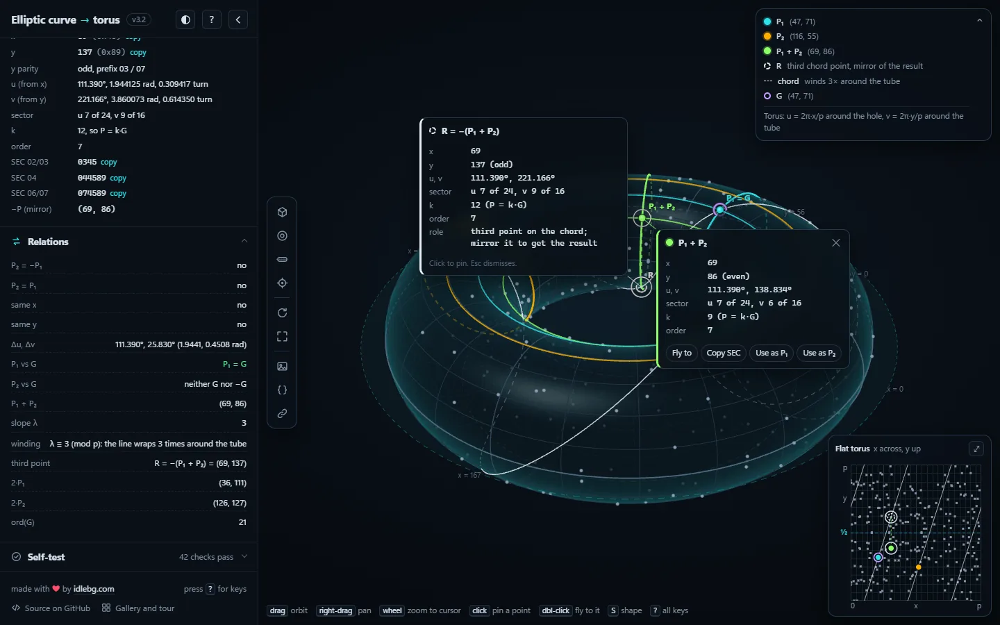
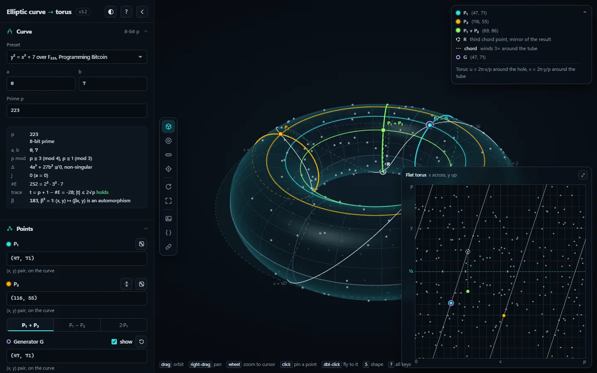
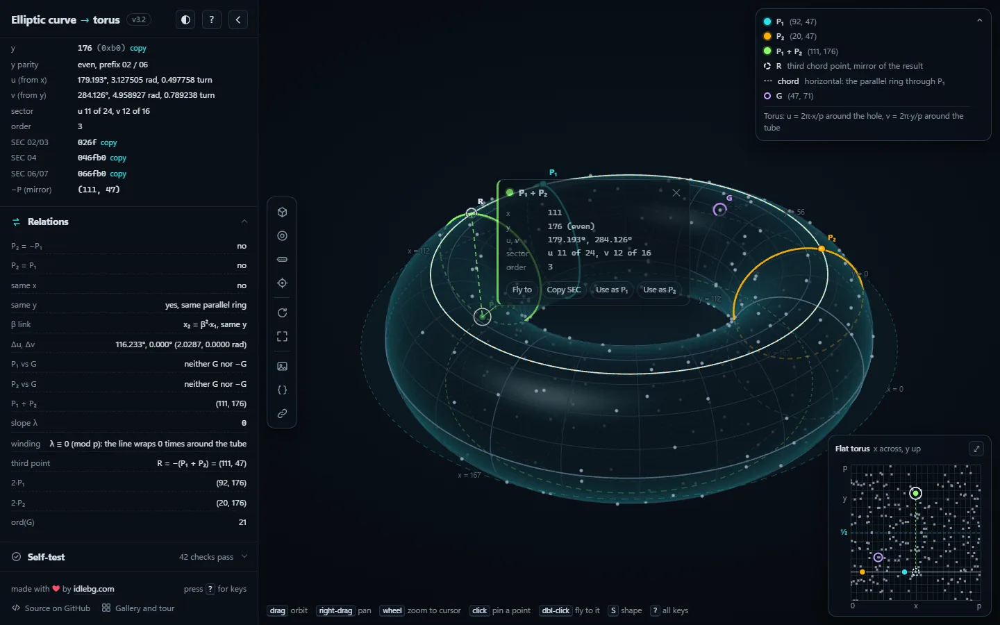
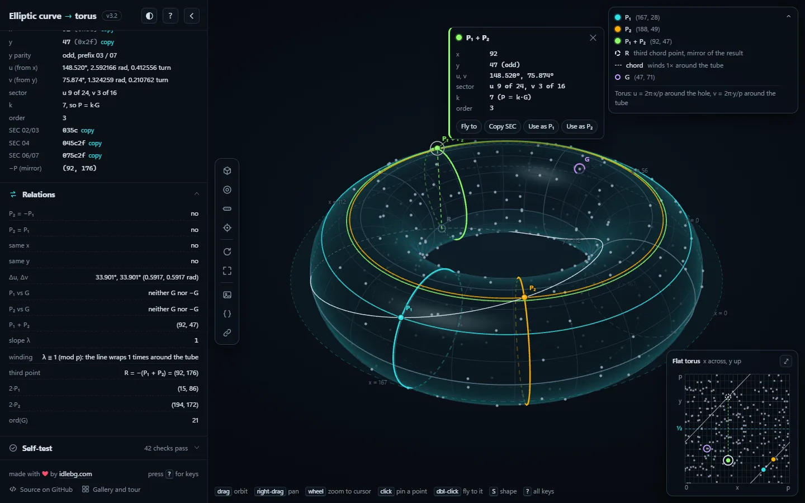
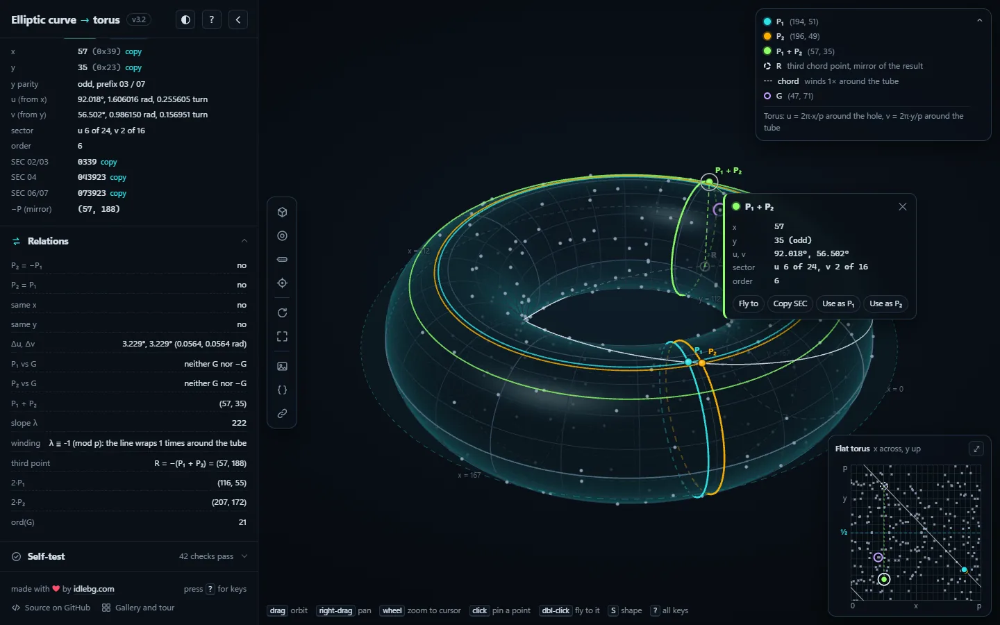

# 24 Adding points: the chord

**Level 2 · Learner.** You will learn how two points of a curve are added, do one addition by hand, and see why the
line through them winds around the donut. Read first: [21 Clock arithmetic](21-clock-arithmetic.md) and
[23 Negation](23-negation.md).

## The chord rule

To add two points P₁ and P₂ of an elliptic curve:

1. draw the line through them, the **chord**;
2. it meets the curve in exactly one more point, **R**;
3. the sum is the mirror image of R: P₁ + P₂ = −R.

Why exactly one more point? Put the line y = λx + c into the curve’s equation. You get an equation of degree 3 in x,
and a cubic has three roots. Two of them are x₁ and x₂, the points you started with, so the third one is forced. For
a cubic x³ − λ²x² + …, the three roots add up to λ², which gives the formula

  x₃ = λ² − x₁ − x₂,  then R = (x₃, λx₃ + c),  and P₁ + P₂ = (x₃, −(λx₃ + c)).

Here λ (“lambda”) is the slope, λ = (y₂ − y₁) / (x₂ − x₁), with the division done mod p (multiply by the inverse).

### Example 24.1 · G + 8G = 9G: the chord winds three times

The preset “y² = x³ + 7 over F₂₂₃, Programming Bitcoin” opens with exactly this addition: P₁ = G = (47, 71) and
P₂ = 8G = (116, 55).

**Open this view:** [G + 8G on F₂₂₃](https://idlebg.com/idleGevrek/elliptic_curve_torus_visualizer_v3.html#s=eyJ2IjozLCJwcmVzZXQiOiJwYjIyMyIsImJhc2VQcmVzZXQiOiJwYjIyMyIsImEiOiIwIiwiYiI6IjciLCJwIjoiMjIzIiwiZyI6Iig0NywgNzEpIiwicDEiOiIoNDcsIDcxKSIsInAyIjoiKDExNiwgNTUpIiwib3AiOiJhZGQiLCJzaG93RyI6dHJ1ZSwiZm9yY2UiOmZhbHNlLCJzaGFwZSI6InRvcnVzIiwibWFwIjoic2NhbGUiLCJiaXRzIjoyNCwic3UiOjI0LCJzdiI6MTYsIlIiOjEuMiwiciI6MC40NiwiZ2xhc3MiOjAuNTUsImJhY2siOjAuNCwic2hvdyI6eyJncmlkIjp0cnVlLCJyaW5ncyI6dHJ1ZSwibGFiZWxzIjp0cnVlLCJjbG91ZCI6dHJ1ZSwiY2hvcmQiOnRydWUsImJldGEiOmZhbHNlLCJtYXAiOnRydWUsInNwaW4iOmZhbHNlfSwicmluZ3MiOnsicDEiOnRydWUsInAyIjp0cnVlLCJzdW0iOnRydWUsImciOmZhbHNlfSwidGhlbWUiOiJkYXJrIiwicGFuZWwiOnRydWUsIm1pbmlCaWciOmZhbHNlLCJsZWdlbmRNaW4iOmZhbHNlLCJzZWNzIjp7ImN1cnZlIjp0cnVlLCJwb2ludHMiOnRydWUsInNoYXBlIjp0cnVlLCJ2aWV3Ijp0cnVlLCJpbnNwZWN0b3IiOnRydWUsInJlbGF0aW9ucyI6dHJ1ZSwidGVzdCI6ZmFsc2V9fQ)

**Do it yourself**

1. In **Curve**, pick the preset **y² = x³ + 7 over F₂₂₃, Programming Bitcoin**.
2. In the 3D view, click the result to pin its card.
3. In the 3D view, hover R; its card stays until you hover another point.
4. Read the **Relations** section in the panel.

**Look at:**

- the white line through G and 8G, winding around the tube three times while it goes once around the hole;
- the dashed ring R = (69, 137), where the line meets the curve again, and the short dashed mirror step from R to the
  green result (69, 86), whose card says k = 9;
- **Relations**: **slope λ** = 3, **winding** “λ ≡ 3 (mod p): the line wraps 3 times around the tube”,
  **third point** R = (69, 137), and **P₁ + P₂** = (69, 86).

**Why:** by hand, mod 223:

- λ = (55 − 71) / (116 − 47) = −16 / 69. Is it 3? Check: 3 × 69 = 207, and 207 ≡ −16 because 207 + 16 = 223. Yes,
  λ = 3.
- x₃ = 3² − 47 − 116 = −154, and −154 + 223 = 69.
- the sum’s y: 3 × (47 − 69) − 71 = −137, which is 86 on the clock. So G + 8G = (69, 86), and R = (69, 137) is its
  mirror image.

The line itself is y ≡ 3x + 153 (mod 223), so c = 153. As x runs once around (0 to 223), 3x runs three times as far,
so the line wraps three times around the tube: that is the winding the legend reports.

### Example 24.2 · On the flat map: three parallel segments

**Open this view:** [G + 8G, flat map enlarged](https://idlebg.com/idleGevrek/elliptic_curve_torus_visualizer_v3.html#s=eyJ2IjozLCJwcmVzZXQiOiJwYjIyMyIsImJhc2VQcmVzZXQiOiJwYjIyMyIsImEiOiIwIiwiYiI6IjciLCJwIjoiMjIzIiwiZyI6Iig0NywgNzEpIiwicDEiOiIoNDcsIDcxKSIsInAyIjoiKDExNiwgNTUpIiwib3AiOiJhZGQiLCJzaG93RyI6dHJ1ZSwiZm9yY2UiOmZhbHNlLCJzaGFwZSI6InRvcnVzIiwibWFwIjoic2NhbGUiLCJiaXRzIjoyNCwic3UiOjI0LCJzdiI6MTYsIlIiOjEuMiwiciI6MC40NiwiZ2xhc3MiOjAuNTUsImJhY2siOjAuNCwic2hvdyI6eyJncmlkIjp0cnVlLCJyaW5ncyI6dHJ1ZSwibGFiZWxzIjp0cnVlLCJjbG91ZCI6dHJ1ZSwiY2hvcmQiOnRydWUsImJldGEiOmZhbHNlLCJtYXAiOnRydWUsInNwaW4iOmZhbHNlfSwicmluZ3MiOnsicDEiOnRydWUsInAyIjp0cnVlLCJzdW0iOnRydWUsImciOmZhbHNlfSwidGhlbWUiOiJkYXJrIiwicGFuZWwiOnRydWUsIm1pbmlCaWciOnRydWUsImxlZ2VuZE1pbiI6ZmFsc2UsInNlY3MiOnsiY3VydmUiOnRydWUsInBvaW50cyI6dHJ1ZSwic2hhcGUiOnRydWUsInZpZXciOnRydWUsImluc3BlY3RvciI6dHJ1ZSwicmVsYXRpb25zIjp0cnVlLCJ0ZXN0IjpmYWxzZX19)

**Do it yourself**

1. In **Curve**, pick the preset **y² = x³ + 7 over F₂₂₃, Programming Bitcoin**.
2. Click **⤢** on the flat map to enlarge it.

**Look at:** the enlarged flat map. The line is drawn as three parallel segments: each time it leaves the top edge it
comes back at the bottom, because y wraps at 223.

**Why:** a line on the torus is a straight line on the flat square that wraps around its edges. Slope 3 means three
crossings of the y range per crossing of the x range.

A word on λ: on the clock, 3, 226 and −220 are the same number, and they would give the same points of the line but
different drawings between them. The visualizer always takes the value between −p/2 and p/2, closest to 0, so the
line winds as few times as possible.

## Special slopes

### Example 24.3 · Slope 0: the chord is a ring around the hole

(92, 47) and (20, 47) have the same y.

**Open this view:** [(92, 47) + (20, 47)](https://idlebg.com/idleGevrek/elliptic_curve_torus_visualizer_v3.html#s=eyJ2IjozLCJwcmVzZXQiOiJjdXN0b20iLCJiYXNlUHJlc2V0IjoicGIyMjMiLCJhIjoiMCIsImIiOiI3IiwicCI6IjIyMyIsImciOiIoNDcsIDcxKSIsInAxIjoiKDkyLCA0NykiLCJwMiI6IigyMCwgNDcpIiwib3AiOiJhZGQiLCJzaG93RyI6dHJ1ZSwiZm9yY2UiOmZhbHNlLCJzaGFwZSI6InRvcnVzIiwibWFwIjoic2NhbGUiLCJiaXRzIjoyNCwic3UiOjI0LCJzdiI6MTYsIlIiOjEuMiwiciI6MC40NiwiZ2xhc3MiOjAuNTUsImJhY2siOjAuNCwic2hvdyI6eyJncmlkIjp0cnVlLCJyaW5ncyI6dHJ1ZSwibGFiZWxzIjp0cnVlLCJjbG91ZCI6dHJ1ZSwiY2hvcmQiOnRydWUsImJldGEiOmZhbHNlLCJtYXAiOnRydWUsInNwaW4iOmZhbHNlfSwicmluZ3MiOnsicDEiOnRydWUsInAyIjp0cnVlLCJzdW0iOnRydWUsImciOmZhbHNlfSwidGhlbWUiOiJkYXJrIiwicGFuZWwiOnRydWUsIm1pbmlCaWciOmZhbHNlLCJsZWdlbmRNaW4iOmZhbHNlLCJzZWNzIjp7ImN1cnZlIjp0cnVlLCJwb2ludHMiOnRydWUsInNoYXBlIjp0cnVlLCJ2aWV3Ijp0cnVlLCJpbnNwZWN0b3IiOnRydWUsInJlbGF0aW9ucyI6dHJ1ZSwidGVzdCI6ZmFsc2V9fQ)

**Do it yourself**

1. In **Curve**, pick the preset **y² = x³ + 7 over F₂₂₃, Programming Bitcoin**.
2. Type `(92, 47)` in **P₁** and `(20, 47)` in **P₂**.
3. In the 3D view, click the result to pin its card.
4. Read the **Relations** section in the panel.

**Look at:** the chord is the ring around the hole at y = 47 (the legend: “horizontal: the parallel ring through
P₁”), and Relations says “λ ≡ 0 (mod p): the line wraps 0 times”. The third point on that ring is R = (111, 47), and
the sum is its mirror image, (111, 176).

**Why:** λ = (47 − 47) / (20 − 92) = 0, so the line is y = 47 and never leaves its ring. Three points of F₂₂₃ have
y = 47, and [35 The GLV endomorphism](35-glv.md) explains why points sharing a y come in threes on this curve.

### Example 24.4 · Slope 1: once around each way

**Open this view:** [(167, 28) + (188, 49)](https://idlebg.com/idleGevrek/elliptic_curve_torus_visualizer_v3.html#s=eyJ2IjozLCJwcmVzZXQiOiJjdXN0b20iLCJiYXNlUHJlc2V0IjoicGIyMjMiLCJhIjoiMCIsImIiOiI3IiwicCI6IjIyMyIsImciOiIoNDcsIDcxKSIsInAxIjoiKDE2NywgMjgpIiwicDIiOiIoMTg4LCA0OSkiLCJvcCI6ImFkZCIsInNob3dHIjp0cnVlLCJmb3JjZSI6ZmFsc2UsInNoYXBlIjoidG9ydXMiLCJtYXAiOiJzY2FsZSIsImJpdHMiOjI0LCJzdSI6MjQsInN2IjoxNiwiUiI6MS4yLCJyIjowLjQ2LCJnbGFzcyI6MC41NSwiYmFjayI6MC40LCJzaG93Ijp7ImdyaWQiOnRydWUsInJpbmdzIjp0cnVlLCJsYWJlbHMiOnRydWUsImNsb3VkIjp0cnVlLCJjaG9yZCI6dHJ1ZSwiYmV0YSI6ZmFsc2UsIm1hcCI6dHJ1ZSwic3BpbiI6ZmFsc2V9LCJyaW5ncyI6eyJwMSI6dHJ1ZSwicDIiOnRydWUsInN1bSI6dHJ1ZSwiZyI6ZmFsc2V9LCJ0aGVtZSI6ImRhcmsiLCJwYW5lbCI6dHJ1ZSwibWluaUJpZyI6ZmFsc2UsImxlZ2VuZE1pbiI6ZmFsc2UsInNlY3MiOnsiY3VydmUiOnRydWUsInBvaW50cyI6dHJ1ZSwic2hhcGUiOnRydWUsInZpZXciOnRydWUsImluc3BlY3RvciI6dHJ1ZSwicmVsYXRpb25zIjp0cnVlLCJ0ZXN0IjpmYWxzZX19)

**Do it yourself**

1. In **Curve**, pick the preset **y² = x³ + 7 over F₂₂₃, Programming Bitcoin**.
2. Type `(167, 28)` in **P₁** and `(188, 49)` in **P₂**.
3. In the 3D view, click the result to pin its card.
4. Read the **Relations** section in the panel.

**Look at:** a line that goes once around the hole and once around the tube, like a stripe on a candy cane. The sum is
(92, 47).

### Example 24.5 · Slope −1: the other diagonal

**Open this view:** [(194, 51) + (196, 49)](https://idlebg.com/idleGevrek/elliptic_curve_torus_visualizer_v3.html#s=eyJ2IjozLCJwcmVzZXQiOiJjdXN0b20iLCJiYXNlUHJlc2V0IjoicGIyMjMiLCJhIjoiMCIsImIiOiI3IiwicCI6IjIyMyIsImciOiIoNDcsIDcxKSIsInAxIjoiKDE5NCwgNTEpIiwicDIiOiIoMTk2LCA0OSkiLCJvcCI6ImFkZCIsInNob3dHIjp0cnVlLCJmb3JjZSI6ZmFsc2UsInNoYXBlIjoidG9ydXMiLCJtYXAiOiJzY2FsZSIsImJpdHMiOjI0LCJzdSI6MjQsInN2IjoxNiwiUiI6MS4yLCJyIjowLjQ2LCJnbGFzcyI6MC41NSwiYmFjayI6MC40LCJzaG93Ijp7ImdyaWQiOnRydWUsInJpbmdzIjp0cnVlLCJsYWJlbHMiOnRydWUsImNsb3VkIjp0cnVlLCJjaG9yZCI6dHJ1ZSwiYmV0YSI6ZmFsc2UsIm1hcCI6dHJ1ZSwic3BpbiI6ZmFsc2V9LCJyaW5ncyI6eyJwMSI6dHJ1ZSwicDIiOnRydWUsInN1bSI6dHJ1ZSwiZyI6ZmFsc2V9LCJ0aGVtZSI6ImRhcmsiLCJwYW5lbCI6dHJ1ZSwibWluaUJpZyI6ZmFsc2UsImxlZ2VuZE1pbiI6ZmFsc2UsInNlY3MiOnsiY3VydmUiOnRydWUsInBvaW50cyI6dHJ1ZSwic2hhcGUiOnRydWUsInZpZXciOnRydWUsImluc3BlY3RvciI6dHJ1ZSwicmVsYXRpb25zIjp0cnVlLCJ0ZXN0IjpmYWxzZX19)

**Do it yourself**

1. In **Curve**, pick the preset **y² = x³ + 7 over F₂₂₃, Programming Bitcoin**.
2. Type `(194, 51)` in **P₁** and `(196, 49)` in **P₂**.
3. In the 3D view, click the result to pin its card.
4. Read the **Relations** section in the panel.

**Look at:** the slope is 222, which is −1 on the clock: Relations writes the winding as “λ ≡ -1 (mod p)”, and the line
winds once around the tube the other way. The sum is (57, 35).

## When the line is too steep

Most chords on most curves are steep: λ is a random number on the clock, so its centred value is often in the
hundreds. The visualizer draws the continuous line only while it winds at most 24 times; beyond that the flat map shows
the line’s p separate points instead (for p up to 4000), and on Bitcoin’s 256-bit curve only R and the mirror step are
drawn. [26 Subtraction](26-subtraction.md) shows a steep example, and [41 The mapping](41-mapping.md) the details.

## Try it yourself

- Add G and 2G on F₂₂₃ (type `G` and `2G`). What slope does Relations report, and is the line drawn?
- Swap P₁ and P₂ with **Swap**: the sum stays the same, but which point is R?
- Compute 8G + 9G by hand with the formula and check it in the visualizer.

## Recap

- P₁ + P₂ = −R, where R is the third point of the curve on the line through P₁ and P₂.
- λ = (y₂ − y₁)/(x₂ − x₁) mod p, x₃ = λ² − x₁ − x₂; the line is y ≡ λx + c.
- On the torus the line winds |λ| times around the tube (λ taken closest to 0); Relations and the legend report it.

Next: [25 Doubling: the tangent](25-tangent.md).
