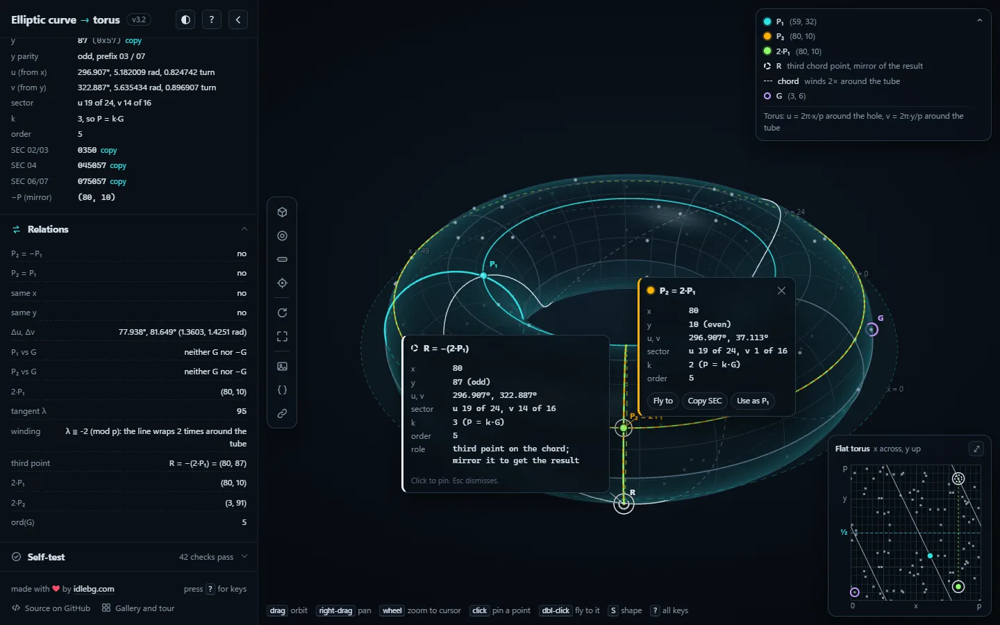
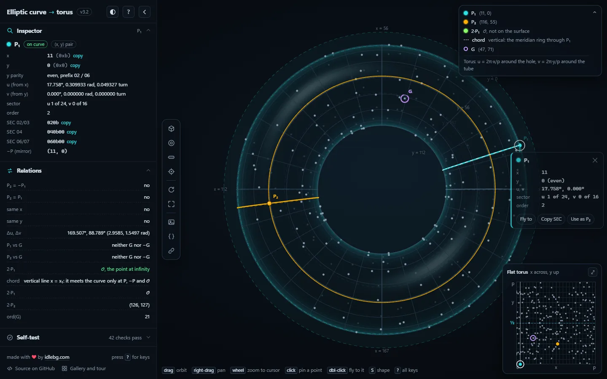
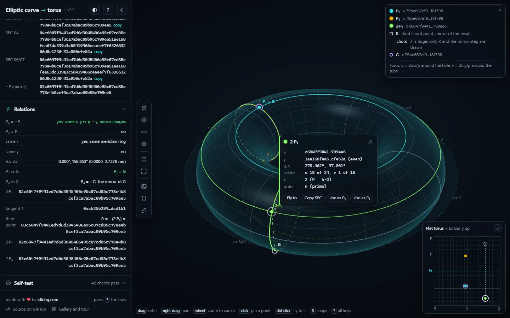

# 25 Doubling: the tangent

**Level 2 · Learner.** You will learn how a point is added to itself, compute one doubling by hand, and see the
doubling of Bitcoin’s G. Read first: [24 Adding points: the chord](24-chord.md).

## From chord to tangent

To add P to itself there is no second point to draw a line through. Instead, take the line that just touches the
curve at P: the **tangent**. It meets the curve at P twice (that is what touching means) and once more, at R, and
again 2·P = −R.

Only the slope changes. For y² = x³ + ax + b the tangent at (x₁, y₁) has

  λ = (3x₁² + a) / (2y₁),  then x₃ = λ² − 2x₁, and 2·P = (x₃, λ(x₁ − x₃) − y₁).

In the visualizer, choose the operation **2·P₁**: P₂ is then ignored, and the line drawn is the tangent at P₁.

### Example 25.1 · Doubling (59, 32) on F₉₇: the tangent

The preset “y² = x³ + 2x + 3 over F₉₇, a point of order 5” with P₁ = (59, 32) and the operation **2·P₁**.

**Open this view:** [2·(59, 32) on F₉₇](https://idlebg.com/idleGevrek/elliptic_curve_torus_visualizer_v3.html#s=eyJ2IjozLCJwcmVzZXQiOiJjdXN0b20iLCJiYXNlUHJlc2V0IjoiYzk3IiwiYSI6IjIiLCJiIjoiMyIsInAiOiI5NyIsImciOiIoMywgNikiLCJwMSI6Iig1OSwgMzIpIiwicDIiOiIoODAsIDEwKSIsIm9wIjoiZGJsIiwic2hvd0ciOnRydWUsImZvcmNlIjpmYWxzZSwic2hhcGUiOiJ0b3J1cyIsIm1hcCI6InNjYWxlIiwiYml0cyI6MjQsInN1IjoyNCwic3YiOjE2LCJSIjoxLjIsInIiOjAuNDYsImdsYXNzIjowLjU1LCJiYWNrIjowLjQsInNob3ciOnsiZ3JpZCI6dHJ1ZSwicmluZ3MiOnRydWUsImxhYmVscyI6dHJ1ZSwiY2xvdWQiOnRydWUsImNob3JkIjp0cnVlLCJiZXRhIjpmYWxzZSwibWFwIjp0cnVlLCJzcGluIjpmYWxzZX0sInJpbmdzIjp7InAxIjp0cnVlLCJwMiI6dHJ1ZSwic3VtIjp0cnVlLCJnIjpmYWxzZX0sInRoZW1lIjoiZGFyayIsInBhbmVsIjp0cnVlLCJtaW5pQmlnIjpmYWxzZSwibGVnZW5kTWluIjpmYWxzZSwic2VjcyI6eyJjdXJ2ZSI6dHJ1ZSwicG9pbnRzIjp0cnVlLCJzaGFwZSI6dHJ1ZSwidmlldyI6dHJ1ZSwiaW5zcGVjdG9yIjp0cnVlLCJyZWxhdGlvbnMiOnRydWUsInRlc3QiOmZhbHNlfX0)

**Do it yourself**

1. In **Curve**, pick the preset **y² = x³ + 2x + 3 over F₉₇, a point of order 5**.
2. Type `(59, 32)` in **P₁**.
3. Choose the operation **2·P₁**.
4. In the 3D view, click the result to pin its card.
5. In the 3D view, hover R; its card stays until you hover another point.
6. Read the **Relations** section in the panel.

**Look at:**

- the tangent line winding twice around the tube, touching the curve at P₁;
- the third point R = (80, 87), dashed, and the mirror step to the result (80, 10), which is exactly the preset’s P₂;
- **Relations**: **tangent λ** = 95, **winding** “λ ≡ -2 (mod p): the line wraps 2 times around the tube”, and
  **2·P₁** = (80, 10);
- P₁’s order, 10.

**Why:** by hand, mod 97, with a = 2:

- the top: 3 × 59² + 2 = 10445 ≡ 66, since 10445 = 107 × 97 + 66;
- the bottom: 2 × 32 = 64. Its inverse is 47, because 64 × 47 = 3008 and 3008 = 31 × 97 + 1;
- so λ = 66 × 47 = 3102 ≡ 95, which is −2 on the clock;
- x₃ = (−2)² − 2 × 59 = −114, and −114 + 194 = 80;
- y: −2 × (59 − 80) − 32 = 10. So 2·(59, 32) = (80, 10), and R = (80, 87) is its mirror image.

Since P₁ has order 10, 2·P₁ has order 5: it is one of the points of order 5 the preset is named after.

### Example 25.2 · A vertical tangent: doubling a point with y = 0

**Open this view:** [2·(11, 0) on F₂₂₃](https://idlebg.com/idleGevrek/elliptic_curve_torus_visualizer_v3.html#s=eyJ2IjozLCJwcmVzZXQiOiJjdXN0b20iLCJiYXNlUHJlc2V0IjoicGIyMjMiLCJhIjoiMCIsImIiOiI3IiwicCI6IjIyMyIsImciOiIoNDcsIDcxKSIsInAxIjoiKDExLCAwKSIsInAyIjoiKDExNiwgNTUpIiwib3AiOiJkYmwiLCJzaG93RyI6dHJ1ZSwiZm9yY2UiOmZhbHNlLCJzaGFwZSI6InRvcnVzIiwibWFwIjoic2NhbGUiLCJiaXRzIjoyNCwic3UiOjI0LCJzdiI6MTYsIlIiOjEuMiwiciI6MC40NiwiZ2xhc3MiOjAuNTUsImJhY2siOjAuNCwic2hvdyI6eyJncmlkIjp0cnVlLCJyaW5ncyI6dHJ1ZSwibGFiZWxzIjp0cnVlLCJjbG91ZCI6dHJ1ZSwiY2hvcmQiOnRydWUsImJldGEiOmZhbHNlLCJtYXAiOnRydWUsInNwaW4iOmZhbHNlfSwicmluZ3MiOnsicDEiOnRydWUsInAyIjp0cnVlLCJzdW0iOnRydWUsImciOmZhbHNlfSwidGhlbWUiOiJkYXJrIiwicGFuZWwiOnRydWUsIm1pbmlCaWciOmZhbHNlLCJsZWdlbmRNaW4iOmZhbHNlLCJzZWNzIjp7ImN1cnZlIjp0cnVlLCJwb2ludHMiOnRydWUsInNoYXBlIjp0cnVlLCJ2aWV3Ijp0cnVlLCJpbnNwZWN0b3IiOnRydWUsInJlbGF0aW9ucyI6dHJ1ZSwidGVzdCI6ZmFsc2V9fQ)

**Do it yourself**

1. In **Curve**, pick the preset **y² = x³ + 7 over F₂₂₃, Programming Bitcoin**.
2. Type `(11, 0)` in **P₁**.
3. Choose the operation **2·P₁**.
4. Press **2** for the top view.
5. In the 3D view, click P₁ to pin its card.
6. Read the **Relations** section in the panel.

**Look at:** **2·P₁** is “𝒪, the point at infinity”, and the chord row says “vertical line”. From the top, the point
sits on the outer rim.

**Why:** the slope formula divides by 2y₁, and here y₁ = 0. The tangent is vertical: it meets the curve at no third
point, so 2·P = 𝒪. That is the doubling side of what [23 Negation](23-negation.md) said: a point with y = 0 is its
own negative.

### Example 25.3 · 2G on secp256k1

Bitcoin’s curve, with P₁ = G and the operation **2·P₁**.

**Open this view:** [2·G on secp256k1](https://idlebg.com/idleGevrek/elliptic_curve_torus_visualizer_v3.html#s=eyJ2IjozLCJwcmVzZXQiOiJrMS1uZWciLCJiYXNlUHJlc2V0IjoiazEtbmVnIiwiYSI6IjAiLCJiIjoiNyIsInAiOiIyXjI1NiAtIDJeMzIgLSA5NzciLCJnIjoiMDI3OWJlNjY3ZWY5ZGNiYmFjNTVhMDYyOTVjZTg3MGIwNzAyOWJmY2RiMmRjZTI4ZDk1OWYyODE1YjE2ZjgxNzk4IiwicDEiOiIwMjc5YmU2NjdlZjlkY2JiYWM1NWEwNjI5NWNlODcwYjA3MDI5YmZjZGIyZGNlMjhkOTU5ZjI4MTViMTZmODE3OTgiLCJwMiI6IjAzNzliZTY2N2VmOWRjYmJhYzU1YTA2Mjk1Y2U4NzBiMDcwMjliZmNkYjJkY2UyOGQ5NTlmMjgxNWIxNmY4MTc5OCIsIm9wIjoiZGJsIiwic2hvd0ciOnRydWUsImZvcmNlIjpmYWxzZSwic2hhcGUiOiJ0b3J1cyIsIm1hcCI6InNjYWxlIiwiYml0cyI6MjQsInN1IjoyNCwic3YiOjE2LCJSIjoxLjIsInIiOjAuNDYsImdsYXNzIjowLjU1LCJiYWNrIjowLjQsInNob3ciOnsiZ3JpZCI6dHJ1ZSwicmluZ3MiOnRydWUsImxhYmVscyI6dHJ1ZSwiY2xvdWQiOnRydWUsImNob3JkIjp0cnVlLCJiZXRhIjpmYWxzZSwibWFwIjp0cnVlLCJzcGluIjpmYWxzZX0sInJpbmdzIjp7InAxIjp0cnVlLCJwMiI6dHJ1ZSwic3VtIjp0cnVlLCJnIjpmYWxzZX0sInRoZW1lIjoiZGFyayIsInBhbmVsIjp0cnVlLCJtaW5pQmlnIjpmYWxzZSwibGVnZW5kTWluIjpmYWxzZSwic2VjcyI6eyJjdXJ2ZSI6dHJ1ZSwicG9pbnRzIjp0cnVlLCJzaGFwZSI6dHJ1ZSwidmlldyI6dHJ1ZSwiaW5zcGVjdG9yIjp0cnVlLCJyZWxhdGlvbnMiOnRydWUsInRlc3QiOmZhbHNlfX0)

**Do it yourself**

1. In **Curve**, pick the preset **secp256k1: G and −G (mirror pair)**.
2. Choose the operation **2·P₁**.
3. In the 3D view, click the result to pin its card.
4. Read the **Relations** section in the panel.

**Look at:** the result’s card says k = 2, and Relations gives 2·P₁ as the compressed key
`02c6047f9441ed7d6d3045406e95c07cd85c778e4b8cef3ca7abac09b95c709ee5`, the public key of private key 2 from
[14 Two points](14-how-far-apart.md). The legend says “λ is huge: only R and the mirror step are drawn”.

**Why:** the tangent at G has the slope (written in hex, 64 digits)
`cb35b28428101a303eb9d1235992ac63f58857c2f631ee6936d3aebbeddcd1b1`, and Relations shows it shortened. A line with a
slope that large winds around the tube about 2.388 × 10⁷⁶ times (a 254-bit number); no picture can show it.
What the visualizer does draw is exact: R, the mirror step and the result. And it keeps track of k: G has k = 1, so
2·P₁ has k = 2.

## Try it yourself

- On F₉₇, double (80, 10): you should get another point of order 5. Then double that.
- On F₂₂₃, compute 2G = 2·(47, 71) by hand and check it against `2G` typed into P₁ ([14](14-how-far-apart.md) gave
  (36, 111)).
- On secp256k1, type `2G` into P₁ and choose **2·P₁**: the card says k = 4.

## Recap

- Doubling uses the tangent: λ = (3x₁² + a)/(2y₁) mod p, x₃ = λ² − 2x₁, and 2·P = −R.
- At a point with y = 0 the tangent is vertical and 2·P = 𝒪.
- On a 256-bit curve the visualizer draws R, the mirror step and the result, and carries k through.

Next: [26 Subtraction](26-subtraction.md).
