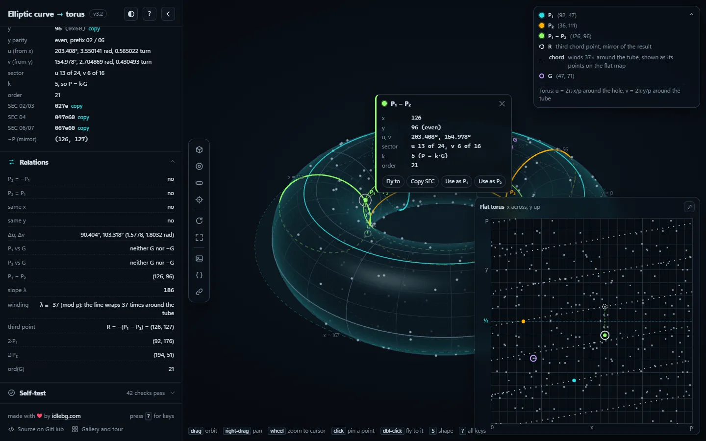
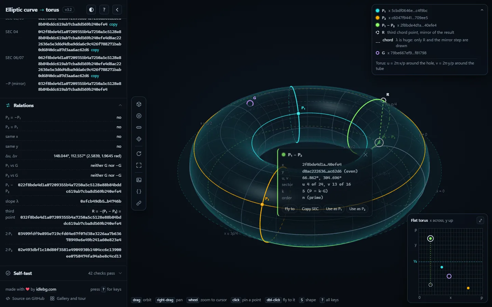
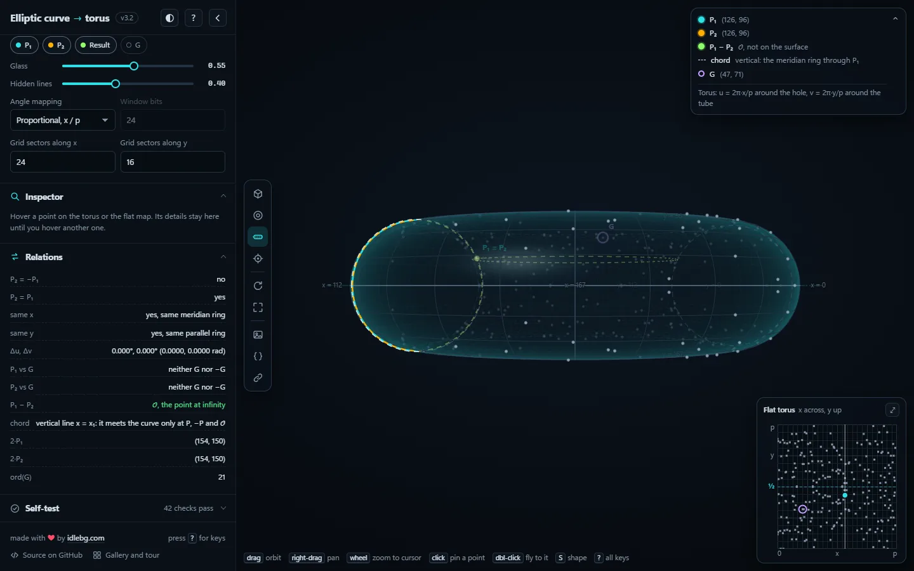

# 26 Subtraction

**Level 2 · Learner.** You will learn that subtracting a point means adding its mirror image, and see 7G − 2G = 5G on
a toy curve and on Bitcoin’s curve. Read first: [23 Negation](23-negation.md) and [24 Adding points](24-chord.md).

## Subtracting is adding the mirror image

In a group, subtracting is adding the negative: P₁ − P₂ = P₁ + (−P₂). On an elliptic curve the negative is the mirror
image, so the operation **P₁ − P₂** draws the chord through P₁ and the mirror image of P₂, not through P₂ itself.

### Example 26.1 · 7G − 2G = 5G on F₂₂₃

**Open this view:** [7G − 2G on F₂₂₃](https://idlebg.com/idleGevrek/elliptic_curve_torus_visualizer_v3.html#s=eyJ2IjozLCJwcmVzZXQiOiJjdXN0b20iLCJiYXNlUHJlc2V0IjoicGIyMjMiLCJhIjoiMCIsImIiOiI3IiwicCI6IjIyMyIsImciOiIoNDcsIDcxKSIsInAxIjoiN0ciLCJwMiI6IjJHIiwib3AiOiJzdWIiLCJzaG93RyI6dHJ1ZSwiZm9yY2UiOmZhbHNlLCJzaGFwZSI6InRvcnVzIiwibWFwIjoic2NhbGUiLCJiaXRzIjoyNCwic3UiOjI0LCJzdiI6MTYsIlIiOjEuMiwiciI6MC40NiwiZ2xhc3MiOjAuNTUsImJhY2siOjAuNCwic2hvdyI6eyJncmlkIjp0cnVlLCJyaW5ncyI6dHJ1ZSwibGFiZWxzIjp0cnVlLCJjbG91ZCI6dHJ1ZSwiY2hvcmQiOnRydWUsImJldGEiOmZhbHNlLCJtYXAiOnRydWUsInNwaW4iOmZhbHNlfSwicmluZ3MiOnsicDEiOnRydWUsInAyIjp0cnVlLCJzdW0iOnRydWUsImciOmZhbHNlfSwidGhlbWUiOiJkYXJrIiwicGFuZWwiOnRydWUsIm1pbmlCaWciOnRydWUsImxlZ2VuZE1pbiI6ZmFsc2UsInNlY3MiOnsiY3VydmUiOnRydWUsInBvaW50cyI6dHJ1ZSwic2hhcGUiOnRydWUsInZpZXciOnRydWUsImluc3BlY3RvciI6dHJ1ZSwicmVsYXRpb25zIjp0cnVlLCJ0ZXN0IjpmYWxzZX19)

**Do it yourself**

1. In **Curve**, pick the preset **y² = x³ + 7 over F₂₂₃, Programming Bitcoin**.
2. Type `7G` in **P₁** and `2G` in **P₂**.
3. Choose the operation **P₁ − P₂**.
4. Click **⤢** on the flat map to enlarge it.
5. In the 3D view, click the result to pin its card.
6. Read the **Relations** section in the panel.

**Look at:**

- **Relations**: **P₁ − P₂** = (126, 96), and the result’s card says k = 5;
- the **winding** row: “λ ≡ -37 (mod p): the line wraps 37 times around the tube”, and the legend: “winds 37× around
  the tube, shown as its points on the flat map”;
- the enlarged flat map: instead of a line, a pattern of 223 dots, the line’s points (x, λx + c) for every x;
- **third point**: R = −(P₁ − P₂) = (126, 127).

**Why:** the line goes through 7G = (92, 47) and −2G = (36, 112), the mirror image of 2G = (36, 111). Its slope is
large, 37 windings around the tube, and a line that winds more than 24 times would cover the donut like a coil, so the
visualizer shows its points on the flat map instead. The scalars work as expected: 7 − 2 = 5, and the card says so.

### Example 26.2 · 7G − 2G = 5G on secp256k1

**Open this view:** [7G − 2G on secp256k1](https://idlebg.com/idleGevrek/elliptic_curve_torus_visualizer_v3.html#s=eyJ2IjozLCJwcmVzZXQiOiJjdXN0b20iLCJiYXNlUHJlc2V0IjoiazEtY2hvcmQiLCJhIjoiMCIsImIiOiI3IiwicCI6IjJeMjU2IC0gMl4zMiAtIDk3NyIsImciOiIwMjc5YmU2NjdlZjlkY2JiYWM1NWEwNjI5NWNlODcwYjA3MDI5YmZjZGIyZGNlMjhkOTU5ZjI4MTViMTZmODE3OTgiLCJwMSI6IjdHIiwicDIiOiIyRyIsIm9wIjoic3ViIiwic2hvd0ciOnRydWUsImZvcmNlIjpmYWxzZSwic2hhcGUiOiJ0b3J1cyIsIm1hcCI6InNjYWxlIiwiYml0cyI6MjQsInN1IjoyNCwic3YiOjE2LCJSIjoxLjIsInIiOjAuNDYsImdsYXNzIjowLjU1LCJiYWNrIjowLjQsInNob3ciOnsiZ3JpZCI6dHJ1ZSwicmluZ3MiOnRydWUsImxhYmVscyI6dHJ1ZSwiY2xvdWQiOnRydWUsImNob3JkIjp0cnVlLCJiZXRhIjpmYWxzZSwibWFwIjp0cnVlLCJzcGluIjpmYWxzZX0sInJpbmdzIjp7InAxIjp0cnVlLCJwMiI6dHJ1ZSwic3VtIjp0cnVlLCJnIjpmYWxzZX0sInRoZW1lIjoiZGFyayIsInBhbmVsIjp0cnVlLCJtaW5pQmlnIjpmYWxzZSwibGVnZW5kTWluIjpmYWxzZSwic2VjcyI6eyJjdXJ2ZSI6dHJ1ZSwicG9pbnRzIjp0cnVlLCJzaGFwZSI6dHJ1ZSwidmlldyI6dHJ1ZSwiaW5zcGVjdG9yIjp0cnVlLCJyZWxhdGlvbnMiOnRydWUsInRlc3QiOmZhbHNlfX0)

**Do it yourself**

1. In **Curve**, pick the preset **secp256k1: G + 2G = 3G**.
2. Type `7G` in **P₁**.
3. Choose the operation **P₁ − P₂**.
4. In the 3D view, click the result to pin its card.
5. Read the **Relations** section in the panel.

**Look at:** the result’s card, k = 5, and in Relations its compressed key,
`022f8bde4d1a07209355b4a7250a5c5128e88b84bddc619ab7cba8d569b240efe4`.

**Why:** that is the public key of private key 5, the same point 2G + 3G gave in [14 Two points](14-how-far-apart.md)
(Relations there showed it as P₁ + P₂). Scalars typed as kG are carried through every operation: the visualizer
computes the point with the curve’s arithmetic and, separately, the number 7 − 2, and labels the result with it.

### Example 26.3 · P − P = 𝒪

**Open this view:** [5G − 5G on F₂₂₃](https://idlebg.com/idleGevrek/elliptic_curve_torus_visualizer_v3.html#s=eyJ2IjozLCJwcmVzZXQiOiJjdXN0b20iLCJiYXNlUHJlc2V0IjoicGIyMjMiLCJhIjoiMCIsImIiOiI3IiwicCI6IjIyMyIsImciOiIoNDcsIDcxKSIsInAxIjoiNUciLCJwMiI6IjVHIiwib3AiOiJzdWIiLCJzaG93RyI6dHJ1ZSwiZm9yY2UiOmZhbHNlLCJzaGFwZSI6InRvcnVzIiwibWFwIjoic2NhbGUiLCJiaXRzIjoyNCwic3UiOjI0LCJzdiI6MTYsIlIiOjEuMiwiciI6MC40NiwiZ2xhc3MiOjAuNTUsImJhY2siOjAuNCwic2hvdyI6eyJncmlkIjp0cnVlLCJyaW5ncyI6dHJ1ZSwibGFiZWxzIjp0cnVlLCJjbG91ZCI6dHJ1ZSwiY2hvcmQiOnRydWUsImJldGEiOmZhbHNlLCJtYXAiOnRydWUsInNwaW4iOmZhbHNlfSwicmluZ3MiOnsicDEiOnRydWUsInAyIjp0cnVlLCJzdW0iOnRydWUsImciOmZhbHNlfSwidGhlbWUiOiJkYXJrIiwicGFuZWwiOnRydWUsIm1pbmlCaWciOmZhbHNlLCJsZWdlbmRNaW4iOmZhbHNlLCJzZWNzIjp7ImN1cnZlIjp0cnVlLCJwb2ludHMiOnRydWUsInNoYXBlIjp0cnVlLCJ2aWV3Ijp0cnVlLCJpbnNwZWN0b3IiOnRydWUsInJlbGF0aW9ucyI6dHJ1ZSwidGVzdCI6ZmFsc2V9fQ)

**Do it yourself**

1. In **Curve**, pick the preset **y² = x³ + 7 over F₂₂₃, Programming Bitcoin**.
2. Type `5G` in **P₁** and `5G` in **P₂**.
3. Choose the operation **P₁ − P₂**.
4. Press **3** for the side view.
5. Read the **Relations** section in the panel.

**Look at:** **P₁ − P₂** is 𝒪, and the chord is vertical.

**Why:** P − P = P + (−P), a point plus its mirror image ([23 Negation](23-negation.md)).

## Try it yourself

- On F₂₂₃, compute 2G − 7G. Which k does the card show? (On this curve k is counted mod 21.)
- Choose **P₁ − P₂** with P₁ = G and P₂ = −G (type `-G`). What is G − (−G)?
- Use **Swap** in Example 26.1: is 2G − 7G the mirror image of 7G − 2G?

## Recap

- P₁ − P₂ = P₁ + (−P₂): the chord goes through P₁ and the mirror image of P₂.
- Scalars carry through: (7G) − (2G) = 5G, on any curve.
- A chord that winds more than 24 times is shown as its points on the flat map (p up to 4000).

Next: [27 Walking the multiples](27-walking-multiples.md).
