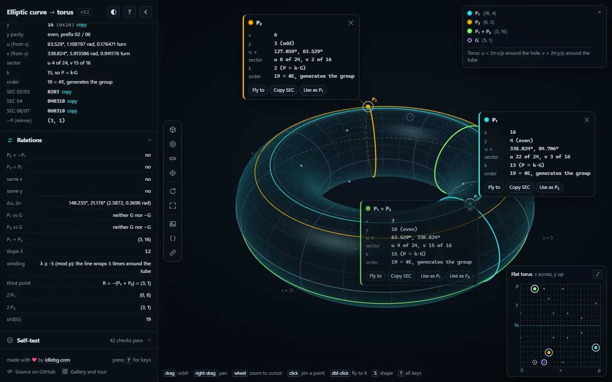
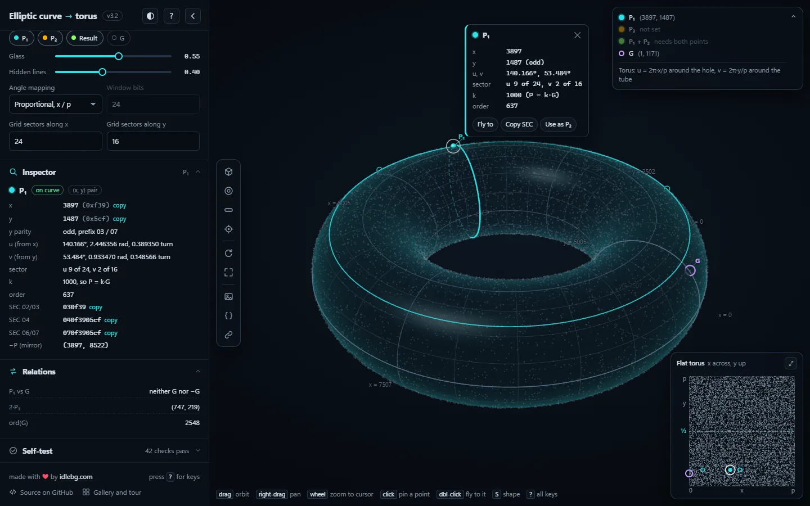
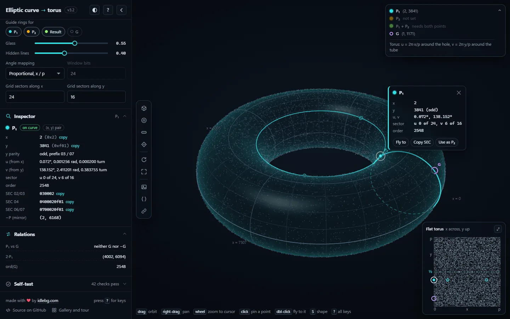

# 29 Discrete logs on toy curves

**Level 2 · Learner.** You will learn what the discrete logarithm problem is, how the visualizer solves it on small
curves, and why the same method cannot touch Bitcoin’s curve. Read first:
[28 Orders and subgroups](28-orders-subgroups.md).

## The problem

Given G and a point Q, find the number k with k·G = Q. This is the
[discrete logarithm](94-glossary.md#discrete-logarithm) of Q. Going forward, from k to kG, is fast (doubling and
adding, [27](27-walking-multiples.md)). Going back is the hard direction, and the security of Bitcoin’s signatures
rests on it: a public key is kG, and k is the private key.

On curves with p up to 2²² the visualizer solves it for every point you type whose order divides ord(G), and writes
the answer as the card’s **k**. It uses **baby-step giant-step**:

1. compute the “baby steps” 0·G, 1·G, …, (m − 1)·G, with m about √ord(G), and remember them;
2. from Q, take “giant steps” backwards, subtracting m·G each time, until you land on a baby step: if Q − i·mG = jG,
   then k = i·m + j.

That needs about 2√ord(G) additions instead of ord(G).

### Example 29.1 · Every k on F₁₇

**Open this view:** [(16, 4) + (6, 3) on F₁₇](https://idlebg.com/idleGevrek/elliptic_curve_torus_visualizer_v3.html#s=eyJ2IjozLCJwcmVzZXQiOiJjdXN0b20iLCJiYXNlUHJlc2V0IjoicHAxNyIsImEiOiIyIiwiYiI6IjIiLCJwIjoiMTciLCJnIjoiKDUsIDEpIiwicDEiOiIoMTYsIDQpIiwicDIiOiIoNiwgMykiLCJvcCI6ImFkZCIsInNob3dHIjp0cnVlLCJmb3JjZSI6ZmFsc2UsInNoYXBlIjoidG9ydXMiLCJtYXAiOiJzY2FsZSIsImJpdHMiOjI0LCJzdSI6MjQsInN2IjoxNiwiUiI6MS4yLCJyIjowLjQ2LCJnbGFzcyI6MC41NSwiYmFjayI6MC40LCJzaG93Ijp7ImdyaWQiOnRydWUsInJpbmdzIjp0cnVlLCJsYWJlbHMiOnRydWUsImNsb3VkIjp0cnVlLCJjaG9yZCI6ZmFsc2UsImJldGEiOmZhbHNlLCJtYXAiOnRydWUsInNwaW4iOmZhbHNlfSwicmluZ3MiOnsicDEiOnRydWUsInAyIjp0cnVlLCJzdW0iOnRydWUsImciOmZhbHNlfSwidGhlbWUiOiJkYXJrIiwicGFuZWwiOnRydWUsIm1pbmlCaWciOmZhbHNlLCJsZWdlbmRNaW4iOmZhbHNlLCJzZWNzIjp7ImN1cnZlIjp0cnVlLCJwb2ludHMiOnRydWUsInNoYXBlIjp0cnVlLCJ2aWV3Ijp0cnVlLCJpbnNwZWN0b3IiOnRydWUsInJlbGF0aW9ucyI6dHJ1ZSwidGVzdCI6ZmFsc2V9fQ)

**Do it yourself**

1. In **Curve**, pick the preset **y² = x³ + 2x + 2 over F₁₇, Paar & Pelzl**.
2. Type `(16, 4)` in **P₁**.
3. In **Display**, turn off **Chord construction** (**K**).
4. In the 3D view, click P₁, P₂ and the result to pin their cards.
5. Read the **Relations** section in the panel.

**Look at:** three cards with k: (16, 4) = 13G, (6, 3) = 2G, and their sum (3, 16) = 15G.

**Why:** 13 + 2 = 15, so the sum of the points is the point of the summed k: adding points adds their k. That rule is
why the visualizer can carry k through operations, and why kG is a group homomorphism, in the language of Level 4.

### Example 29.2 · Discrete logs on F₁₀₀₀₉

On y² = x³ + 7 over F₁₀₀₀₉, G = (1, 1171) has order 2548, so the cofactor is 10192 / 2548 = 4. Type a point as plain
(x, y): the visualizer does not know where it came from, and finds k itself.

**Open this view:** [(3897, 1487) on F₁₀₀₀₉](https://idlebg.com/idleGevrek/elliptic_curve_torus_visualizer_v3.html#s=eyJ2IjozLCJwcmVzZXQiOiJjdXN0b20iLCJiYXNlUHJlc2V0IjoidDEwMDA5IiwiYSI6IjAiLCJiIjoiNyIsInAiOiIxMDAwOSIsImciOiIoMSwgMTE3MSkiLCJwMSI6IigzODk3LCAxNDg3KSIsInAyIjoiIiwib3AiOiJhZGQiLCJzaG93RyI6dHJ1ZSwiZm9yY2UiOmZhbHNlLCJzaGFwZSI6InRvcnVzIiwibWFwIjoic2NhbGUiLCJiaXRzIjoyNCwic3UiOjI0LCJzdiI6MTYsIlIiOjEuMiwiciI6MC40NiwiZ2xhc3MiOjAuNTUsImJhY2siOjAuNCwic2hvdyI6eyJncmlkIjp0cnVlLCJyaW5ncyI6dHJ1ZSwibGFiZWxzIjp0cnVlLCJjbG91ZCI6dHJ1ZSwiY2hvcmQiOmZhbHNlLCJiZXRhIjp0cnVlLCJtYXAiOnRydWUsInNwaW4iOmZhbHNlfSwicmluZ3MiOnsicDEiOnRydWUsInAyIjp0cnVlLCJzdW0iOnRydWUsImciOmZhbHNlfSwidGhlbWUiOiJkYXJrIiwicGFuZWwiOnRydWUsIm1pbmlCaWciOmZhbHNlLCJsZWdlbmRNaW4iOmZhbHNlLCJzZWNzIjp7ImN1cnZlIjp0cnVlLCJwb2ludHMiOnRydWUsInNoYXBlIjp0cnVlLCJ2aWV3Ijp0cnVlLCJpbnNwZWN0b3IiOnRydWUsInJlbGF0aW9ucyI6dHJ1ZSwidGVzdCI6ZmFsc2V9fQ)

| P₁ typed as (x, y) | k found by the visualizer | open |
| --- | --- | --- |
| `(2298, 3395)` | 100 | [open](https://idlebg.com/idleGevrek/elliptic_curve_torus_visualizer_v3.html#s=eyJ2IjozLCJwcmVzZXQiOiJjdXN0b20iLCJiYXNlUHJlc2V0IjoidDEwMDA5IiwiYSI6IjAiLCJiIjoiNyIsInAiOiIxMDAwOSIsImciOiIoMSwgMTE3MSkiLCJwMSI6IigyMjk4LCAzMzk1KSIsInAyIjoiIiwib3AiOiJhZGQiLCJzaG93RyI6dHJ1ZSwiZm9yY2UiOmZhbHNlLCJzaGFwZSI6InRvcnVzIiwibWFwIjoic2NhbGUiLCJiaXRzIjoyNCwic3UiOjI0LCJzdiI6MTYsIlIiOjEuMiwiciI6MC40NiwiZ2xhc3MiOjAuNTUsImJhY2siOjAuNCwic2hvdyI6eyJncmlkIjp0cnVlLCJyaW5ncyI6dHJ1ZSwibGFiZWxzIjp0cnVlLCJjbG91ZCI6dHJ1ZSwiY2hvcmQiOmZhbHNlLCJiZXRhIjp0cnVlLCJtYXAiOnRydWUsInNwaW4iOmZhbHNlfSwicmluZ3MiOnsicDEiOnRydWUsInAyIjp0cnVlLCJzdW0iOnRydWUsImciOmZhbHNlfSwidGhlbWUiOiJkYXJrIiwicGFuZWwiOnRydWUsIm1pbmlCaWciOmZhbHNlLCJsZWdlbmRNaW4iOmZhbHNlLCJzZWNzIjp7ImN1cnZlIjp0cnVlLCJwb2ludHMiOnRydWUsInNoYXBlIjp0cnVlLCJ2aWV3Ijp0cnVlLCJpbnNwZWN0b3IiOnRydWUsInJlbGF0aW9ucyI6dHJ1ZSwidGVzdCI6ZmFsc2V9fQ) |
| `(3897, 1487)` | 1000 | [open](https://idlebg.com/idleGevrek/elliptic_curve_torus_visualizer_v3.html#s=eyJ2IjozLCJwcmVzZXQiOiJjdXN0b20iLCJiYXNlUHJlc2V0IjoidDEwMDA5IiwiYSI6IjAiLCJiIjoiNyIsInAiOiIxMDAwOSIsImciOiIoMSwgMTE3MSkiLCJwMSI6IigzODk3LCAxNDg3KSIsInAyIjoiIiwib3AiOiJhZGQiLCJzaG93RyI6dHJ1ZSwiZm9yY2UiOmZhbHNlLCJzaGFwZSI6InRvcnVzIiwibWFwIjoic2NhbGUiLCJiaXRzIjoyNCwic3UiOjI0LCJzdiI6MTYsIlIiOjEuMiwiciI6MC40NiwiZ2xhc3MiOjAuNTUsImJhY2siOjAuNCwic2hvdyI6eyJncmlkIjp0cnVlLCJyaW5ncyI6dHJ1ZSwibGFiZWxzIjp0cnVlLCJjbG91ZCI6dHJ1ZSwiY2hvcmQiOmZhbHNlLCJiZXRhIjp0cnVlLCJtYXAiOnRydWUsInNwaW4iOmZhbHNlfSwicmluZ3MiOnsicDEiOnRydWUsInAyIjp0cnVlLCJzdW0iOnRydWUsImciOmZhbHNlfSwidGhlbWUiOiJkYXJrIiwicGFuZWwiOnRydWUsIm1pbmlCaWciOmZhbHNlLCJsZWdlbmRNaW4iOmZhbHNlLCJzZWNzIjp7ImN1cnZlIjp0cnVlLCJwb2ludHMiOnRydWUsInNoYXBlIjp0cnVlLCJ2aWV3Ijp0cnVlLCJpbnNwZWN0b3IiOnRydWUsInJlbGF0aW9ucyI6dHJ1ZSwidGVzdCI6ZmFsc2V9fQ) |
| `(747, 219)` | 2000 | [open](https://idlebg.com/idleGevrek/elliptic_curve_torus_visualizer_v3.html#s=eyJ2IjozLCJwcmVzZXQiOiJjdXN0b20iLCJiYXNlUHJlc2V0IjoidDEwMDA5IiwiYSI6IjAiLCJiIjoiNyIsInAiOiIxMDAwOSIsImciOiIoMSwgMTE3MSkiLCJwMSI6Iig3NDcsIDIxOSkiLCJwMiI6IiIsIm9wIjoiYWRkIiwic2hvd0ciOnRydWUsImZvcmNlIjpmYWxzZSwic2hhcGUiOiJ0b3J1cyIsIm1hcCI6InNjYWxlIiwiYml0cyI6MjQsInN1IjoyNCwic3YiOjE2LCJSIjoxLjIsInIiOjAuNDYsImdsYXNzIjowLjU1LCJiYWNrIjowLjQsInNob3ciOnsiZ3JpZCI6dHJ1ZSwicmluZ3MiOnRydWUsImxhYmVscyI6dHJ1ZSwiY2xvdWQiOnRydWUsImNob3JkIjpmYWxzZSwiYmV0YSI6dHJ1ZSwibWFwIjp0cnVlLCJzcGluIjpmYWxzZX0sInJpbmdzIjp7InAxIjp0cnVlLCJwMiI6dHJ1ZSwic3VtIjp0cnVlLCJnIjpmYWxzZX0sInRoZW1lIjoiZGFyayIsInBhbmVsIjp0cnVlLCJtaW5pQmlnIjpmYWxzZSwibGVnZW5kTWluIjpmYWxzZSwic2VjcyI6eyJjdXJ2ZSI6dHJ1ZSwicG9pbnRzIjp0cnVlLCJzaGFwZSI6dHJ1ZSwidmlldyI6dHJ1ZSwiaW5zcGVjdG9yIjp0cnVlLCJyZWxhdGlvbnMiOnRydWUsInRlc3QiOmZhbHNlfX0) |
| `(1, 8838)` | 2547 | [open](https://idlebg.com/idleGevrek/elliptic_curve_torus_visualizer_v3.html#s=eyJ2IjozLCJwcmVzZXQiOiJjdXN0b20iLCJiYXNlUHJlc2V0IjoidDEwMDA5IiwiYSI6IjAiLCJiIjoiNyIsInAiOiIxMDAwOSIsImciOiIoMSwgMTE3MSkiLCJwMSI6IigxLCA4ODM4KSIsInAyIjoiIiwib3AiOiJhZGQiLCJzaG93RyI6dHJ1ZSwiZm9yY2UiOmZhbHNlLCJzaGFwZSI6InRvcnVzIiwibWFwIjoic2NhbGUiLCJiaXRzIjoyNCwic3UiOjI0LCJzdiI6MTYsIlIiOjEuMiwiciI6MC40NiwiZ2xhc3MiOjAuNTUsImJhY2siOjAuNCwic2hvdyI6eyJncmlkIjp0cnVlLCJyaW5ncyI6dHJ1ZSwibGFiZWxzIjp0cnVlLCJjbG91ZCI6dHJ1ZSwiY2hvcmQiOmZhbHNlLCJiZXRhIjp0cnVlLCJtYXAiOnRydWUsInNwaW4iOmZhbHNlfSwicmluZ3MiOnsicDEiOnRydWUsInAyIjp0cnVlLCJzdW0iOnRydWUsImciOmZhbHNlfSwidGhlbWUiOiJkYXJrIiwicGFuZWwiOnRydWUsIm1pbmlCaWciOmZhbHNlLCJsZWdlbmRNaW4iOmZhbHNlLCJzZWNzIjp7ImN1cnZlIjp0cnVlLCJwb2ludHMiOnRydWUsInNoYXBlIjp0cnVlLCJ2aWV3Ijp0cnVlLCJpbnNwZWN0b3IiOnRydWUsInJlbGF0aW9ucyI6dHJ1ZSwidGVzdCI6ZmFsc2V9fQ) |

**Do it yourself**

1. In **Curve**, pick the preset **y² = x³ + 7 over F₁₀₀₀₉, dense and 6-fold symmetric**.
2. Type `(3897, 1487)` in **P₁**.
3. Empty **P₂**.
4. In **Display**, turn off **Chord construction** (**K**).
5. In the 3D view, click P₁ to pin its card.
6. Read the **Inspector** section in the panel.

**Look at:** (3897, 1487) gets k = 1000. The table gives three more points and the k the visualizer found for each;
the points were made by the tutorials’ scripts as 100G, 2000G and 2547G, and the visualizer recovers exactly those
numbers.

**Why:** with ord(G) = 2548, baby-step giant-step stores 51 baby steps (51 is ⌈√2548⌉) and takes at most about as many
giant steps. 2547G is −G, the mirror image of G = (1, 1171): look at its x.

### Example 29.3 · No k: a point outside ⟨G⟩

**Open this view:** [(2, 3841) on F₁₀₀₀₉](https://idlebg.com/idleGevrek/elliptic_curve_torus_visualizer_v3.html#s=eyJ2IjozLCJwcmVzZXQiOiJjdXN0b20iLCJiYXNlUHJlc2V0IjoidDEwMDA5IiwiYSI6IjAiLCJiIjoiNyIsInAiOiIxMDAwOSIsImciOiIoMSwgMTE3MSkiLCJwMSI6IigyLCAzODQxKSIsInAyIjoiIiwib3AiOiJhZGQiLCJzaG93RyI6dHJ1ZSwiZm9yY2UiOmZhbHNlLCJzaGFwZSI6InRvcnVzIiwibWFwIjoic2NhbGUiLCJiaXRzIjoyNCwic3UiOjI0LCJzdiI6MTYsIlIiOjEuMiwiciI6MC40NiwiZ2xhc3MiOjAuNTUsImJhY2siOjAuNCwic2hvdyI6eyJncmlkIjp0cnVlLCJyaW5ncyI6dHJ1ZSwibGFiZWxzIjp0cnVlLCJjbG91ZCI6dHJ1ZSwiY2hvcmQiOmZhbHNlLCJiZXRhIjp0cnVlLCJtYXAiOnRydWUsInNwaW4iOmZhbHNlfSwicmluZ3MiOnsicDEiOnRydWUsInAyIjp0cnVlLCJzdW0iOnRydWUsImciOmZhbHNlfSwidGhlbWUiOiJkYXJrIiwicGFuZWwiOnRydWUsIm1pbmlCaWciOmZhbHNlLCJsZWdlbmRNaW4iOmZhbHNlLCJzZWNzIjp7ImN1cnZlIjp0cnVlLCJwb2ludHMiOnRydWUsInNoYXBlIjp0cnVlLCJ2aWV3Ijp0cnVlLCJpbnNwZWN0b3IiOnRydWUsInJlbGF0aW9ucyI6dHJ1ZSwidGVzdCI6ZmFsc2V9fQ)

**Do it yourself**

1. In **Curve**, pick the preset **y² = x³ + 7 over F₁₀₀₀₉, dense and 6-fold symmetric**.
2. Type `(2, 3841)` in **P₁**.
3. Empty **P₂**.
4. In **Display**, turn off **Chord construction** (**K**).
5. In the 3D view, click P₁ to pin its card.
6. Read the **Inspector** section in the panel.

**Look at:** (2, 3841) has order 2548, the same as G, but its card has no k.

**Why:** with cofactor 4, only one point in four is a multiple of G. The search runs to its end without landing on a
baby step, and that proves Q is not in ⟨G⟩: there is no k to find.

## Why Bitcoin’s curve is safe from this

On secp256k1, G has order n, a 256-bit number. Baby-step giant-step would need about √n steps, about 3.403 × 10³⁸,
and storage for as many points. No computer, and no number of computers, comes anywhere near that; no better general
method is known either (Pollard’s rho needs about the same √n time with little memory). That is the gap between the
two directions: kG takes a few hundred curve operations, k from kG takes about 10³⁸.

The visualizer never attempts a discrete log on secp256k1 or P-256. It shows k only where it was given, typed as `kG`,
and carries it through operations (Example 26.2).

## Try it yourself

- On F₁₀₀₀₉, click the dice next to P₁ a few times: about one point in four gets a k.
- On F₂₂₃ (cofactor 12), do the same: how often does a k appear?
- On F₁₇, type the points of Example 29.1 the other way round, and choose **P₁ − P₂**: which k does the result get?

## Recap

- The discrete log of Q is the k with kG = Q; the visualizer finds it for p up to 2²² with baby-step giant-step,
  in about 2√ord(G) steps.
- Points outside ⟨G⟩ have no k; the search proves it.
- On secp256k1 the same search would take about 3.403 × 10³⁸ steps: that gap is Bitcoin’s security.

Next, Level 3 begins: [31 secp256k1 in the panel](31-secp256k1.md). Or continue with Level 4 at
[41 The mapping](41-mapping.md).
