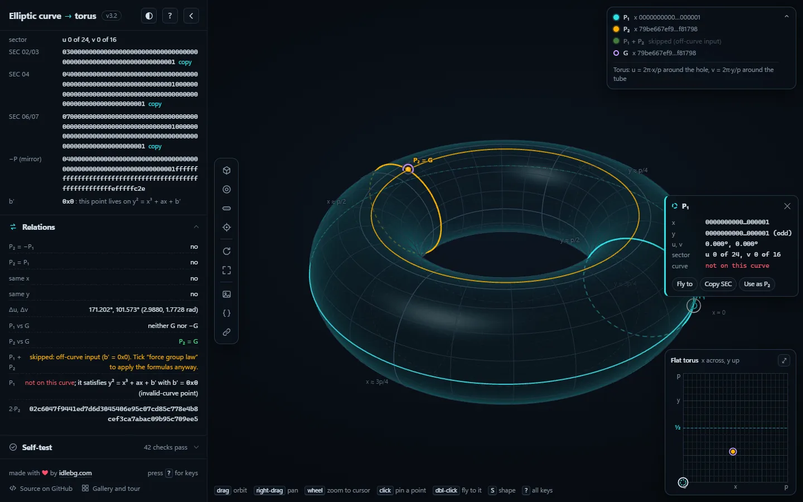
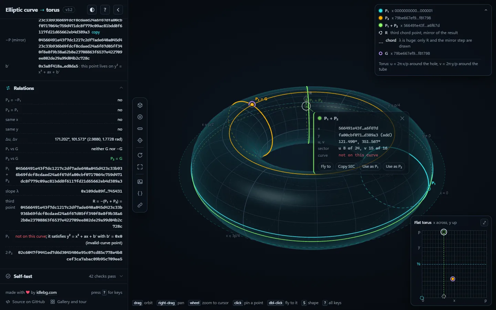
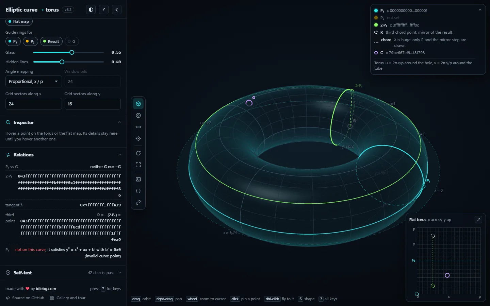
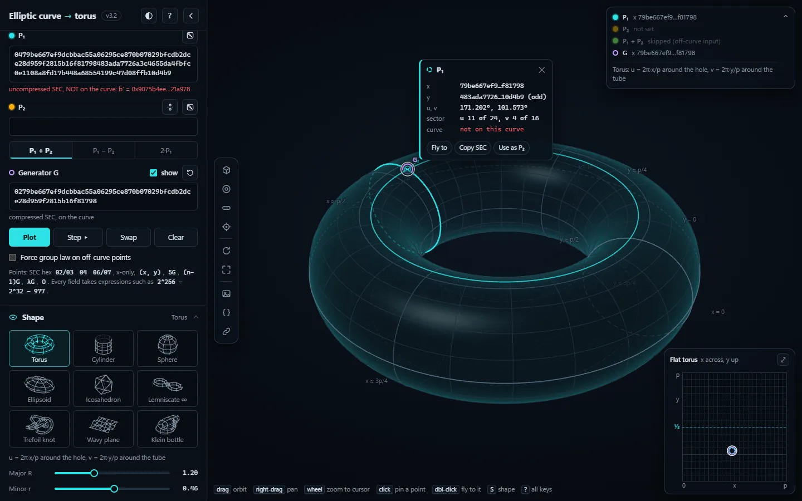

# 36 Invalid points

**Level 3 · Bitcoiner.** A point that is not on the curve can still be fed to the addition formulas, and they do not
notice. You will see how the visualizer shows such points, what “Force group law” computes, and why every wallet and
node must check that a point is on the curve. Read first: [21 Clock arithmetic](21-clock-arithmetic.md) (Example 21.2)
and [33 Key formats](33-key-formats.md).

## The formulas never use b

The chord and tangent formulas ([24](24-chord.md), [25](25-tangent.md)) use a, the coordinates and p, but never b. So
any pair (x, y) lies on some curve y² = x³ + ax + b′ with the same a, namely b′ = y² − x³ − ax, and the formulas
compute that curve’s group law. The visualizer names this b′ for every point that is off the curve.

### Example 36.1 · (1, 1) is not on secp256k1

**Open this view:** [(1, 1) and G](https://idlebg.com/idleGevrek/elliptic_curve_torus_visualizer_v3.html#s=eyJ2IjozLCJwcmVzZXQiOiJjdXN0b20iLCJiYXNlUHJlc2V0IjoiazEtbmVnIiwiYSI6IjAiLCJiIjoiNyIsInAiOiIyXjI1NiAtIDJeMzIgLSA5NzciLCJnIjoiMDI3OWJlNjY3ZWY5ZGNiYmFjNTVhMDYyOTVjZTg3MGIwNzAyOWJmY2RiMmRjZTI4ZDk1OWYyODE1YjE2ZjgxNzk4IiwicDEiOiIoMSwgMSkiLCJwMiI6IkciLCJvcCI6ImFkZCIsInNob3dHIjp0cnVlLCJmb3JjZSI6ZmFsc2UsInNoYXBlIjoidG9ydXMiLCJtYXAiOiJzY2FsZSIsImJpdHMiOjI0LCJzdSI6MjQsInN2IjoxNiwiUiI6MS4yLCJyIjowLjQ2LCJnbGFzcyI6MC41NSwiYmFjayI6MC40LCJzaG93Ijp7ImdyaWQiOnRydWUsInJpbmdzIjp0cnVlLCJsYWJlbHMiOnRydWUsImNsb3VkIjp0cnVlLCJjaG9yZCI6dHJ1ZSwiYmV0YSI6ZmFsc2UsIm1hcCI6dHJ1ZSwic3BpbiI6ZmFsc2V9LCJyaW5ncyI6eyJwMSI6dHJ1ZSwicDIiOnRydWUsInN1bSI6dHJ1ZSwiZyI6ZmFsc2V9LCJ0aGVtZSI6ImRhcmsiLCJwYW5lbCI6dHJ1ZSwibWluaUJpZyI6ZmFsc2UsImxlZ2VuZE1pbiI6ZmFsc2UsInNlY3MiOnsiY3VydmUiOnRydWUsInBvaW50cyI6dHJ1ZSwic2hhcGUiOnRydWUsInZpZXciOnRydWUsImluc3BlY3RvciI6dHJ1ZSwicmVsYXRpb25zIjp0cnVlLCJ0ZXN0IjpmYWxzZX19)

**Do it yourself**

1. In **Curve**, pick the preset **secp256k1: G and −G (mirror pair)**.
2. Type `(1, 1)` in **P₁** and `G` in **P₂**.
3. In the 3D view, click P₁ to pin its card.
4. Read the **Relations** section in the panel.

**Look at:**

- the message: “(x, y) pair, NOT on the curve: b′ = 0x0”; the point is drawn with a dashed outline;
- Relations: P₁ “not on this curve; it satisfies y² = x³ + ax + b′ with b′ = 0x0 (invalid-curve point)”, and
  **P₁ + P₂**: “skipped: off-curve input (b′ = 0x0). Tick “force group law” to apply the formulas anyway.”

**Why:** 1² − 1³ = 0, so (1, 1) lies on y² = x³, which is not an elliptic curve at all but a curve with a cusp
([46](46-singular-composite.md)). By default the visualizer refuses to add a point that is not on the curve, which is
what correct software does.

### Example 36.2 · Force group law: (1, 1) + G anyway

**Open this view:** [(1, 1) + G, forced](https://idlebg.com/idleGevrek/elliptic_curve_torus_visualizer_v3.html#s=eyJ2IjozLCJwcmVzZXQiOiJjdXN0b20iLCJiYXNlUHJlc2V0IjoiazEtbmVnIiwiYSI6IjAiLCJiIjoiNyIsInAiOiIyXjI1NiAtIDJeMzIgLSA5NzciLCJnIjoiMDI3OWJlNjY3ZWY5ZGNiYmFjNTVhMDYyOTVjZTg3MGIwNzAyOWJmY2RiMmRjZTI4ZDk1OWYyODE1YjE2ZjgxNzk4IiwicDEiOiIoMSwgMSkiLCJwMiI6IkciLCJvcCI6ImFkZCIsInNob3dHIjp0cnVlLCJmb3JjZSI6dHJ1ZSwic2hhcGUiOiJ0b3J1cyIsIm1hcCI6InNjYWxlIiwiYml0cyI6MjQsInN1IjoyNCwic3YiOjE2LCJSIjoxLjIsInIiOjAuNDYsImdsYXNzIjowLjU1LCJiYWNrIjowLjQsInNob3ciOnsiZ3JpZCI6dHJ1ZSwicmluZ3MiOnRydWUsImxhYmVscyI6dHJ1ZSwiY2xvdWQiOnRydWUsImNob3JkIjp0cnVlLCJiZXRhIjpmYWxzZSwibWFwIjp0cnVlLCJzcGluIjpmYWxzZX0sInJpbmdzIjp7InAxIjp0cnVlLCJwMiI6dHJ1ZSwic3VtIjp0cnVlLCJnIjpmYWxzZX0sInRoZW1lIjoiZGFyayIsInBhbmVsIjp0cnVlLCJtaW5pQmlnIjpmYWxzZSwibGVnZW5kTWluIjpmYWxzZSwic2VjcyI6eyJjdXJ2ZSI6dHJ1ZSwicG9pbnRzIjp0cnVlLCJzaGFwZSI6dHJ1ZSwidmlldyI6dHJ1ZSwiaW5zcGVjdG9yIjp0cnVlLCJyZWxhdGlvbnMiOnRydWUsInRlc3QiOmZhbHNlfX0)

**Do it yourself**

1. In **Curve**, pick the preset **secp256k1: G and −G (mirror pair)**.
2. Type `(1, 1)` in **P₁** and `G` in **P₂**.
3. Tick **Force group law on off-curve points**.
4. In the 3D view, click the result to pin its card.
5. Read the **Relations** section in the panel.

**Look at:** with **Force group law on off-curve points** ticked, the sum appears, flagged “not on this curve”. Its
coordinates are x = `566491e43f7dc1217c2df7ade640a045d423c33b936b69fdcf8cdaed24a6f67d` and y = `fa00cbf0717064c759d471dc8f779c09ac81bdd8f6117fd21d65662eb4d389a3`, and its b′ is `3a8f418af8186a0354118b2a3828098f2bcf0f0f06d01e254d780d06d2ed8da5`: on neither of the two
curves. Relations writes the sum as an uncompressed key, **P₁ + P₂** =
`04566491e43f7dc1217c2df7ade640a045d423c33b936b69fdcf8cdaed24a6f67dfa00cbf0717064c759d471dc8f779c09ac81bdd8f6117fd21d65662eb4d389a3`, and the **third point** R and the
Inspector’s **−P (mirror)** row as `04` keys too.

**Why:** this is exactly what an implementation without the on-curve check computes. The chord through two points of
different curves y² = x³ + b′ produces a third value of b′; nothing in the arithmetic raises an error.

The `04` form is the only one that names this point. The compressed key
`03566491e43f7dc1217c2df7ade640a045d423c33b936b69fdcf8cdaed24a6f67d` stores x and the parity of y, and reading it means finding the y on the curve: that gives
the curve point (x, `373fb17b5e27f726ad3b289d8046b74d267f02407e25a1ba823a170761cfec13`), a different point. So the visualizer writes a point
off the curve as `04` ‖ x ‖ y: in Relations, in the Inspector, and when **Step** puts it into P₁ (Example 36.3), so
a forced computation keeps its exact points.

### Example 36.3 · Force group law: doubling (1, 1)

**Open this view:** [2·(1, 1), forced](https://idlebg.com/idleGevrek/elliptic_curve_torus_visualizer_v3.html#s=eyJ2IjozLCJwcmVzZXQiOiJjdXN0b20iLCJiYXNlUHJlc2V0IjoiazEtbmVnIiwiYSI6IjAiLCJiIjoiNyIsInAiOiIyXjI1NiAtIDJeMzIgLSA5NzciLCJnIjoiMDI3OWJlNjY3ZWY5ZGNiYmFjNTVhMDYyOTVjZTg3MGIwNzAyOWJmY2RiMmRjZTI4ZDk1OWYyODE1YjE2ZjgxNzk4IiwicDEiOiIoMSwgMSkiLCJwMiI6IiIsIm9wIjoiZGJsIiwic2hvd0ciOnRydWUsImZvcmNlIjp0cnVlLCJzaGFwZSI6InRvcnVzIiwibWFwIjoic2NhbGUiLCJiaXRzIjoyNCwic3UiOjI0LCJzdiI6MTYsIlIiOjEuMiwiciI6MC40NiwiZ2xhc3MiOjAuNTUsImJhY2siOjAuNCwic2hvdyI6eyJncmlkIjp0cnVlLCJyaW5ncyI6dHJ1ZSwibGFiZWxzIjp0cnVlLCJjbG91ZCI6dHJ1ZSwiY2hvcmQiOnRydWUsImJldGEiOmZhbHNlLCJtYXAiOnRydWUsInNwaW4iOmZhbHNlfSwicmluZ3MiOnsicDEiOnRydWUsInAyIjp0cnVlLCJzdW0iOnRydWUsImciOmZhbHNlfSwidGhlbWUiOiJkYXJrIiwicGFuZWwiOnRydWUsIm1pbmlCaWciOmZhbHNlLCJsZWdlbmRNaW4iOmZhbHNlLCJzZWNzIjp7ImN1cnZlIjp0cnVlLCJwb2ludHMiOnRydWUsInNoYXBlIjp0cnVlLCJ2aWV3Ijp0cnVlLCJpbnNwZWN0b3IiOnRydWUsInJlbGF0aW9ucyI6dHJ1ZSwidGVzdCI6ZmFsc2V9fQ)

| N pressed | P₁ | x/y | 2·P₁ (the result) | open |
| --- | --- | --- | --- | --- |
| 1 | 2·(1, 1) = (1/4, 1/8) | 2 | 4·(1, 1) = (1/16, 1/64) | [open](https://idlebg.com/idleGevrek/elliptic_curve_torus_visualizer_v3.html#s=eyJ2IjozLCJwcmVzZXQiOiJjdXN0b20iLCJiYXNlUHJlc2V0IjoiazEtbmVnIiwiYSI6IjAiLCJiIjoiNyIsInAiOiIyXjI1NiAtIDJeMzIgLSA5NzciLCJnIjoiMDI3OWJlNjY3ZWY5ZGNiYmFjNTVhMDYyOTVjZTg3MGIwNzAyOWJmY2RiMmRjZTI4ZDk1OWYyODE1YjE2ZjgxNzk4IiwicDEiOiIwNDNmZmZmZmZmZmZmZmZmZmZmZmZmZmZmZmZmZmZmZmZmZmZmZmZmZmZmZmZmZmZmZmZmZmZmZmZmYmZmZmZmMGMxZmZmZmZmZmZmZmZmZmZmZmZmZmZmZmZmZmZmZmZmZmZmZmZmZmZmZmZmZmZmZmZmZmZmZmZmZmRmZmZmZjg2IiwicDIiOiIiLCJvcCI6ImRibCIsInNob3dHIjp0cnVlLCJmb3JjZSI6dHJ1ZSwic2hhcGUiOiJ0b3J1cyIsIm1hcCI6InNjYWxlIiwiYml0cyI6MjQsInN1IjoyNCwic3YiOjE2LCJSIjoxLjIsInIiOjAuNDYsImdsYXNzIjowLjU1LCJiYWNrIjowLjQsInNob3ciOnsiZ3JpZCI6dHJ1ZSwicmluZ3MiOnRydWUsImxhYmVscyI6dHJ1ZSwiY2xvdWQiOnRydWUsImNob3JkIjp0cnVlLCJiZXRhIjpmYWxzZSwibWFwIjp0cnVlLCJzcGluIjpmYWxzZX0sInJpbmdzIjp7InAxIjp0cnVlLCJwMiI6dHJ1ZSwic3VtIjp0cnVlLCJnIjpmYWxzZX0sInRoZW1lIjoiZGFyayIsInBhbmVsIjp0cnVlLCJtaW5pQmlnIjpmYWxzZSwibGVnZW5kTWluIjpmYWxzZSwic2VjcyI6eyJjdXJ2ZSI6dHJ1ZSwicG9pbnRzIjp0cnVlLCJzaGFwZSI6dHJ1ZSwidmlldyI6dHJ1ZSwiaW5zcGVjdG9yIjp0cnVlLCJyZWxhdGlvbnMiOnRydWUsInRlc3QiOmZhbHNlfX0) |
| 2 | 4·(1, 1) = (1/16, 1/64) | 4 | 8·(1, 1) = (1/64, 1/512) | [open](https://idlebg.com/idleGevrek/elliptic_curve_torus_visualizer_v3.html#s=eyJ2IjozLCJwcmVzZXQiOiJjdXN0b20iLCJiYXNlUHJlc2V0IjoiazEtbmVnIiwiYSI6IjAiLCJiIjoiNyIsInAiOiIyXjI1NiAtIDJeMzIgLSA5NzciLCJnIjoiMDI3OWJlNjY3ZWY5ZGNiYmFjNTVhMDYyOTVjZTg3MGIwNzAyOWJmY2RiMmRjZTI4ZDk1OWYyODE1YjE2ZjgxNzk4IiwicDEiOiIwNDBmZmZmZmZmZmZmZmZmZmZmZmZmZmZmZmZmZmZmZmZmZmZmZmZmZmZmZmZmZmZmZmZmZmZmZmZmZWZmZmZmYzNjM2ZmZmZmZmZmZmZmZmZmZmZmZmZmZmZmZmZmZmZmZmZmZmZmZmZmZmZmZmZmZmZmZmZmZmZmZjNiZmZmZDE0IiwicDIiOiIiLCJvcCI6ImRibCIsInNob3dHIjp0cnVlLCJmb3JjZSI6dHJ1ZSwic2hhcGUiOiJ0b3J1cyIsIm1hcCI6InNjYWxlIiwiYml0cyI6MjQsInN1IjoyNCwic3YiOjE2LCJSIjoxLjIsInIiOjAuNDYsImdsYXNzIjowLjU1LCJiYWNrIjowLjQsInNob3ciOnsiZ3JpZCI6dHJ1ZSwicmluZ3MiOnRydWUsImxhYmVscyI6dHJ1ZSwiY2xvdWQiOnRydWUsImNob3JkIjp0cnVlLCJiZXRhIjpmYWxzZSwibWFwIjp0cnVlLCJzcGluIjpmYWxzZX0sInJpbmdzIjp7InAxIjp0cnVlLCJwMiI6dHJ1ZSwic3VtIjp0cnVlLCJnIjpmYWxzZX0sInRoZW1lIjoiZGFyayIsInBhbmVsIjp0cnVlLCJtaW5pQmlnIjpmYWxzZSwibGVnZW5kTWluIjpmYWxzZSwic2VjcyI6eyJjdXJ2ZSI6dHJ1ZSwicG9pbnRzIjp0cnVlLCJzaGFwZSI6dHJ1ZSwidmlldyI6dHJ1ZSwiaW5zcGVjdG9yIjp0cnVlLCJyZWxhdGlvbnMiOnRydWUsInRlc3QiOmZhbHNlfX0) |
| 3 | 8·(1, 1) = (1/64, 1/512) | 8 | 16·(1, 1) = (1/256, 1/4096) | [open](https://idlebg.com/idleGevrek/elliptic_curve_torus_visualizer_v3.html#s=eyJ2IjozLCJwcmVzZXQiOiJjdXN0b20iLCJiYXNlUHJlc2V0IjoiazEtbmVnIiwiYSI6IjAiLCJiIjoiNyIsInAiOiIyXjI1NiAtIDJeMzIgLSA5NzciLCJnIjoiMDI3OWJlNjY3ZWY5ZGNiYmFjNTVhMDYyOTVjZTg3MGIwNzAyOWJmY2RiMmRjZTI4ZDk1OWYyODE1YjE2ZjgxNzk4IiwicDEiOiIwNGMzZmZmZmZmZmZmZmZmZmZmZmZmZmZmZmZmZmZmZmZmZmZmZmZmZmZmZmZmZmZmZmZmZmZmZmZmM2JmZmZkMTQ5ODdmZmZmZmZmZmZmZmZmZmZmZmZmZmZmZmZmZmZmZmZmZmZmZmZmZmZmZmZmZmZmZmZmZmZmZjY3N2ZmZGJhIiwicDIiOiIiLCJvcCI6ImRibCIsInNob3dHIjp0cnVlLCJmb3JjZSI6dHJ1ZSwic2hhcGUiOiJ0b3J1cyIsIm1hcCI6InNjYWxlIiwiYml0cyI6MjQsInN1IjoyNCwic3YiOjE2LCJSIjoxLjIsInIiOjAuNDYsImdsYXNzIjowLjU1LCJiYWNrIjowLjQsInNob3ciOnsiZ3JpZCI6dHJ1ZSwicmluZ3MiOnRydWUsImxhYmVscyI6dHJ1ZSwiY2xvdWQiOnRydWUsImNob3JkIjp0cnVlLCJiZXRhIjpmYWxzZSwibWFwIjp0cnVlLCJzcGluIjpmYWxzZX0sInJpbmdzIjp7InAxIjp0cnVlLCJwMiI6dHJ1ZSwic3VtIjp0cnVlLCJnIjpmYWxzZX0sInRoZW1lIjoiZGFyayIsInBhbmVsIjp0cnVlLCJtaW5pQmlnIjpmYWxzZSwibGVnZW5kTWluIjpmYWxzZSwic2VjcyI6eyJjdXJ2ZSI6dHJ1ZSwicG9pbnRzIjp0cnVlLCJzaGFwZSI6dHJ1ZSwidmlldyI6dHJ1ZSwiaW5zcGVjdG9yIjp0cnVlLCJyZWxhdGlvbnMiOnRydWUsInRlc3QiOmZhbHNlfX0) |
| 4 | 16·(1, 1) = (1/256, 1/4096) | 16 | 32·(1, 1) = (1/1024, 1/32768) | [open](https://idlebg.com/idleGevrek/elliptic_curve_torus_visualizer_v3.html#s=eyJ2IjozLCJwcmVzZXQiOiJjdXN0b20iLCJiYXNlUHJlc2V0IjoiazEtbmVnIiwiYSI6IjAiLCJiIjoiNyIsInAiOiIyXjI1NiAtIDJeMzIgLSA5NzciLCJnIjoiMDI3OWJlNjY3ZWY5ZGNiYmFjNTVhMDYyOTVjZTg3MGIwNzAyOWJmY2RiMmRjZTI4ZDk1OWYyODE1YjE2ZjgxNzk4IiwicDEiOiIwNDMwZmZmZmZmZmZmZmZmZmZmZmZmZmZmZmZmZmZmZmZmZmZmZmZmZmZmZmZmZmZmZmZmZmZmZmZmY2VmZmZmNDU1MzBmZmZmZmZmZmZmZmZmZmZmZmZmZmZmZmZmZmZmZmZmZmZmZmZmZmZmZmZmZmZmZmZmZmZmZmFjZWZmZWMzIiwicDIiOiIiLCJvcCI6ImRibCIsInNob3dHIjp0cnVlLCJmb3JjZSI6dHJ1ZSwic2hhcGUiOiJ0b3J1cyIsIm1hcCI6InNjYWxlIiwiYml0cyI6MjQsInN1IjoyNCwic3YiOjE2LCJSIjoxLjIsInIiOjAuNDYsImdsYXNzIjowLjU1LCJiYWNrIjowLjQsInNob3ciOnsiZ3JpZCI6dHJ1ZSwicmluZ3MiOnRydWUsImxhYmVscyI6dHJ1ZSwiY2xvdWQiOnRydWUsImNob3JkIjp0cnVlLCJiZXRhIjpmYWxzZSwibWFwIjp0cnVlLCJzcGluIjpmYWxzZX0sInJpbmdzIjp7InAxIjp0cnVlLCJwMiI6dHJ1ZSwic3VtIjp0cnVlLCJnIjpmYWxzZX0sInRoZW1lIjoiZGFyayIsInBhbmVsIjp0cnVlLCJtaW5pQmlnIjpmYWxzZSwibGVnZW5kTWluIjpmYWxzZSwic2VjcyI6eyJjdXJ2ZSI6dHJ1ZSwicG9pbnRzIjp0cnVlLCJzaGFwZSI6dHJ1ZSwidmlldyI6dHJ1ZSwiaW5zcGVjdG9yIjp0cnVlLCJyZWxhdGlvbnMiOnRydWUsInRlc3QiOmZhbHNlfX0) |

**Do it yourself**

1. In **Curve**, pick the preset **secp256k1: G and −G (mirror pair)**.
2. Type `(1, 1)` in **P₁**.
3. Empty **P₂**.
4. Choose the operation **2·P₁**.
5. Tick **Force group law on off-curve points**.
6. Read the **Relations** section in the panel.

**Look at:** 2·(1, 1) is x = `3fffffffffffffffffffffffffffffffffffffffffffffffffffffffbfffff0c`, y = `1fffffffffffffffffffffffffffffffffffffffffffffffffffffffdfffff86`, which is (1/4, 1/8) mod p, and its b′ is still 0.
Relations writes it as
`043fffffffffffffffffffffffffffffffffffffffffffffffffffffffbfffff0c1fffffffffffffffffffffffffffffffffffffffffffffffffffffffdfffff86`. Here the compressed
key `023fffffffffffffffffffffffffffffffffffffffffffffffffffffffbfffff0c` could not even be read: no point of secp256k1 has x = 1/4 (x³ + 7 has no
square root mod p), so it would be refused. Each row of the table presses **N** (Step) a few more times from this
view: P₁ becomes the result, written as a `04` key, and the walk stays on y² = x³, with x/y = 2, 4, 8, 16.

**Why:** doubling a point stays on the point’s own curve y² = x³ + b′. That is the core of the
[invalid-curve attack](94-glossary.md#invalid-curve-attack): an attacker sends a point of an attacker-chosen curve
with a small subgroup; a victim that multiplies it by a secret key without checking computes on that curve, and the
result leaks the key modulo the small order. [45 Invalid-curve attacks](45-invalid-curve-attacks.md) runs it on a
toy curve.

### Example 36.4 · An uncompressed key that is not a point

`04` followed by G’s x and G’s y plus one: `0479be667ef9dcbbac55a06295ce870b07029bfcdb2dce28d959f2815b16f81798483ada7726a3c4655da4fbfc0e1108a8fd17b448a68554199c47d08ffb10d4b9`.

**Open this view:** [04 with y + 1](https://idlebg.com/idleGevrek/elliptic_curve_torus_visualizer_v3.html#s=eyJ2IjozLCJwcmVzZXQiOiJjdXN0b20iLCJiYXNlUHJlc2V0IjoiazEtbmVnIiwiYSI6IjAiLCJiIjoiNyIsInAiOiIyXjI1NiAtIDJeMzIgLSA5NzciLCJnIjoiMDI3OWJlNjY3ZWY5ZGNiYmFjNTVhMDYyOTVjZTg3MGIwNzAyOWJmY2RiMmRjZTI4ZDk1OWYyODE1YjE2ZjgxNzk4IiwicDEiOiIwNDc5YmU2NjdlZjlkY2JiYWM1NWEwNjI5NWNlODcwYjA3MDI5YmZjZGIyZGNlMjhkOTU5ZjI4MTViMTZmODE3OTg0ODNhZGE3NzI2YTNjNDY1NWRhNGZiZmMwZTExMDhhOGZkMTdiNDQ4YTY4NTU0MTk5YzQ3ZDA4ZmZiMTBkNGI5IiwicDIiOiIiLCJvcCI6ImFkZCIsInNob3dHIjp0cnVlLCJmb3JjZSI6ZmFsc2UsInNoYXBlIjoidG9ydXMiLCJtYXAiOiJzY2FsZSIsImJpdHMiOjI0LCJzdSI6MjQsInN2IjoxNiwiUiI6MS4yLCJyIjowLjQ2LCJnbGFzcyI6MC41NSwiYmFjayI6MC40LCJzaG93Ijp7ImdyaWQiOnRydWUsInJpbmdzIjp0cnVlLCJsYWJlbHMiOnRydWUsImNsb3VkIjp0cnVlLCJjaG9yZCI6dHJ1ZSwiYmV0YSI6ZmFsc2UsIm1hcCI6dHJ1ZSwic3BpbiI6ZmFsc2V9LCJyaW5ncyI6eyJwMSI6dHJ1ZSwicDIiOnRydWUsInN1bSI6dHJ1ZSwiZyI6ZmFsc2V9LCJ0aGVtZSI6ImRhcmsiLCJwYW5lbCI6dHJ1ZSwibWluaUJpZyI6ZmFsc2UsImxlZ2VuZE1pbiI6ZmFsc2UsInNlY3MiOnsiY3VydmUiOnRydWUsInBvaW50cyI6dHJ1ZSwic2hhcGUiOnRydWUsInZpZXciOnRydWUsImluc3BlY3RvciI6dHJ1ZSwicmVsYXRpb25zIjp0cnVlLCJ0ZXN0IjpmYWxzZX19)

**Do it yourself**

1. In **Curve**, pick the preset **secp256k1: G and −G (mirror pair)**.
2. Type `0479be667ef9dcbbac55a06295ce870b07029bfcdb2dce28d959f2815b16f81798483ada7726a3c4655da4fbfc0e1108a8fd17b448a68554199c47d08ffb10d4b9` in **P₁**.
3. Empty **P₂**.
4. In the 3D view, click P₁ to pin its card.
5. Read the **Points** section in the panel.

**Look at:** “uncompressed SEC, NOT on the curve”, with b′ = 2y + 8 for G’s y, in full `9075b4ee4d4788cabb49f7f81c221151fa2f68914d0aa833388fa11ff621a978`.
The Inspector’s **−P (mirror)** row is an `04` key as well,
`0479be667ef9dcbbac55a06295ce870b07029bfcdb2dce28d959f2815b16f81798b7c52588d95c3b9aa25b0403f1eef75702e84bb7597aabe663b82f6f04ef2776`: the mirror image lies on the same curve y² = x³ + b′.

**Why:** a compressed key cannot be off the curve: decompression either finds a y or fails. An uncompressed (or hybrid)
key carries a y that may not fit. libsecp256k1 refuses such keys when parsing (as does idleCore’s decoder, which
follows its rules; the tutorials’ scripts check it on this key), so Bitcoin never computes with them;
any other software that accepts public keys, or does ECDH with them, must do the same check.

## Try it yourself

- Type `(0, 1)` into P₁: which b′ does the message name?
- In Example 36.3, keep pressing **N**: every result keeps b′ = 0x0, and x/y keeps doubling.
- Untick **Force group law**: the result disappears again.

## Recap

- The group-law formulas ignore b, so an off-curve point silently computes on the curve y² = x³ + ax + b′.
- The visualizer draws off-curve points dashed, names their b′ and skips the operation unless **Force group law** is
  ticked.
- Checking “is this point on the curve?” on every received key is mandatory; libsecp256k1 does it when parsing.

Next: [37 Where points appear in Bitcoin](37-points-in-bitcoin.md).
