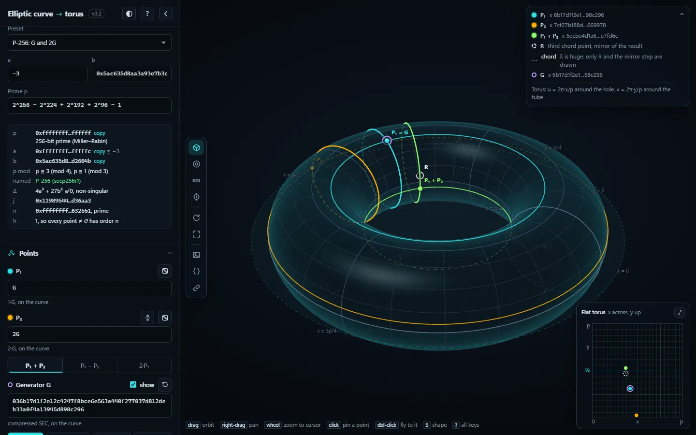
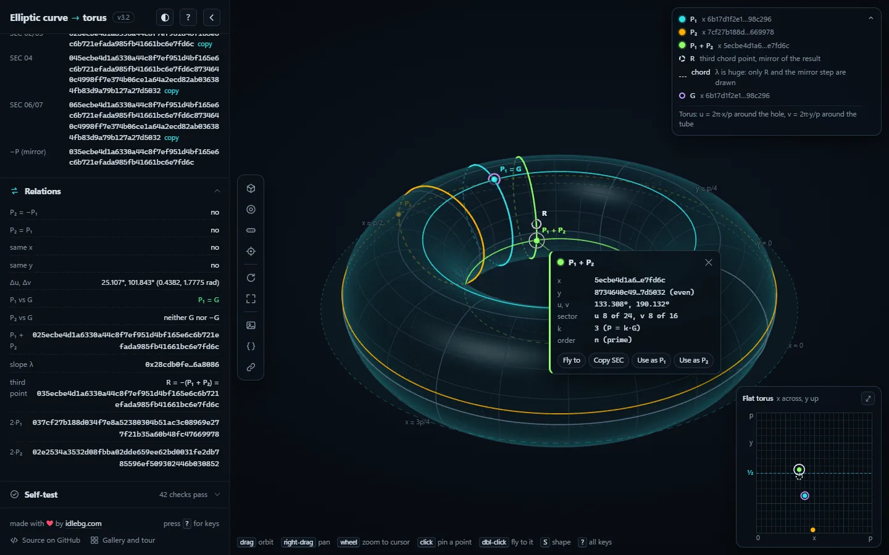

# 39 P-256 next to secp256k1

**Level 3 · Bitcoiner.** NIST P-256 (secp256r1), the curve of TLS, passkeys and smart cards, side by side with
Bitcoin’s: what is the same, what differs, and why it has no β. Read first: [31 secp256k1 in the panel](31-secp256k1.md).

## The parameters

P-256 is y² = x³ + ax + b over F_p with

- p = 2²⁵⁶ − 2²²⁴ + 2¹⁹² + 2⁹⁶ − 1 = `ffffffff00000001000000000000000000000000ffffffffffffffffffffffff`;
- a = p − 3 = `ffffffff00000001000000000000000000000000fffffffffffffffffffffffc`, that is a ≡ −3;
- b = `5ac635d8aa3a93e7b3ebbd55769886bc651d06b0cc53b0f63bce3c3e27d2604b`;
- n = `ffffffff00000000ffffffffffffffffbce6faada7179e84f3b9cac2fc632551`, prime, and h = 1;
- G = `036b17d1f2e12c4247f8bce6e563a440f277037d812deb33a0f4a13945d898c296` (compressed).

Like secp256k1 it has prime order (cofactor 1): by Hasse’s bound the number of points lies within 2√p of p + 1, and the
only multiple of n in that window is n itself. Like secp256k1, p ≡ 3 (mod 4), so decompression is one square root, and
p ≡ 1 (mod 3). Unlike secp256k1, a ≠ 0.

### Example 39.1 · The Curve facts of P-256

**Open this view:** [P-256’s Curve facts](https://idlebg.com/idleGevrek/elliptic_curve_torus_visualizer_v3.html#s=eyJ2IjozLCJwcmVzZXQiOiJwMjU2IiwiYmFzZVByZXNldCI6InAyNTYiLCJhIjoiLTMiLCJiIjoiMHg1YWM2MzVkOGFhM2E5M2U3YjNlYmJkNTU3Njk4ODZiYzY1MWQwNmIwY2M1M2IwZjYzYmNlM2MzZTI3ZDI2MDRiIiwicCI6IjJeMjU2IC0gMl4yMjQgKyAyXjE5MiArIDJeOTYgLSAxIiwiZyI6IjAzNmIxN2QxZjJlMTJjNDI0N2Y4YmNlNmU1NjNhNDQwZjI3NzAzN2Q4MTJkZWIzM2EwZjRhMTM5NDVkODk4YzI5NiIsInAxIjoiRyIsInAyIjoiMkciLCJvcCI6ImFkZCIsInNob3dHIjp0cnVlLCJmb3JjZSI6ZmFsc2UsInNoYXBlIjoidG9ydXMiLCJtYXAiOiJzY2FsZSIsImJpdHMiOjI0LCJzdSI6MjQsInN2IjoxNiwiUiI6MS4yLCJyIjowLjQ2LCJnbGFzcyI6MC41NSwiYmFjayI6MC40LCJzaG93Ijp7ImdyaWQiOnRydWUsInJpbmdzIjp0cnVlLCJsYWJlbHMiOnRydWUsImNsb3VkIjp0cnVlLCJjaG9yZCI6dHJ1ZSwiYmV0YSI6ZmFsc2UsIm1hcCI6dHJ1ZSwic3BpbiI6ZmFsc2V9LCJyaW5ncyI6eyJwMSI6dHJ1ZSwicDIiOnRydWUsInN1bSI6dHJ1ZSwiZyI6ZmFsc2V9LCJ0aGVtZSI6ImRhcmsiLCJwYW5lbCI6dHJ1ZSwibWluaUJpZyI6ZmFsc2UsImxlZ2VuZE1pbiI6ZmFsc2UsInNlY3MiOnsiY3VydmUiOnRydWUsInBvaW50cyI6dHJ1ZSwic2hhcGUiOnRydWUsInZpZXciOnRydWUsImluc3BlY3RvciI6dHJ1ZSwicmVsYXRpb25zIjp0cnVlLCJ0ZXN0IjpmYWxzZX19)

**Do it yourself**

1. In **Curve**, pick the preset **P-256: G and 2G**.
2. Read the **Curve** section in the panel.

**Look at:** the **a** row, “≡ −3”: the visualizer names a small negative representative when there is one; **named**
“P-256 (secp256r1)”; **j**, the j-invariant `1198954424ebb0f8479de43131caece8ee0a9b13a558c21e0b2f74e3fcd36aa3`, not 0; and no **β** row: the **β-orbit** switch is greyed out.

**Why:** the GLV map (x, y) ↦ (βx, y) needs a = 0 (so that x³ + b ignores the cube root of unity). With a = −3, βx does
not give a point, even though p ≡ 1 (mod 3) provides the β. a = −3 was chosen instead because it makes the doubling
formula in Jacobian coordinates cheaper. The two curves trade one speed-up for another.

### Example 39.2 · G + 2G = 3G on P-256

**Open this view:** [G + 2G on P-256](https://idlebg.com/idleGevrek/elliptic_curve_torus_visualizer_v3.html#s=eyJ2IjozLCJwcmVzZXQiOiJwMjU2IiwiYmFzZVByZXNldCI6InAyNTYiLCJhIjoiLTMiLCJiIjoiMHg1YWM2MzVkOGFhM2E5M2U3YjNlYmJkNTU3Njk4ODZiYzY1MWQwNmIwY2M1M2IwZjYzYmNlM2MzZTI3ZDI2MDRiIiwicCI6IjJeMjU2IC0gMl4yMjQgKyAyXjE5MiArIDJeOTYgLSAxIiwiZyI6IjAzNmIxN2QxZjJlMTJjNDI0N2Y4YmNlNmU1NjNhNDQwZjI3NzAzN2Q4MTJkZWIzM2EwZjRhMTM5NDVkODk4YzI5NiIsInAxIjoiRyIsInAyIjoiMkciLCJvcCI6ImFkZCIsInNob3dHIjp0cnVlLCJmb3JjZSI6ZmFsc2UsInNoYXBlIjoidG9ydXMiLCJtYXAiOiJzY2FsZSIsImJpdHMiOjI0LCJzdSI6MjQsInN2IjoxNiwiUiI6MS4yLCJyIjowLjQ2LCJnbGFzcyI6MC41NSwiYmFjayI6MC40LCJzaG93Ijp7ImdyaWQiOnRydWUsInJpbmdzIjp0cnVlLCJsYWJlbHMiOnRydWUsImNsb3VkIjp0cnVlLCJjaG9yZCI6dHJ1ZSwiYmV0YSI6ZmFsc2UsIm1hcCI6dHJ1ZSwic3BpbiI6ZmFsc2V9LCJyaW5ncyI6eyJwMSI6dHJ1ZSwicDIiOnRydWUsInN1bSI6dHJ1ZSwiZyI6ZmFsc2V9LCJ0aGVtZSI6ImRhcmsiLCJwYW5lbCI6dHJ1ZSwibWluaUJpZyI6ZmFsc2UsImxlZ2VuZE1pbiI6ZmFsc2UsInNlY3MiOnsiY3VydmUiOnRydWUsInBvaW50cyI6dHJ1ZSwic2hhcGUiOnRydWUsInZpZXciOnRydWUsImluc3BlY3RvciI6dHJ1ZSwicmVsYXRpb25zIjp0cnVlLCJ0ZXN0IjpmYWxzZX19)

**Do it yourself**

1. In **Curve**, pick the preset **P-256: G and 2G**.
2. In the 3D view, click the result to pin its card.
3. Read the **Relations** section in the panel.

**Look at:** the same construction as on secp256k1: only R and the mirror step are drawn, and the result’s card says
k = 3. Relations gives 3G = `025ecbe4d1a6330a44c8f7ef951d4bf165e6c6b721efada985fb41661bc6e7fd6c`; OpenSSL computes the same point (the build checks it).

**Why:** everything in Levels 2 and 3 that does not use a = 0 works on any curve: the chord and tangent, negation,
k carried through, the key formats. 2G = `037cf27b188d034f7e8a52380304b51ac3c08969e277f21b35a60b48fc47669978`.

## Try it yourself

- Switch the P-256 preset to the sphere and the trefoil: the shapes do not care which curve it is.
- Type `-G` into P₂ and choose **P₁ + P₂**: 𝒪, as on every curve.
- Change a from `-3` to `0` with the same b and p: the curve is no longer named, and the **β** row appears (p ≡ 1 mod 3).

## Recap

- P-256: a ≡ −3, a random-looking b, prime order n, p ≡ 3 (mod 4) and p ≡ 1 (mod 3).
- No GLV endomorphism of the β kind, because a ≠ 0; the visualizer greys out the β-orbit.
- Every other construction carries over unchanged.

Next, Level 4: [41 The mapping](41-mapping.md).
