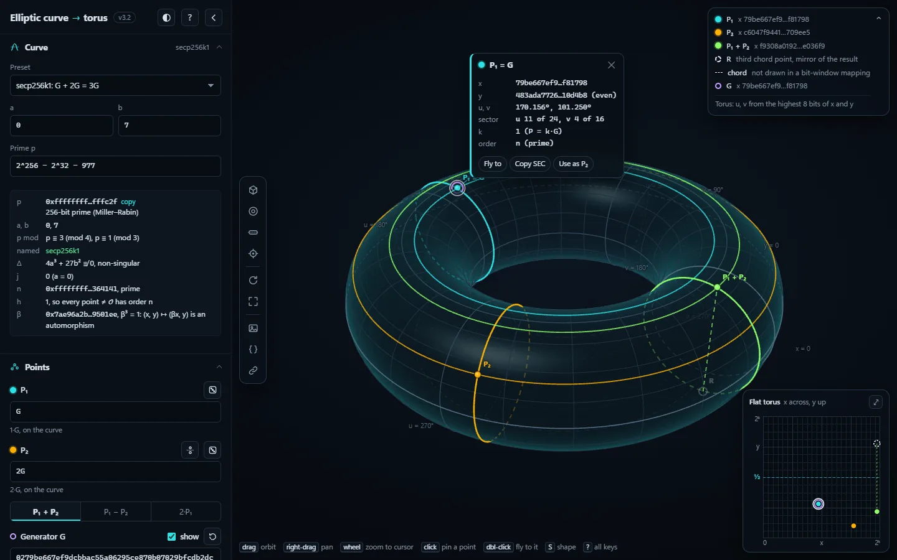
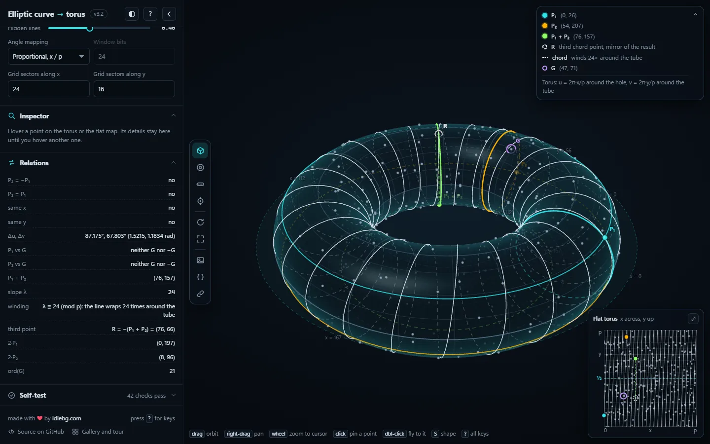
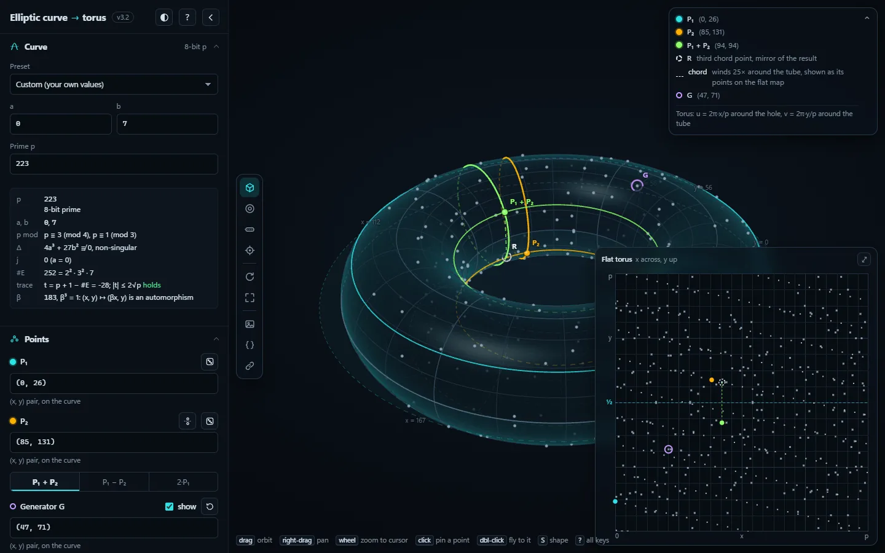
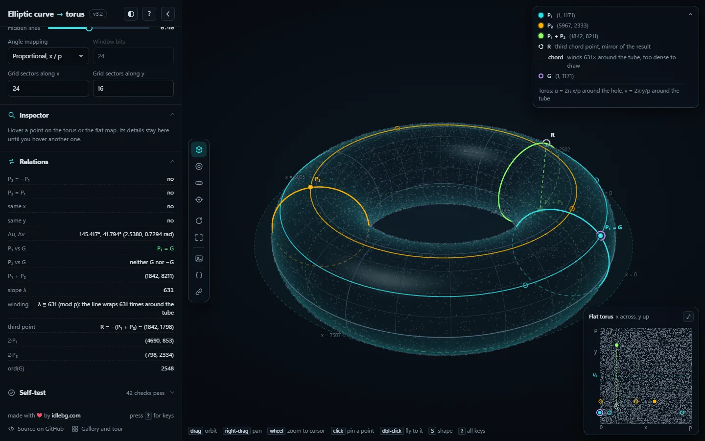

# 41 The mapping

**Level 4 · Researcher.** Exactly how a point becomes a position: the proportional map and its precision, the two bit
windows, the grid sectors, and the rules that decide how much of a chord is drawn. Read first:
[13 Why a donut](13-why-a-donut.md) and [24 Adding points](24-chord.md).

## Turns

The model never stores positions, only **turns** in [0, 1): (t_u, t_v) for (x, y). Every shape then maps turns to 3D
([47 Shapes as topology](47-shapes-topology.md)), and the flat map draws them directly. Three mappings exist (**Display
→ Angle mapping**):

| mapping | t_u for a coordinate c (L = bit length of p, w = **Window bits**, 4 to 52) |
| --- | --- |
| Proportional, x / p | ⌊2⁵²·c / p⌋ / 2⁵² |
| Low bits window | (c mod 2ʷ) / 2ʷ |
| High bits window | ⌊c / 2^(L−w)⌋ / 2ʷ, the top w bits of c as an L-bit number |

Angles are u = 2π·t_u and v = 2π·t_v. The proportional map keeps the 52 leading bits of c/p, as a double can; two
256-bit coordinates closer than about p/2⁵² share an angle. Only the proportional map turns y ↦ p − y into a
reflection, so the mirror plane is drawn only there, and only there is the chord drawn as a line.

The grid has **Grid sectors along x** × **along y** sectors (24 × 16 by default); a point’s sector is
(⌊t_u·s_u⌋, ⌊t_v·s_v⌋), shown on its card and in the Inspector.

### Example 41.1 · The high-bits window

**Open this view:** [G + 2G, high 8 bits](https://idlebg.com/idleGevrek/elliptic_curve_torus_visualizer_v3.html#s=eyJ2IjozLCJwcmVzZXQiOiJrMS1jaG9yZCIsImJhc2VQcmVzZXQiOiJrMS1jaG9yZCIsImEiOiIwIiwiYiI6IjciLCJwIjoiMl4yNTYgLSAyXjMyIC0gOTc3IiwiZyI6IjAyNzliZTY2N2VmOWRjYmJhYzU1YTA2Mjk1Y2U4NzBiMDcwMjliZmNkYjJkY2UyOGQ5NTlmMjgxNWIxNmY4MTc5OCIsInAxIjoiRyIsInAyIjoiMkciLCJvcCI6ImFkZCIsInNob3dHIjp0cnVlLCJmb3JjZSI6ZmFsc2UsInNoYXBlIjoidG9ydXMiLCJtYXAiOiJoaWdoIiwiYml0cyI6OCwic3UiOjI0LCJzdiI6MTYsIlIiOjEuMiwiciI6MC40NiwiZ2xhc3MiOjAuNTUsImJhY2siOjAuNCwic2hvdyI6eyJncmlkIjp0cnVlLCJyaW5ncyI6dHJ1ZSwibGFiZWxzIjp0cnVlLCJjbG91ZCI6dHJ1ZSwiY2hvcmQiOnRydWUsImJldGEiOmZhbHNlLCJtYXAiOnRydWUsInNwaW4iOmZhbHNlfSwicmluZ3MiOnsicDEiOnRydWUsInAyIjp0cnVlLCJzdW0iOnRydWUsImciOmZhbHNlfSwidGhlbWUiOiJkYXJrIiwicGFuZWwiOnRydWUsIm1pbmlCaWciOmZhbHNlLCJsZWdlbmRNaW4iOmZhbHNlLCJzZWNzIjp7ImN1cnZlIjp0cnVlLCJwb2ludHMiOnRydWUsInNoYXBlIjp0cnVlLCJ2aWV3Ijp0cnVlLCJpbnNwZWN0b3IiOnRydWUsInJlbGF0aW9ucyI6dHJ1ZSwidGVzdCI6ZmFsc2V9fQ)

**Do it yourself**

1. In **Curve**, pick the preset **secp256k1: G + 2G = 3G**.
2. Set **Angle mapping** to **High bits window** and **Window bits** to 8.
3. In the 3D view, click P₁ to pin its card.

**Look at:** the legend, “u, v from the highest 8 bits of x and y”, and G at t_u = 121/256, t_v = 72/256: G’s x
starts with the byte 0x79 = 121 and its y with 0x48 = 72. The chord row says “not drawn in a bit-window mapping”.

**Why:** the windows look at bit patterns rather than magnitudes. The high window sorts 256-bit coordinates by their
leading bits; the low window exposes trailing bits, such as y’s parity ([34](34-parity-taproot.md)).

## The chord as a line

For P₁ ≠ ±P₂ the chord is {(x, y) : y ≡ λx + c (mod p)}. As a line on the torus it is the image of
t ↦ (t, λ′t + c/p) for t ∈ [0, 1], where λ′ is any integer ≡ λ: different choices give different curves through the
same p lattice points. The visualizer takes λ′ = the centred representative in (−p/2, p/2], which minimises the
winding |λ′| around the tube (one turn around the hole, |λ′| around the tube: a (1, λ′) torus curve). Relations prints
it as “λ ≡ λ′ (mod p)” for p ≤ 100 000.

Drawing rules (proportional mapping):

- |λ′| ≤ 24 and p ≤ 10⁶: the continuous line, on the surface and the flat map;
- |λ′| > 24, p ≤ 4000: no line in 3D; the flat map shows the line’s p lattice points (x, λx + c);
- |λ′| > 24 and 4000 < p ≤ 10⁶: “too dense to draw”;
- p > 10⁶: “λ is huge: only R and the mirror step are drawn”.

R and the mirror step R → −R are always drawn.

### Example 41.2 · |λ| = 24: still drawn

**Open this view:** [(0, 26) + (54, 207)](https://idlebg.com/idleGevrek/elliptic_curve_torus_visualizer_v3.html#s=eyJ2IjozLCJwcmVzZXQiOiJjdXN0b20iLCJiYXNlUHJlc2V0IjoicGIyMjMiLCJhIjoiMCIsImIiOiI3IiwicCI6IjIyMyIsImciOiIoNDcsIDcxKSIsInAxIjoiKDAsIDI2KSIsInAyIjoiKDU0LCAyMDcpIiwib3AiOiJhZGQiLCJzaG93RyI6dHJ1ZSwiZm9yY2UiOmZhbHNlLCJzaGFwZSI6InRvcnVzIiwibWFwIjoic2NhbGUiLCJiaXRzIjoyNCwic3UiOjI0LCJzdiI6MTYsIlIiOjEuMiwiciI6MC40NiwiZ2xhc3MiOjAuNTUsImJhY2siOjAuNCwic2hvdyI6eyJncmlkIjp0cnVlLCJyaW5ncyI6dHJ1ZSwibGFiZWxzIjp0cnVlLCJjbG91ZCI6dHJ1ZSwiY2hvcmQiOnRydWUsImJldGEiOmZhbHNlLCJtYXAiOnRydWUsInNwaW4iOmZhbHNlfSwicmluZ3MiOnsicDEiOnRydWUsInAyIjp0cnVlLCJzdW0iOnRydWUsImciOmZhbHNlfSwidGhlbWUiOiJkYXJrIiwicGFuZWwiOnRydWUsIm1pbmlCaWciOmZhbHNlLCJsZWdlbmRNaW4iOmZhbHNlLCJzZWNzIjp7ImN1cnZlIjp0cnVlLCJwb2ludHMiOnRydWUsInNoYXBlIjp0cnVlLCJ2aWV3Ijp0cnVlLCJpbnNwZWN0b3IiOnRydWUsInJlbGF0aW9ucyI6dHJ1ZSwidGVzdCI6ZmFsc2V9fQ)

**Do it yourself**

1. In **Curve**, pick the preset **y² = x³ + 7 over F₂₂₃, Programming Bitcoin**.
2. Type `(0, 26)` in **P₁** and `(54, 207)` in **P₂**.
3. Read the **Relations** section in the panel.

### Example 41.3 · |λ| = 25: its points on the flat map

**Open this view:** [(0, 26) + (85, 131)](https://idlebg.com/idleGevrek/elliptic_curve_torus_visualizer_v3.html#s=eyJ2IjozLCJwcmVzZXQiOiJjdXN0b20iLCJiYXNlUHJlc2V0IjoicGIyMjMiLCJhIjoiMCIsImIiOiI3IiwicCI6IjIyMyIsImciOiIoNDcsIDcxKSIsInAxIjoiKDAsIDI2KSIsInAyIjoiKDg1LCAxMzEpIiwib3AiOiJhZGQiLCJzaG93RyI6dHJ1ZSwiZm9yY2UiOmZhbHNlLCJzaGFwZSI6InRvcnVzIiwibWFwIjoic2NhbGUiLCJiaXRzIjoyNCwic3UiOjI0LCJzdiI6MTYsIlIiOjEuMiwiciI6MC40NiwiZ2xhc3MiOjAuNTUsImJhY2siOjAuNCwic2hvdyI6eyJncmlkIjp0cnVlLCJyaW5ncyI6dHJ1ZSwibGFiZWxzIjp0cnVlLCJjbG91ZCI6dHJ1ZSwiY2hvcmQiOnRydWUsImJldGEiOmZhbHNlLCJtYXAiOnRydWUsInNwaW4iOmZhbHNlfSwicmluZ3MiOnsicDEiOnRydWUsInAyIjp0cnVlLCJzdW0iOnRydWUsImciOmZhbHNlfSwidGhlbWUiOiJkYXJrIiwicGFuZWwiOnRydWUsIm1pbmlCaWciOnRydWUsImxlZ2VuZE1pbiI6ZmFsc2UsInNlY3MiOnsiY3VydmUiOnRydWUsInBvaW50cyI6dHJ1ZSwic2hhcGUiOnRydWUsInZpZXciOnRydWUsImluc3BlY3RvciI6dHJ1ZSwicmVsYXRpb25zIjp0cnVlLCJ0ZXN0IjpmYWxzZX19)

**Do it yourself**

1. In **Curve**, pick the preset **y² = x³ + 7 over F₂₂₃, Programming Bitcoin**.
2. Type `(0, 26)` in **P₁** and `(85, 131)` in **P₂**.
3. Click **⤢** on the flat map to enlarge it.

**Look at:** the legend switches from “winds 24× around the tube” to “winds 25× around the tube, shown as its points on
the flat map”, and the enlarged map shows 223 points on 25 parallel lines.

### Example 41.4 · p > 4000: too dense to draw

**Open this view:** [G + 3G on F₁₀₀₀₉](https://idlebg.com/idleGevrek/elliptic_curve_torus_visualizer_v3.html#s=eyJ2IjozLCJwcmVzZXQiOiJ0MTAwMDkiLCJiYXNlUHJlc2V0IjoidDEwMDA5IiwiYSI6IjAiLCJiIjoiNyIsInAiOiIxMDAwOSIsImciOiIoMSwgMTE3MSkiLCJwMSI6IkciLCJwMiI6IjNHIiwib3AiOiJhZGQiLCJzaG93RyI6dHJ1ZSwiZm9yY2UiOmZhbHNlLCJzaGFwZSI6InRvcnVzIiwibWFwIjoic2NhbGUiLCJiaXRzIjoyNCwic3UiOjI0LCJzdiI6MTYsIlIiOjEuMiwiciI6MC40NiwiZ2xhc3MiOjAuNTUsImJhY2siOjAuNCwic2hvdyI6eyJncmlkIjp0cnVlLCJyaW5ncyI6dHJ1ZSwibGFiZWxzIjp0cnVlLCJjbG91ZCI6dHJ1ZSwiY2hvcmQiOnRydWUsImJldGEiOnRydWUsIm1hcCI6dHJ1ZSwic3BpbiI6ZmFsc2V9LCJyaW5ncyI6eyJwMSI6dHJ1ZSwicDIiOnRydWUsInN1bSI6dHJ1ZSwiZyI6ZmFsc2V9LCJ0aGVtZSI6ImRhcmsiLCJwYW5lbCI6dHJ1ZSwibWluaUJpZyI6ZmFsc2UsImxlZ2VuZE1pbiI6ZmFsc2UsInNlY3MiOnsiY3VydmUiOnRydWUsInBvaW50cyI6dHJ1ZSwic2hhcGUiOnRydWUsInZpZXciOnRydWUsImluc3BlY3RvciI6dHJ1ZSwicmVsYXRpb25zIjp0cnVlLCJ0ZXN0IjpmYWxzZX19)

**Do it yourself**

1. In **Curve**, pick the preset **y² = x³ + 7 over F₁₀₀₀₉, dense and 6-fold symmetric**.
2. Read the **Relations** section in the panel.

**Look at:** Relations: “λ ≡ 631 (mod p): the line wraps 631 times around the tube”; the legend: “too dense to draw”.

**Why:** a chord between unrelated points has a slope uniformly spread over F_p, so on all but the smallest curves the
line is a dense coil. The few chords with small centred λ, such as points sharing a y (λ = 0, [24](24-chord.md)), are
the exception, and they are exactly the ones the picture explains best.

## Try it yourself

- On secp256k1 set **Low bits window** with **Window bits** 5, type `G` into both points and step with **N**: each step
  lands on a new pair of 5-bit values.
- Find a chord on F₂₂₃ with λ ≡ ±2 among the dots ([24](24-chord.md) found ±1).
- Try to set the grid to 223 × 223 sectors: the fields stop at 96 along x and 64 along y.

## Recap

- Turns: proportional ⌊2⁵²c/p⌋/2⁵², or a low or high window of w bits; only the proportional map makes −P a
  reflection.
- The chord is the (1, λ′) torus curve with λ′ the centred slope; it is drawn while |λ′| ≤ 24 and p ≤ 10⁶.
- Beyond that: lattice points on the flat map (p ≤ 4000), “too dense”, or only R and the mirror step.

Next: [42 Group structure](42-group-structure.md).
