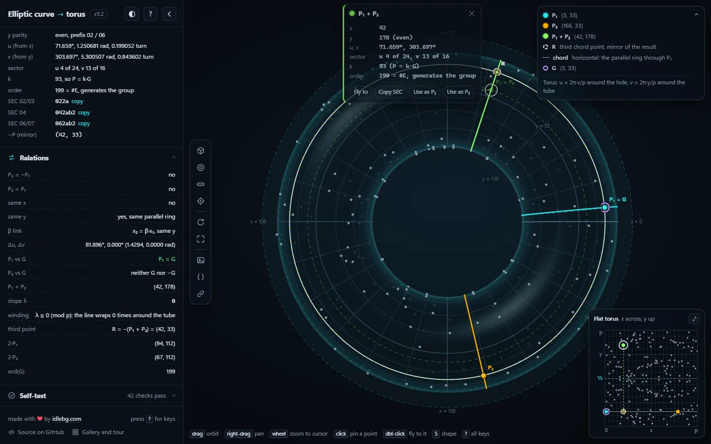
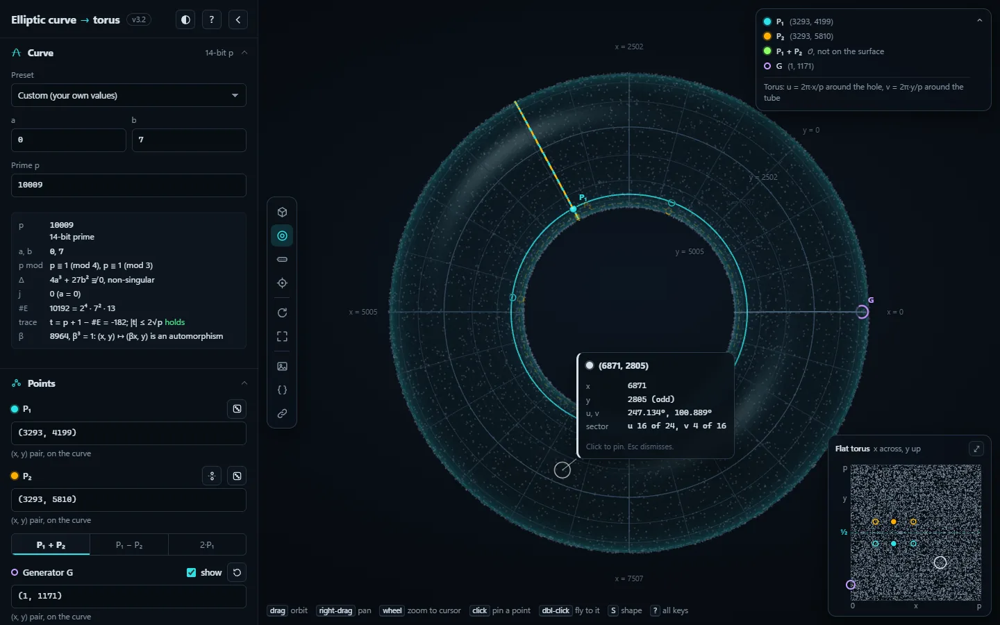
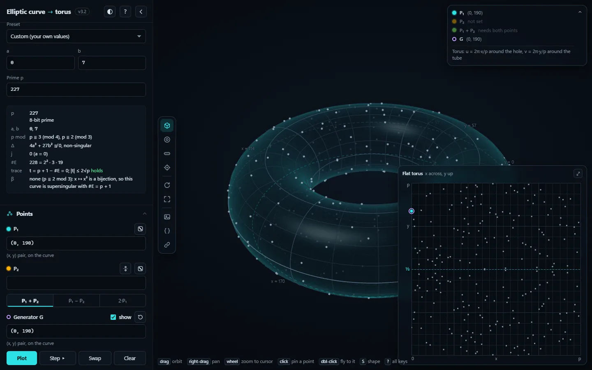

# 43 j = 0 and its automorphisms

**Level 4 · Researcher.** Curves with a = 0 (j-invariant 0) have six automorphisms instead of two. You will see their
orbits on F₂₁₁ and F₁₀₀₀₉, and what happens when p ≡ 2 (mod 3): the curve becomes supersingular with exactly p + 1
points. Read first: [35 The GLV endomorphism](35-glv.md).

## The automorphism group

For p > 3, j(E) = 1728 · 4a³ / (4a³ + 27b²), so j = 0 exactly when a = 0 (the **j** row says “0 (a = 0)”). Every curve
has the automorphisms ±1: (x, y) ↦ (x, ±y). A curve y² = x³ + b over F_p with p ≡ 1 (mod 3) has more: with β a
primitive cube root of unity, (x, y) ↦ (βx, −y) has order 6 and generates

  Aut(E) ≅ μ₆ = {(x, y) ↦ (βⁱx, ±y)}.

Its orbits on the affine points have size 6, except for the points with y = 0 (one orbit of size 3, when x³ + b splits)
and with x = 0 (an orbit (0, ±y) of size 2, when b is a square).

### Example 43.1 · Three points share y = 33 on F₂₁₁

**Open this view:** [the F₂₁₁ preset from the top](https://idlebg.com/idleGevrek/elliptic_curve_torus_visualizer_v3.html#s=eyJ2IjozLCJwcmVzZXQiOiJ0MjExIiwiYmFzZVByZXNldCI6InQyMTEiLCJhIjoiMCIsImIiOiI3IiwicCI6IjIxMSIsImciOiIoMywgMzMpIiwicDEiOiIoMywgMzMpIiwicDIiOiIoMTY2LCAzMykiLCJvcCI6ImFkZCIsInNob3dHIjp0cnVlLCJmb3JjZSI6ZmFsc2UsInNoYXBlIjoidG9ydXMiLCJtYXAiOiJzY2FsZSIsImJpdHMiOjI0LCJzdSI6MjQsInN2IjoxNiwiUiI6MS4yLCJyIjowLjQ2LCJnbGFzcyI6MC41NSwiYmFjayI6MC40LCJzaG93Ijp7ImdyaWQiOnRydWUsInJpbmdzIjp0cnVlLCJsYWJlbHMiOnRydWUsImNsb3VkIjp0cnVlLCJjaG9yZCI6dHJ1ZSwiYmV0YSI6dHJ1ZSwibWFwIjp0cnVlLCJzcGluIjpmYWxzZX0sInJpbmdzIjp7InAxIjp0cnVlLCJwMiI6dHJ1ZSwic3VtIjp0cnVlLCJnIjpmYWxzZX0sInRoZW1lIjoiZGFyayIsInBhbmVsIjp0cnVlLCJtaW5pQmlnIjpmYWxzZSwibGVnZW5kTWluIjpmYWxzZSwic2VjcyI6eyJjdXJ2ZSI6dHJ1ZSwicG9pbnRzIjp0cnVlLCJzaGFwZSI6dHJ1ZSwidmlldyI6dHJ1ZSwiaW5zcGVjdG9yIjp0cnVlLCJyZWxhdGlvbnMiOnRydWUsInRlc3QiOmZhbHNlfX0)

**Do it yourself**

1. In **Curve**, pick the preset **y² = x³ + 7 over F₂₁₁, three points share y = 33**.
2. Press **2** for the top view.
3. In the 3D view, click the result to pin its card.
4. Read the **Relations** section in the panel.

**Look at:** the preset “three points share y = 33”: (3, 33) and (166, 33), with the β-orbit marking the third, (42, 33).
Relations: **β link** “x₂ = β·x₁, same y”. The chord is the ring y = 33 itself, so its third point is
R = (42, 33) and the sum is (42, 178).

**Why:** here β = 196 and β² = 14: 196 × 3 = 588 ≡ 166 and 14 × 3 = 42 (mod 211). F₂₁₁’s group is cyclic of prime order
199, and the automorphism acts on it as multiplication by a cube root of unity mod 199, as λ does on secp256k1.

### Example 43.2 · Six points from one on F₁₀₀₀₉

**Open this view:** [(3293, 4199) and its five siblings](https://idlebg.com/idleGevrek/elliptic_curve_torus_visualizer_v3.html#s=eyJ2IjozLCJwcmVzZXQiOiJjdXN0b20iLCJiYXNlUHJlc2V0IjoidDEwMDA5IiwiYSI6IjAiLCJiIjoiNyIsInAiOiIxMDAwOSIsImciOiIoMSwgMTE3MSkiLCJwMSI6IigzMjkzLCA0MTk5KSIsInAyIjoiKDMyOTMsIDU4MTApIiwib3AiOiJhZGQiLCJzaG93RyI6dHJ1ZSwiZm9yY2UiOmZhbHNlLCJzaGFwZSI6InRvcnVzIiwibWFwIjoic2NhbGUiLCJiaXRzIjoyNCwic3UiOjI0LCJzdiI6MTYsIlIiOjEuMiwiciI6MC40NiwiZ2xhc3MiOjAuNTUsImJhY2siOjAuNCwic2hvdyI6eyJncmlkIjp0cnVlLCJyaW5ncyI6dHJ1ZSwibGFiZWxzIjp0cnVlLCJjbG91ZCI6dHJ1ZSwiY2hvcmQiOmZhbHNlLCJiZXRhIjp0cnVlLCJtYXAiOnRydWUsInNwaW4iOmZhbHNlfSwicmluZ3MiOnsicDEiOnRydWUsInAyIjp0cnVlLCJzdW0iOnRydWUsImciOmZhbHNlfSwidGhlbWUiOiJkYXJrIiwicGFuZWwiOnRydWUsIm1pbmlCaWciOmZhbHNlLCJsZWdlbmRNaW4iOmZhbHNlLCJzZWNzIjp7ImN1cnZlIjp0cnVlLCJwb2ludHMiOnRydWUsInNoYXBlIjp0cnVlLCJ2aWV3Ijp0cnVlLCJpbnNwZWN0b3IiOnRydWUsInJlbGF0aW9ucyI6dHJ1ZSwidGVzdCI6ZmFsc2V9fQ)

**Do it yourself**

1. In **Curve**, pick the preset **y² = x³ + 7 over F₁₀₀₀₉, dense and 6-fold symmetric**.
2. Type `(3293, 4199)` in **P₁**.
3. Click the mirror button next to **P₂** (its tooltip: “Set P₂ = −P₁, the mirror image”).
4. In **Display**, turn off **Chord construction** (**K**).
5. Press **2** for the top view.

**Look at:** from the top, the six marked points (1911, 4199), (1911, 5810), (3293, 4199), (3293, 5810), (4805, 4199), (4805, 5810): three x values on each of two rings, mirror images of each
other.

**Why:** this is one μ₆-orbit (β = 8964 as the visualizer picks it). F₁₀₀₀₉ has no point with x = 0 (7 is not a square
mod 10009) and three points with y = 0, so its 10 191 dots split into one orbit of three and 1698 orbits of six. That is the
“6-fold symmetric” of the preset’s name, and why every row of its flat map has three dots or none
([12](12-cloud-of-dots.md)).

## p ≡ 2 (mod 3): supersingular

If p ≡ 2 (mod 3), then 3 ∤ p − 1 and x ↦ x³ is a bijection of F_p. So for each y there is exactly one x with
x³ = y² − b: the curve has exactly one point per value of y, p affine points in all, and #E = p + 1. Such a curve is
supersingular (trace 0), its β row says so, and no β exists to give an automorphism of order 3 over F_p.

### Example 43.3 · p ≡ 2 (mod 3): one point per row

**Open this view:** [y² = x³ + 7 over F₂₂₇](https://idlebg.com/idleGevrek/elliptic_curve_torus_visualizer_v3.html#s=eyJ2IjozLCJwcmVzZXQiOiJjdXN0b20iLCJiYXNlUHJlc2V0IjoicGIyMjMiLCJhIjoiMCIsImIiOiI3IiwicCI6IjIyNyIsImciOiIoMCwgMTkwKSIsInAxIjoiKDAsIDE5MCkiLCJwMiI6IiIsIm9wIjoiYWRkIiwic2hvd0ciOnRydWUsImZvcmNlIjpmYWxzZSwic2hhcGUiOiJ0b3J1cyIsIm1hcCI6InNjYWxlIiwiYml0cyI6MjQsInN1IjoyNCwic3YiOjE2LCJSIjoxLjIsInIiOjAuNDYsImdsYXNzIjowLjU1LCJiYWNrIjowLjQsInNob3ciOnsiZ3JpZCI6dHJ1ZSwicmluZ3MiOnRydWUsImxhYmVscyI6dHJ1ZSwiY2xvdWQiOnRydWUsImNob3JkIjp0cnVlLCJiZXRhIjpmYWxzZSwibWFwIjp0cnVlLCJzcGluIjpmYWxzZX0sInJpbmdzIjp7InAxIjp0cnVlLCJwMiI6dHJ1ZSwic3VtIjp0cnVlLCJnIjpmYWxzZX0sInRoZW1lIjoiZGFyayIsInBhbmVsIjp0cnVlLCJtaW5pQmlnIjp0cnVlLCJsZWdlbmRNaW4iOmZhbHNlLCJzZWNzIjp7ImN1cnZlIjp0cnVlLCJwb2ludHMiOnRydWUsInNoYXBlIjp0cnVlLCJ2aWV3Ijp0cnVlLCJpbnNwZWN0b3IiOnRydWUsInJlbGF0aW9ucyI6dHJ1ZSwidGVzdCI6ZmFsc2V9fQ)

**Do it yourself**

1. In **Curve**, pick the preset **y² = x³ + 7 over F₂₂₃, Programming Bitcoin**.
2. Type `227` in **Prime p**, `(0, 190)` in **Generator G** and `(0, 190)` in **P₁**.
3. Empty **P₂**.
4. Click **⤢** on the flat map to enlarge it.
5. Read the **Curve** section in the panel.

**Look at:** the facts: **p mod** “p ≡ 3 (mod 4), p ≡ 2 (mod 3)”, **#E** “228 = 2² · 3 · 19”, and **β** “none (p ≡ 2
mod 3): x ↦ x³ is a bijection, so this curve is supersingular with #E = p + 1”. The enlarged flat map has exactly one
dot in every row.

**Why:** y² = x³ + 7 over F₂₂₇ has the 227 points (x(y), y), one for each y, plus 𝒪. Only one of them has y = 0,
(143, 0), the unique cube root of −7.

## Try it yourself

- On F₂₁₁, type (42, 33) into P₂: the β link now says β², and the chord still runs along the ring.
- Type y² = x³ + 7 with p = 229 (≡ 1 mod 3) and p = 233 (≡ 2 mod 3) and compare their flat maps.
- On F₁₀₀₀₉, type a point with y = 0: its β-orbit has three points, all on the outer rim.

## Recap

- j = 0 ⇔ a = 0; for p ≡ 1 (mod 3) the automorphism group is μ₆: (x, y) ↦ (βⁱx, ±y).
- Orbits have size 6, except 3 for y = 0 and 2 for x = 0; that is the six-fold pattern of F₁₀₀₀₉.
- For p ≡ 2 (mod 3), x ↦ x³ is a bijection: one point per y, #E = p + 1, supersingular.

Next: [44 Quadratic twists](44-twists.md).
