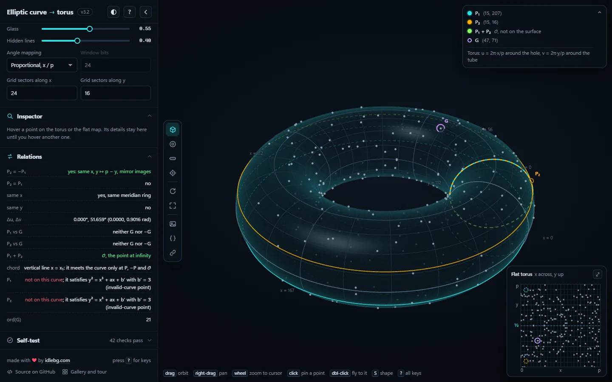
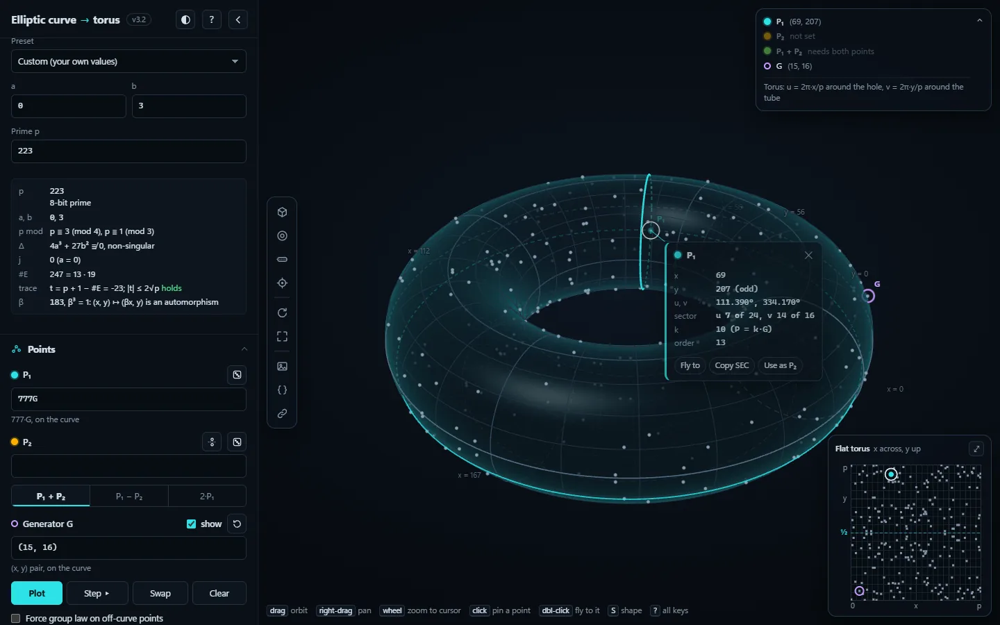
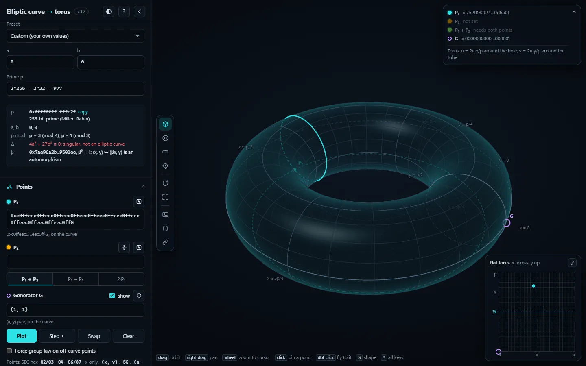

# 45 Invalid-curve attacks

**Level 4 · Researcher.** Because the group law never uses b, software that multiplies an unchecked point by a secret
computes on whatever curve the point really lies on. You will run the attack on a toy curve, recover a made-up key from
three small subgroups, and see the extreme case, the cusp, where the discrete log is a division. Read first:
[36 Invalid points](36-invalid-points.md) and [42 Group structure](42-group-structure.md).

## The attack

A victim holds a secret k and computes k·Q for points Q it receives (ECDH is the classic case). If it does not check
that Q is on its curve E: y² = x³ + ax + b, an attacker can send Q on E_b′: y² = x³ + ax + b′ for a b′ of the
attacker’s choice, with Q of small order r in E_b′(F_p). The victim’s double-and-add then computes k·Q in E_b′, which
lies in the r-element group ⟨Q⟩, and anything that reveals k·Q reveals k mod r. Several b′ with coprime r, combined
by the Chinese remainder theorem, give k.

Over F₂₂₃ the curves y² = x³ + b′ fall into six classes with group orders 196, 201, 219, 229, 247 and 252
(the tutorials’ scripts compute every b′). The victim’s curve is y² = x³ + 7 (252 points); y² = x³ + 3 has 247 = 13 · 19 points and
y² = x³ + 13 has 196 = 2² · 7² points, Z/2 × Z/98. The victim’s secret, made up for this chapter, is k = 777.

### Example 45.1 · The victim’s view: an off-curve point of order 13

The attacker’s point Q = (15, 16) is not on y² = x³ + 7; it lies on y² = x³ + 3, where it has order 13. With **Force
group law** ticked (the victim’s missing check), add Q to itself with **Step**: P₁ = `(15, 16)`, P₂ = `(15, 16)`, then
**N** eleven times.

**Open this view:** [12·(15, 16) + (15, 16), forced](https://idlebg.com/idleGevrek/elliptic_curve_torus_visualizer_v3.html#s=eyJ2IjozLCJwcmVzZXQiOiJjdXN0b20iLCJiYXNlUHJlc2V0IjoicGIyMjMiLCJhIjoiMCIsImIiOiI3IiwicCI6IjIyMyIsImciOiIoNDcsIDcxKSIsInAxIjoiKDE1LCAyMDcpIiwicDIiOiIoMTUsIDE2KSIsIm9wIjoiYWRkIiwic2hvd0ciOnRydWUsImZvcmNlIjp0cnVlLCJzaGFwZSI6InRvcnVzIiwibWFwIjoic2NhbGUiLCJiaXRzIjoyNCwic3UiOjI0LCJzdiI6MTYsIlIiOjEuMiwiciI6MC40NiwiZ2xhc3MiOjAuNTUsImJhY2siOjAuNCwic2hvdyI6eyJncmlkIjp0cnVlLCJyaW5ncyI6dHJ1ZSwibGFiZWxzIjp0cnVlLCJjbG91ZCI6dHJ1ZSwiY2hvcmQiOmZhbHNlLCJiZXRhIjpmYWxzZSwibWFwIjp0cnVlLCJzcGluIjpmYWxzZX0sInJpbmdzIjp7InAxIjp0cnVlLCJwMiI6dHJ1ZSwic3VtIjp0cnVlLCJnIjpmYWxzZX0sInRoZW1lIjoiZGFyayIsInBhbmVsIjp0cnVlLCJtaW5pQmlnIjpmYWxzZSwibGVnZW5kTWluIjpmYWxzZSwic2VjcyI6eyJjdXJ2ZSI6dHJ1ZSwicG9pbnRzIjp0cnVlLCJzaGFwZSI6dHJ1ZSwidmlldyI6dHJ1ZSwiaW5zcGVjdG9yIjp0cnVlLCJyZWxhdGlvbnMiOnRydWUsInRlc3QiOmZhbHNlfX0)

**Do it yourself**

1. In **Curve**, pick the preset **y² = x³ + 7 over F₂₂₃, Programming Bitcoin**.
2. Type `(15, 16)` in **P₁** and `(15, 16)` in **P₂**.
3. Tick **Force group law on off-curve points**.
4. Press **N** (or the **Step ▸** button) 11 times.
5. In **Display**, turn off **Chord construction** (**K**).
6. Read the **Relations** section in the panel.

**Look at:** P₁ is now 12Q = (15, 207), still “NOT on the curve: b′ = 3”, and P₁ + P₂ = 13Q = 𝒪.

**Why:** the formulas computed in the 13-element group ⟨Q⟩ of y² = x³ + 3 all along. Whatever k the victim uses,
k·Q is one of only 13 points.

### Example 45.2 · The attacker’s view: 777·Q reveals 777 mod 13

The attacker knows the curve y² = x³ + 3, so it can type it, with G = Q, and look at the victim’s result as a multiple
of Q.

**Open this view:** [777G on y² = x³ + 3](https://idlebg.com/idleGevrek/elliptic_curve_torus_visualizer_v3.html#s=eyJ2IjozLCJwcmVzZXQiOiJjdXN0b20iLCJiYXNlUHJlc2V0IjoicGIyMjMiLCJhIjoiMCIsImIiOiIzIiwicCI6IjIyMyIsImciOiIoMTUsIDE2KSIsInAxIjoiNzc3RyIsInAyIjoiIiwib3AiOiJhZGQiLCJzaG93RyI6dHJ1ZSwiZm9yY2UiOmZhbHNlLCJzaGFwZSI6InRvcnVzIiwibWFwIjoic2NhbGUiLCJiaXRzIjoyNCwic3UiOjI0LCJzdiI6MTYsIlIiOjEuMiwiciI6MC40NiwiZ2xhc3MiOjAuNTUsImJhY2siOjAuNCwic2hvdyI6eyJncmlkIjp0cnVlLCJyaW5ncyI6dHJ1ZSwibGFiZWxzIjp0cnVlLCJjbG91ZCI6dHJ1ZSwiY2hvcmQiOmZhbHNlLCJiZXRhIjpmYWxzZSwibWFwIjp0cnVlLCJzcGluIjpmYWxzZX0sInJpbmdzIjp7InAxIjp0cnVlLCJwMiI6dHJ1ZSwic3VtIjp0cnVlLCJnIjpmYWxzZX0sInRoZW1lIjoiZGFyayIsInBhbmVsIjp0cnVlLCJtaW5pQmlnIjpmYWxzZSwibGVnZW5kTWluIjpmYWxzZSwic2VjcyI6eyJjdXJ2ZSI6dHJ1ZSwicG9pbnRzIjp0cnVlLCJzaGFwZSI6dHJ1ZSwidmlldyI6dHJ1ZSwiaW5zcGVjdG9yIjp0cnVlLCJyZWxhdGlvbnMiOnRydWUsInRlc3QiOmZhbHNlfX0)

| b′ | Q | order of Q | the card’s k for 777·Q | open |
| --- | --- | --- | --- | --- |
| 3 | (15, 16) | 13 | 10 | [open](https://idlebg.com/idleGevrek/elliptic_curve_torus_visualizer_v3.html#s=eyJ2IjozLCJwcmVzZXQiOiJjdXN0b20iLCJiYXNlUHJlc2V0IjoicGIyMjMiLCJhIjoiMCIsImIiOiIzIiwicCI6IjIyMyIsImciOiIoMTUsIDE2KSIsInAxIjoiNzc3RyIsInAyIjoiIiwib3AiOiJhZGQiLCJzaG93RyI6dHJ1ZSwiZm9yY2UiOmZhbHNlLCJzaGFwZSI6InRvcnVzIiwibWFwIjoic2NhbGUiLCJiaXRzIjoyNCwic3UiOjI0LCJzdiI6MTYsIlIiOjEuMiwiciI6MC40NiwiZ2xhc3MiOjAuNTUsImJhY2siOjAuNCwic2hvdyI6eyJncmlkIjp0cnVlLCJyaW5ncyI6dHJ1ZSwibGFiZWxzIjp0cnVlLCJjbG91ZCI6dHJ1ZSwiY2hvcmQiOmZhbHNlLCJiZXRhIjpmYWxzZSwibWFwIjp0cnVlLCJzcGluIjpmYWxzZX0sInJpbmdzIjp7InAxIjp0cnVlLCJwMiI6dHJ1ZSwic3VtIjp0cnVlLCJnIjpmYWxzZX0sInRoZW1lIjoiZGFyayIsInBhbmVsIjp0cnVlLCJtaW5pQmlnIjpmYWxzZSwibGVnZW5kTWluIjpmYWxzZSwic2VjcyI6eyJjdXJ2ZSI6dHJ1ZSwicG9pbnRzIjp0cnVlLCJzaGFwZSI6dHJ1ZSwidmlldyI6dHJ1ZSwiaW5zcGVjdG9yIjp0cnVlLCJyZWxhdGlvbnMiOnRydWUsInRlc3QiOmZhbHNlfX0) |
| 3 | (27, 109) | 19 | 17 | [open](https://idlebg.com/idleGevrek/elliptic_curve_torus_visualizer_v3.html#s=eyJ2IjozLCJwcmVzZXQiOiJjdXN0b20iLCJiYXNlUHJlc2V0IjoicGIyMjMiLCJhIjoiMCIsImIiOiIzIiwicCI6IjIyMyIsImciOiIoMjcsIDEwOSkiLCJwMSI6Ijc3N0ciLCJwMiI6IiIsIm9wIjoiYWRkIiwic2hvd0ciOnRydWUsImZvcmNlIjpmYWxzZSwic2hhcGUiOiJ0b3J1cyIsIm1hcCI6InNjYWxlIiwiYml0cyI6MjQsInN1IjoyNCwic3YiOjE2LCJSIjoxLjIsInIiOjAuNDYsImdsYXNzIjowLjU1LCJiYWNrIjowLjQsInNob3ciOnsiZ3JpZCI6dHJ1ZSwicmluZ3MiOnRydWUsImxhYmVscyI6dHJ1ZSwiY2xvdWQiOnRydWUsImNob3JkIjpmYWxzZSwiYmV0YSI6ZmFsc2UsIm1hcCI6dHJ1ZSwic3BpbiI6ZmFsc2V9LCJyaW5ncyI6eyJwMSI6dHJ1ZSwicDIiOnRydWUsInN1bSI6dHJ1ZSwiZyI6ZmFsc2V9LCJ0aGVtZSI6ImRhcmsiLCJwYW5lbCI6dHJ1ZSwibWluaUJpZyI6ZmFsc2UsImxlZ2VuZE1pbiI6ZmFsc2UsInNlY3MiOnsiY3VydmUiOnRydWUsInBvaW50cyI6dHJ1ZSwic2hhcGUiOnRydWUsInZpZXciOnRydWUsImluc3BlY3RvciI6dHJ1ZSwicmVsYXRpb25zIjp0cnVlLCJ0ZXN0IjpmYWxzZX19) |
| 13 | (10, 11) | 49 | 42 | [open](https://idlebg.com/idleGevrek/elliptic_curve_torus_visualizer_v3.html#s=eyJ2IjozLCJwcmVzZXQiOiJjdXN0b20iLCJiYXNlUHJlc2V0IjoicGIyMjMiLCJhIjoiMCIsImIiOiIxMyIsInAiOiIyMjMiLCJnIjoiKDEwLCAxMSkiLCJwMSI6Ijc3N0ciLCJwMiI6IiIsIm9wIjoiYWRkIiwic2hvd0ciOnRydWUsImZvcmNlIjpmYWxzZSwic2hhcGUiOiJ0b3J1cyIsIm1hcCI6InNjYWxlIiwiYml0cyI6MjQsInN1IjoyNCwic3YiOjE2LCJSIjoxLjIsInIiOjAuNDYsImdsYXNzIjowLjU1LCJiYWNrIjowLjQsInNob3ciOnsiZ3JpZCI6dHJ1ZSwicmluZ3MiOnRydWUsImxhYmVscyI6dHJ1ZSwiY2xvdWQiOnRydWUsImNob3JkIjpmYWxzZSwiYmV0YSI6ZmFsc2UsIm1hcCI6dHJ1ZSwic3BpbiI6ZmFsc2V9LCJyaW5ncyI6eyJwMSI6dHJ1ZSwicDIiOnRydWUsInN1bSI6dHJ1ZSwiZyI6ZmFsc2V9LCJ0aGVtZSI6ImRhcmsiLCJwYW5lbCI6dHJ1ZSwibWluaUJpZyI6ZmFsc2UsImxlZ2VuZE1pbiI6ZmFsc2UsInNlY3MiOnsiY3VydmUiOnRydWUsInBvaW50cyI6dHJ1ZSwic2hhcGUiOnRydWUsInZpZXciOnRydWUsImluc3BlY3RvciI6dHJ1ZSwicmVsYXRpb25zIjp0cnVlLCJ0ZXN0IjpmYWxzZX19) |

**Do it yourself**

1. In **Curve**, pick the preset **y² = x³ + 7 over F₂₂₃, Programming Bitcoin**.
2. Type `3` in **b**, `(15, 16)` in **Generator G** and `777G` in **P₁**.
3. Empty **P₂**.
4. In **Display**, turn off **Chord construction** (**K**).
5. In the 3D view, click P₁ to pin its card.
6. Read the **Curve** section in the panel.

**Look at:** #E = 247 = 13 · 19, ord(G) = 13, and the card of 777G: k = 10. The table repeats it for a point of order
19 on the same curve and a point of order 49 on y² = x³ + 13: the cards show 17 and 42.

**Why:** 777 ≡ 10 (mod 13), 777 ≡ 17 (mod 19), 777 ≡ 42 (mod 49). The moduli are coprime and 13 · 19 · 49 = 12103 exceeds
777, so the Chinese remainder theorem returns k = 777 exactly. A real attack needs about 256 bits of moduli, from many
b′, and is equally mechanical. libsecp256k1 refuses off-curve points when parsing, which is why Bitcoin never computes
on them; any ECDH or point-multiplying code must check y² = x³ + ax + b first.

## The cusp

b′ = 0 gives y² = x³, a curve with a cusp at (0, 0). Its nonsingular points still form a group under the same formulas,
and (x, y) ↦ x/y is an isomorphism onto (F_p, +): k·(1, 1) has x/y = k. A victim that multiplies (1, 1) by k without
checking hands over k mod p, which for secp256k1 (n < p) is the whole key.

### Example 45.3 · The cusp: the discrete log is a division

secp256k1’s p with b = `0` and G = `(1, 1)`, and P₁ = K·G for K = `c0ffeec0ffeec0ffeec0ffeec0ffeec0ffeec0ffeec0ffeec0ffeec0ffeec0ff`,
a visible pattern made up for this example.

**Open this view:** [K·(1, 1) on y² = x³](https://idlebg.com/idleGevrek/elliptic_curve_torus_visualizer_v3.html#s=eyJ2IjozLCJwcmVzZXQiOiJjdXN0b20iLCJiYXNlUHJlc2V0IjoiazEtbmVnIiwiYSI6IjAiLCJiIjoiMCIsInAiOiIyXjI1NiAtIDJeMzIgLSA5NzciLCJnIjoiKDEsIDEpIiwicDEiOiIweGMwZmZlZWMwZmZlZWMwZmZlZWMwZmZlZWMwZmZlZWMwZmZlZWMwZmZlZWMwZmZlZWMwZmZlZWMwZmZlZWMwZmZHIiwicDIiOiIiLCJvcCI6ImFkZCIsInNob3dHIjp0cnVlLCJmb3JjZSI6ZmFsc2UsInNoYXBlIjoidG9ydXMiLCJtYXAiOiJzY2FsZSIsImJpdHMiOjI0LCJzdSI6MjQsInN2IjoxNiwiUiI6MS4yLCJyIjowLjQ2LCJnbGFzcyI6MC41NSwiYmFjayI6MC40LCJzaG93Ijp7ImdyaWQiOnRydWUsInJpbmdzIjp0cnVlLCJsYWJlbHMiOnRydWUsImNsb3VkIjp0cnVlLCJjaG9yZCI6dHJ1ZSwiYmV0YSI6ZmFsc2UsIm1hcCI6dHJ1ZSwic3BpbiI6ZmFsc2V9LCJyaW5ncyI6eyJwMSI6dHJ1ZSwicDIiOnRydWUsInN1bSI6dHJ1ZSwiZyI6ZmFsc2V9LCJ0aGVtZSI6ImRhcmsiLCJwYW5lbCI6dHJ1ZSwibWluaUJpZyI6ZmFsc2UsImxlZ2VuZE1pbiI6ZmFsc2UsInNlY3MiOnsiY3VydmUiOnRydWUsInBvaW50cyI6dHJ1ZSwic2hhcGUiOnRydWUsInZpZXciOnRydWUsImluc3BlY3RvciI6dHJ1ZSwicmVsYXRpb25zIjp0cnVlLCJ0ZXN0IjpmYWxzZX19)

**Do it yourself**

1. In **Curve**, pick the preset **secp256k1: G and −G (mirror pair)**.
2. Type `0` in **b**, `(1, 1)` in **Generator G** and `0xc0ffeec0ffeec0ffeec0ffeec0ffeec0ffeec0ffeec0ffeec0ffeec0ffeec0ffG` in **P₁**.
3. Empty **P₂**.
4. Read the **Curve** section in the panel.

**Look at:** the facts say “4a³ + 27b² ≡ 0: singular, not an elliptic curve”, yet K·G is computed:
x = `7520132f2435dba62a47e5354328f671a619409053ddfbcd3c5ffb4f320d6a0f`,
y = `d39bf98afab7e3d80ba63b6b899165b0c86a727e484b45cd6fccfe643df671ff`.

**Why:** x · y⁻¹ mod p for this point is exactly K (checked with idleCore’s field arithmetic by the tutorials’ scripts). No search is
needed: one inversion and one multiplication recover the key.

## Try it yourself

- In Example 45.1 press **N** once more: P₁ becomes `O`, and the walk starts over at Q.
- Find a point of order 3 on y² = x³ + 19 over F₂₂₃ (201 = 3 · 67 points) and add 777 mod 3 to the table.
- In Example 45.3, type `2G` and `3G`: compute x · y⁻¹ mod p for each with any big-number calculator. You get 2 and 3.

## Recap

- The group law ignores b: an unchecked point computes on y² = x³ + ax + b′.
- A point of small order r on such a curve leaks k mod r; a few of them and the Chinese remainder theorem give k.
- On the cusp y² = x³, x/y is an isomorphism to (F_p, +): the discrete log is a division.

Next: [46 Singular curves and composite moduli](46-singular-composite.md).
