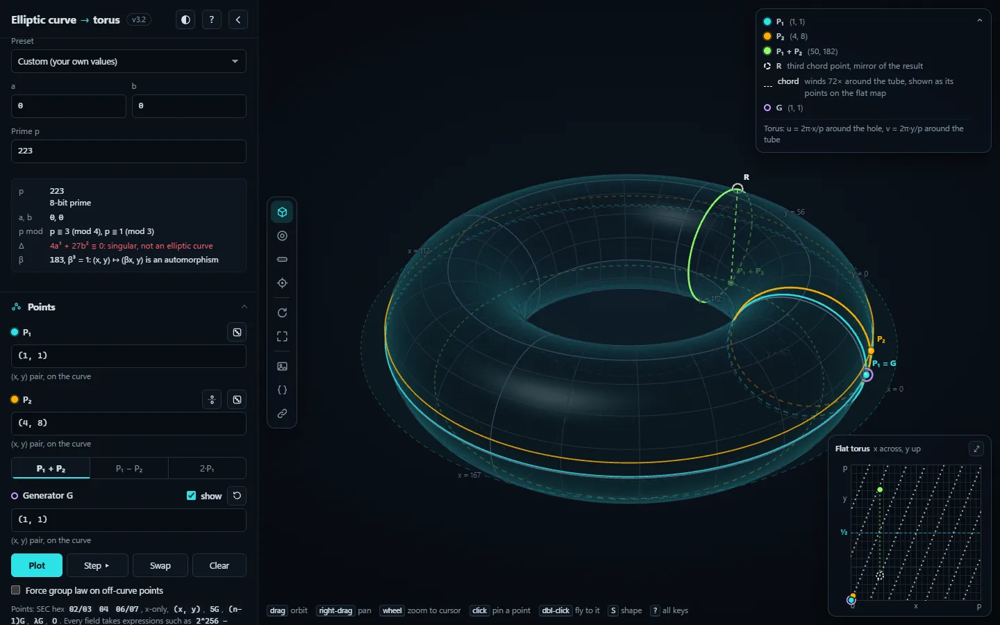
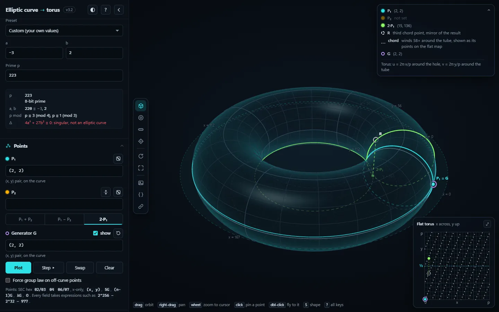
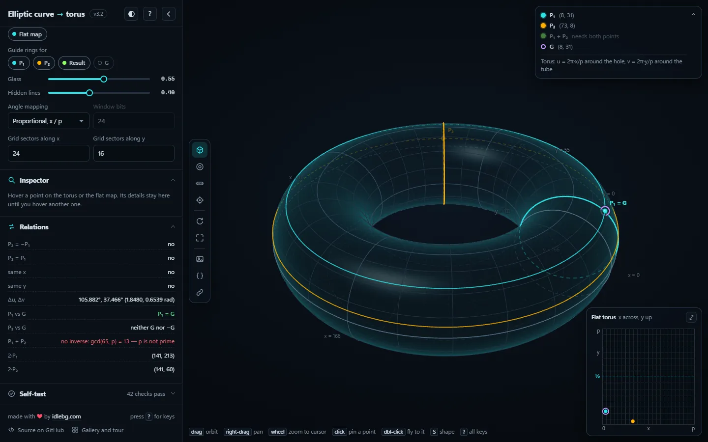

# 46 Singular curves and composite moduli

**Level 4 · Researcher.** What the visualizer does when the input is not an elliptic curve: Δ = 0 (a cusp or a node)
or a composite p. Both still compute, and both are instructive: the singular groups are the multiplicative and additive
groups in disguise, and a failed inversion mod a composite is Lenstra’s factoring method. Read first:
[21 Clock arithmetic](21-clock-arithmetic.md) and [45 Invalid-curve attacks](45-invalid-curve-attacks.md).

## Singular cubics

y² = x³ + ax + b is an elliptic curve only if the discriminant 4a³ + 27b² is nonzero; otherwise the cubic has a double
root and the curve a singular point. The **Δ** row then says “4a³ + 27b² ≡ 0: singular, not an elliptic curve”, the
visualizer stops counting points, and the formulas still run on the nonsingular points, which form a group:

- **cusp** (triple root, y² = x³): the group is (F_p, +), via (x, y) ↦ x/y;
- **node** (double root, y² = (x − r)²(x + 2r)): the group is F_p* if the two tangent slopes at the node lie in F_p
  (split), or the norm-1 subgroup of F_{p²}* of order p + 1 if they do not (non-split).

### Example 46.1 · The cusp y² = x³ over F₂₂₃

**Open this view:** [y² = x³ over F₂₂₃](https://idlebg.com/idleGevrek/elliptic_curve_torus_visualizer_v3.html#s=eyJ2IjozLCJwcmVzZXQiOiJjdXN0b20iLCJiYXNlUHJlc2V0IjoicGIyMjMiLCJhIjoiMCIsImIiOiIwIiwicCI6IjIyMyIsImciOiIoMSwgMSkiLCJwMSI6IigxLCAxKSIsInAyIjoiKDQsIDgpIiwib3AiOiJhZGQiLCJzaG93RyI6dHJ1ZSwiZm9yY2UiOmZhbHNlLCJzaGFwZSI6InRvcnVzIiwibWFwIjoic2NhbGUiLCJiaXRzIjoyNCwic3UiOjI0LCJzdiI6MTYsIlIiOjEuMiwiciI6MC40NiwiZ2xhc3MiOjAuNTUsImJhY2siOjAuNCwic2hvdyI6eyJncmlkIjp0cnVlLCJyaW5ncyI6dHJ1ZSwibGFiZWxzIjp0cnVlLCJjbG91ZCI6dHJ1ZSwiY2hvcmQiOnRydWUsImJldGEiOmZhbHNlLCJtYXAiOnRydWUsInNwaW4iOmZhbHNlfSwicmluZ3MiOnsicDEiOnRydWUsInAyIjp0cnVlLCJzdW0iOnRydWUsImciOmZhbHNlfSwidGhlbWUiOiJkYXJrIiwicGFuZWwiOnRydWUsIm1pbmlCaWciOmZhbHNlLCJsZWdlbmRNaW4iOmZhbHNlLCJzZWNzIjp7ImN1cnZlIjp0cnVlLCJwb2ludHMiOnRydWUsInNoYXBlIjp0cnVlLCJ2aWV3Ijp0cnVlLCJpbnNwZWN0b3IiOnRydWUsInJlbGF0aW9ucyI6dHJ1ZSwidGVzdCI6ZmFsc2V9fQ)

**Do it yourself**

1. In **Curve**, pick the preset **y² = x³ + 7 over F₂₂₃, Programming Bitcoin**.
2. Type `0` in **b**, `(1, 1)` in **Generator G**, `(1, 1)` in **P₁** and `(4, 8)` in **P₂**.
3. Read the **Curve** section in the panel.

**Look at:** the Δ row, and the sum (1, 1) + (4, 8) = (50, 182) in Relations.

**Why:** the nonsingular points are (t², t³) for t ≠ 0, 222 of them, plus 𝒪: a group of order 223 = p. Under x/y,
(1, 1) ↦ 1 and (4, 8) ↦ 1/2, and their sum ↦ 3/2 ≡ 113, which is 50 · 182⁻¹ mod 223. That map is why the cusp is
useless for cryptography and fatal as an invalid-curve target ([45](45-invalid-curve-attacks.md)).

### Example 46.2 · The node y² = x³ − 3x + 2 over F₂₂₃

x³ − 3x + 2 = (x − 1)²(x + 2): a node at (1, 0).

**Open this view:** [y² = x³ − 3x + 2 over F₂₂₃](https://idlebg.com/idleGevrek/elliptic_curve_torus_visualizer_v3.html#s=eyJ2IjozLCJwcmVzZXQiOiJjdXN0b20iLCJiYXNlUHJlc2V0IjoicGIyMjMiLCJhIjoiLTMiLCJiIjoiMiIsInAiOiIyMjMiLCJnIjoiKDIsIDIpIiwicDEiOiIoMiwgMikiLCJwMiI6IiIsIm9wIjoiZGJsIiwic2hvd0ciOnRydWUsImZvcmNlIjpmYWxzZSwic2hhcGUiOiJ0b3J1cyIsIm1hcCI6InNjYWxlIiwiYml0cyI6MjQsInN1IjoyNCwic3YiOjE2LCJSIjoxLjIsInIiOjAuNDYsImdsYXNzIjowLjU1LCJiYWNrIjowLjQsInNob3ciOnsiZ3JpZCI6dHJ1ZSwicmluZ3MiOnRydWUsImxhYmVscyI6dHJ1ZSwiY2xvdWQiOnRydWUsImNob3JkIjp0cnVlLCJiZXRhIjpmYWxzZSwibWFwIjp0cnVlLCJzcGluIjpmYWxzZX0sInJpbmdzIjp7InAxIjp0cnVlLCJwMiI6dHJ1ZSwic3VtIjp0cnVlLCJnIjpmYWxzZX0sInRoZW1lIjoiZGFyayIsInBhbmVsIjp0cnVlLCJtaW5pQmlnIjpmYWxzZSwibGVnZW5kTWluIjpmYWxzZSwic2VjcyI6eyJjdXJ2ZSI6dHJ1ZSwicG9pbnRzIjp0cnVlLCJzaGFwZSI6dHJ1ZSwidmlldyI6dHJ1ZSwiaW5zcGVjdG9yIjp0cnVlLCJyZWxhdGlvbnMiOnRydWUsInRlc3QiOmZhbHNlfX0)

**Do it yourself**

1. In **Curve**, pick the preset **y² = x³ + 7 over F₂₂₃, Programming Bitcoin**.
2. Type `-3` in **a**, `2` in **b**, `(2, 2)` in **Generator G** and `(2, 2)` in **P₁**.
3. Empty **P₂**.
4. Choose the operation **2·P₁**.
5. Read the **Curve** section in the panel.

**Look at:** the Δ row again, and 2·(2, 2) = (15, 136).

**Why:** at the node the two branches have slopes ±√3, and 3 is not a square mod 223, so the node is non-split. Counting
by brute force: 224 affine points including the node itself, so 223 nonsingular points plus 𝒪, a group of order
224 = p + 1, as the non-split case predicts.

## A composite modulus

If p is not prime, F_p is not a field: some nonzero numbers have no inverse. The **p** row says “composite: F_p is not a
field”, square roots are refused (so 02/03 and x-only inputs fail), and an addition whose slope needs a non-invertible
denominator stops with the gcd that blocked it.

### Example 46.3 · p = 221: a failed inversion finds a factor

221 = 13 · 17. The points (8, 31), (73, 8) and (59, 31) satisfy y² ≡ x³ + 7 (mod 221).

**Open this view:** [(8, 31) + (73, 8) mod 221](https://idlebg.com/idleGevrek/elliptic_curve_torus_visualizer_v3.html#s=eyJ2IjozLCJwcmVzZXQiOiJjdXN0b20iLCJiYXNlUHJlc2V0IjoicGIyMjMiLCJhIjoiMCIsImIiOiI3IiwicCI6IjIyMSIsImciOiIoOCwgMzEpIiwicDEiOiIoOCwgMzEpIiwicDIiOiIoNzMsIDgpIiwib3AiOiJhZGQiLCJzaG93RyI6dHJ1ZSwiZm9yY2UiOmZhbHNlLCJzaGFwZSI6InRvcnVzIiwibWFwIjoic2NhbGUiLCJiaXRzIjoyNCwic3UiOjI0LCJzdiI6MTYsIlIiOjEuMiwiciI6MC40NiwiZ2xhc3MiOjAuNTUsImJhY2siOjAuNCwic2hvdyI6eyJncmlkIjp0cnVlLCJyaW5ncyI6dHJ1ZSwibGFiZWxzIjp0cnVlLCJjbG91ZCI6dHJ1ZSwiY2hvcmQiOnRydWUsImJldGEiOmZhbHNlLCJtYXAiOnRydWUsInNwaW4iOmZhbHNlfSwicmluZ3MiOnsicDEiOnRydWUsInAyIjp0cnVlLCJzdW0iOnRydWUsImciOmZhbHNlfSwidGhlbWUiOiJkYXJrIiwicGFuZWwiOnRydWUsIm1pbmlCaWciOmZhbHNlLCJsZWdlbmRNaW4iOmZhbHNlLCJzZWNzIjp7ImN1cnZlIjp0cnVlLCJwb2ludHMiOnRydWUsInNoYXBlIjp0cnVlLCJ2aWV3Ijp0cnVlLCJpbnNwZWN0b3IiOnRydWUsInJlbGF0aW9ucyI6dHJ1ZSwidGVzdCI6ZmFsc2V9fQ)

| P₂ | what happens | open |
| --- | --- | --- |
| `(73, 8)` | no inverse: gcd(65, p) = 13 — p is not prime | [open](https://idlebg.com/idleGevrek/elliptic_curve_torus_visualizer_v3.html#s=eyJ2IjozLCJwcmVzZXQiOiJjdXN0b20iLCJiYXNlUHJlc2V0IjoicGIyMjMiLCJhIjoiMCIsImIiOiI3IiwicCI6IjIyMSIsImciOiIoOCwgMzEpIiwicDEiOiIoOCwgMzEpIiwicDIiOiIoNzMsIDgpIiwib3AiOiJhZGQiLCJzaG93RyI6dHJ1ZSwiZm9yY2UiOmZhbHNlLCJzaGFwZSI6InRvcnVzIiwibWFwIjoic2NhbGUiLCJiaXRzIjoyNCwic3UiOjI0LCJzdiI6MTYsIlIiOjEuMiwiciI6MC40NiwiZ2xhc3MiOjAuNTUsImJhY2siOjAuNCwic2hvdyI6eyJncmlkIjp0cnVlLCJyaW5ncyI6dHJ1ZSwibGFiZWxzIjp0cnVlLCJjbG91ZCI6dHJ1ZSwiY2hvcmQiOnRydWUsImJldGEiOmZhbHNlLCJtYXAiOnRydWUsInNwaW4iOmZhbHNlfSwicmluZ3MiOnsicDEiOnRydWUsInAyIjp0cnVlLCJzdW0iOnRydWUsImciOmZhbHNlfSwidGhlbWUiOiJkYXJrIiwicGFuZWwiOnRydWUsIm1pbmlCaWciOmZhbHNlLCJsZWdlbmRNaW4iOmZhbHNlLCJzZWNzIjp7ImN1cnZlIjp0cnVlLCJwb2ludHMiOnRydWUsInNoYXBlIjp0cnVlLCJ2aWV3Ijp0cnVlLCJpbnNwZWN0b3IiOnRydWUsInJlbGF0aW9ucyI6dHJ1ZSwidGVzdCI6ZmFsc2V9fQ) |
| `(59, 31)` | no inverse: gcd(51, p) = 17 — p is not prime | [open](https://idlebg.com/idleGevrek/elliptic_curve_torus_visualizer_v3.html#s=eyJ2IjozLCJwcmVzZXQiOiJjdXN0b20iLCJiYXNlUHJlc2V0IjoicGIyMjMiLCJhIjoiMCIsImIiOiI3IiwicCI6IjIyMSIsImciOiIoOCwgMzEpIiwicDEiOiIoOCwgMzEpIiwicDIiOiIoNTksIDMxKSIsIm9wIjoiYWRkIiwic2hvd0ciOnRydWUsImZvcmNlIjpmYWxzZSwic2hhcGUiOiJ0b3J1cyIsIm1hcCI6InNjYWxlIiwiYml0cyI6MjQsInN1IjoyNCwic3YiOjE2LCJSIjoxLjIsInIiOjAuNDYsImdsYXNzIjowLjU1LCJiYWNrIjowLjQsInNob3ciOnsiZ3JpZCI6dHJ1ZSwicmluZ3MiOnRydWUsImxhYmVscyI6dHJ1ZSwiY2xvdWQiOnRydWUsImNob3JkIjp0cnVlLCJiZXRhIjpmYWxzZSwibWFwIjp0cnVlLCJzcGluIjpmYWxzZX0sInJpbmdzIjp7InAxIjp0cnVlLCJwMiI6dHJ1ZSwic3VtIjp0cnVlLCJnIjpmYWxzZX0sInRoZW1lIjoiZGFyayIsInBhbmVsIjp0cnVlLCJtaW5pQmlnIjpmYWxzZSwibGVnZW5kTWluIjpmYWxzZSwic2VjcyI6eyJjdXJ2ZSI6dHJ1ZSwicG9pbnRzIjp0cnVlLCJzaGFwZSI6dHJ1ZSwidmlldyI6dHJ1ZSwiaW5zcGVjdG9yIjp0cnVlLCJyZWxhdGlvbnMiOnRydWUsInRlc3QiOmZhbHNlfX0) |
| `0208` | p is not prime, so x cannot be lifted to a point (no square roots mod p); use (x, y) or 04… | [open](https://idlebg.com/idleGevrek/elliptic_curve_torus_visualizer_v3.html#s=eyJ2IjozLCJwcmVzZXQiOiJjdXN0b20iLCJiYXNlUHJlc2V0IjoicGIyMjMiLCJhIjoiMCIsImIiOiI3IiwicCI6IjIyMSIsImciOiIoOCwgMzEpIiwicDEiOiIoOCwgMzEpIiwicDIiOiIwMjA4Iiwib3AiOiJhZGQiLCJzaG93RyI6dHJ1ZSwiZm9yY2UiOmZhbHNlLCJzaGFwZSI6InRvcnVzIiwibWFwIjoic2NhbGUiLCJiaXRzIjoyNCwic3UiOjI0LCJzdiI6MTYsIlIiOjEuMiwiciI6MC40NiwiZ2xhc3MiOjAuNTUsImJhY2siOjAuNCwic2hvdyI6eyJncmlkIjp0cnVlLCJyaW5ncyI6dHJ1ZSwibGFiZWxzIjp0cnVlLCJjbG91ZCI6dHJ1ZSwiY2hvcmQiOnRydWUsImJldGEiOmZhbHNlLCJtYXAiOnRydWUsInNwaW4iOmZhbHNlfSwicmluZ3MiOnsicDEiOnRydWUsInAyIjp0cnVlLCJzdW0iOnRydWUsImciOmZhbHNlfSwidGhlbWUiOiJkYXJrIiwicGFuZWwiOnRydWUsIm1pbmlCaWciOmZhbHNlLCJsZWdlbmRNaW4iOmZhbHNlLCJzZWNzIjp7ImN1cnZlIjp0cnVlLCJwb2ludHMiOnRydWUsInNoYXBlIjp0cnVlLCJ2aWV3Ijp0cnVlLCJpbnNwZWN0b3IiOnRydWUsInJlbGF0aW9ucyI6dHJ1ZSwidGVzdCI6ZmFsc2V9fQ) |

**Do it yourself**

1. In **Curve**, pick the preset **y² = x³ + 7 over F₂₂₃, Programming Bitcoin**.
2. Type `221` in **Prime p**, `(8, 31)` in **Generator G**, `(8, 31)` in **P₁** and `(73, 8)` in **P₂**.
3. Read the **Relations** section in the panel.

**Look at:** **P₁ + P₂** in Relations: “no inverse: gcd(65, p) = 13 — p is not prime”. The table shows the other
factor appearing for (59, 31), and a compressed input refused.

**Why:** the chord’s slope needs 1/(x₂ − x₁), and 73 − 8 = 65 = 5 · 13 shares the factor 13 with 221; 59 − 8 = 51 = 3 · 17
shares 17. This is the heart of Lenstra’s elliptic-curve method: compute k·P on a random curve mod N for a k with many
small factors; when k is a multiple of the group order modulo one prime factor q of N (but not modulo the others), an
inversion fails and the gcd it hits reveals q.

## Try it yourself

- Type y² = x³ over F₂₂₃ with P₁ = `(9, 27)` (t = 3): what is x/y, and what is P₁ + (1, 1)?
- Try p = `15` with a = 0, b = 7 (the visualizer needs p ≥ 5). Which points can you type?
- Make the node split: over a prime where 3 is a square (p = 11, say), count the points of y² = x³ − 3x + 2 by hand.

## Recap

- Δ = 0: the visualizer flags the curve as singular and stops counting; the formulas still work on nonsingular points.
- Cusp: (F_p, +) via x/y. Node: F_p* (split) or a group of order p + 1 (non-split).
- Composite p: no field, no square roots; a failed inversion returns a factor of p, which is Lenstra’s ECM.

Next: [47 Shapes as topology](47-shapes-topology.md).
