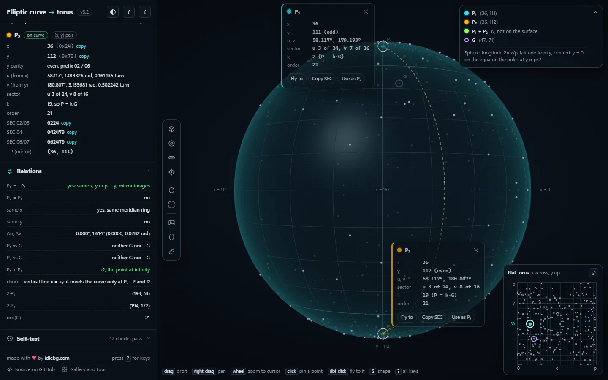
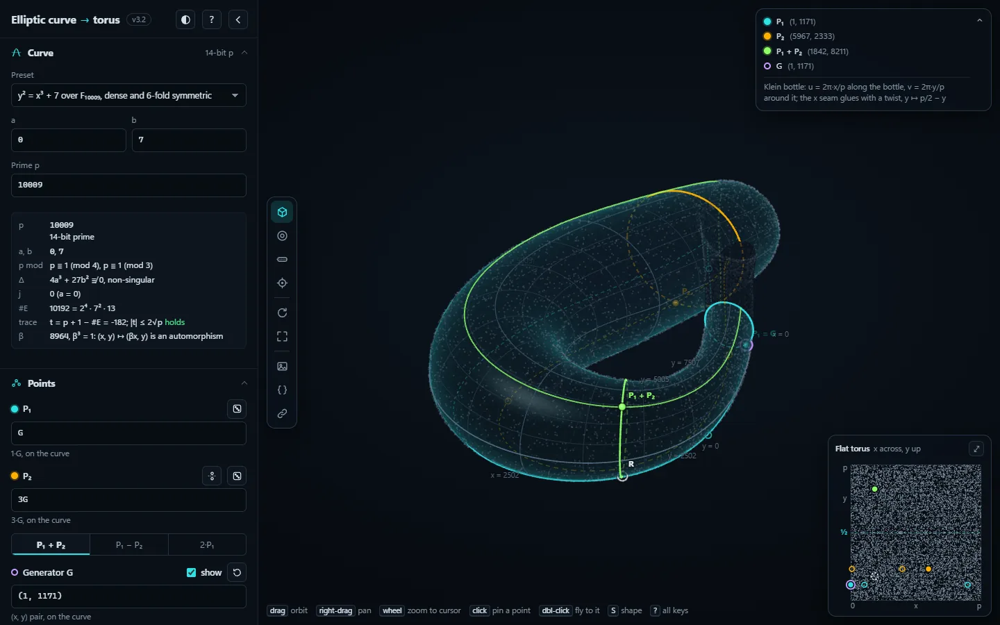
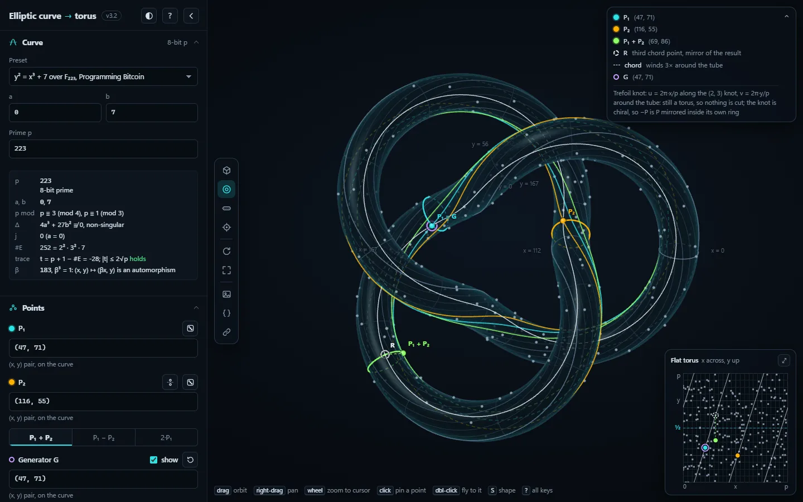

# 47 Shapes as topology

**Level 4 · Researcher.** Each shape is the square [0, 1)² of turns with some edges identified and some cut. This
chapter says which, why y is centred at every cut, how the Klein bottle’s seam is twisted, and what the trefoil is as
a knot. Read first: [16 One set of points, nine shapes](16-nine-shapes.md) and [41 The mapping](41-mapping.md).

## The patch and its identifications

Every shape is a map P(s, t) on the patch (s, t) ∈ [0, 1]², fed by the turns: s = t_u, and t = t_v for a direction that
closes, t = (t_v + ½) mod 1 for a direction that is cut. The identifications realised:

| shape | s = 0 ~ s = 1 | t = 0 ~ t = 1 | the surface |
| --- | --- | --- | --- |
| Torus, Lemniscate, Trefoil knot | glued | glued | a torus (embedded differently) |
| Cylinder | glued | cut | an annulus |
| Sphere, Ellipsoid, Icosahedron | glued | cut, each edge collapsed to a pole | a sphere |
| Wavy plane | cut | cut | a disc (the flat map itself) |
| Klein bottle | glued with t ↦ ½ − t | glued | a Klein bottle (immersed) |

Only the first row keeps both wrap-arounds; the others are pictures of the same torus torn along a known ring, which
is useful precisely because the tear is at a known place.

## Why y is centred at the cut

Negation is y ↦ p − y, that is t_v ↦ 1 − t_v. With t = (t_v + ½) mod 1 it becomes t ↦ 1 − t, a reflection of the patch
about t = ½, which every cut shape realises as a reflection of space (through its mirror plane; the trefoil, having no
mirror plane, inside each ring). Its fixed line t = ½ is y = 0, on the mirror, so the points with y = 0, their own
negatives, sit on the mirror. The two edges t = 0 and t = 1, which the reflection swaps, are y ≈ p/2, where the cut
runs; since p/2 is not an integer, no point of the curve lies on the cut itself.

### Example 47.1 · The cut at y ≈ p/2: 2G and −2G at the poles

On F₂₂₃, 2G = (36, 111) and −2G = (36, 112): 111 < 223/2 < 112.

**Open this view:** [2G and −2G on the sphere](https://idlebg.com/idleGevrek/elliptic_curve_torus_visualizer_v3.html#s=eyJ2IjozLCJwcmVzZXQiOiJjdXN0b20iLCJiYXNlUHJlc2V0IjoicGIyMjMiLCJhIjoiMCIsImIiOiI3IiwicCI6IjIyMyIsImciOiIoNDcsIDcxKSIsInAxIjoiMkciLCJwMiI6IigzNiwgMTEyKSIsIm9wIjoiYWRkIiwic2hvd0ciOnRydWUsImZvcmNlIjpmYWxzZSwic2hhcGUiOiJzcGhlcmUiLCJtYXAiOiJzY2FsZSIsImJpdHMiOjI0LCJzdSI6MjQsInN2IjoxNiwiUiI6MS4yLCJyIjowLjQ2LCJnbGFzcyI6MC41NSwiYmFjayI6MC40LCJzaG93Ijp7ImdyaWQiOnRydWUsInJpbmdzIjp0cnVlLCJsYWJlbHMiOnRydWUsImNsb3VkIjp0cnVlLCJjaG9yZCI6ZmFsc2UsImJldGEiOmZhbHNlLCJtYXAiOnRydWUsInNwaW4iOmZhbHNlfSwicmluZ3MiOnsicDEiOnRydWUsInAyIjp0cnVlLCJzdW0iOnRydWUsImciOmZhbHNlfSwidGhlbWUiOiJkYXJrIiwicGFuZWwiOnRydWUsIm1pbmlCaWciOmZhbHNlLCJsZWdlbmRNaW4iOmZhbHNlLCJzZWNzIjp7ImN1cnZlIjp0cnVlLCJwb2ludHMiOnRydWUsInNoYXBlIjp0cnVlLCJ2aWV3Ijp0cnVlLCJpbnNwZWN0b3IiOnRydWUsInJlbGF0aW9ucyI6dHJ1ZSwidGVzdCI6ZmFsc2V9fQ)

**Do it yourself**

1. In **Curve**, pick the preset **y² = x³ + 7 over F₂₂₃, Programming Bitcoin**.
2. Type `2G` in **P₁**.
3. Click the mirror button next to **P₂** (its tooltip: “Set P₂ = −P₁, the mirror image”).
4. In **Shape**, pick **Sphere** (or press **S** until it shows).
5. In **Display**, turn off **Chord construction** (**K**).
6. Press **3** for the side view.
7. In the 3D view, click P₁ and P₂ to pin their cards.
8. Read the **Relations** section in the panel.

**Look at:** on the sphere from the side, 2G sits at the north pole and −2G at the south pole. Relations: Δv = 1.614°,
one step around the tube on the torus.

**Why:** the sphere cuts the torus exactly between y = 111 and y = 112 and pulls the two edges of the cut to opposite
poles. Neighbours across the cut become antipodes; the torus, which cuts nothing, keeps them neighbours on its inner
equator.

### Example 47.2 · The Klein bottle’s twisted seam

**Open this view:** [F₁₀₀₀₉ on the Klein bottle](https://idlebg.com/idleGevrek/elliptic_curve_torus_visualizer_v3.html#s=eyJ2IjozLCJwcmVzZXQiOiJ0MTAwMDkiLCJiYXNlUHJlc2V0IjoidDEwMDA5IiwiYSI6IjAiLCJiIjoiNyIsInAiOiIxMDAwOSIsImciOiIoMSwgMTE3MSkiLCJwMSI6IkciLCJwMiI6IjNHIiwib3AiOiJhZGQiLCJzaG93RyI6dHJ1ZSwiZm9yY2UiOmZhbHNlLCJzaGFwZSI6ImtsZWluIiwibWFwIjoic2NhbGUiLCJiaXRzIjoyNCwic3UiOjI0LCJzdiI6MTYsIlIiOjEuMiwiciI6MC40NiwiZ2xhc3MiOjAuNTUsImJhY2siOjAuNCwic2hvdyI6eyJncmlkIjp0cnVlLCJyaW5ncyI6dHJ1ZSwibGFiZWxzIjp0cnVlLCJjbG91ZCI6dHJ1ZSwiY2hvcmQiOmZhbHNlLCJiZXRhIjp0cnVlLCJtYXAiOnRydWUsInNwaW4iOmZhbHNlfSwicmluZ3MiOnsicDEiOnRydWUsInAyIjp0cnVlLCJzdW0iOnRydWUsImciOmZhbHNlfSwidGhlbWUiOiJkYXJrIiwicGFuZWwiOnRydWUsIm1pbmlCaWciOmZhbHNlLCJsZWdlbmRNaW4iOmZhbHNlLCJzZWNzIjp7ImN1cnZlIjp0cnVlLCJwb2ludHMiOnRydWUsInNoYXBlIjp0cnVlLCJ2aWV3Ijp0cnVlLCJpbnNwZWN0b3IiOnRydWUsInJlbGF0aW9ucyI6dHJ1ZSwidGVzdCI6ZmFsc2V9fQ)

**Do it yourself**

1. In **Curve**, pick the preset **y² = x³ + 7 over F₁₀₀₀₉, dense and 6-fold symmetric**.
2. In **Shape**, pick **Klein bottle** (or press **S** until it shows).
3. In **Display**, turn off **Chord construction** (**K**).

**Look at:** the 10 191 dots of F₁₀₀₀₉ on a surface that passes through itself (an immersion: a Klein bottle does not
embed in 3D). Rings and the chord break at the seam.

**Why:** the shape glues s = 1 to s = 0 with t ↦ ½ − t (the build checks P(1, t) = P(0, ½ − t) at 21 values of t), so a
line arriving at the seam at height y continues at p/2 − y. That glue is orientation-reversing: the surface has no
outside, and the visualizer draws its glass and mask from both sides.

### Example 47.3 · The trefoil as a (2, 3) torus knot

**Open this view:** [F₂₂₃ on the trefoil, top view](https://idlebg.com/idleGevrek/elliptic_curve_torus_visualizer_v3.html#s=eyJ2IjozLCJwcmVzZXQiOiJwYjIyMyIsImJhc2VQcmVzZXQiOiJwYjIyMyIsImEiOiIwIiwiYiI6IjciLCJwIjoiMjIzIiwiZyI6Iig0NywgNzEpIiwicDEiOiIoNDcsIDcxKSIsInAyIjoiKDExNiwgNTUpIiwib3AiOiJhZGQiLCJzaG93RyI6dHJ1ZSwiZm9yY2UiOmZhbHNlLCJzaGFwZSI6InRyZWZvaWwiLCJtYXAiOiJzY2FsZSIsImJpdHMiOjI0LCJzdSI6MjQsInN2IjoxNiwiUiI6MS4yLCJyIjowLjQ2LCJnbGFzcyI6MC41NSwiYmFjayI6MC40LCJzaG93Ijp7ImdyaWQiOnRydWUsInJpbmdzIjp0cnVlLCJsYWJlbHMiOnRydWUsImNsb3VkIjp0cnVlLCJjaG9yZCI6dHJ1ZSwiYmV0YSI6ZmFsc2UsIm1hcCI6dHJ1ZSwic3BpbiI6ZmFsc2V9LCJyaW5ncyI6eyJwMSI6dHJ1ZSwicDIiOnRydWUsInN1bSI6dHJ1ZSwiZyI6ZmFsc2V9LCJ0aGVtZSI6ImRhcmsiLCJwYW5lbCI6dHJ1ZSwibWluaUJpZyI6ZmFsc2UsImxlZ2VuZE1pbiI6ZmFsc2UsInNlY3MiOnsiY3VydmUiOnRydWUsInBvaW50cyI6dHJ1ZSwic2hhcGUiOnRydWUsInZpZXciOnRydWUsImluc3BlY3RvciI6dHJ1ZSwicmVsYXRpb25zIjp0cnVlLCJ0ZXN0IjpmYWxzZX19)

**Do it yourself**

1. In **Curve**, pick the preset **y² = x³ + 7 over F₂₂₃, Programming Bitcoin**.
2. In **Shape**, pick **Trefoil knot** (or press **S** until it shows).
3. Press **2** for the top view.

**Look at:** from the top, the tube runs twice around the centre and through three lobes.

**Why:** the core is C(θ) = ((A + B cos 3θ) cos 2θ, (A + B cos 3θ) sin 2θ, B sin 3θ) with A = R and B = 0.45·A, a curve on
the torus of radii (A, B) that goes 2 times around its axis and 3 times around its tube: the (2, 3) torus knot, the
trefoil. The build checks both facts on the live shape: the tube’s centre (the mean of P(s, 0) and P(s, ½)) lies on
C(2πs) at 40 values of s, and turns twice around the axis as s runs once. The tube of radius 0.42·r around it is
framed by the normal of that torus, which is perpendicular to the knot because the knot lies on it. As a surface the
tube is still a torus, so nothing is cut; but the knot is chiral, so no reflection of space maps it to itself, and −P
is realised as the reflection inside its own ring ([15](15-mirror-images.md)).

## Try it yourself

- In Example 47.1, switch to the cylinder: 2G and −2G are now at the top and bottom edges.
- Put a chord across the Klein bottle’s seam (F₂₂₃’s preset, then the Klein bottle) and follow where it reappears.
- On the trefoil, compare the side view with the torus’s: the mirror plane is not drawn.

## Recap

- Torus, lemniscate and trefoil identify both edges; cylinder and the spheres cut y; the wavy plane cuts both; the
  Klein bottle glues x with t ↦ ½ − t.
- y is centred at every cut, so negation is the reflection t ↦ 1 − t and y = 0 lies on the mirror.
- The trefoil’s core is the (2, 3) torus knot; being chiral, it realises −P inside each ring.

Next: [48 Scripting with ecTorus](48-scripting.md).
