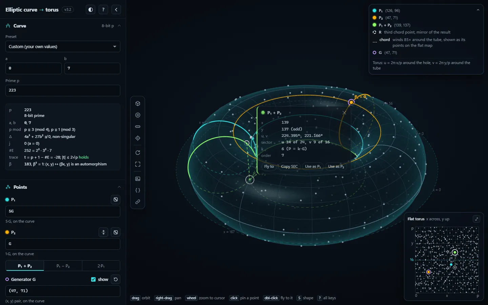
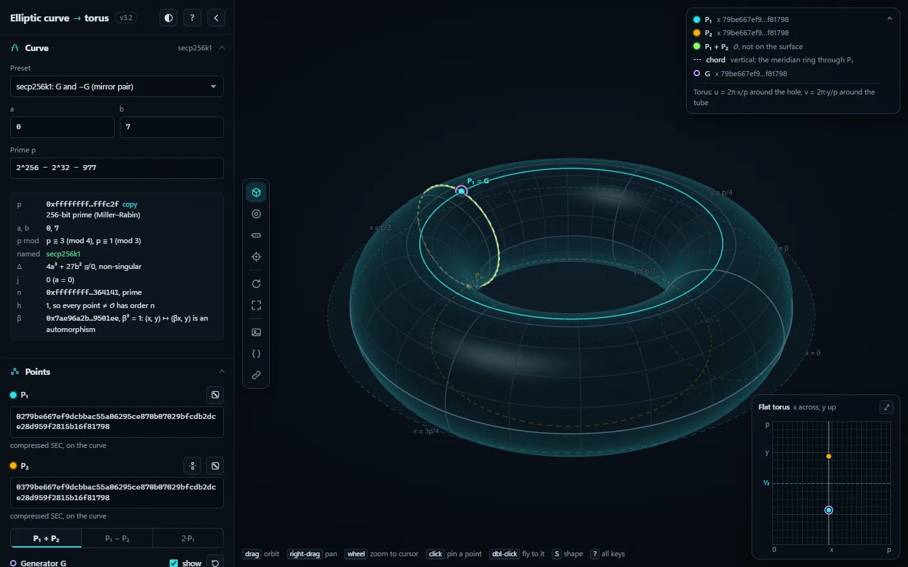

# 48 Scripting with ecTorus

**Level 4 · Researcher.** The page exposes its state, its computed model and its whole engine as `ecTorus` in the
browser console. You will drive the page from the console, read the model, and redo claims of earlier chapters with
the engine. Read first: [24 Adding points](24-chord.md) and [29 Discrete logs](29-discrete-logs.md).

Open the console with F12 (or Ctrl+Shift+J / Cmd+Option+J) on the visualizer’s tab. Every snippet below was run in the
page by the build of these tutorials, and its result compared with an independent computation; the comment after `→`
is that result. BigInts print with a trailing `n`.

## The API

| member | what it is |
| --- | --- |
| `ecTorus.state` | a copy of the editable state (what Copy link encodes) |
| `ecTorus.set(patch)` | merge `patch` into the state and redraw, like typing into the panel |
| `ecTorus.model` | everything computed from the state: `curve`, `facts`, `inputs`, `pts`, `op`, `rel`, `small`, `G`, `ordG`, `beta` |
| `ecTorus.screenOf(key)` | the screen position of a drawn point (`'p1'`, `'p2'`, `'sum'`, `'g'`, `'r'`) |
| `ecTorus.engine` | `Curve`, `parsePoint`, `evalExpr`, `encodeSEC`, `sqrtMod`, `isProbablePrime`, `chord`, `turns`, `smallCurve`, `pointOrder`, `dlog`, `KNOWN` |
| `ecTorus.selfTest()` | the 42 in-page checks: `{ pass, fail, items }` |

## Driving the page

`ecTorus.set({ preset: 'custom', a: '0', b: '7', p: '223', g: '(47, 71)', p1: '5G', p2: 'G', op: 'add' })` builds the view below: F₂₂₃ with P₁ = 5G and P₂ = G.

### Example 48.1 · ecTorus.set: 5G + G on F₂₂₃

[](../img/48-set.webp)

**Open this view:** [5G + G on F₂₂₃](https://idlebg.com/idleGevrek/elliptic_curve_torus_visualizer_v3.html#s=eyJ2IjozLCJwcmVzZXQiOiJjdXN0b20iLCJiYXNlUHJlc2V0IjoicGIyMjMiLCJhIjoiMCIsImIiOiI3IiwicCI6IjIyMyIsImciOiIoNDcsIDcxKSIsInAxIjoiNUciLCJwMiI6IkciLCJvcCI6ImFkZCIsInNob3dHIjp0cnVlLCJmb3JjZSI6ZmFsc2UsInNoYXBlIjoidG9ydXMiLCJtYXAiOiJzY2FsZSIsImJpdHMiOjI0LCJzdSI6MjQsInN2IjoxNiwiUiI6MS4yLCJyIjowLjQ2LCJnbGFzcyI6MC41NSwiYmFjayI6MC40LCJzaG93Ijp7ImdyaWQiOnRydWUsInJpbmdzIjp0cnVlLCJsYWJlbHMiOnRydWUsImNsb3VkIjp0cnVlLCJjaG9yZCI6dHJ1ZSwiYmV0YSI6ZmFsc2UsIm1hcCI6dHJ1ZSwic3BpbiI6ZmFsc2V9LCJyaW5ncyI6eyJwMSI6dHJ1ZSwicDIiOnRydWUsInN1bSI6dHJ1ZSwiZyI6ZmFsc2V9LCJ0aGVtZSI6ImRhcmsiLCJwYW5lbCI6dHJ1ZSwibWluaUJpZyI6ZmFsc2UsImxlZ2VuZE1pbiI6ZmFsc2UsInNlY3MiOnsiY3VydmUiOnRydWUsInBvaW50cyI6dHJ1ZSwic2hhcGUiOnRydWUsInZpZXciOnRydWUsImluc3BlY3RvciI6dHJ1ZSwicmVsYXRpb25zIjp0cnVlLCJ0ZXN0IjpmYWxzZX19)

**Do it yourself**

1. In **Curve**, pick the preset **y² = x³ + 7 over F₂₂₃, Programming Bitcoin**.
2. Type `5G` in **P₁** and `G` in **P₂**.
3. In the 3D view, click the result to pin its card.

The model then answers, and the engine redoes [24](24-chord.md)’s chord and [29](29-discrete-logs.md)’s discrete log:

```js
ecTorus.model.op.P
// → { x: 139n, y: 137n }
```

```js
ecTorus.model.pts.sum.k
// → 6n
```

```js
ecTorus.model.ordG
// → 21n
```

```js
ecTorus.model.small.count
// → 252n
```

```js
ecTorus.model.rel.find(([k]) => k === 'ord(G)')[1]
// → 21n
```

```js
const { Curve, chord, dlog, turns } = ecTorus.engine;
const c = new Curve(0n, 7n, 223n), G = { x: 47n, y: 71n };
chord(c, G, c.mul(8n, G))
// → { type: 'secant', lambda: 3n, c: 153n, R: { x: 69n, y: 137n } }
```

```js
dlog(c, G, { x: 69n, y: 86n }, 21n)
// → 9n
```

```js
turns(47n, 223n)
// → 0.21076233183856496
```

```js
ecTorus.engine.smallCurve(0n, 7n, 223n, false).count
// → 252n
```

```js
ecTorus.selfTest().fail
// → 0
```

`model.pts` holds one record per drawn point (`p1`, `p2`, `sum`, `g`, `r`, and the β-siblings `p1b1`, `p1b2`, …), each with
`P` (BigInt coordinates), `onCurve`, `tu` and `tv` (turns), `k` or `kTyped`, `order`, and after a render `pos` (its 3D
position). `model.facts` and `model.rel` are the rows of **Curve** facts and **Relations** as `[label, html]` pairs.

## The engine on secp256k1

### Example 48.2 · The engine on secp256k1

[](../img/48-engine.webp)

**Open this view:** [the default view](https://idlebg.com/idleGevrek/elliptic_curve_torus_visualizer_v3.html#s=eyJ2IjozLCJwcmVzZXQiOiJrMS1uZWciLCJiYXNlUHJlc2V0IjoiazEtbmVnIiwiYSI6IjAiLCJiIjoiNyIsInAiOiIyXjI1NiAtIDJeMzIgLSA5NzciLCJnIjoiMDI3OWJlNjY3ZWY5ZGNiYmFjNTVhMDYyOTVjZTg3MGIwNzAyOWJmY2RiMmRjZTI4ZDk1OWYyODE1YjE2ZjgxNzk4IiwicDEiOiIwMjc5YmU2NjdlZjlkY2JiYWM1NWEwNjI5NWNlODcwYjA3MDI5YmZjZGIyZGNlMjhkOTU5ZjI4MTViMTZmODE3OTgiLCJwMiI6IjAzNzliZTY2N2VmOWRjYmJhYzU1YTA2Mjk1Y2U4NzBiMDcwMjliZmNkYjJkY2UyOGQ5NTlmMjgxNWIxNmY4MTc5OCIsIm9wIjoiYWRkIiwic2hvd0ciOnRydWUsImZvcmNlIjpmYWxzZSwic2hhcGUiOiJ0b3J1cyIsIm1hcCI6InNjYWxlIiwiYml0cyI6MjQsInN1IjoyNCwic3YiOjE2LCJSIjoxLjIsInIiOjAuNDYsImdsYXNzIjowLjU1LCJiYWNrIjowLjQsInNob3ciOnsiZ3JpZCI6dHJ1ZSwicmluZ3MiOnRydWUsImxhYmVscyI6dHJ1ZSwiY2xvdWQiOnRydWUsImNob3JkIjp0cnVlLCJiZXRhIjpmYWxzZSwibWFwIjp0cnVlLCJzcGluIjpmYWxzZX0sInJpbmdzIjp7InAxIjp0cnVlLCJwMiI6dHJ1ZSwic3VtIjp0cnVlLCJnIjpmYWxzZX0sInRoZW1lIjoiZGFyayIsInBhbmVsIjp0cnVlLCJtaW5pQmlnIjpmYWxzZSwibGVnZW5kTWluIjpmYWxzZSwic2VjcyI6eyJjdXJ2ZSI6dHJ1ZSwicG9pbnRzIjp0cnVlLCJzaGFwZSI6dHJ1ZSwidmlldyI6dHJ1ZSwiaW5zcGVjdG9yIjp0cnVlLCJyZWxhdGlvbnMiOnRydWUsInRlc3QiOmZhbHNlfX0)

**Do it yourself**

1. In **Curve**, pick the preset **secp256k1: G and −G (mirror pair)**.

```js
ecTorus.engine.evalExpr('2^256 - 2^32 - 977')
// → 115792089237316195423570985008687907853269984665640564039457584007908834671663n
```

```js
const { Curve, KNOWN, encodeSEC } = ecTorus.engine;
const k1 = KNOWN[0], c = new Curve(k1.a, k1.b, k1.p);
encodeSEC(c.mul(7n, k1.G), c)
// → '025cbdf0646e5db4eaa398f365f2ea7a0e3d419b7e0330e39ce92bddedcac4f9bc'
```

```js
ecTorus.engine.parsePoint('7G', { curve: c, G: k1.G }).kind
// → 'scalar'
```

```js
ecTorus.engine.isProbablePrime(k1.n)
// → true
```

`Curve` works on any (a, b, p): `add`, `dbl`, `neg`, `mul(k, P)` (Jacobian, k may be negative), `isOn`, `eq`, `bPrime`,
`disc`, `jInvariant`. Points are `{ x, y }` objects with BigInt coordinates, and `null` is 𝒪. Errors from `parsePoint`
are `EcError`s with the same messages the panel shows.

## Try it yourself

- Walk the multiples from the console: `for (let k = 1; k <= 21; k++) ecTorus.set({ p1: k + 'G' })` runs P₁ through G to
  21G = 𝒪 (the last one is “nothing to draw”).
- Read Δu and Δv for the current pair: `ecTorus.model.rel.find(([k]) => k === 'Δu, Δv')[1]`.
- Count points of your own curve: `ecTorus.engine.smallCurve(1n, 1n, 23n, false).count` (chapter [22](22-counting-points.md)
  gives 28).

## Recap

- `ecTorus.set` drives the page; `ecTorus.state` and `ecTorus.model` read it; `screenOf` locates drawn points.
- `ecTorus.engine` is the full BigInt engine: curves, parsing, encodings, chords, counting, orders, discrete logs.
- Everything the panel shows can be recomputed in the console, which is how these tutorials check themselves.

Next: [49 Trusting the numbers](49-trusting-numbers.md).
