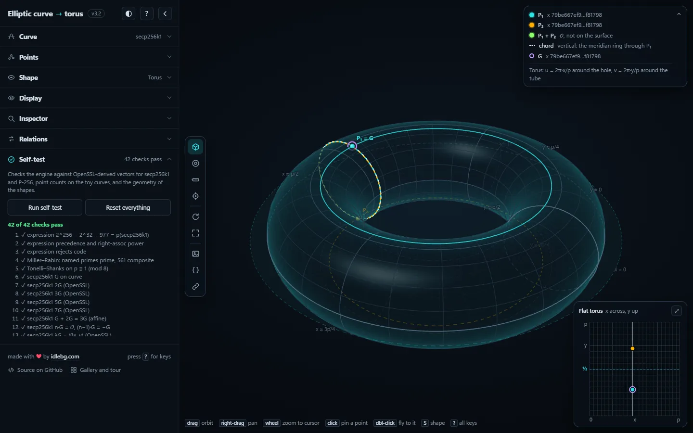

# 49 Trusting the numbers

**Level 4 · Researcher.** Why the numbers the visualizer shows can be trusted, how it checks itself, how these
tutorials checked every claim twice, and how to check any claim yourself without it. Read first:
[48 Scripting with ecTorus](48-scripting.md).

## The in-page Self-test

When the page opens it runs 42 checks of its own engine against values computed elsewhere: OpenSSL’s multiples of G on
secp256k1 and P-256, the GLV pair, SEC round trips, parser edge cases, point counts of toy curves from an independent
brute force, and the geometry of the shapes. The **Self-test** heading says “42 checks pass” when they do.

### Example 49.1 · The in-page Self-test

[](../img/49-selftest.webp)

**Open this view:** [the Self-test section open](https://idlebg.com/idleGevrek/elliptic_curve_torus_visualizer_v3.html#s=eyJ2IjozLCJwcmVzZXQiOiJrMS1uZWciLCJiYXNlUHJlc2V0IjoiazEtbmVnIiwiYSI6IjAiLCJiIjoiNyIsInAiOiIyXjI1NiAtIDJeMzIgLSA5NzciLCJnIjoiMDI3OWJlNjY3ZWY5ZGNiYmFjNTVhMDYyOTVjZTg3MGIwNzAyOWJmY2RiMmRjZTI4ZDk1OWYyODE1YjE2ZjgxNzk4IiwicDEiOiIwMjc5YmU2NjdlZjlkY2JiYWM1NWEwNjI5NWNlODcwYjA3MDI5YmZjZGIyZGNlMjhkOTU5ZjI4MTViMTZmODE3OTgiLCJwMiI6IjAzNzliZTY2N2VmOWRjYmJhYzU1YTA2Mjk1Y2U4NzBiMDcwMjliZmNkYjJkY2UyOGQ5NTlmMjgxNWIxNmY4MTc5OCIsIm9wIjoiYWRkIiwic2hvd0ciOnRydWUsImZvcmNlIjpmYWxzZSwic2hhcGUiOiJ0b3J1cyIsIm1hcCI6InNjYWxlIiwiYml0cyI6MjQsInN1IjoyNCwic3YiOjE2LCJSIjoxLjIsInIiOjAuNDYsImdsYXNzIjowLjU1LCJiYWNrIjowLjQsInNob3ciOnsiZ3JpZCI6dHJ1ZSwicmluZ3MiOnRydWUsImxhYmVscyI6dHJ1ZSwiY2xvdWQiOnRydWUsImNob3JkIjp0cnVlLCJiZXRhIjpmYWxzZSwibWFwIjp0cnVlLCJzcGluIjpmYWxzZX0sInJpbmdzIjp7InAxIjp0cnVlLCJwMiI6dHJ1ZSwic3VtIjp0cnVlLCJnIjpmYWxzZX0sInRoZW1lIjoiZGFyayIsInBhbmVsIjp0cnVlLCJtaW5pQmlnIjpmYWxzZSwibGVnZW5kTWluIjpmYWxzZSwic2VjcyI6eyJjdXJ2ZSI6ZmFsc2UsInBvaW50cyI6ZmFsc2UsInNoYXBlIjpmYWxzZSwidmlldyI6ZmFsc2UsImluc3BlY3RvciI6ZmFsc2UsInJlbGF0aW9ucyI6ZmFsc2UsInRlc3QiOnRydWV9fQ)

**Do it yourself**

1. In **Curve**, pick the preset **secp256k1: G and −G (mirror pair)**.
2. Open the **Self-test** section.
3. Close the **Curve**, **Points**, **Shape**, **Display**, **Inspector** and **Relations** sections (click the heading).
4. Click **Run self-test**.

**Look at:** “42 of 42 checks pass”, then each check by name with ✓ (a failing one would show ✗ and turn the heading
red). `ecTorus.selfTest()` returns the same list as `{ pass, fail, items }`.

**Why:** the self-test compares the shipped code against fixed expected values, so a broken build or a browser bug
shows up at once. It is not independent of the page’s own reasoning about which values to expect; the next two layers
are.

## How these tutorials were checked

Every number, point, key, order and count in these tutorials was computed by the tutorials’ own scripts, never typed
from memory, and checked in two independent ways:

1. **Against the live visualizer.** The build script opens the tutorials’ copy of the visualizer, builds each example’s
   state the way a person would (preset, typed fields, buttons), reopens it from its `#s=` link, and evaluates the example’s checks: JavaScript
   against `ecTorus.model` and the visible text of the panel (Relations rows, Curve facts, messages, card and Inspector
   rows). Only then does it take the screenshot. It also confirms that the link equals what **Copy link** produces and
   fails on any console error.
2. **Against an independent computation.** A reference script and one module per chapter compute the expected values
   without the visualizer: brute force for toy curves (enumeration, orders by repeated addition, discrete logs by tables), the
   idleCore library for secp256k1 (cross-checked against OpenSSL), OpenSSL for P-256, and the BIP test vectors as idleCore
   carries them. Each chapter’s quoted values must appear verbatim in its text, or the build fails.

The scripts stay with the tutorials’ source and are not part of this edition; the next section shows how to
recheck any claim without them.

## Checking a claim yourself

You need neither the visualizer nor the tutorials’ scripts. Python with the `cryptography` package (OpenSSL) gives secp256k1
multiples; plain Python gives any toy curve.

```python
from cryptography.hazmat.primitives.asymmetric import ec

def kG(k):  # k·G on secp256k1, computed by OpenSSL
    pub = ec.derive_private_key(k, ec.SECP256K1()).public_key().public_numbers()
    return pub.x, pub.y

x, y = kG(5)
print(('03' if y & 1 else '02') + format(x, '064x'))
```

prints `022f8bde4d1a07209355b4a7250a5c5128e88b84bddc619ab7cba8d569b240efe4`, the public key of private key 5 that [26 Subtraction](26-subtraction.md) obtained as
7G − 2G.

```python
p, a, b = 223, 0, 7
points = [(x, y) for x in range(p) for y in range(p) if (y * y - x**3 - a * x - b) % p == 0]
print(len(points) + 1)  # + 1 for the point at infinity
```

prints `252`, the #E of the F₂₂₃ preset ([22 Counting points](22-counting-points.md)). Both snippets were run when these
tutorials were built, and their output above is what they printed.

## Try it yourself

- Extend the toy snippet to count y² = x³ + x + 1 over F₂₃ and compare with chapter 22’s table.
- Compute 2G on F₂₂₃ with the chord-and-tangent formulas in ten lines of Python and compare with (36, 111).
- In the console, list the names of the self-test’s checks: `ecTorus.selfTest().items.map((i) => i.name)`.

## Recap

- The page checks itself at load (42 checks, **Self-test** section).
- These tutorials checked every example twice: against the live page and against independent code.
- OpenSSL in Python and plain brute force are enough to recheck any claim yourself.

Next: the reference pages, starting with [91 Cookbook](91-cookbook.md).
