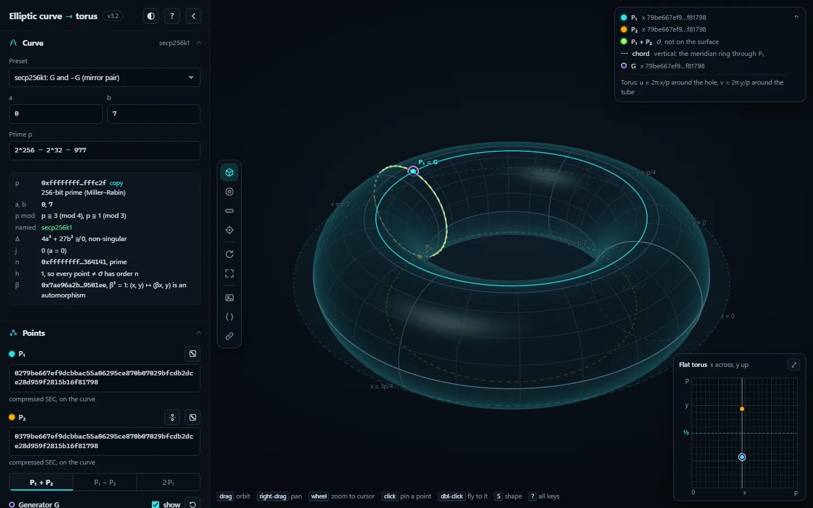

# 95 FAQ and troubleshooting

Short answers, each pointing to the chapter that explains more.

### Example 95.1 · The opening view

Every answer below starts from the view the visualizer opens with (or **Reset everything** in **Self-test**).

**Open this view:** [the opening view](https://idlebg.com/idleGevrek/elliptic_curve_torus_visualizer_v3.html#s=eyJ2IjozLCJwcmVzZXQiOiJrMS1uZWciLCJiYXNlUHJlc2V0IjoiazEtbmVnIiwiYSI6IjAiLCJiIjoiNyIsInAiOiIyXjI1NiAtIDJeMzIgLSA5NzciLCJnIjoiMDI3OWJlNjY3ZWY5ZGNiYmFjNTVhMDYyOTVjZTg3MGIwNzAyOWJmY2RiMmRjZTI4ZDk1OWYyODE1YjE2ZjgxNzk4IiwicDEiOiIwMjc5YmU2NjdlZjlkY2JiYWM1NWEwNjI5NWNlODcwYjA3MDI5YmZjZGIyZGNlMjhkOTU5ZjI4MTViMTZmODE3OTgiLCJwMiI6IjAzNzliZTY2N2VmOWRjYmJhYzU1YTA2Mjk1Y2U4NzBiMDcwMjliZmNkYjJkY2UyOGQ5NTlmMjgxNWIxNmY4MTc5OCIsIm9wIjoiYWRkIiwic2hvd0ciOnRydWUsImZvcmNlIjpmYWxzZSwic2hhcGUiOiJ0b3J1cyIsIm1hcCI6InNjYWxlIiwiYml0cyI6MjQsInN1IjoyNCwic3YiOjE2LCJSIjoxLjIsInIiOjAuNDYsImdsYXNzIjowLjU1LCJiYWNrIjowLjQsInNob3ciOnsiZ3JpZCI6dHJ1ZSwicmluZ3MiOnRydWUsImxhYmVscyI6dHJ1ZSwiY2xvdWQiOnRydWUsImNob3JkIjp0cnVlLCJiZXRhIjpmYWxzZSwibWFwIjp0cnVlLCJzcGluIjpmYWxzZX0sInJpbmdzIjp7InAxIjp0cnVlLCJwMiI6dHJ1ZSwic3VtIjp0cnVlLCJnIjpmYWxzZX0sInRoZW1lIjoiZGFyayIsInBhbmVsIjp0cnVlLCJtaW5pQmlnIjpmYWxzZSwibGVnZW5kTWluIjpmYWxzZSwic2VjcyI6eyJjdXJ2ZSI6dHJ1ZSwicG9pbnRzIjp0cnVlLCJzaGFwZSI6dHJ1ZSwidmlldyI6dHJ1ZSwiaW5zcGVjdG9yIjp0cnVlLCJyZWxhdGlvbnMiOnRydWUsInRlc3QiOmZhbHNlfX0)

**Do it yourself**

1. In **Curve**, pick the preset **secp256k1: G and −G (mirror pair)**.

## About what it can do

### Can this find private keys?

No. Finding k from kG is the discrete logarithm problem. The visualizer solves it only on toy curves with p up to 2²²,
by baby-step giant-step, which takes about √n steps. On secp256k1 that is about 3.403 × 10³⁸ steps, far beyond any
computer, and the visualizer never even tries: it shows k only when you typed it as `kG`
([29 Discrete logs](29-discrete-logs.md)). Where a public key lands on the torus says nothing about its private key
([14](14-how-far-apart.md)).

### Can I paste a Bitcoin address?

Not directly. A P2PKH or P2WPKH address holds a hash of the public key, not the key, so no point can be recovered from
it. A Taproot (P2TR) address is different: it encodes the 32-byte x-only output key itself, in bech32m. For example,
the BIP341 test address `bc1p2wsldez5mud2yam29q22wgfh9439spgduvct83k3pm50fcxa5dps59h4z5` has the scriptPubKey
`512053a1f6e454df1aa2776a2814a721372d6258050de330b3c6d10ee8f4e0dda343`: after the two bytes `5120` comes the key
`53a1f6e454df1aa2776a2814a721372d6258050de330b3c6d10ee8f4e0dda343`, which you can paste into P₁ as an x-only key
([37](37-points-in-bitcoin.md), Example 37.3). The visualizer reads hex only; decode the address with a wallet or library
first.

### Which curves can it draw?

Any y² = x³ + ax + b over a prime p up to 1024 bits. It names secp256k1 and P-256; counts points, finds orders and
discrete logs for p up to 2²² (4 194 304); and draws every point for p up to 262 144 ([12](12-cloud-of-dots.md),
[22](22-counting-points.md)). A composite p or a singular curve is computed anyway and flagged
([46](46-singular-composite.md)).

## When something looks wrong

### Why does my key give an error?

The message under the field names the reason. The usual ones: a bare number such as `2` (“odd number of hex digits”;
type `2G` for the key 2), a compressed key of the wrong length (“compressed SEC is 33 bytes for this p”), an x with no
point (“this x lies on the quadratic twist”), x or y ≥ p, or an unknown prefix. [33 Key formats](33-key-formats.md)
lists every message with an input that triggers it.

### A point has an order but no k. Why?

It is not a multiple of G: on curves whose group is larger than ⟨G⟩ (cofactor above 1) most points are outside it
([28 Orders and subgroups](28-orders-subgroups.md)). Plain dots of **All curve points** show neither; click **Use as P₁**
on a pinned dot to see its order and k ([12](12-cloud-of-dots.md)).

### The chord is not drawn.

It is drawn as a line only while it winds at most 24 times around the tube and p is at most 10⁶, in the proportional
mapping. Steeper chords appear as their points on the flat map (p up to 4000) or not at all; on 256-bit curves only R
and the mirror step are drawn. The legend’s **chord** row always says which ([41 The mapping](41-mapping.md)).

### Relations says “P₂ = −P₁: no” for (6, 0) and its mirror image.

For a point with y = 0 the mirror image is the point itself, and the visualizer reports the pair as “P₂ = P₁: yes”
instead ([23 Negation](23-negation.md)).

### A long number in the panel ends in “…”.

The panel shortens long values to their first and last digits. The full value is in the tooltip, behind the **copy**
button, and in the **Inspector** ([31](31-secp256k1.md)).

### I opened an example and my own view is gone.

Opening a link that carries a state replaces the stored view. Before opening examples, keep your own with **Copy a link
that restores this exact state** ([11](11-start-here.md), [17](17-save-share-export.md)).

### The link I sent does not open on the other computer.

The part before `#s=` is where you opened the visualizer, for example a file on your disk. Send the HTML file with the
link, or tell the other person to put the part from `#s=` onwards after the address of their own copy
([17](17-save-share-export.md)).

## About the browser

### The 3D view is black or missing.

The 3D view needs WebGL 2. Without it the page says: “WebGL is unavailable in this browser, so the 3D view cannot
start. The curve maths, inspector and flat map still work.” Everything else in the panel keeps working, including the
flat map. Try another browser, or enable hardware acceleration in the browser’s settings.

### It is slow.

Very large clouds (p near 262 144) and fat lines on a computer without a graphics card are the heavy cases. Turn off
**All curve points** (key **C**), or open the file with `?lines=thin` at the end of its address
([17](17-save-share-export.md)).

### Animations make me dizzy.

The visualizer respects the system setting “reduce motion”: the shape morph is skipped and camera moves are instant.

### Does it send anything anywhere?

No. The file makes no network requests: no fonts, no scripts, no analytics. Its state stays in your browser’s storage
and in the links you copy. These tutorials load nothing from the network either.
